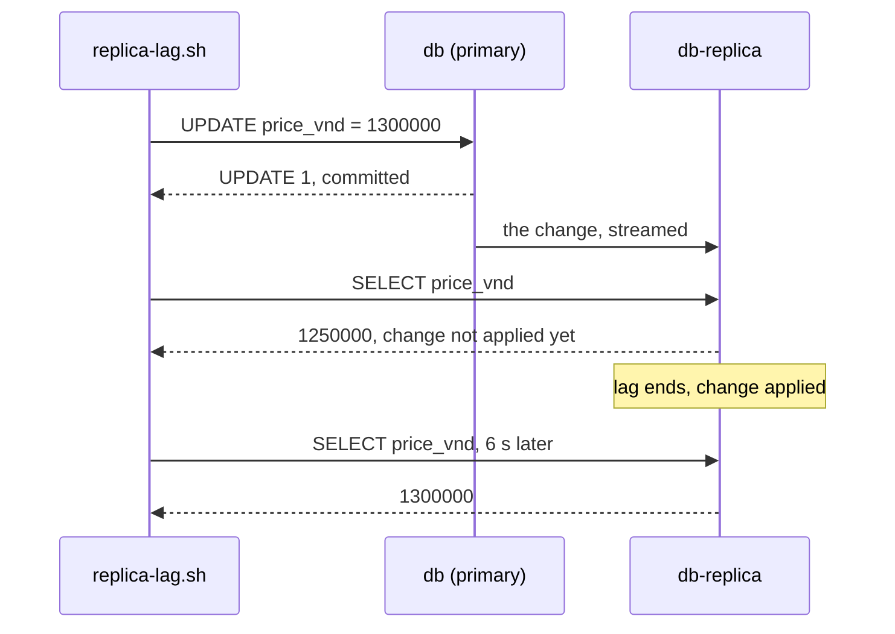

## Before you start

- [[backend.l3.eventual-consistency]] — you know that two copies of data can disagree for a while and agree once every change has reached both, with no promise of when.
- [[backend.l3.table-partitioning]] — you know that partitioning splits a table inside one server, so every partition still shares that server's CPU, memory and disk.

## The situation

Product pages, order history and every new order all go to `db`, the one PostgreSQL server of Đơn Hàng. Suppose reads keep growing until `db` is busy mostly answering them. A colleague suggests a second server that keeps a copy of `db` and answers the reads instead. You try the lab's copy. You change product 1's price to 1,300,000 VND on `db`, and the same `SELECT` on the copy, run straight after, still says 1,250,000.

Which reads can a copy like this take off `db`, and which must stay on `db`?

## Core concepts

- primary — the one server that accepts writes and whose changes the other servers copy; here `db`.
- **read replica** — a second PostgreSQL server that receives the primary's changes as a stream and applies them; it answers queries but refuses every write.
- asynchronous replication — the primary commits a transaction without waiting for any replica to receive or apply it; PostgreSQL replicates this way by default.
- **replication lag** — the delay between the primary committing a change and the replica applying it; during it, the replica answers with the data from before the change.
- **read-your-writes** — the rule that a read made right after a write, by the same request or customer, sees that write.

## How it works



In the situation above, the copy is a read replica and `db` is its primary. The replica starts as a copy of the whole primary, so every table and row is there to query. From then on, the primary sends it each change, and the replica applies them. It refuses writes of its own.

Follow the diagram from the top. `replica-lag.sh`, a lab script shown below, sends an `UPDATE` to `db`. `db` commits it and answers without waiting for `db-replica`, because replication is asynchronous unless configured otherwise. A `SELECT` that reaches the replica before it applies the change returns the old price. That gap is replication lag. Once the lag ends the replica applies the change, and the same `SELECT` returns the new price.

On a real replica the lag is often short, typically under a second while the replica keeps up with the load. But the primary never waits for it, so no limit is promised: a replica that cannot keep up falls further behind.

This is eventual consistency between two servers. The strong consistency of the prerequisite lesson holds on one server; a query on the replica runs on a second server, which may not have applied the commit yet.

Lag decides which reads a replica may answer. A read that can live with data a few seconds old, such as the product list, can go to a replica. A read that follows its own write cannot: after a customer places an order, the page showing that order must find it. Sending such reads to the primary is one simple way to keep read-your-writes.

Every `INSERT` and `UPDATE` still goes to the one primary, and each replica applies the same changes again. A replica adds capacity for reads only.

## In the Đơn Hàng system

The replica is one more service in the Compose file:

```yaml file=docker-compose.yml tag=stage-3 lines=581-605
  # lesson: backend.l3.read-replicas
  # A read replica of db, only with `--profile replica` (from stage-3;
  # scripts/backend/replica-lag.sh starts it). db/replica/start.sh copies db
  # once and then runs PostgreSQL as a standby that streams db's changes.
  # Nothing in Đơn Hàng reads from it: the api still uses db for everything.
  db-replica:
    image: postgres:17.6-alpine
    container_name: donhang-db-replica
    hostname: db-replica
    profiles: [replica]
    user: postgres
    command: ["sh", "/start.sh"]
    environment:
      PGPASSWORD: "${POSTGRES_PASSWORD}"
      TZ: "Asia/Ho_Chi_Minh"
      PGTZ: "Asia/Ho_Chi_Minh"
    volumes:
      - ./db/replica/start.sh:/start.sh:ro
      - db-replica-data:/var/lib/postgresql/data
    depends_on:
      db:
        condition: service_healthy
    networks:
      donhang:
        ipv4_address: 172.28.0.31
```

`profiles: [replica]` keeps `db-replica` out of a plain `docker compose up`. It runs the same `postgres:17.6-alpine` image as `db`, and `command` runs `db/replica/start.sh`, which is outside this excerpt; the comment above says what it does: copy `db` once, then follow it. PostgreSQL calls a server that follows a primary this way a standby; here it is the read replica. The last comment line matters for the API: at stage-3 nothing in Đơn Hàng reads from the replica.

`replica-lag.sh` starts `db-replica` as a fresh copy of `db`, then runs these lines. Its `on`, defined above the excerpt, runs `psql`, PostgreSQL's command-line client, against the server named first and prints each statement before its result:

```bash file=scripts/backend/replica-lag.sh tag=stage-3 lines=22-43
echo "== db-replica answers queries"
on db-replica --command "SELECT pg_is_in_recovery() AS replica, count(*) AS products FROM products"
echo "== but refuses writes"
on db-replica --command "UPDATE products SET price_vnd = 1300000 WHERE id = 1" || true
echo

price=$(psql --host db --username donhang --dbname donhang --no-psqlrc --tuples-only --no-align \
             --command "SELECT price_vnd FROM products WHERE id = 1")
trap 'psql --host db --username donhang --dbname donhang --no-psqlrc --quiet \
           --command "UPDATE products SET price_vnd = $price WHERE id = 1"' EXIT

# lesson: backend.l3.read-replicas
# The UPDATE has committed on db when psql returns; the replica receives it
# right away but, in this lab, waits 5 s before applying it.
echo "== a new price for product 1 on db, then the same read on both servers"
on db --command "UPDATE products SET price_vnd = 1300000 WHERE id = 1"
on db --command "SELECT price_vnd FROM products WHERE id = 1"
on db-replica --command "SELECT price_vnd FROM products WHERE id = 1"
sleep 6
echo "== 6 seconds later, on db-replica"
on db-replica --command "SELECT price_vnd FROM products WHERE id = 1"
echo "(product 1 gets its old price back on db when this script ends)"
```

```text output=true
== db-replica answers queries
-- on db-replica
SELECT pg_is_in_recovery() AS replica, count(*) AS products FROM products
 replica | products 
---------+----------
 t       |        8

== but refuses writes
-- on db-replica
UPDATE products SET price_vnd = 1300000 WHERE id = 1
ERROR:  cannot execute UPDATE in a read-only transaction

== a new price for product 1 on db, then the same read on both servers
-- on db
UPDATE products SET price_vnd = 1300000 WHERE id = 1
UPDATE 1
-- on db
SELECT price_vnd FROM products WHERE id = 1
 price_vnd 
-----------
   1300000

-- on db-replica
SELECT price_vnd FROM products WHERE id = 1
 price_vnd 
-----------
   1250000

== 6 seconds later, on db-replica
-- on db-replica
SELECT price_vnd FROM products WHERE id = 1
 price_vnd 
-----------
   1300000

(product 1 gets its old price back on db when this script ends)
```

Reading the output from the top:

1. `pg_is_in_recovery()` returns `t` on `db-replica`: the server is replaying changes it receives, not taking writes of its own. It holds the 8 products `db` has.
2. The `UPDATE` sent to the replica fails because every transaction there is read-only; `|| true` lets the script go on.
3. The `price=$(psql …)` line only reads product 1's current price into a variable, and the `trap … EXIT` line puts it back on exit. Right after `UPDATE 1` on `db`, `db` returns `1300000` and `db-replica` still returns `1250000`.
4. Six seconds later the replica returns `1300000`. The `# lesson:` comment above the price change explains why the old price shows up on every run: this lab replica waits 5 seconds on purpose before applying each change. A real replica has no such fixed wait.

## Seniors often assume…

- **"A replica always holds the same data as the primary, since it copies every change."** → Actually it copies every change, but a change shows on the replica only after the replica applies it, and the primary does not wait for that. For as long as the lag lasts, the replica answers with older data, as the `1250000` above shows. You notice this when a value changed a moment ago shows up old on one page and new on the next.
- **"Sending every `GET` to a replica is safe, because reads cannot break anything."** → Actually a read cannot change data, but it can hide a write the caller just made. If the API sent `GET /api/v1/orders/{id}` to a replica, it could answer `404` for an order it created a moment earlier. You notice this when a customer reports an order that "disappeared" and was there again after a refresh.
- **"Adding replicas also makes placing orders faster."** → Actually every `INSERT` of an order still goes to the one primary, and each replica has to apply the same rows too. Moving reads away can leave the primary more room for writes, but write capacity stays that of one server. You notice this when order traffic grows, replicas are added, and `db` is still the busy one.

## Try it (3 minutes)

With the lab running (`scripts/up.sh`), in the root folder of the example repository:

1. Run `scripts/backend/replica-lag.sh`. It starts `db-replica` as a fresh copy of `db` first.
2. Compare the three `price_vnd` values in the last two parts of the output.

Expected result: `t` and `8`; the error `cannot execute UPDATE in a read-only transaction`; `1300000` on `db` and `1250000` on `db-replica` straight after the update; `1300000` on `db-replica` six seconds later.

## Connections

- [[backend.l3.eventual-consistency]] — prerequisite: the replica is the same kind of disagreement, between two servers of one database instead of two services.
- [[backend.l3.table-partitioning]] — the contrast: partitioning splits a table on one server, while a replica adds a second server, for reads only.
- [[backend.l2.cache-invalidation]] — the same problem in another copy: there a TTL limits how long Redis can be old, here no limit on the lag is promised.
- [[k8s.l1.deploying-don-hang]] — a different meaning of the word replica: there `db` runs as one Pod, and a second Pod of it would start a separate database with its own data, not a copy that follows the first.
- [[backend.l3.sharding]] — the next step: when writes outgrow one primary, the rows themselves are split across several servers.

## Five-line summary

1. A read replica takes reads off the primary, but it applies each change only after the primary commits it, so it can return old data.
2. The replica receives the primary's changes as a stream and applies them; it answers queries and refuses every write.
3. Replication is asynchronous by default: the primary does not wait, so no limit on the lag is promised.
4. A read that must see its own write goes to the primary; reads that can live with slightly old data may go to a replica.
5. Every write still goes to the one primary, so replicas add capacity for reads, never for writes.
