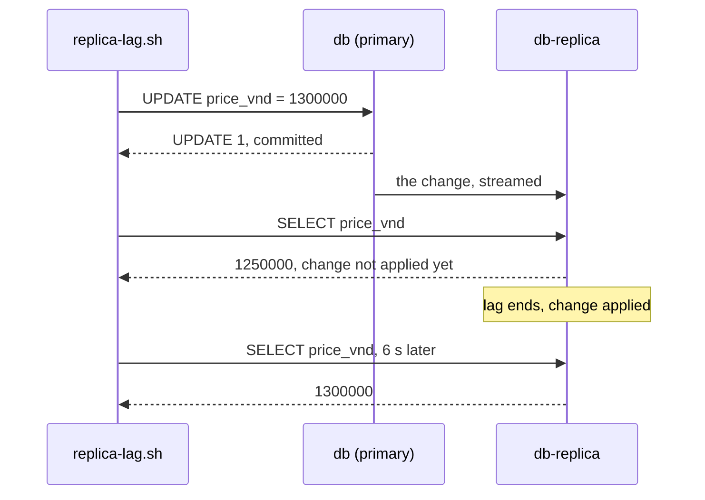

## Bạn cần biết trước

- [[backend.l3.eventual-consistency]] — bạn biết hai bản dữ liệu có thể lệch nhau một lúc rồi khớp lại khi mọi thay đổi đã tới cả hai, mà không hứa là bao lâu.
- [[backend.l3.table-partitioning]] — bạn biết partitioning chia một bảng bên trong một server, nên mọi partition vẫn dùng chung CPU, bộ nhớ và ổ đĩa của server đó.

## Tình huống

Trang sản phẩm, lịch sử đơn hàng và mọi đơn mới đều đi tới `db`, server PostgreSQL duy nhất của Đơn Hàng. Giả sử lượng đọc cứ tăng tới mức `db` bận chủ yếu là để trả lời chúng. Một đồng nghiệp đề xuất thêm một server thứ hai giữ bản sao của `db` và trả lời các lần đọc thay nó. Bạn thử bản sao có sẵn trong lab. Bạn đổi giá sản phẩm 1 thành 1.300.000 VND trên `db`, và cùng câu `SELECT` đó chạy ngay sau trên bản sao vẫn ra 1.250.000.

Những lần đọc nào một bản sao như vậy có thể gánh thay `db`, và những lần đọc nào phải ở lại `db`?

## Khái niệm cốt lõi

- primary — server duy nhất nhận lệnh ghi, và các server khác chép lại thay đổi của nó. Ở đây là `db`.
- **read replica** (server database nhận và áp thay đổi từ primary, trả lời truy vấn đọc nhưng từ chối ghi) — một server PostgreSQL thứ hai nhận thay đổi của primary dưới dạng một luồng liên tục và áp chúng vào dữ liệu của mình. Nó trả lời truy vấn nhưng từ chối mọi lệnh ghi.
- replication bất đồng bộ — primary commit một giao dịch mà không chờ replica nào nhận hay áp thay đổi đó. Mặc định PostgreSQL replicate theo cách này.
- **replication lag** (khoảng trễ giữa lúc primary commit một thay đổi và lúc replica áp dụng nó) — khoảng thời gian từ lúc primary commit một thay đổi tới lúc replica áp nó. Trong khoảng đó, replica trả lời bằng dữ liệu từ trước thay đổi.
- **read-your-writes** (yêu cầu một client đọc lại luôn thấy thay đổi chính nó vừa ghi) — quy tắc rằng một lần đọc ngay sau một lần ghi, của cùng request hay cùng khách hàng, phải thấy lần ghi đó.

## Cơ chế hoạt động



Trong tình huống trên, bản sao là một read replica và `db` là primary của nó. Replica khởi đầu là bản sao của toàn bộ primary, nên mọi bảng và mọi dòng đều có sẵn để truy vấn. Từ đó trở đi, primary gửi cho nó từng thay đổi, và replica áp chúng. Bản thân replica từ chối mọi lệnh ghi.

Đi theo sơ đồ từ trên xuống. `replica-lag.sh`, một script thực hành có ở bên dưới, gửi một lệnh `UPDATE` tới `db`. `db` commit rồi trả lời ngay, không chờ `db-replica`, vì replication là bất đồng bộ trừ khi được cấu hình khác. Một câu `SELECT` tới replica trước khi replica áp thay đổi sẽ trả về giá cũ. Khoảng hở đó là replication lag. Hết lag, replica áp thay đổi, và cùng câu `SELECT` trả về giá mới.

Trên một replica thật, lag thường ngắn, thường dưới một giây nếu replica theo kịp tải. Nhưng primary không bao giờ chờ nó, nên không có giới hạn nào được hứa: một replica không theo kịp sẽ tụt lại xa hơn.

Đây là eventual consistency giữa hai server. Strong consistency ở bài kiến thức nền đúng trên một server. Một truy vấn trên replica chạy trên server thứ hai, nơi có thể chưa áp commit đó.

Lag quyết định replica được trả lời những lần đọc nào. Lần đọc chấp nhận được dữ liệu cũ vài giây, như danh sách sản phẩm, có thể đi tới replica. Lần đọc theo sau chính lần ghi của nó thì không: sau khi khách đặt đơn, trang hiển thị đơn đó phải tìm thấy nó. Muốn giữ read-your-writes, cách đơn giản là gửi những lần đọc như vậy tới primary.

Mọi `INSERT` và `UPDATE` vẫn đi tới một primary duy nhất, và mỗi replica lại áp đúng những thay đổi đó thêm một lần nữa. Replica chỉ thêm sức chứa cho phần đọc.

## Trong hệ thống Đơn Hàng

Replica là thêm một service trong file Compose:

```yaml file=docker-compose.yml tag=stage-3 lines=581-605
  # lesson: backend.l3.read-replicas
  # A read replica of db, only with `--profile replica` (from stage-3;
  # scripts/backend/replica-lag.sh starts it). db/replica/start.sh copies db
  # once and then runs PostgreSQL as a standby that streams db's changes.
  # Nothing in Đơn Hàng reads from it: the api still uses db for everything.
  db-replica:
    image: postgres:17.6-alpine
    container_name: donhang-db-replica
    hostname: db-replica
    profiles: [replica]
    user: postgres
    command: ["sh", "/start.sh"]
    environment:
      PGPASSWORD: "${POSTGRES_PASSWORD}"
      TZ: "Asia/Ho_Chi_Minh"
      PGTZ: "Asia/Ho_Chi_Minh"
    volumes:
      - ./db/replica/start.sh:/start.sh:ro
      - db-replica-data:/var/lib/postgresql/data
    depends_on:
      db:
        condition: service_healthy
    networks:
      donhang:
        ipv4_address: 172.28.0.31
```

`profiles: [replica]` giữ `db-replica` ngoài một lệnh `docker compose up` thông thường. Nó chạy cùng image `postgres:17.6-alpine` với `db`, và `command` chạy `db/replica/start.sh`, file nằm ngoài đoạn trích. Comment phía trên cho biết file đó làm gì: chép `db` một lần, rồi bám theo nó. PostgreSQL gọi một server bám theo primary kiểu này là standby, ở đây nó chính là read replica. Dòng comment cuối quan trọng với API: ở stage-3 không phần nào của Đơn Hàng đọc từ replica.

`replica-lag.sh` khởi động `db-replica` thành một bản sao mới của `db`, rồi chạy các dòng dưới đây. Hàm `on` của nó, định nghĩa phía trên đoạn trích, chạy `psql`, chương trình dòng lệnh của PostgreSQL, tới server được nêu tên đầu tiên, và in từng câu lệnh trước kết quả của nó:

```bash file=scripts/backend/replica-lag.sh tag=stage-3 lines=22-43
echo "== db-replica answers queries"
on db-replica --command "SELECT pg_is_in_recovery() AS replica, count(*) AS products FROM products"
echo "== but refuses writes"
on db-replica --command "UPDATE products SET price_vnd = 1300000 WHERE id = 1" || true
echo

price=$(psql --host db --username donhang --dbname donhang --no-psqlrc --tuples-only --no-align \
             --command "SELECT price_vnd FROM products WHERE id = 1")
trap 'psql --host db --username donhang --dbname donhang --no-psqlrc --quiet \
           --command "UPDATE products SET price_vnd = $price WHERE id = 1"' EXIT

# lesson: backend.l3.read-replicas
# The UPDATE has committed on db when psql returns; the replica receives it
# right away but, in this lab, waits 5 s before applying it.
echo "== a new price for product 1 on db, then the same read on both servers"
on db --command "UPDATE products SET price_vnd = 1300000 WHERE id = 1"
on db --command "SELECT price_vnd FROM products WHERE id = 1"
on db-replica --command "SELECT price_vnd FROM products WHERE id = 1"
sleep 6
echo "== 6 seconds later, on db-replica"
on db-replica --command "SELECT price_vnd FROM products WHERE id = 1"
echo "(product 1 gets its old price back on db when this script ends)"
```

```text output=true
== db-replica answers queries
-- on db-replica
SELECT pg_is_in_recovery() AS replica, count(*) AS products FROM products
 replica | products 
---------+----------
 t       |        8

== but refuses writes
-- on db-replica
UPDATE products SET price_vnd = 1300000 WHERE id = 1
ERROR:  cannot execute UPDATE in a read-only transaction

== a new price for product 1 on db, then the same read on both servers
-- on db
UPDATE products SET price_vnd = 1300000 WHERE id = 1
UPDATE 1
-- on db
SELECT price_vnd FROM products WHERE id = 1
 price_vnd 
-----------
   1300000

-- on db-replica
SELECT price_vnd FROM products WHERE id = 1
 price_vnd 
-----------
   1250000

== 6 seconds later, on db-replica
-- on db-replica
SELECT price_vnd FROM products WHERE id = 1
 price_vnd 
-----------
   1300000

(product 1 gets its old price back on db when this script ends)
```

Đọc kết quả từ trên xuống:

1. `pg_is_in_recovery()` trả về `t` trên `db-replica`: server này đang phát lại những thay đổi nó nhận được, không nhận lệnh ghi riêng. Nó có đủ 8 sản phẩm như `db`.
2. Lệnh `UPDATE` gửi tới replica thất bại vì mọi giao dịch ở đó đều chỉ đọc. `|| true` giúp script chạy tiếp.
3. Dòng `price=$(psql …)` chỉ đọc giá hiện tại của sản phẩm 1 vào một biến, còn dòng `trap … EXIT` đặt lại giá đó khi script kết thúc. Ngay sau `UPDATE 1` trên `db`, `db` trả về `1300000` còn `db-replica` vẫn trả về `1250000`.
4. Sáu giây sau, replica trả về `1300000`. Comment `# lesson:` phía trên lệnh đổi giá giải thích vì sao lần chạy nào cũng thấy giá cũ: replica trong lab này cố ý chờ 5 giây trước khi áp mỗi thay đổi. Replica thật không có khoảng chờ cố định như vậy.

## Senior hay nhầm rằng…

- **"Replica luôn giữ đúng dữ liệu như primary, vì nó chép mọi thay đổi."** → Thực ra nó chép mọi thay đổi, nhưng một thay đổi chỉ hiện trên replica sau khi replica áp nó, và primary không chờ bước đó. Lag kéo dài bao lâu thì replica trả lời bằng dữ liệu cũ bấy lâu, như giá `1250000` ở trên. Bạn sẽ nhận ra khi một giá trị vừa đổi hiện bản cũ ở trang này và bản mới ở trang kế tiếp.
- **"Gửi mọi `GET` tới replica là an toàn, vì đọc thì không làm hỏng gì."** → Thực ra một lần đọc không đổi được dữ liệu, nhưng có thể giấu mất lần ghi bên gọi vừa thực hiện. Nếu API gửi `GET /api/v1/orders/{id}` tới replica, nó có thể trả `404` cho một đơn chính nó vừa tạo. Bạn sẽ nhận ra khi khách báo một đơn "biến mất" rồi lại hiện ra sau khi tải lại trang.
- **"Thêm replica cũng làm đặt đơn nhanh hơn."** → Thực ra mọi `INSERT` của một đơn vẫn đi tới một primary duy nhất, và mỗi replica cũng phải áp đúng những dòng đó. Chuyển phần đọc đi có thể để primary dư sức hơn cho phần ghi, nhưng sức ghi vẫn chỉ là của một server. Bạn sẽ nhận ra khi lưu lượng đặt đơn tăng, replica đã được thêm, mà `db` vẫn là server bận nhất.

## Thử ngay (3 phút)

Khi hệ thống ví dụ đang chạy (`scripts/up.sh`), tại thư mục gốc của repository ví dụ:

1. Chạy `scripts/backend/replica-lag.sh`. Script khởi động `db-replica` thành một bản sao mới của `db` trước.
2. So ba giá trị `price_vnd` trong hai phần cuối của kết quả.

Kết quả mong đợi: `t` và `8`. Lỗi `cannot execute UPDATE in a read-only transaction`. Ngay sau lệnh cập nhật, `1300000` trên `db` và `1250000` trên `db-replica`. Sáu giây sau, `1300000` trên `db-replica`.

## Liên hệ

- [[backend.l3.eventual-consistency]] — kiến thức nền: replica là cùng kiểu lệch dữ liệu đó, nhưng giữa hai server của một database thay vì giữa hai service.
- [[backend.l3.table-partitioning]] — đối chiếu: partitioning chia một bảng trên một server, còn replica thêm một server thứ hai, chỉ cho phần đọc.
- [[backend.l2.cache-invalidation]] — cùng vấn đề ở một bản sao khác: ở đó TTL giới hạn Redis được cũ bao lâu, ở đây lag không có giới hạn nào được hứa.
- [[k8s.l1.deploying-don-hang]] — một nghĩa khác của chữ replica: ở đó `db` chạy thành một Pod, và Pod thứ hai của nó sẽ khởi động một database riêng với dữ liệu riêng, không phải một bản sao bám theo cái đầu.
- [[backend.l3.sharding]] — bước tiếp theo: khi lượng ghi vượt quá sức một primary, chính các dòng được chia ra nhiều server.

## Tóm tắt 5 dòng

1. Read replica gánh bớt phần đọc cho primary, nhưng chỉ áp mỗi thay đổi sau khi primary đã commit, nên có thể trả về dữ liệu cũ.
2. Replica nhận thay đổi của primary dưới dạng một luồng liên tục rồi áp chúng. Nó trả lời truy vấn và từ chối mọi lệnh ghi.
3. Replication mặc định là bất đồng bộ: primary không chờ, nên lag không có giới hạn nào được hứa.
4. Lần đọc phải thấy lần ghi của chính nó thì đi tới primary. Lần đọc chấp nhận được dữ liệu hơi cũ có thể đi tới replica.
5. Mọi lệnh ghi vẫn đi tới một primary duy nhất, nên replica thêm sức chứa cho phần đọc, không bao giờ cho phần ghi.
