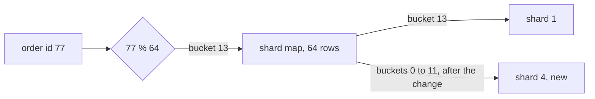

## Before you start

- [[backend.l3.sharding]] — you know the shard key decides each row's shard, here with `% 4`, the remainder after dividing by 4.
- [[backend.l3.cross-shard-queries]] — you know a query with the shard key goes to one shard, so the code must always know which shard that is.

## The situation

The four-shard plan has run for a while, and the shards are filling up. The team orders a fifth server. A colleague proposes the obvious change: replace `% 4` with `% 5` in the code that picks a shard, copy the new shard's share of the orders onto it, and switch over. That sounds like a fifth of the rows. Before anything moves, you rehearse on `donhang_perf`, the 200,000-order practice database, and count how many orders would really change shard.

How can you add a fifth shard so that only the rows it should hold have to move?

## Core concepts

- rebalancing — moving rows between shards because a shard was added or one has grown too large, while every row stays findable during the move.
- bucket — one of a fixed number of groups of keys, here the orders whose `id % 64` gives the same number.
- **shard map** — a table that says which shard holds each bucket, looked up before every query to pick the shard.

## How it works



Start without the map. With `shard = id % 4`, the id alone gives the shard. Change the divisor to 5 and most answers change. The pair `id % 4`, `id % 5` repeats every 20 ids and matches only for the first 4 of each 20 (0 to 3, 20 to 23, …). Of the 16 that move, 4 have `id % 5 = 4` and go to the new shard; the other 12 go to a different old shard.

The shard map adds one step between key and shard. In the diagram, `77 % 64` gives bucket 13, and the map's row for bucket 13 says shard 1. The divisor 64 never changes; only map rows do. To add shard 4, you point some rows at it, and only the orders in those buckets move. In the practice file below, buckets 0 to 11, 12 of the 64, go to shard 4.

The map has costs. Every read and write looks it up before it can pick a connection, so the map is a dependency of every request: if no copy of it can be read, no request knows where to go. A bucket being moved has rows on its old shard and copies on its new one. Until its map row changes, that bucket's writes go only to the old shard, and every write the old shard took after the copy must also reach the new one before the switch; afterwards, writes go only to the new shard. A bucket that took writes on both would hold two versions of the same orders.

Finally, the bucket count is fixed when the map is created: changing 64 moves many keys to another bucket, the same problem as changing `% 4` to `% 5`. Each bucket lives whole on one shard, so 64 buckets fill at most 64 shards.

## In the Đơn Hàng system

Đơn Hàng itself is not sharded at stage-3. The practice file `db/sharding/rebalance.sql` only counts; the comment at its top, outside the excerpt, says nothing is moved. It uses the order's `id` as the shard key, and consecutive ids spread evenly, so each count shows the move alone.

```sql file=db/sharding/rebalance.sql tag=stage-3 lines=8-32
SELECT count(*) FILTER (WHERE id % 4 <> id % 5) AS orders_that_move,
       count(*) AS orders,
       round(100.0 * count(*) FILTER (WHERE id % 4 <> id % 5) / count(*), 1) AS percent
FROM orders;

-- The shard map: id % 64 picks a bucket, and the map says which shard
-- holds each bucket. To start with, the 4 shards hold 16 buckets each.
CREATE TEMP TABLE shard_map (
    bucket integer PRIMARY KEY,
    shard  integer NOT NULL
);
INSERT INTO shard_map (bucket, shard)
SELECT bucket, bucket % 4 FROM generate_series(0, 63) AS bucket;

-- lesson: backend.l3.rebalancing-shards
-- Adding shard 4 changes 12 rows of the map, 3 buckets from each old
-- shard. Only the orders in those 12 buckets move; no other order changes
-- shard, because no other bucket did.
UPDATE shard_map SET shard = 4 WHERE bucket < 12;

SELECT count(*) FILTER (WHERE shard_map.shard = 4) AS orders_that_move,
       count(*) AS orders,
       round(100.0 * count(*) FILTER (WHERE shard_map.shard = 4) / count(*), 1) AS percent
FROM orders
JOIN shard_map ON shard_map.bucket = orders.id % 64;
```

The first query counts the orders whose shard differs between `id % 4` and `id % 5`; `FILTER (WHERE …)` makes `count(*)` count only those rows. Then the file builds the map as a temporary table with one row per bucket, 0 to 63, and gives bucket `b` to shard `b % 4`, so each old shard starts with 16 buckets. The `UPDATE` points buckets 0 to 11 at shard 4: three buckets from each old shard. The last query in the excerpt finds each order's bucket with `orders.id % 64`, joins it to the map, and counts the orders now on shard 4.

The script runs that file with `psql`, PostgreSQL's command-line client, from a prepared container that reaches the database by the name `db`. Above the excerpt, it builds `donhang_perf` first if it does not exist yet. `--echo-queries` prints each query before its result; the other options skip personal settings, stop at the first error and drop the row-count footer:

```bash file=scripts/backend/rebalance-shards.sh tag=stage-3 lines=11-13
psql --host db --username donhang --dbname donhang_perf \
     --no-psqlrc --set ON_ERROR_STOP=on --pset footer=off --echo-queries \
     --file /repo/db/sharding/rebalance.sql
```

```text output=true
SELECT count(*) FILTER (WHERE id % 4 <> id % 5) AS orders_that_move,
...
 orders_that_move | orders | percent
------------------+--------+---------
           160000 | 200000 |    80.0
...
 orders_that_move | orders | percent
------------------+--------+---------
            37500 | 200000 |    18.8
...
 shard | buckets | orders
-------+---------+--------
     0 |      13 |  40625
     1 |      13 |  40625
     2 |      13 |  40625
     3 |      13 |  40625
     4 |      12 |  37500
```

With `% 5`, 160,000 of the 200,000 orders change shard: 80%. With the map, 37,500 move, 18.8%, and they are exactly the orders of the 12 moved buckets: each bucket holds 3,125 orders. The last table comes from one more query after the excerpt, which counts the buckets and orders on each shard. Each old shard keeps 13 buckets, the new one has 12, so the spread is close to even but not exact, because 64 buckets do not divide into 5 equal groups.

## Seniors often assume…

- **"Adding a fifth shard to `key % 4` moves only the fifth shard's share of the rows."** → Actually the remainder changes for most keys, not only for the new shard's share. In `donhang_perf`, 80% of the orders change shard, while the new shard receives only 20%; the other 60% move between old shards. You notice this when the copy job's row count is four times the plan, and shard 0 is sending rows to shard 1.
- **"Rebalancing is a one-off copy that can run at night while the system works as usual."** → Actually orders keep arriving while a bucket is copied. A write that reaches the old shard after its rows were copied is missing on the new shard once the map points there. Moving a bucket therefore needs the write rule from "How it works", and every request depends on the map being right at each moment. You notice this when orders placed during the move cannot be found afterwards.
- **"A shard map with 64 buckets lets me grow to any number of shards later."** → Actually each bucket lives whole on one shard, so 64 buckets fill at most 64 shards, and the spread is uneven whenever the shard count does not divide 64, as the 13 and 12 above show. The count has to be chosen when the map is created, larger than the number of shards you expect. You notice this when you plan one more shard and every shard is down to a single bucket.

## Try it (3 minutes)

1. With the example system running (`scripts/up.sh`), run `scripts/backend/rebalance-shards.sh` from the repository root. It builds `donhang_perf` first if it does not exist yet, and then takes longer.
2. Compare the two `percent` values, then work out how many orders would move if a sixth shard later took 10 more buckets.

Expected result: the first `percent` is `80.0`, the second is `18.8`, and the last table shows 13 buckets and 40625 orders for shards 0 to 3, and 12 buckets and 37500 orders for shard 4.

<details><summary>Suggested answer</summary>

Each bucket holds 3,125 orders, because 200,000 consecutive ids split evenly over 64 remainders. Ten buckets therefore move 31,250 orders, and every other order stays where it is.

</details>

## Connections

- [[backend.l3.sharding]] — the prerequisite that chose the shard key; this lesson keeps the key and changes only where its buckets live.
- [[backend.l3.cross-shard-queries]] — the previous lesson; a query with the shard key now finds its one shard through the map.
- [[backend.l2.cache-aside]] — one way to keep a copy of the map close to the code that reads it, if that copy is refreshed when a bucket moves.

## Five-line summary

1. A shard map puts a fixed set of buckets between key and shard, so adding a shard moves only the buckets reassigned to it.
2. With `shard = key % N`, going from 4 to 5 shards moves 80% of `donhang_perf`'s orders, mostly between old shards.
3. Giving 12 of 64 buckets to a fifth shard moves 18.8% of the orders, exactly the rows of those 12 buckets.
4. Every request looks up the map first, and a bucket being moved must take its writes on only one shard at a time.
5. The bucket count is fixed when the map is created, and it caps how many shards the data can ever be spread over.
