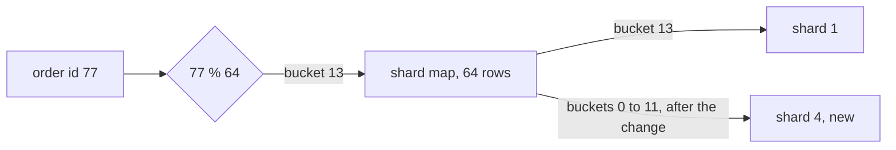

## Bạn cần biết trước

- [[backend.l3.sharding]] — bạn biết shard key quyết định mỗi dòng nằm ở shard nào, ở đây bằng `% 4`, tức số dư khi chia cho 4.
- [[backend.l3.cross-shard-queries]] — bạn biết một truy vấn có shard key chỉ tới một shard, nên code luôn phải biết đó là shard nào.

## Tình huống

Phương án bốn shard đã chạy được một thời gian, và các shard đang đầy dần. Nhóm đặt mua server thứ năm. Một đồng nghiệp đề xuất cách hiển nhiên: thay `% 4` bằng `% 5` trong đoạn code chọn shard, chép phần đơn thuộc về shard mới sang đó, rồi chuyển hẳn sang cách chia mới. Nghe như chỉ một phần năm số dòng. Trước khi chuyển bất cứ thứ gì, bạn diễn tập trên `donhang_perf`, database thực hành có 200.000 đơn, và đếm xem thật ra bao nhiêu đơn sẽ đổi shard.

Làm sao thêm shard thứ năm mà chỉ những dòng nó cần giữ phải chuyển đi?

## Khái niệm cốt lõi

- cân bằng lại shard — chuyển dòng giữa các shard vì vừa thêm một shard hoặc có một shard đã quá lớn, trong khi mọi dòng vẫn tìm thấy được suốt lúc chuyển.
- bucket — một trong một số cố định các nhóm khóa, ở đây là các đơn có `id % 64` ra cùng một số.
- **shard map** (bảng cho biết mỗi bucket khóa nằm ở shard nào, tra trước mỗi truy vấn) — một bảng cho biết shard nào giữ từng bucket, được tra trước mỗi truy vấn để chọn shard.

## Cơ chế hoạt động



Hãy bắt đầu khi chưa có map. Với `shard = id % 4`, chỉ cần id là biết shard. Đổi số chia thành 5 thì phần lớn câu trả lời đổi theo. Cặp `id % 4`, `id % 5` lặp lại sau mỗi 20 id và chỉ trùng nhau ở 4 id đầu của mỗi nhóm 20 (0 đến 3, 20 đến 23, …). Trong 16 id phải chuyển, 4 id có `id % 5 = 4` và sang shard mới, 12 id còn lại sang một shard cũ khác.

Shard map chèn thêm một bước giữa khóa và shard. Trong sơ đồ, `77 % 64` cho bucket 13, và dòng của bucket 13 trong map ghi shard 1. Số chia 64 không bao giờ đổi, chỉ các dòng của map đổi. Muốn thêm shard 4, bạn trỏ một số dòng sang nó, và chỉ các đơn trong những bucket đó phải chuyển. Trong file thực hành bên dưới, bucket 0 đến 11, tức 12 trên 64 bucket, sang shard 4.

Map cũng có cái giá của nó. Mọi lần đọc và ghi đều tra map trước khi chọn được connection, nên map là thứ mọi request phụ thuộc vào: nếu không đọc được bản nào của nó, không request nào biết phải đi đâu. Một bucket đang chuyển có dòng trên shard cũ và bản chép trên shard mới. Cho tới khi dòng của nó trong map đổi, các lần ghi vào bucket đó chỉ tới shard cũ, và mọi lần ghi shard cũ nhận sau khi chép cũng phải tới được shard mới trước lúc chuyển. Sau đó, các lần ghi chỉ tới shard mới. Một bucket nhận ghi ở cả hai nơi sẽ giữ hai phiên bản của cùng những đơn đó.

Cuối cùng, số bucket được cố định khi tạo map: đổi 64 làm nhiều khóa sang bucket khác, đúng vấn đề của đổi `% 4` thành `% 5`. Mỗi bucket nằm trọn trên một shard, nên 64 bucket chỉ lấp được tối đa 64 shard.

## Trong hệ thống Đơn Hàng

Ở stage-3, bản thân Đơn Hàng chưa được sharding. File thực hành `db/sharding/rebalance.sql` chỉ đếm. Chú thích ở đầu file, ngoài đoạn trích, nói rằng không có gì bị chuyển. File dùng `id` của đơn làm shard key, và các id liên tiếp chia đều, nên mỗi con số đếm được chỉ phản ánh riêng tác động của lần chuyển.

```sql file=db/sharding/rebalance.sql tag=stage-3 lines=8-32
SELECT count(*) FILTER (WHERE id % 4 <> id % 5) AS orders_that_move,
       count(*) AS orders,
       round(100.0 * count(*) FILTER (WHERE id % 4 <> id % 5) / count(*), 1) AS percent
FROM orders;

-- The shard map: id % 64 picks a bucket, and the map says which shard
-- holds each bucket. To start with, the 4 shards hold 16 buckets each.
CREATE TEMP TABLE shard_map (
    bucket integer PRIMARY KEY,
    shard  integer NOT NULL
);
INSERT INTO shard_map (bucket, shard)
SELECT bucket, bucket % 4 FROM generate_series(0, 63) AS bucket;

-- lesson: backend.l3.rebalancing-shards
-- Adding shard 4 changes 12 rows of the map, 3 buckets from each old
-- shard. Only the orders in those 12 buckets move; no other order changes
-- shard, because no other bucket did.
UPDATE shard_map SET shard = 4 WHERE bucket < 12;

SELECT count(*) FILTER (WHERE shard_map.shard = 4) AS orders_that_move,
       count(*) AS orders,
       round(100.0 * count(*) FILTER (WHERE shard_map.shard = 4) / count(*), 1) AS percent
FROM orders
JOIN shard_map ON shard_map.bucket = orders.id % 64;
```

Truy vấn đầu đếm các đơn có shard khác nhau giữa `id % 4` và `id % 5`. `FILTER (WHERE …)` khiến `count(*)` chỉ đếm những dòng đó. Tiếp theo, file dựng map thành một bảng tạm với mỗi bucket một dòng, từ 0 đến 63, và giao bucket `b` cho shard `b % 4`, nên lúc đầu mỗi shard cũ có 16 bucket. Lệnh `UPDATE` trỏ bucket 0 đến 11 sang shard 4: ba bucket từ mỗi shard cũ. Truy vấn cuối trong đoạn trích tìm bucket của từng đơn bằng `orders.id % 64`, join với map, rồi đếm các đơn giờ nằm ở shard 4.

Script chạy file đó bằng `psql`, chương trình dòng lệnh của PostgreSQL, từ một container đã chuẩn bị sẵn, nơi database được gọi bằng tên `db`. Phía trên đoạn trích, script dựng `donhang_perf` trước nếu database này chưa có. `--echo-queries` in từng truy vấn trước kết quả của nó. Các tùy chọn còn lại bỏ qua thiết lập cá nhân, dừng ở lỗi đầu tiên và bỏ dòng đếm số dòng ở cuối:

```bash file=scripts/backend/rebalance-shards.sh tag=stage-3 lines=11-13
psql --host db --username donhang --dbname donhang_perf \
     --no-psqlrc --set ON_ERROR_STOP=on --pset footer=off --echo-queries \
     --file /repo/db/sharding/rebalance.sql
```

```text output=true
SELECT count(*) FILTER (WHERE id % 4 <> id % 5) AS orders_that_move,
...
 orders_that_move | orders | percent
------------------+--------+---------
           160000 | 200000 |    80.0
...
 orders_that_move | orders | percent
------------------+--------+---------
            37500 | 200000 |    18.8
...
 shard | buckets | orders
-------+---------+--------
     0 |      13 |  40625
     1 |      13 |  40625
     2 |      13 |  40625
     3 |      13 |  40625
     4 |      12 |  37500
```

Với `% 5`, 160.000 trong 200.000 đơn đổi shard: 80%. Với map, 37.500 đơn chuyển, tức 18,8%, và đó đúng là các đơn của 12 bucket được chuyển: mỗi bucket giữ 3.125 đơn. Bảng cuối đến từ một truy vấn nữa sau đoạn trích, đếm số bucket và số đơn trên mỗi shard. Mỗi shard cũ giữ 13 bucket, shard mới có 12, nên các shard gần đều nhau nhưng không đều tuyệt đối, vì 64 bucket không chia được thành 5 nhóm bằng nhau.

## Senior hay nhầm rằng…

- **"Thêm shard thứ năm vào `key % 4` chỉ chuyển phần dòng thuộc về shard thứ năm."** → Thực ra số dư đổi với phần lớn khóa, không chỉ với phần của shard mới. Trong `donhang_perf`, 80% số đơn đổi shard, trong khi shard mới chỉ nhận 20%. 60% còn lại chuyển qua lại giữa các shard cũ. Bạn sẽ nhận ra khi số dòng của job chép gấp bốn lần kế hoạch, và shard 0 đang gửi dòng sang shard 1.
- **"Cân bằng lại shard là một lần chép duy nhất, chạy ban đêm trong khi hệ thống vẫn hoạt động như thường."** → Thực ra đơn vẫn tiếp tục đến trong lúc một bucket đang được chép. Một lần ghi tới shard cũ sau khi dòng của nó đã được chép sẽ thiếu trên shard mới khi map trỏ sang đó. Vì vậy chuyển một bucket cần quy tắc ghi ở mục "Cơ chế hoạt động", và mọi request đều cần map đúng ở từng thời điểm. Bạn sẽ nhận ra khi các đơn đặt trong lúc chuyển không tìm thấy được nữa.
- **"Shard map với 64 bucket cho phép sau này tăng lên bao nhiêu shard cũng được."** → Thực ra mỗi bucket nằm trọn trên một shard, nên 64 bucket chỉ lấp được tối đa 64 shard, và các shard lệch nhau mỗi khi số shard không chia hết 64, như con số 13 và 12 ở trên. Số bucket phải được chọn lúc tạo map, lớn hơn số shard bạn dự kiến. Bạn sẽ nhận ra khi định thêm một shard nữa mà mỗi shard chỉ còn đúng một bucket.

## Thử ngay (3 phút)

1. Khi hệ thống ví dụ đang chạy (`scripts/up.sh`), chạy `scripts/backend/rebalance-shards.sh` từ thư mục gốc của repository. Nếu `donhang_perf` chưa có, script dựng nó trước và mất lâu hơn.
2. So sánh hai giá trị `percent`, rồi tính xem bao nhiêu đơn sẽ chuyển nếu sau này một shard thứ sáu nhận thêm 10 bucket.

Kết quả mong đợi: `percent` thứ nhất là `80.0`, thứ hai là `18.8`, và bảng cuối cho 13 bucket và 40.625 đơn ở các shard 0 đến 3, 12 bucket và 37.500 đơn ở shard 4.

<details><summary>Gợi ý đáp án</summary>

Mỗi bucket giữ 3.125 đơn, vì 200.000 id liên tiếp chia đều cho 64 số dư. Vậy 10 bucket chuyển 31.250 đơn, còn mọi đơn khác vẫn ở nguyên chỗ.

</details>

## Liên hệ

- [[backend.l3.sharding]] — bài cần học trước, nơi chọn shard key. Bài này giữ nguyên khóa và chỉ đổi nơi các bucket của nó nằm.
- [[backend.l3.cross-shard-queries]] — bài trước: một truy vấn có shard key giờ tìm shard duy nhất của nó qua map.
- [[backend.l2.cache-aside]] — có thể dùng để giữ bản sao của map gần đoạn code đọc nó, với điều kiện bản sao đó được làm mới khi một bucket chuyển đi.

## Tóm tắt 5 dòng

1. Shard map đặt một tập bucket cố định giữa khóa và shard, nên thêm một shard chỉ chuyển những bucket được giao lại cho nó.
2. Với `shard = key % N`, đi từ 4 lên 5 shard làm 80% số đơn của `donhang_perf` phải chuyển, phần lớn là giữa các shard cũ.
3. Giao 12 trên 64 bucket cho shard thứ năm chỉ chuyển 18,8% số đơn, đúng các dòng của 12 bucket đó.
4. Mọi request tra map trước, và một bucket đang chuyển chỉ được nhận ghi trên một shard tại mỗi thời điểm.
5. Số bucket được cố định khi tạo map, và nó giới hạn số shard tối đa mà dữ liệu có thể trải ra.
