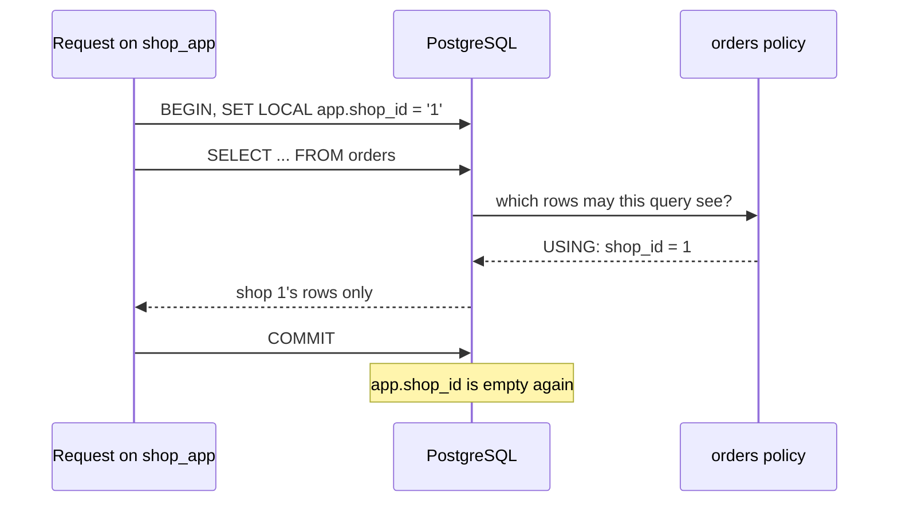

## Before you start

- [[backend.l3.tenant-isolation-models]] — you know shared tables keep every shop's rows in one `orders` table, told apart by a `shop_id` column.
- [[backend.l2.transactions-in-practice]] — you know a transaction groups the statements between `BEGIN` and `COMMIT` or `ROLLBACK`, so they take effect all or nothing.

## The situation

A teammate writes a quick support query on `donhang_tenancy`, the practice database where both shops share one `orders` table. Shop 1's owner asked how many orders are still `new`, and the query counts them. It forgets `WHERE shop_id = 1`, so the answer includes shop 2's orders, and shop 1's owner now knows something about a competitor. Nobody noticed in review, because the query looked right. Every query in the api, every report and every script has to remember the same clause, and one that forgets is enough.

Can PostgreSQL add the shop condition itself, so that a query which forgets it still sees only one shop's rows?

## Core concepts

- **row-level security** — a PostgreSQL feature that, once turned on for a table, adds the condition of the table's policies to every query on it, so each role sees only the rows that condition allows.
- policy — a named rule on one table, made with `CREATE POLICY`; its `USING` condition says which existing rows a query may see, change or delete, and an optional `WITH CHECK` condition says which new or changed rows it may write.
- role — a PostgreSQL user or group of users; a connection acts as one role at a time, and `SET ROLE` switches it to another. A superuser is a role that passes every permission check in the database.
- connection pool — a set of open connections that the library the api uses to talk to PostgreSQL keeps and lends to one request after another, instead of opening one per request.
- `SET LOCAL` — changes a setting only until the current transaction ends, whether it ends with `COMMIT` or `ROLLBACK`.
- `app.shop_id` — a custom setting: PostgreSQL stores a dotted name like this on the connection without knowing what it means, and `current_setting('app.shop_id', true)` reads it, giving null when it was never set.

## How it works



In the diagram, a request on `shop_app` sets its shop with `SET LOCAL`, sends a `SELECT` with no shop clause, and gets back only the rows the `orders` policy allows; after `COMMIT` the setting is empty. `ALTER TABLE orders ENABLE ROW LEVEL SECURITY` turns this on. From then on, PostgreSQL checks the `USING` condition of the table's policies on every row a query on `orders` reads, before the query's own conditions, so a row that fails it is never seen. A table with row-level security on and no policy shows such queries no rows.

Superusers and roles with `BYPASSRLS`, a flag a role can be given, skip the policies. So does the table's owner, unless a table setting this lesson does not use makes it subject to them. The PostgreSQL image creates its `POSTGRES_USER`, here `donhang`, as a superuser, and `donhang` owns the practice tables. The demo therefore switches to `shop_app`, a role that only has rights to read and change the tables.

The policy reads the current shop from `app.shop_id`. When that setting is missing, the condition becomes `shop_id = null`. Unlike `==` in C#, `=` in SQL gives null, not true, when either side is null, and a policy keeps only rows for which its condition is true. So the query sees no rows rather than every shop's.

Where the setting lives matters because the connection pool lends one connection to request after request. A value set with plain `SET` belongs to the connection, so it can outlive the request unless something clears it. `SET LOCAL` inside the request's transaction ties the shop to that transaction, so the next request starts with no shop.

## In the Đơn Hàng system

The api connects as `donhang`, and Đơn Hàng's own database has no policies at stage-3. The practice database does, from this file:

```sql file=db/tenancy/row-level-security.sql tag=stage-3 lines=18-28
-- lesson: backend.l3.row-level-security
-- Every query shop_app sends to orders gets this USING condition added.
-- current_setting(..., true) gives null when app.shop_id was never set,
-- and '' after a SET LOCAL has ended; NULLIF turns '' into null too. Either
-- way shop_id = null is never true, so no rows: not every shop's rows.
-- With no WITH CHECK, a new or changed row must pass USING as well.
ALTER TABLE orders ENABLE ROW LEVEL SECURITY;
DROP POLICY IF EXISTS orders_of_current_shop ON orders;
CREATE POLICY orders_of_current_shop ON orders
    FOR ALL
    USING (shop_id = NULLIF(current_setting('app.shop_id', true), '')::integer);
```

The policy is `FOR ALL`, so it covers `SELECT`, `INSERT`, `UPDATE` and `DELETE`. It has no `WITH CHECK` clause, and then PostgreSQL uses the `USING` condition for new and changed rows too: a row the request could not see, it cannot write either. The file's comment says the setting reads `''` once a `SET LOCAL` has ended. `::integer` cannot turn `''` into a number and would raise an error, so `NULLIF` turns `''` into null first, and the condition stays `shop_id = null`. Above the excerpt, the file creates `shop_app` as a role that cannot log in and grants it rights on `orders` and `customers`; the script reaches it with `SET ROLE` from `donhang`.

The script that queries the table as each role. Its `sql`, defined above the excerpt, runs `psql`, PostgreSQL's command-line client, as `donhang` and prints each statement before its result:

```bash file=scripts/backend/row-level-security.sh tag=stage-3 lines=21-45
echo "== as donhang, a superuser: the policy does not apply"
sql "SELECT shop_id, count(*) FROM orders GROUP BY shop_id ORDER BY shop_id"

echo "== as shop_app, before any shop is set"
sql "SET ROLE shop_app; SELECT count(*) FROM orders"

# lesson: backend.l3.row-level-security
# What a request does on a pooled connection: set the shop inside its own
# transaction, with SET LOCAL, so it is gone when the transaction ends and
# the next request on this connection starts with no shop at all.
echo "== as shop_app, inside a transaction for shop 1"
sql "SET ROLE shop_app;
BEGIN;
SET LOCAL app.shop_id = '1';
SELECT shop_id, id, status FROM orders ORDER BY id;
COMMIT;
SELECT current_setting('app.shop_id', true) AS shop_after_commit, count(*) FROM orders;"

echo "== as shop_app for shop 1, insert an order of shop 2"
sql "SET ROLE shop_app;
BEGIN;
SET LOCAL app.shop_id = '1';
INSERT INTO orders (shop_id, id, customer_id, placed_at, status)
VALUES (2, 3, 1, now(), 'new');
ROLLBACK;" || true
```

```text output=true
...
== as donhang, a superuser: the policy does not apply
SELECT shop_id, count(*) FROM orders GROUP BY shop_id ORDER BY shop_id
 shop_id | count 
---------+-------
       1 |     3
       2 |     2

== as shop_app, before any shop is set
SET ROLE shop_app; SELECT count(*) FROM orders
SET
 count 
-------
     0
...
 shop_id | id | status  
---------+----+---------
       1 |  1 | paid
       1 |  2 | new
       1 |  3 | shipped

COMMIT
 shop_after_commit | count 
-------------------+-------
                   |     0
...
ERROR:  new row violates row-level security policy for table "orders"
...
```

Reading the output from the top:

1. As `donhang`, the query sees all five orders of both shops, because the policy does not apply to a superuser.
2. As `shop_app` with no shop set, the same table shows 0 rows.
3. Inside the transaction for shop 1, the `SELECT` has no `WHERE`, yet it returns only shop 1's three orders.
4. After `COMMIT`, `shop_after_commit` is blank and the count is 0 again, which is what the next request on this connection would see.
5. The insert of an order for shop 2 fails, because the new row does not pass `USING`; `|| true` lets the script carry on.

The rest of the script, outside the excerpt, turns row-level security on for `customers`, which has no policy, inside a transaction it rolls back, and counts 0 rows.

This is the difference from a filter in application code. A `WHERE shop_id = ...` written in the api protects only the queries that go through that code. Row-level security also covers a raw SQL query, a report or a script, as long as it runs as the restricted role.

## Seniors often assume…

- **"Once row-level security is on, every connection is filtered, including the one the API uses today."** → Actually superusers, roles with `BYPASSRLS` and, normally, the table's owner skip the policies. The api connects as `donhang`, a superuser, so its queries would still see every shop's rows. Filtering starts only for a connection that acts as a restricted role such as `shop_app`. You notice this when a test of a new policy, run from the usual connection, returns every shop's rows and the policy looks broken.
- **"Setting the shop once when a connection opens is enough, because each request gets its own connection."** → Actually the pool hands one open connection to many requests in turn, so a request does not own its connection. A shop set with plain `SET` stays with the connection; some pools clear a connection's settings when it is returned, and that can be switched off. `SET LOCAL` inside the request's transaction does not depend on either. You notice this when a request that never set a shop sees another shop's orders, and the fault comes and goes with whichever connection the request happened to get.
- **"With row-level security, the API no longer needs to know which shop the caller belongs to."** → Actually the policy filters by whatever `app.shop_id` the session sets, and PostgreSQL does not check where that value came from. In the api, the request chooses it, so the api still has to find the shop from the caller's verified identity, never from a header the caller can change. Row-level security then keeps every query of that request inside that one shop. You notice this when a caller edits a shop id in a request and the database, correctly following its policy, returns the other shop's orders.

## Try it (3 minutes)

1. With the example system running (`scripts/up.sh`), run `scripts/backend/row-level-security.sh` from the repository root. It builds the practice databases first if `donhang_tenancy` is missing.
2. Compare the counts as `donhang` with the counts as `shop_app`, then find the `shop_after_commit` row printed after `COMMIT`.

Expected result: 3 and 2 orders per shop as `donhang`; 0 as `shop_app` with no shop set; shop 1's three orders inside the transaction and 0 after `COMMIT`; the error `new row violates row-level security policy for table "orders"`; and 0 rows of `customers` at the end.

## Connections

- [[backend.l3.tenant-isolation-models]] — the layout this lesson protects: with shared tables, PostgreSQL itself can now add the shop clause that each query used to carry.
- [[backend.l2.transactions-in-practice]] — prerequisite for `SET LOCAL`: the shop lives exactly as long as the transaction you met there.
- [[backend.l2.resource-based-authorization]] — the same kind of check one layer up: the api decides per order in C#, row-level security decides per row in the database.
- [[backend.l3.multi-tenancy]] — the rule this lesson still relies on: the shop comes from the caller's verified identity, not from the request body.
- [[backend.l3.table-partitioning]] — the next lesson: splitting one large table into smaller ones, for size rather than for isolation.

## Five-line summary

1. Row-level security makes PostgreSQL add a policy's shop condition to every query on a table, even one whose author forgot it.
2. Superusers, roles with `BYPASSRLS` and normally the table's owner skip policies, so filtered queries must run as a restricted role.
3. The policy reads the shop from `app.shop_id`; a missing or empty value becomes null, and `shop_id = null` matches no rows.
4. Pooled connections serve request after request, so the shop is set with `SET LOCAL` and disappears when the transaction ends.
5. A `FOR ALL` policy without `WITH CHECK` also checks new rows, and the api must still find the shop from the caller's verified identity.
