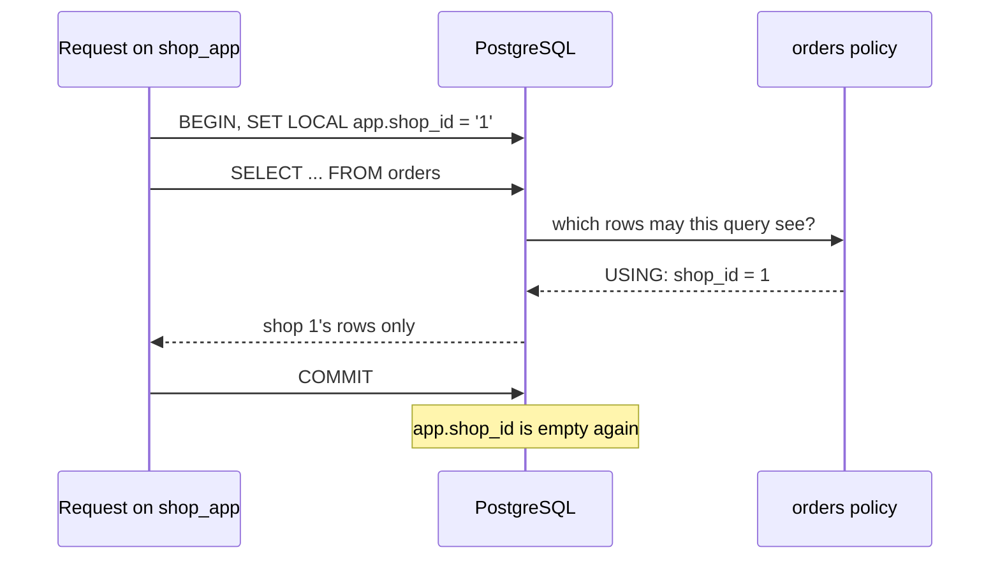

## Bạn cần biết trước

- [[backend.l3.tenant-isolation-models]] — bạn biết với bảng dùng chung, dòng của mọi cửa hàng nằm trong một bảng `orders`, phân biệt nhau bằng cột `shop_id`.
- [[backend.l2.transactions-in-practice]] — bạn biết một giao dịch gom các câu lệnh giữa `BEGIN` và `COMMIT` hoặc `ROLLBACK`, nên chúng có hiệu lực tất cả hoặc không gì cả.

## Tình huống

Một đồng nghiệp viết nhanh một truy vấn hỗ trợ trên `donhang_tenancy`, database thực hành nơi hai cửa hàng dùng chung một bảng `orders`. Chủ cửa hàng 1 hỏi còn bao nhiêu đơn đang `new`, và truy vấn đếm chúng. Truy vấn quên `WHERE shop_id = 1`, nên con số gồm cả đơn của cửa hàng 2, và chủ cửa hàng 1 giờ biết được một điều về đối thủ. Không ai phát hiện khi review, vì truy vấn trông đúng. Mọi truy vấn trong api, mọi báo cáo và mọi script đều phải nhớ cùng một mệnh đề, và chỉ cần một chỗ quên là đủ.

PostgreSQL có thể tự thêm điều kiện cửa hàng, để một truy vấn quên nó vẫn chỉ thấy dòng của một cửa hàng không?

## Khái niệm cốt lõi

- **row-level security** (tính năng PostgreSQL tự thêm điều kiện của policy vào mọi truy vấn trên bảng, giới hạn dòng mỗi role thấy) — khi đã bật cho một bảng, PostgreSQL thêm điều kiện của các policy trên bảng đó vào mọi truy vấn tới nó, nên mỗi role chỉ thấy những dòng mà điều kiện cho phép.
- policy — một quy tắc có tên trên một bảng, tạo bằng `CREATE POLICY`. Điều kiện `USING` của nó cho biết truy vấn được thấy, sửa hay xóa những dòng có sẵn nào, còn điều kiện `WITH CHECK` (không bắt buộc) cho biết truy vấn được ghi những dòng mới hay dòng đã sửa nào.
- role — một user hoặc một nhóm user của PostgreSQL. Mỗi lúc một kết nối hành động dưới một role, và `SET ROLE` chuyển nó sang role khác. Superuser là role vượt qua mọi phép kiểm tra quyền trong database.
- connection pool — một tập kết nối đang mở mà thư viện api dùng để nói chuyện với PostgreSQL giữ lại và cho hết request này tới request khác mượn, thay vì mỗi request mở một kết nối.
- `SET LOCAL` — chỉ đổi một thiết lập cho tới khi giao dịch hiện tại kết thúc, dù kết thúc bằng `COMMIT` hay `ROLLBACK`.
- `app.shop_id` — một thiết lập tự đặt: PostgreSQL lưu một cái tên có dấu chấm như thế này trên kết nối mà không cần biết nó nghĩa là gì, và `current_setting('app.shop_id', true)` đọc nó, trả về null nếu chưa từng được đặt.

## Cơ chế hoạt động



Trong sơ đồ, một request chạy dưới `shop_app` đặt cửa hàng của nó bằng `SET LOCAL`, gửi một `SELECT` không có mệnh đề cửa hàng, và chỉ nhận về những dòng mà policy của `orders` cho phép. Sau `COMMIT`, thiết lập lại trống. Lệnh `ALTER TABLE orders ENABLE ROW LEVEL SECURITY` bật cơ chế này. Từ đó, PostgreSQL kiểm tra điều kiện `USING` của các policy trên bảng với từng dòng mà truy vấn trên `orders` đọc, trước các điều kiện của chính truy vấn, nên dòng không đạt sẽ không bao giờ được thấy. Bảng đã bật row-level security mà không có policy nào thì không cho những truy vấn đó thấy dòng nào.

Superuser và role có `BYPASSRLS`, một cờ có thể gán cho role, bỏ qua các policy. Chủ sở hữu bảng cũng vậy, trừ khi một thiết lập của bảng mà bài này không dùng buộc họ phải theo policy. Image PostgreSQL tạo `POSTGRES_USER` của nó, ở đây là `donhang`, thành superuser, và `donhang` sở hữu các bảng thực hành. Vì thế bản demo chuyển sang `shop_app`, một role chỉ có quyền đọc và sửa các bảng.

Policy đọc cửa hàng hiện tại từ `app.shop_id`. Khi thiết lập này không có, điều kiện trở thành `shop_id = null`. Khác với `==` trong C#, `=` trong SQL trả về null chứ không phải true khi một trong hai vế là null, và policy chỉ giữ những dòng có điều kiện là true. Nên truy vấn không thấy dòng nào, thay vì thấy dòng của mọi cửa hàng.

Thiết lập nằm ở đâu là chuyện quan trọng, vì connection pool cho hết request này tới request khác mượn cùng một kết nối. Giá trị đặt bằng `SET` thường thuộc về kết nối, nên nó có thể sống lâu hơn request, trừ khi có gì đó xóa nó đi. `SET LOCAL` bên trong giao dịch của request gắn cửa hàng với giao dịch đó, nên request kế tiếp bắt đầu mà không có cửa hàng nào.

## Trong hệ thống Đơn Hàng

Api kết nối dưới `donhang`, và ở stage-3 database của chính Đơn Hàng không có policy nào. Database thực hành thì có, từ file này:

```sql file=db/tenancy/row-level-security.sql tag=stage-3 lines=18-28
-- lesson: backend.l3.row-level-security
-- Every query shop_app sends to orders gets this USING condition added.
-- current_setting(..., true) gives null when app.shop_id was never set,
-- and '' after a SET LOCAL has ended; NULLIF turns '' into null too. Either
-- way shop_id = null is never true, so no rows: not every shop's rows.
-- With no WITH CHECK, a new or changed row must pass USING as well.
ALTER TABLE orders ENABLE ROW LEVEL SECURITY;
DROP POLICY IF EXISTS orders_of_current_shop ON orders;
CREATE POLICY orders_of_current_shop ON orders
    FOR ALL
    USING (shop_id = NULLIF(current_setting('app.shop_id', true), '')::integer);
```

Policy là `FOR ALL`, nên nó áp cho `SELECT`, `INSERT`, `UPDATE` và `DELETE`. Nó không có mệnh đề `WITH CHECK`, và khi đó PostgreSQL dùng luôn điều kiện `USING` cho dòng mới và dòng đã sửa: dòng nào request không thấy được thì cũng không ghi được. Chú thích trong file nói thiết lập đọc ra `''` khi một `SET LOCAL` đã kết thúc. `::integer` không biến `''` thành số được và sẽ báo lỗi, nên `NULLIF` đổi `''` thành null trước, và điều kiện vẫn là `shop_id = null`. Phía trên đoạn trích, file tạo `shop_app` là một role không đăng nhập được và cấp cho nó quyền trên `orders` và `customers`. Script chuyển sang role này bằng `SET ROLE` từ `donhang`.

Script truy vấn bảng dưới từng role. Hàm `sql` của nó, định nghĩa phía trên đoạn trích, chạy `psql`, client dòng lệnh của PostgreSQL, dưới `donhang` và in từng câu lệnh trước kết quả của nó:

```bash file=scripts/backend/row-level-security.sh tag=stage-3 lines=21-45
echo "== as donhang, a superuser: the policy does not apply"
sql "SELECT shop_id, count(*) FROM orders GROUP BY shop_id ORDER BY shop_id"

echo "== as shop_app, before any shop is set"
sql "SET ROLE shop_app; SELECT count(*) FROM orders"

# lesson: backend.l3.row-level-security
# What a request does on a pooled connection: set the shop inside its own
# transaction, with SET LOCAL, so it is gone when the transaction ends and
# the next request on this connection starts with no shop at all.
echo "== as shop_app, inside a transaction for shop 1"
sql "SET ROLE shop_app;
BEGIN;
SET LOCAL app.shop_id = '1';
SELECT shop_id, id, status FROM orders ORDER BY id;
COMMIT;
SELECT current_setting('app.shop_id', true) AS shop_after_commit, count(*) FROM orders;"

echo "== as shop_app for shop 1, insert an order of shop 2"
sql "SET ROLE shop_app;
BEGIN;
SET LOCAL app.shop_id = '1';
INSERT INTO orders (shop_id, id, customer_id, placed_at, status)
VALUES (2, 3, 1, now(), 'new');
ROLLBACK;" || true
```

```text output=true
...
== as donhang, a superuser: the policy does not apply
SELECT shop_id, count(*) FROM orders GROUP BY shop_id ORDER BY shop_id
 shop_id | count 
---------+-------
       1 |     3
       2 |     2

== as shop_app, before any shop is set
SET ROLE shop_app; SELECT count(*) FROM orders
SET
 count 
-------
     0
...
 shop_id | id | status  
---------+----+---------
       1 |  1 | paid
       1 |  2 | new
       1 |  3 | shipped

COMMIT
 shop_after_commit | count 
-------------------+-------
                   |     0
...
ERROR:  new row violates row-level security policy for table "orders"
...
```

Đọc kết quả từ trên xuống:

1. Dưới `donhang`, truy vấn thấy cả năm đơn của hai cửa hàng, vì policy không áp cho superuser.
2. Dưới `shop_app` khi chưa đặt cửa hàng, cùng bảng đó hiện 0 dòng.
3. Trong giao dịch cho cửa hàng 1, `SELECT` không có `WHERE` mà vẫn chỉ trả về ba đơn của cửa hàng 1.
4. Sau `COMMIT`, `shop_after_commit` trống và số đếm lại là 0, đúng là thứ request kế tiếp trên kết nối này sẽ thấy.
5. Lệnh thêm một đơn cho cửa hàng 2 thất bại, vì dòng mới không đạt `USING`. `|| true` giúp script chạy tiếp.

Phần còn lại của script, nằm ngoài đoạn trích, bật row-level security cho `customers`, bảng không có policy nào, bên trong một giao dịch mà nó rollback, và đếm được 0 dòng.

Đây là chỗ khác với bộ lọc trong code ứng dụng. Một `WHERE shop_id = ...` viết trong api chỉ bảo vệ những truy vấn đi qua đoạn code đó. Row-level security còn bao cả truy vấn SQL viết tay, báo cáo hay script, miễn là nó chạy dưới role bị giới hạn.

## Senior hay nhầm rằng…

- **"Đã bật row-level security thì mọi kết nối đều bị lọc, kể cả kết nối api đang dùng."** → Thực ra superuser, role có `BYPASSRLS` và, thông thường, chủ sở hữu bảng đều bỏ qua policy. Api kết nối dưới `donhang`, một superuser, nên truy vấn của nó vẫn thấy dòng của mọi cửa hàng. Dòng chỉ bắt đầu bị lọc với kết nối hành động dưới một role bị giới hạn như `shop_app`. Bạn sẽ nhận ra khi thử một policy mới từ kết nối quen thuộc, nhận về dòng của mọi cửa hàng và tưởng policy hỏng.
- **"Đặt cửa hàng một lần khi kết nối mở là đủ, vì mỗi request có kết nối riêng."** → Thực ra pool lần lượt đưa một kết nối đang mở cho nhiều request, nên request không sở hữu kết nối của nó. Cửa hàng đặt bằng `SET` thường ở lại với kết nối. Có pool xóa thiết lập của kết nối khi nó được trả về, và tính năng đó tắt đi được. `SET LOCAL` bên trong giao dịch của request không phụ thuộc vào điều nào trong hai điều đó. Bạn sẽ nhận ra khi một request chưa hề đặt cửa hàng lại thấy đơn của cửa hàng khác, và lỗi lúc có lúc không tùy request tình cờ lấy được kết nối nào.
- **"Có row-level security rồi thì api không cần biết người gọi thuộc cửa hàng nào nữa."** → Thực ra policy lọc theo bất kỳ `app.shop_id` nào mà phiên kết nối đặt, và PostgreSQL không kiểm tra giá trị đó đến từ đâu. Trong api, chính request chọn giá trị này, nên api vẫn phải lấy cửa hàng từ danh tính đã xác minh của người gọi, không bao giờ từ một header mà người gọi sửa được. Row-level security sau đó giữ mọi truy vấn của request ấy trong đúng một cửa hàng. Bạn sẽ nhận ra khi người gọi sửa mã cửa hàng trong request và database, làm đúng theo policy, trả về đơn của cửa hàng kia.

## Thử ngay (3 phút)

1. Khi hệ thống ví dụ đang chạy (`scripts/up.sh`), chạy `scripts/backend/row-level-security.sh` từ thư mục gốc của repository. Nếu chưa có `donhang_tenancy`, script sẽ dựng các database thực hành trước.
2. So số đếm dưới `donhang` với số đếm dưới `shop_app`, rồi tìm dòng `shop_after_commit` in ra sau `COMMIT`.

Kết quả mong đợi: dưới `donhang`, mỗi cửa hàng có 3 và 2 đơn. Dưới `shop_app` khi chưa đặt cửa hàng là 0. Trong giao dịch có ba đơn của cửa hàng 1, sau `COMMIT` là 0. Có lỗi `new row violates row-level security policy for table "orders"`, và cuối cùng là 0 dòng của `customers`.

## Liên hệ

- [[backend.l3.tenant-isolation-models]] — cách bố trí mà bài này bảo vệ: với bảng dùng chung, giờ chính PostgreSQL có thể thêm mệnh đề cửa hàng mà trước đây truy vấn nào cũng phải tự mang.
- [[backend.l2.transactions-in-practice]] — nền tảng của `SET LOCAL`: cửa hàng sống đúng bằng thời gian của giao dịch bạn đã gặp ở bài đó.
- [[backend.l2.resource-based-authorization]] — cùng kiểu kiểm tra ở tầng trên: api quyết định theo từng đơn trong C#, row-level security quyết định theo từng dòng trong database.
- [[backend.l3.multi-tenancy]] — quy tắc mà bài này vẫn dựa vào: cửa hàng lấy từ danh tính đã xác minh của người gọi, không lấy từ body của request.
- [[backend.l3.table-partitioning]] — bài kế tiếp: chia một bảng lớn thành nhiều bảng nhỏ hơn, vì kích thước chứ không vì cách ly.

## Tóm tắt 5 dòng

1. Row-level security khiến PostgreSQL thêm điều kiện cửa hàng của policy vào mọi truy vấn trên bảng, kể cả truy vấn mà người viết đã quên.
2. Superuser, role có `BYPASSRLS` và thông thường cả chủ sở hữu bảng bỏ qua policy, nên truy vấn cần lọc phải chạy dưới một role bị giới hạn.
3. Policy đọc cửa hàng từ `app.shop_id`. Giá trị thiếu hoặc rỗng thành null, và `shop_id = null` không khớp dòng nào.
4. Kết nối trong pool phục vụ hết request này tới request khác, nên cửa hàng được đặt bằng `SET LOCAL` và biến mất khi giao dịch kết thúc.
5. Policy `FOR ALL` không có `WITH CHECK` cũng kiểm tra dòng mới, và api vẫn phải lấy cửa hàng từ danh tính đã xác minh của người gọi.
