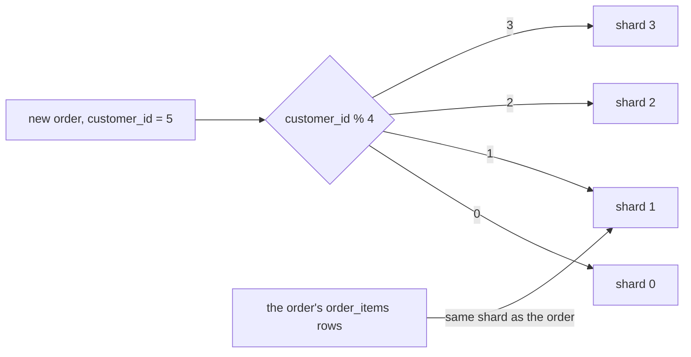

## Before you start

- [[backend.l3.table-partitioning]] — you know partitions split one table by a key inside one database, so they all share one server.
- [[backend.l3.read-replicas]] — you know a replica takes reads off the primary, while every write still goes to that one server.
- [[backend.l3.tenant-isolation-models]] — you know a shop can get a database of its own, and PostgreSQL refuses a query that names a table in another database.

## The situation

Picture Đơn Hàng taking many times the orders it takes at stage-3. Every new order is an `INSERT` into `orders` and `order_items`, and all of them land on one PostgreSQL server. Partitioning split the table, but the partitions share that server's CPU and disk. Replicas took the reads away, yet every write still goes to the primary. The team proposes four databases, each on its own server, each holding a quarter of the orders. Before anything moves, you rehearse on `donhang_perf`, the 200,000-order practice database.

Which value of an order should decide which of the four databases stores it?

## Core concepts

- **sharding** — storing each row of a table in one of several databases, usually on separate servers, where a value in the row decides which one.
- **shard** — one of those databases; it has its own CPU, disk and connections, and it holds only its share of the rows.
- **shard key** — the value of a row that decides its shard; in this lesson either `customer_id` or the order's `id`, turned into a shard number with `% 4`, the remainder after dividing by 4.
- **hot shard** — a shard that holds or receives far more than its share of the rows or traffic.

## How it works



In the diagram, the shard key is `customer_id`. Customer 5's new order gives `5 % 4 = 1`, so the code that writes it connects to shard 1 and runs the `INSERT` there. The other three shards never see that row.

That is the difference from partitions. Partitions split a table inside one database, and PostgreSQL itself skips the partitions a query cannot need. Shards split it across databases, usually on separate servers, and the code that sends a query has to pick the database first. Because each shard brings its own CPU, disk and connections, write capacity grows with the number of shards, as long as the writes spread over them.

The price is that no single database sees all the rows. One query, and one ordinary transaction, run inside one database, so they reach only the rows on one shard.

That price shapes the choice of key: rows that are usually read together should share it. `order_items` has no `customer_id` column, so each item is stored on the shard of its order, as the last arrow shows. One customer's orders and their items then sit on one shard, and that customer's order history is one query with a `JOIN` on that shard.

The key also decides balance. Every row with the same key value lands on the same shard. One value with a huge share of the rows therefore makes a hot shard, however the other values are spread. A database per tenant follows the same rule: the shop is the shard key, and one large shop can be a hot shard by itself.

## In the Đơn Hàng system

Đơn Hàng itself is not sharded at stage-3. The practice file only counts where `donhang_perf`'s orders would land with four shards; nothing is copied or moved.

```sql file=db/sharding/shard-skew.sql tag=stage-3 lines=5-22
-- lesson: backend.l3.sharding
-- By customer: all of one customer's orders land on one shard, so customer
-- 1, who placed 81% of them, takes that shard with them.
SELECT customer_id % 4 AS shard,
       count(*) AS orders,
       round(100.0 * count(*) / sum(count(*)) OVER (), 1) AS percent
FROM orders
GROUP BY customer_id % 4
ORDER BY shard;

-- By order id: consecutive ids take turns, so the shards come out even,
-- but one customer's orders are spread over all four.
SELECT id % 4 AS shard,
       count(*) AS orders,
       round(100.0 * count(*) / sum(count(*)) OVER (), 1) AS percent
FROM orders
GROUP BY id % 4
ORDER BY shard;
```

Each query computes a shard number for every order, once from `customer_id` and once from `id`, and counts the orders per number. `sum(count(*)) OVER ()` adds up the counts of all groups, so `percent` is each shard's share of all orders. `donhang_perf` has 20 customers: customer 1 placed 81% of the orders, and each of the other 19 placed 1%.

The script runs that file with `psql`, PostgreSQL's command-line client, from a prepared container that reaches the database by the name `db`. Above the excerpt, it builds `donhang_perf` first if the database does not exist yet:

```bash file=scripts/backend/shard-skew.sh tag=stage-3 lines=11-14
echo "== customer_id % 4, then id % 4"
psql --host db --username donhang --dbname donhang_perf \
     --no-psqlrc --set ON_ERROR_STOP=on --pset footer=off \
     --file /repo/db/sharding/shard-skew.sql
```

```text output=true
== customer_id % 4, then id % 4
 shard | orders | percent 
-------+--------+---------
     0 |  10000 |     5.0
     1 | 170000 |    85.0
     2 |  10000 |     5.0
     3 |  10000 |     5.0

 shard | orders | percent 
-------+--------+---------
     0 |  50000 |    25.0
     1 |  50000 |    25.0
     2 |  50000 |    25.0
     3 |  50000 |    25.0
```

In the first table, shard 1 holds 170,000 orders, 85%: customer 1's 81% plus 1% each from customers 5, 9, 13 and 17. It is a hot shard. In the second table, each shard gets exactly 50,000, but one customer's orders are now spread over all four. Neither key is free: by customer, one history sits on one shard and shard 1 is hot; by id, the shards are even and reading one customer means asking every shard. So pick a key that keeps rows usually read together on one shard, and among those, one where no single value holds a large share.

## Seniors often assume…

- **"Sharding orders by order id is best, because it spreads the orders evenly."** → Actually an even spread is only one of two tests; the other is which rows are read together. With `id % 4`, every customer's orders are spread over all four shards, so the most common read, one customer's history, has to ask all of them. You notice this when every view of a customer's orders sends a query to each shard and merges the answers.
- **"A hot shard goes away if I add more shards."** → Actually every row with the same key value lands on the same shard, however many shards there are. Customer 1's 81% stays together, so the shard holding customer 1 holds at least 81% with 4 shards or with 40. More shards only shrink the other customers' share. You notice this when new shards sit nearly idle while one shard is as busy as before.
- **"After sharding, the shards still act like one database for joins and transactions."** → Actually each shard is a separate database, and one query or ordinary transaction covers one database only. A `JOIN` finds only the rows on the shard it runs on, which is why each order's `order_items` must follow it to the same shard. You notice this when an order's items were stored on another shard and its `JOIN` on the order's shard returns no items.

## Try it (3 minutes)

1. With the example system running (`scripts/up.sh`), run `scripts/backend/shard-skew.sh` from the repository root. It builds `donhang_perf` first if it does not exist yet.
2. Compare the two tables, then work out which customers share shard 1 in the first one.

Expected result: the first table shows shard 1 with 170000 orders and 85.0 percent, the others with 10000 and 5.0; the second table shows 50000 and 25.0 for every shard.

<details><summary>Suggested answer</summary>

Shard 1 holds customers 1, 5, 9, 13 and 17, the ids whose remainder after dividing by 4 is 1. Customer 1 brings 81% and the other four bring 1% each, so 85% in total.

</details>

## Connections

- [[backend.l3.table-partitioning]] — the same split by a key, kept inside one database on one server; sharding takes it across servers.
- [[backend.l3.read-replicas]] — adds servers for reads only; sharding is the step that spreads writes.
- [[backend.l3.tenant-isolation-models]] — a database per shop is sharding with the shop as the shard key.
- [[backend.l3.cross-shard-queries]] — the next lesson: what a query without the shard key has to do.
- [[backend.l3.rebalancing-shards]] — how to add a shard later without moving most of the rows.
- [[design.l3.module-owns-its-tables]] — a split along a different line, by module, where joins across the split also give way.

## Five-line summary

1. Sharding stores each row in one of several databases, usually on separate servers, and the row's shard key decides which one.
2. Unlike partitions, each shard has its own CPU, disk and connections, so writes spread, but no database sees all the rows.
3. In `donhang_perf`, `customer_id % 4` puts 85% of orders on shard 1, because customer 1 placed 81%; `id % 4` gives 25% each.
4. Rows usually read together should share a shard key: orders and their `order_items` by `customer_id` keep one customer's history on one shard.
5. One large customer or tenant makes a hot shard however the keys are spread; a database per tenant is sharding by tenant.
