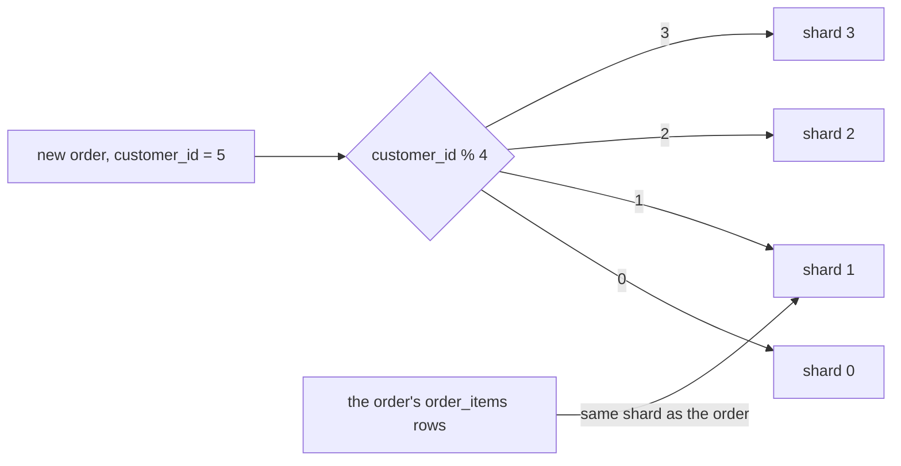

## Bạn cần biết trước

- [[backend.l3.table-partitioning]] — bạn biết partition chia một bảng theo một khóa bên trong một database, nên mọi partition dùng chung một server.
- [[backend.l3.read-replicas]] — bạn biết replica gánh bớt phần đọc cho primary, còn mọi lệnh ghi vẫn đi tới đúng một server đó.
- [[backend.l3.tenant-isolation-models]] — bạn biết mỗi shop có thể có database riêng, và PostgreSQL từ chối một truy vấn nêu tên bảng ở database khác.

## Tình huống

Hãy hình dung Đơn Hàng nhận số đơn gấp nhiều lần so với ở stage-3. Mỗi đơn mới là một lệnh `INSERT` vào `orders` và `order_items`, và tất cả đều đổ vào một server PostgreSQL. Partitioning đã chia bảng, nhưng các partition dùng chung CPU và ổ đĩa của server đó. Replica đã lấy đi phần đọc, nhưng mọi lệnh ghi vẫn đi tới primary. Nhóm đề xuất dùng bốn database, mỗi cái trên một server riêng, mỗi cái giữ một phần tư số đơn. Trước khi chuyển dữ liệu, bạn diễn tập trên `donhang_perf`, database thực hành có 200.000 đơn.

Giá trị nào của một đơn nên quyết định đơn đó nằm ở database nào trong bốn cái?

## Khái niệm cốt lõi

- **sharding** (chia các dòng của dữ liệu qua nhiều database, thường trên nhiều server, theo shard key) — lưu mỗi dòng của một bảng vào một trong nhiều database, thường trên các server riêng, và một giá trị trong dòng quyết định database nào.
- **shard** (một trong các database của hệ thống đã sharding, giữ một phần các dòng) — một trong các database đó. Nó có CPU, ổ đĩa và connection riêng, và chỉ giữ phần dòng của mình.
- **shard key** (giá trị của dòng dùng để quyết định dòng đó nằm ở shard nào) — giá trị của dòng quyết định shard của nó. Trong bài này là `customer_id` hoặc `id` của đơn, đổi thành số thứ tự shard bằng `% 4`, tức số dư khi chia cho 4.
- **hot shard** (shard giữ hoặc nhận nhiều hơn hẳn phần dòng hay lưu lượng của nó) — shard giữ hoặc nhận nhiều hơn hẳn phần dòng hay lưu lượng đáng lẽ chia cho nó.

## Cơ chế hoạt động



Trong sơ đồ, shard key là `customer_id`. Đơn mới của khách 5 cho `5 % 4 = 1`, nên đoạn code ghi đơn kết nối tới shard 1 và chạy lệnh `INSERT` ở đó. Ba shard còn lại không bao giờ thấy dòng này.

Đó là chỗ khác với partition. Partition chia một bảng bên trong một database, và chính PostgreSQL bỏ qua những partition mà truy vấn không cần tới. Shard chia bảng qua nhiều database, thường trên các server riêng, và đoạn code gửi truy vấn phải tự chọn database trước. Vì mỗi shard mang theo CPU, ổ đĩa và connection riêng, sức ghi tăng theo số shard, miễn là lệnh ghi trải đều trên chúng.

Cái giá phải trả là không database nào thấy được mọi dòng. Một truy vấn, và một giao dịch thông thường, chạy bên trong một database, nên chỉ chạm tới các dòng trên một shard.

Cái giá đó định hình cách chọn khóa: những dòng thường được đọc cùng nhau nên có chung khóa. `order_items` không có cột `customer_id`, nên mỗi item được lưu ở shard của đơn chứa nó, như mũi tên cuối cùng cho thấy. Khi đó các đơn của một khách và item của chúng nằm trên một shard, và lịch sử đơn của khách đó là một truy vấn có `JOIN` trên shard ấy.

Khóa cũng quyết định độ cân bằng. Mọi dòng có cùng giá trị khóa đều nằm trên cùng một shard. Vì vậy một giá trị chiếm phần lớn số dòng sẽ tạo ra hot shard, dù các giá trị khác trải đều thế nào. Mô hình database riêng cho từng tenant cũng theo đúng quy tắc này: shop chính là shard key, và một shop lớn tự nó có thể thành hot shard.

## Trong hệ thống Đơn Hàng

Ở stage-3, bản thân Đơn Hàng chưa được sharding. File thực hành chỉ đếm xem các đơn của `donhang_perf` sẽ rơi vào đâu nếu có bốn shard. Không có gì bị chép hay chuyển đi.

```sql file=db/sharding/shard-skew.sql tag=stage-3 lines=5-22
-- lesson: backend.l3.sharding
-- By customer: all of one customer's orders land on one shard, so customer
-- 1, who placed 81% of them, takes that shard with them.
SELECT customer_id % 4 AS shard,
       count(*) AS orders,
       round(100.0 * count(*) / sum(count(*)) OVER (), 1) AS percent
FROM orders
GROUP BY customer_id % 4
ORDER BY shard;

-- By order id: consecutive ids take turns, so the shards come out even,
-- but one customer's orders are spread over all four.
SELECT id % 4 AS shard,
       count(*) AS orders,
       round(100.0 * count(*) / sum(count(*)) OVER (), 1) AS percent
FROM orders
GROUP BY id % 4
ORDER BY shard;
```

Mỗi truy vấn tính một số thứ tự shard cho từng đơn, lần đầu từ `customer_id`, lần sau từ `id`, rồi đếm số đơn theo từng số. `sum(count(*)) OVER ()` cộng số đếm của mọi nhóm, nên `percent` là phần của mỗi shard trên tổng số đơn. `donhang_perf` có 20 khách: khách 1 đặt 81% số đơn, 19 khách còn lại mỗi người đặt 1%.

Script chạy file đó bằng `psql`, chương trình dòng lệnh của PostgreSQL, từ một container dựng sẵn, nơi database được gọi bằng tên `db`. Phía trên đoạn trích, script dựng `donhang_perf` trước nếu database này chưa có:

```bash file=scripts/backend/shard-skew.sh tag=stage-3 lines=11-14
echo "== customer_id % 4, then id % 4"
psql --host db --username donhang --dbname donhang_perf \
     --no-psqlrc --set ON_ERROR_STOP=on --pset footer=off \
     --file /repo/db/sharding/shard-skew.sql
```

```text output=true
== customer_id % 4, then id % 4
 shard | orders | percent 
-------+--------+---------
     0 |  10000 |     5.0
     1 | 170000 |    85.0
     2 |  10000 |     5.0
     3 |  10000 |     5.0

 shard | orders | percent 
-------+--------+---------
     0 |  50000 |    25.0
     1 |  50000 |    25.0
     2 |  50000 |    25.0
     3 |  50000 |    25.0
```

Ở bảng đầu, shard 1 giữ 170.000 đơn, tức 85%: 81% của khách 1 cộng mỗi khách 5, 9, 13 và 17 thêm 1%. Đó là một hot shard. Ở bảng thứ hai, mỗi shard nhận đúng 50.000 đơn, nhưng giờ các đơn của một khách lại trải ra cả bốn shard. Không khóa nào miễn phí. Theo khách, lịch sử của một khách nằm trên một shard nhưng shard 1 bị quá tải. Theo `id`, các shard đều nhau nhưng muốn đọc một khách phải hỏi mọi shard. Vì vậy hãy chọn khóa giữ những dòng thường được đọc cùng nhau trên một shard, và trong số đó, chọn khóa mà không giá trị nào chiếm phần lớn.

## Senior hay nhầm rằng…

- **"Sharding đơn theo `id` của đơn là tốt nhất, vì nó chia đơn đều nhau."** → Thực ra chia đều chỉ là một trong hai phép thử, phép thử còn lại là những dòng nào được đọc cùng nhau. Với `id % 4`, đơn của mỗi khách trải ra cả bốn shard, nên lần đọc phổ biến nhất, lịch sử của một khách, phải hỏi tất cả. Bạn sẽ nhận ra khi mỗi lần xem đơn của một khách đều gửi một truy vấn tới từng shard rồi gộp các câu trả lời lại.
- **"Hot shard sẽ hết nếu thêm shard."** → Thực ra mọi dòng có cùng giá trị khóa đều nằm trên cùng một shard, dù có bao nhiêu shard. 81% của khách 1 vẫn ở chung một chỗ, nên shard giữ khách 1 giữ ít nhất 81%, dù có 4 shard hay 40. Thêm shard chỉ làm nhỏ phần của các khách khác. Bạn sẽ nhận ra khi các shard mới gần như rảnh, còn một shard vẫn bận như trước.
- **"Sau khi sharding, các shard vẫn hoạt động như một database khi `JOIN` và chạy giao dịch."** → Thực ra mỗi shard là một database riêng, và một truy vấn hay một giao dịch thông thường chỉ bao một database. Một `JOIN` chỉ tìm thấy các dòng trên shard nơi nó chạy, nên `order_items` của mỗi đơn phải theo đơn đó về cùng shard. Bạn sẽ nhận ra khi item của một đơn bị lưu ở shard khác, và `JOIN` trên shard của đơn không trả về item nào.

## Thử ngay (3 phút)

1. Khi hệ thống ví dụ đang chạy (`scripts/up.sh`), chạy `scripts/backend/shard-skew.sh` từ thư mục gốc của repository. Script dựng `donhang_perf` trước nếu database này chưa có.
2. So hai bảng, rồi tìm xem những khách nào chung shard 1 ở bảng đầu.

Kết quả mong đợi: bảng đầu cho shard 1 có `170000` đơn và `85.0` percent, các shard còn lại có `10000` và `5.0`. Bảng thứ hai cho mọi shard `50000` và `25.0`.

<details><summary>Gợi ý đáp án</summary>

Shard 1 giữ các khách 1, 5, 9, 13 và 17, tức những `id` có số dư bằng 1 khi chia cho 4. Khách 1 mang tới 81%, bốn khách kia mỗi người 1%, nên tổng là 85%.

</details>

## Liên hệ

- [[backend.l3.table-partitioning]] — cùng kiểu chia theo một khóa, nhưng giữ bên trong một database trên một server. Sharding đưa việc chia đó ra nhiều server.
- [[backend.l3.read-replicas]] — thêm server chỉ cho phần đọc. Sharding là bước trải phần ghi ra.
- [[backend.l3.tenant-isolation-models]] — database riêng cho từng shop chính là sharding với shop làm shard key.
- [[backend.l3.cross-shard-queries]] — bài tiếp theo: một truy vấn không có shard key phải làm gì.
- [[backend.l3.rebalancing-shards]] — cách thêm shard về sau mà không phải chuyển phần lớn các dòng.
- [[design.l3.module-owns-its-tables]] — chia theo một đường khác, theo module, nơi `JOIN` xuyên qua đường chia cũng không còn dùng được.

## Tóm tắt 5 dòng

1. Sharding lưu mỗi dòng vào một trong nhiều database, thường trên các server riêng, và shard key của dòng quyết định database nào.
2. Khác với partition, mỗi shard có CPU, ổ đĩa và connection riêng, nên phần ghi được trải ra, nhưng không database nào thấy mọi dòng.
3. Trong `donhang_perf`, `customer_id % 4` đặt 85% số đơn lên shard 1 vì khách 1 đặt 81%, còn `id % 4` cho mỗi shard 25%.
4. Những dòng thường được đọc cùng nhau nên chung shard key: đơn và `order_items` của nó theo `customer_id` giữ lịch sử của một khách trên một shard.
5. Một khách hay một tenant lớn tạo ra hot shard dù khóa trải đều thế nào. Database riêng cho từng tenant chính là sharding theo tenant.
