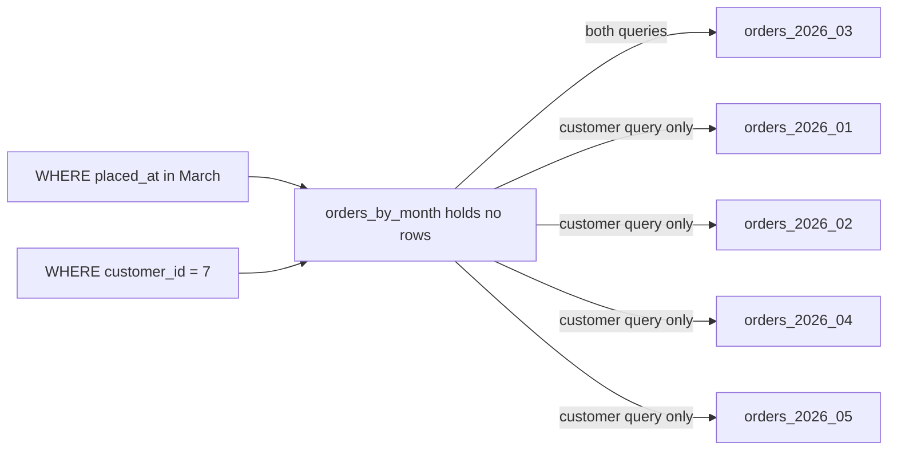

## Before you start

- [[backend.l2.indexes-and-plans]] — you can read an `EXPLAIN` plan as a tree of steps and know what a sequential scan is.
- [[backend.l2.composite-indexes]] — you know a key or index can span two columns, and the order of those columns matters.

## The situation

`donhang_perf`, the practice database from the indexes lessons, holds 200,000 orders placed from January to May 2026. Two jobs keep coming back. A monthly report counts one month's orders, yet the `orders` table mixes every month together. A clean-up job is asked to remove January, and a `DELETE` has to find and remove January's orders one row at a time. Every new month makes both jobs work against a bigger table, although each one only cares about a single month.

Could PostgreSQL keep each month's orders apart, so that a query for one month reads only that month and removing a month is quick?

## Core concepts

- **table partitioning** — splitting one table into child tables, called partitions, by the value of a key, all inside the same database; queries and inserts still name the parent table.
- partition — one of those child tables; in this lesson each one holds a range of `placed_at` values, one calendar month.
- **partition key** — the column or columns whose value decides which partition a row is stored in; here `placed_at`.
- partition pruning — the query planner leaving out every partition that, judging by its range, cannot hold a row the query asks for.
- detaching a partition — turning a partition back into an ordinary table that no longer belongs to the parent, which can then be kept or dropped.

## How it works



In the diagram, `orders_by_month` is the partitioned table and the five boxes on the right are its partitions, one per month. Arrows show which partitions each query's plan reads. The parent holds no rows of its own. When a row is inserted, PostgreSQL compares its `placed_at` with each partition's range and stores the row in the partition whose range contains it. A range includes its lower bound and excludes its upper bound, so an order placed at exactly midnight on 1 March belongs to March.

Queries are still written against `orders_by_month`, as if it were one table. When the query planner plans the March query, it compares the condition on the partition key with each range and prunes every partition that cannot match.

The customer query has no condition on `placed_at`. The planner cannot rule out any month, so the plan visits all five partitions and combines what each returns. That is why the key is usually chosen from the queries the table answers most: a table read mostly by month suits a monthly key.

A primary key, or a unique constraint (a rule that no two rows share a value in the given columns), must include the partition key. PostgreSQL enforces it with one index per partition, and each index sees only its own partition, so without the key two partitions could hold the same value.

Storing each month in its own table also changes how a month is removed: drop its partition, or detach it first as the script does, then drop it. Dropping a table discards all its rows at once, without the row-by-row work of a `DELETE`.

All of this happens in one database on one server, so the partitions share that server's CPU, memory and disk.

## In the Đơn Hàng system

The API's own `orders` table is not partitioned at stage-3. The practice copy is built by this file:

```sql file=db/partitioning/orders-by-month.sql tag=stage-3 lines=7-28
-- lesson: backend.l3.table-partitioning
-- The parent table holds no rows: each row goes to the partition whose
-- range contains its placed_at. The primary key has to include placed_at,
-- the partition key, so (id, placed_at) instead of id alone.
CREATE TABLE orders_by_month (
    id          integer     NOT NULL,
    customer_id integer     NOT NULL,
    placed_at   timestamptz NOT NULL,
    status      text        NOT NULL,
    PRIMARY KEY (id, placed_at)
) PARTITION BY RANGE (placed_at);

CREATE TABLE orders_2026_01 PARTITION OF orders_by_month
    FOR VALUES FROM ('2026-01-01 00:00+07') TO ('2026-02-01 00:00+07');
CREATE TABLE orders_2026_02 PARTITION OF orders_by_month
    FOR VALUES FROM ('2026-02-01 00:00+07') TO ('2026-03-01 00:00+07');
CREATE TABLE orders_2026_03 PARTITION OF orders_by_month
    FOR VALUES FROM ('2026-03-01 00:00+07') TO ('2026-04-01 00:00+07');
CREATE TABLE orders_2026_04 PARTITION OF orders_by_month
    FOR VALUES FROM ('2026-04-01 00:00+07') TO ('2026-05-01 00:00+07');
CREATE TABLE orders_2026_05 PARTITION OF orders_by_month
    FOR VALUES FROM ('2026-05-01 00:00+07') TO ('2026-06-01 00:00+07');
```

`PARTITION BY RANGE (placed_at)` makes `placed_at` the partition key, and each `PARTITION OF ... FOR VALUES FROM ... TO ...` creates one month. The primary key is `(id, placed_at)`, not `id`. Below the excerpt, the file copies every row of `orders` into `orders_by_month` and creates an index on `customer_id` for the parent table, which PostgreSQL repeats on each partition. The file starts with `DROP TABLE IF EXISTS`, so every run rebuilds the table.

`placed_at` is a `timestamptz`, a date and time with a time zone; `+07` in each bound means Vietnam time.

The script runs that file, then queries the result. Its `sql`, defined above the excerpt, runs psql, PostgreSQL's command-line program for sending SQL to the database, and prints each statement before its result:

```bash file=scripts/backend/partition-pruning.sh tag=stage-3 lines=20-42
echo "== rows in each partition"
sql "SELECT tableoid::regclass AS partition, count(*) FROM orders_by_month GROUP BY 1 ORDER BY 1"

# lesson: backend.l3.table-partitioning
# COSTS OFF: only the shape of the plan, which is what matters here.
echo "== March's orders: a condition on placed_at, the partition key"
sql "EXPLAIN (COSTS OFF) SELECT count(*) FROM orders_by_month
WHERE placed_at >= '2026-03-01 00:00+07' AND placed_at < '2026-04-01 00:00+07'"
echo "== one customer's orders: no condition on placed_at"
sql "EXPLAIN (COSTS OFF) SELECT count(*) FROM orders_by_month WHERE customer_id = 7"

echo "== a primary key without the partition key"
sql "CREATE TABLE orders_by_month_id_only (id integer PRIMARY KEY, placed_at timestamptz NOT NULL)
PARTITION BY RANGE (placed_at)" || true
echo

# lesson: backend.l3.table-partitioning
# Removing January: two quick statements on the table's structure, instead
# of a DELETE that finds and removes January's rows one by one.
echo "== remove January"
sql "ALTER TABLE orders_by_month DETACH PARTITION orders_2026_01"
sql "DROP TABLE orders_2026_01"
sql "SELECT min(placed_at), count(*) FROM orders_by_month"
```

```text output=true
== rows in each partition
SELECT tableoid::regclass AS partition, count(*) FROM orders_by_month GROUP BY 1 ORDER BY 1
   partition    | count 
----------------+-------
 orders_2026_01 | 44639
 orders_2026_02 | 40320
 orders_2026_03 | 44640
 orders_2026_04 | 43200
 orders_2026_05 | 27201
...
   ->  Seq Scan on orders_2026_03 orders_by_month
...
   ->  Append
         ->  Index Only Scan using orders_2026_01_customer_id_idx on orders_2026_01 orders_by_month_1
...
         ->  Index Only Scan using orders_2026_05_customer_id_idx on orders_2026_05 orders_by_month_5
...
ERROR:  unique constraint on partitioned table must include all partitioning columns
...
 2026-02-01 00:00:00+07 | 155361
```

Reading the output from the top:

1. `tableoid::regclass` names the table each row is really stored in. The five counts add up to 200,000, and the parent appears nowhere.
2. The March query's plan reads `orders_2026_03` only. It scans that partition from start to end, which is fine, because every row in it is a March order.
3. The customer query's plan has an `Append` step that reads all five partitions, each through its own copy of the `customer_id` index: each `Index Only Scan using orders_2026_0N_customer_id_idx` line is one partition read through its copy.
4. A primary key on `id` alone is refused with the error shown, and `|| true` lets the script carry on.
5. After detaching and dropping `orders_2026_01`, the oldest order is from 1 February and 155,361 rows remain, without a `DELETE` touching January's rows.

## Seniors often assume…

- **"Partitioning makes every query on the table faster."** → Actually only a query whose conditions on the partition key let the planner prune partitions reads less. The customer query above still visits every month, through five indexes instead of one. You notice this when a screen filtered by customer is no faster after partitioning and its plan shows an `Append` over every partition.
- **"Partitioning spreads a table over several database servers."** → Actually each partition created with `CREATE TABLE ... PARTITION OF`, as in `orders-by-month.sql`, is an ordinary table in the same database, on the same server, using the same CPU, memory and disk. Partitioning shrinks what one query reads; it adds no machine. You notice this when write traffic grows, the table is already partitioned, and the database server is just as busy as before.
- **"A partitioned table can keep `id` alone as its primary key."** → Actually PostgreSQL refuses it, because each partition's index checks uniqueness only inside that partition, so it could not stop the same `id` from appearing in two months. The key must include `placed_at`, as `(id, placed_at)` does. You notice this when `CREATE TABLE` fails with `unique constraint on partitioned table must include all partitioning columns`.

## Try it (3 minutes)

1. With the example system running (`scripts/up.sh`), run `scripts/backend/partition-pruning.sh` from the repository root. It builds `donhang_perf` first if it does not exist yet.
2. Find the line under each `EXPLAIN` that names a partition, and count how many partitions each plan reads.

Expected result: five partition counts that add up to 200,000; the March plan names only `orders_2026_03`; the customer plan names all five partitions under `Append`; the error for a primary key without `placed_at`; and, after January is removed, a minimum `placed_at` of `2026-02-01 00:00:00+07` with 155,361 rows.

## Connections

- [[backend.l2.indexes-and-plans]] — prerequisite: pruning is visible only because you can read which tables a plan's steps scan.
- [[backend.l2.composite-indexes]] — the same reasoning about which queries a structure serves, applied to a whole table instead of an index.
- [[backend.l2.cursor-pagination]] — a query this layout does not help: one customer's page has no condition on `placed_at`, so it would visit every month.
- [[backend.l3.read-replicas]] — the next lesson: adding a second server to take reads, which partitioning cannot do.
- [[backend.l3.sharding]] — splitting rows across several databases on separate servers, the step beyond one server's limits.

## Five-line summary

1. Table partitioning stores a table's rows in smaller child tables, each holding one range of the partition key, inside the same database.
2. A query with conditions on the partition key reads only the partitions that can match; the March query reads one of five.
3. A query without such a condition, like one customer's orders, reads every partition, so the key is usually chosen from the most common queries.
4. A primary key or unique constraint must include the partition key, so `orders_by_month` uses `(id, placed_at)`.
5. Removing a month is dropping its partition (the script detaches it first), and every partition still shares one server's CPU, memory and disk.
