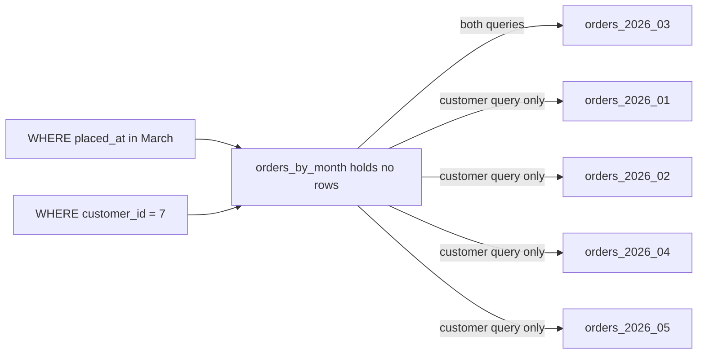

## Bạn cần biết trước

- [[backend.l2.indexes-and-plans]] — bạn đọc được một plan `EXPLAIN` như một cây các bước và biết sequential scan là gì.
- [[backend.l2.composite-indexes]] — bạn biết một khóa hay một index có thể gồm hai cột, và thứ tự của hai cột đó có ý nghĩa.

## Tình huống

`donhang_perf`, database thực hành từ các bài về index, chứa 200.000 đơn đặt từ tháng 1 tới tháng 5 năm 2026. Có hai công việc cứ lặp lại. Báo cáo hằng tháng đếm đơn của một tháng, nhưng bảng `orders` trộn mọi tháng vào nhau. Job dọn dẹp được yêu cầu xóa tháng 1, và một lệnh `DELETE` phải tìm rồi xóa từng dòng đơn của tháng 1. Mỗi tháng mới qua, cả hai công việc lại phải chạy trên một bảng lớn hơn, dù mỗi việc chỉ quan tâm tới đúng một tháng.

PostgreSQL có thể giữ đơn của mỗi tháng tách riêng, để truy vấn cho một tháng chỉ đọc tháng đó và xóa một tháng thì nhanh không?

## Khái niệm cốt lõi

- **table partitioning** (chia một bảng thành nhiều bảng con (partition) theo giá trị của một khóa, trong cùng database) — tách một bảng thành các bảng con, gọi là partition, theo giá trị của một khóa, tất cả nằm trong cùng một database. Truy vấn và lệnh insert vẫn gọi tên bảng cha.
- partition — một trong các bảng con đó. Trong bài này, mỗi partition chứa một khoảng giá trị `placed_at`, đúng một tháng dương lịch.
- **partition key** (cột hoặc các cột quyết định một dòng nằm ở partition nào) — cột hoặc các cột mà giá trị của chúng quyết định một dòng được lưu vào partition nào. Ở đây là `placed_at`.
- partition pruning — query planner bỏ qua mọi partition mà, xét theo khoảng của nó, không thể chứa dòng nào truy vấn cần.
- detach một partition — biến một partition trở lại thành bảng bình thường, không còn thuộc bảng cha, sau đó có thể giữ lại hoặc drop.

## Cơ chế hoạt động



Trong sơ đồ, `orders_by_month` là bảng đã partition, còn năm ô bên phải là các partition của nó, mỗi tháng một ô. Mũi tên cho biết plan của mỗi truy vấn đọc những partition nào. Bảng cha không tự chứa dòng nào. Khi một dòng được insert, PostgreSQL so `placed_at` của nó với khoảng của từng partition và lưu dòng vào partition có khoảng chứa nó. Một khoảng tính cả cận dưới và không tính cận trên, nên đơn đặt đúng nửa đêm ngày 1 tháng 3 thuộc về tháng 3.

Truy vấn vẫn viết trên `orders_by_month`, như thể đó là một bảng. Khi lập plan cho truy vấn tháng 3, query planner so điều kiện trên partition key với từng khoảng và cắt bỏ mọi partition không thể khớp.

Truy vấn theo khách hàng không có điều kiện nào trên `placed_at`. Planner không loại được tháng nào, nên plan đi qua cả năm partition và gộp những gì mỗi partition trả về. Vì thế khóa thường được chọn theo những truy vấn mà bảng phải trả lời nhiều nhất: bảng chủ yếu được đọc theo tháng thì hợp với khóa theo tháng.

Khóa chính, hay một unique constraint (quy tắc không cho hai dòng trùng giá trị ở các cột đã chọn), phải chứa partition key. PostgreSQL thực thi nó bằng một index cho mỗi partition, và mỗi index chỉ thấy partition của chính nó, nên nếu thiếu khóa thì hai partition có thể chứa cùng một giá trị.

Lưu mỗi tháng trong một bảng riêng cũng đổi cách xóa một tháng: drop partition của nó, hoặc detach trước như script làm, rồi drop. Drop một bảng là bỏ toàn bộ dòng của nó trong một lần, không phải xóa từng dòng như `DELETE`.

Tất cả chuyện này diễn ra trong một database trên một server, nên các partition dùng chung CPU, bộ nhớ và ổ đĩa của server đó.

## Trong hệ thống Đơn Hàng

Ở stage-3, bảng `orders` của chính api không được partition. Bản sao thực hành được dựng từ file này:

```sql file=db/partitioning/orders-by-month.sql tag=stage-3 lines=7-28
-- lesson: backend.l3.table-partitioning
-- The parent table holds no rows: each row goes to the partition whose
-- range contains its placed_at. The primary key has to include placed_at,
-- the partition key, so (id, placed_at) instead of id alone.
CREATE TABLE orders_by_month (
    id          integer     NOT NULL,
    customer_id integer     NOT NULL,
    placed_at   timestamptz NOT NULL,
    status      text        NOT NULL,
    PRIMARY KEY (id, placed_at)
) PARTITION BY RANGE (placed_at);

CREATE TABLE orders_2026_01 PARTITION OF orders_by_month
    FOR VALUES FROM ('2026-01-01 00:00+07') TO ('2026-02-01 00:00+07');
CREATE TABLE orders_2026_02 PARTITION OF orders_by_month
    FOR VALUES FROM ('2026-02-01 00:00+07') TO ('2026-03-01 00:00+07');
CREATE TABLE orders_2026_03 PARTITION OF orders_by_month
    FOR VALUES FROM ('2026-03-01 00:00+07') TO ('2026-04-01 00:00+07');
CREATE TABLE orders_2026_04 PARTITION OF orders_by_month
    FOR VALUES FROM ('2026-04-01 00:00+07') TO ('2026-05-01 00:00+07');
CREATE TABLE orders_2026_05 PARTITION OF orders_by_month
    FOR VALUES FROM ('2026-05-01 00:00+07') TO ('2026-06-01 00:00+07');
```

`PARTITION BY RANGE (placed_at)` biến `placed_at` thành partition key, và mỗi `PARTITION OF ... FOR VALUES FROM ... TO ...` tạo một tháng. Khóa chính là `(id, placed_at)`, không phải `id`. Phía dưới đoạn trích, file chép mọi dòng của `orders` sang `orders_by_month` và tạo một index trên `customer_id` cho bảng cha, rồi PostgreSQL lặp lại index đó trên từng partition. File bắt đầu bằng `DROP TABLE IF EXISTS`, nên mỗi lần chạy đều dựng lại bảng.

`placed_at` có kiểu `timestamptz`, tức ngày giờ kèm múi giờ. `+07` trong mỗi cận nghĩa là giờ Việt Nam.

Script chạy file đó, rồi truy vấn kết quả. Hàm `sql` của nó, định nghĩa phía trên đoạn trích, chạy psql, chương trình dòng lệnh của PostgreSQL để gửi SQL tới database, và in từng câu lệnh trước kết quả của nó:

```bash file=scripts/backend/partition-pruning.sh tag=stage-3 lines=20-42
echo "== rows in each partition"
sql "SELECT tableoid::regclass AS partition, count(*) FROM orders_by_month GROUP BY 1 ORDER BY 1"

# lesson: backend.l3.table-partitioning
# COSTS OFF: only the shape of the plan, which is what matters here.
echo "== March's orders: a condition on placed_at, the partition key"
sql "EXPLAIN (COSTS OFF) SELECT count(*) FROM orders_by_month
WHERE placed_at >= '2026-03-01 00:00+07' AND placed_at < '2026-04-01 00:00+07'"
echo "== one customer's orders: no condition on placed_at"
sql "EXPLAIN (COSTS OFF) SELECT count(*) FROM orders_by_month WHERE customer_id = 7"

echo "== a primary key without the partition key"
sql "CREATE TABLE orders_by_month_id_only (id integer PRIMARY KEY, placed_at timestamptz NOT NULL)
PARTITION BY RANGE (placed_at)" || true
echo

# lesson: backend.l3.table-partitioning
# Removing January: two quick statements on the table's structure, instead
# of a DELETE that finds and removes January's rows one by one.
echo "== remove January"
sql "ALTER TABLE orders_by_month DETACH PARTITION orders_2026_01"
sql "DROP TABLE orders_2026_01"
sql "SELECT min(placed_at), count(*) FROM orders_by_month"
```

```text output=true
== rows in each partition
SELECT tableoid::regclass AS partition, count(*) FROM orders_by_month GROUP BY 1 ORDER BY 1
   partition    | count 
----------------+-------
 orders_2026_01 | 44639
 orders_2026_02 | 40320
 orders_2026_03 | 44640
 orders_2026_04 | 43200
 orders_2026_05 | 27201
...
   ->  Seq Scan on orders_2026_03 orders_by_month
...
   ->  Append
         ->  Index Only Scan using orders_2026_01_customer_id_idx on orders_2026_01 orders_by_month_1
...
         ->  Index Only Scan using orders_2026_05_customer_id_idx on orders_2026_05 orders_by_month_5
...
ERROR:  unique constraint on partitioned table must include all partitioning columns
...
 2026-02-01 00:00:00+07 | 155361
```

Đọc kết quả từ trên xuống:

1. `tableoid::regclass` cho biết tên bảng thực sự chứa mỗi dòng. Năm số đếm cộng lại đúng 200.000, và bảng cha không xuất hiện ở đâu cả.
2. Plan của truy vấn tháng 3 chỉ đọc `orders_2026_03`. Nó quét partition đó từ đầu tới cuối, và như vậy không sao, vì mọi dòng trong đó đều là đơn tháng 3.
3. Plan của truy vấn theo khách hàng có bước `Append` đọc cả năm partition, mỗi partition qua bản sao index `customer_id` riêng của nó: mỗi dòng `Index Only Scan using orders_2026_0N_customer_id_idx` là một partition được đọc qua bản sao đó.
4. Khóa chính chỉ trên `id` bị từ chối với lỗi như trên, và `|| true` giúp script chạy tiếp.
5. Sau khi detach rồi drop `orders_2026_01`, đơn cũ nhất là từ ngày 1 tháng 2 và còn lại 155.361 dòng, mà không có `DELETE` nào động tới các dòng của tháng 1.

## Senior hay nhầm rằng…

- **"Partitioning làm mọi truy vấn trên bảng nhanh hơn."** → Thực ra chỉ truy vấn có điều kiện trên partition key đủ để planner cắt bỏ partition mới đọc ít đi. Truy vấn theo khách hàng ở trên vẫn đi qua mọi tháng, qua năm index thay vì một. Bạn sẽ nhận ra khi một màn hình lọc theo khách hàng không nhanh hơn chút nào sau khi partition, và plan của nó có một `Append` đi qua mọi partition.
- **"Partitioning trải một bảng ra nhiều database server."** → Thực ra mỗi partition tạo bằng `CREATE TABLE ... PARTITION OF`, như trong `orders-by-month.sql`, là một bảng bình thường trong cùng database, trên cùng server, dùng cùng CPU, bộ nhớ và ổ đĩa. Partitioning thu nhỏ phần dữ liệu một truy vấn phải đọc. Nó không thêm máy nào. Bạn sẽ nhận ra khi lưu lượng ghi tăng, bảng đã được partition, mà database server vẫn bận y như trước.
- **"Bảng đã partition vẫn giữ được khóa chính chỉ gồm `id`."** → Thực ra PostgreSQL từ chối, vì index của mỗi partition chỉ kiểm tra tính duy nhất bên trong partition đó, nên không chặn được cùng một `id` xuất hiện ở hai tháng. Khóa phải chứa `placed_at`, như `(id, placed_at)`. Bạn sẽ nhận ra khi `CREATE TABLE` thất bại với lỗi `unique constraint on partitioned table must include all partitioning columns`.

## Thử ngay (3 phút)

1. Khi hệ thống ví dụ đang chạy (`scripts/up.sh`), chạy `scripts/backend/partition-pruning.sh` từ thư mục gốc của repository. Nếu chưa có `donhang_perf`, script sẽ dựng nó trước.
2. Tìm dòng nêu tên partition dưới mỗi `EXPLAIN`, và đếm xem mỗi plan đọc bao nhiêu partition.

Kết quả mong đợi: năm số đếm partition cộng lại đúng 200.000. Plan tháng 3 chỉ nêu tên `orders_2026_03`. Plan theo khách hàng nêu tên cả năm partition dưới `Append`. Có lỗi cho khóa chính không chứa `placed_at`. Và sau khi xóa tháng 1, `placed_at` nhỏ nhất là `2026-02-01 00:00:00+07` với 155.361 dòng.

## Liên hệ

- [[backend.l2.indexes-and-plans]] — kiến thức nền: bạn thấy được pruning chỉ vì bạn đọc được các bước của plan quét những bảng nào.
- [[backend.l2.composite-indexes]] — cùng cách suy luận xem một cấu trúc phục vụ truy vấn nào, nhưng áp cho cả một bảng thay vì một index.
- [[backend.l2.cursor-pagination]] — một truy vấn mà cách bố trí này không giúp được: một trang đơn của một khách hàng không có điều kiện trên `placed_at`, nên sẽ đi qua mọi tháng.
- [[backend.l3.read-replicas]] — bài kế tiếp: thêm một server thứ hai để gánh phần đọc, điều partitioning không làm được.
- [[backend.l3.sharding]] — chia các dòng ra nhiều database trên các server riêng, bước tiếp theo khi đã chạm giới hạn của một server.

## Tóm tắt 5 dòng

1. Table partitioning lưu các dòng của một bảng trong những bảng con nhỏ hơn, mỗi bảng giữ một khoảng của partition key, tất cả trong cùng một database.
2. Truy vấn có điều kiện trên partition key chỉ đọc những partition có thể khớp. Truy vấn tháng 3 chỉ đọc một trong năm partition.
3. Truy vấn không có điều kiện như vậy, như đơn của một khách hàng, đọc mọi partition, nên khóa thường được chọn theo những truy vấn phổ biến nhất.
4. Khóa chính hay unique constraint phải chứa partition key, nên `orders_by_month` dùng `(id, placed_at)`.
5. Xóa một tháng là drop partition của nó (script detach trước), và mọi partition vẫn dùng chung CPU, bộ nhớ và ổ đĩa của một server.
