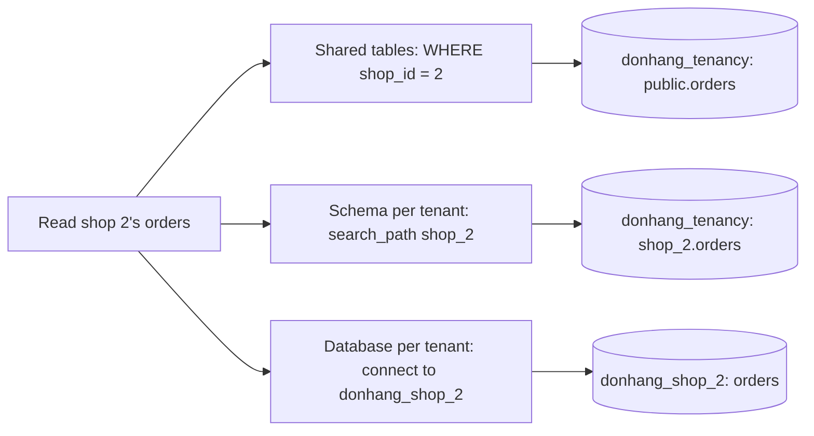

## Before you start

- [[backend.l3.multi-tenancy]] — you know a tenant is one shop using a shared system, and that one query which forgets the shop breaks isolation.
- [[backend.l2.composite-indexes]] — you know an index on two columns is sorted by the first, so it narrows only searches that name the first column.
- [[design.l3.module-owns-its-tables]] — you know two parts of Đơn Hàng can own separate tables while still sharing one PostgreSQL database.

## The situation

The owner of a second shop has signed up and expects to take orders next week, and you have to decide where those orders will live. You could add its rows to the same `orders` table as the first shop's. You could give it its own set of tables beside the first shop's, in the same database. Or you could give it a whole database of its own. Each answer looks fine on the day it is made. Each one changes what a forgotten filter does, how many times a migration runs, and how many connections the api opens.

Where should the line between one shop's data and the next sit, and what does each place cost?

## Core concepts

- **shared tables (multi-tenancy)** — every tenant's rows sit in the same tables, and each row has a column, here `shop_id`, that names the tenant it belongs to.
- **schema per tenant** — each tenant has its own schema, a named group of tables inside one shared database (a different sense from the "schema change" of a migration), so `shop_1.orders` and `shop_2.orders` are two separate tables.
- **database per tenant** — each tenant has its own database on the server; the code is the same for every tenant, but no table is shared.

## How it works

Đơn Hàng's own database stays single-shop at stage-3. This module builds practice databases instead: `donhang_tenancy` holds the first two layouts, and `donhang_shop_1` and `donhang_shop_2` hold the third. All three contain the same orders, split by shop.



Each branch answers the same question, "which rows are shop 2's", in a different place.

With shared tables, the answer is in every query. The rows of both shops sit in one `orders` table, `public.orders`: `public` is the schema every new PostgreSQL database starts with, and a table created without a schema name goes there. The `WHERE shop_id = 2` clause picks shop 2's rows. That is why `shop_id` comes first in the table's keys and index: a query for one shop then reads only that shop's part of the index.

With a schema per tenant, the answer is in a setting of the connection. The `search_path` setting is the list of schemas PostgreSQL searches, in order, for a table name written without a schema; `SET` changes it for the current connection only. After `SET search_path TO shop_2`, the plain name `orders` means `shop_2.orders`, so the query itself names no shop.

With a database per tenant, the answer is in which database the connection opens. A PostgreSQL connection is opened to one database, and a query cannot read the tables of another one. Reading shop 2 means connecting to `donhang_shop_2`.

Moving down the diagram, the line between shops moves from a clause in each query to a whole database. The isolation gets stronger, and so does the work you repeat for every shop.

## In the Đơn Hàng system

The shared-tables layout, from the file that builds it:

```sql file=db/tenancy/shared-schema.sql tag=stage-3 lines=9-29
-- lesson: backend.l3.tenant-isolation-models
-- shop_id comes first in every key and index: a query for one shop reads
-- only that shop's part of each index, each shop numbers its own rows from
-- 1, and an order can only point at a customer of the same shop.
CREATE TABLE customers (
    shop_id   integer NOT NULL REFERENCES shops (id),
    id        integer NOT NULL,
    full_name text    NOT NULL,
    PRIMARY KEY (shop_id, id)
);

CREATE TABLE orders (
    shop_id     integer     NOT NULL REFERENCES shops (id),
    id          integer     NOT NULL,
    customer_id integer     NOT NULL,
    placed_at   timestamptz NOT NULL,
    status      text        NOT NULL,
    PRIMARY KEY (shop_id, id),
    FOREIGN KEY (shop_id, customer_id) REFERENCES customers (shop_id, id)
);
CREATE INDEX orders_shop_id_customer_id ON orders (shop_id, customer_id);
```

`shops` is a table with one row per shop. Look at the three places `shop_id` comes first. The primary key `(shop_id, id)` lets each shop number its orders from 1. The `FOREIGN KEY (shop_id, customer_id)` line pairs `customer_id` with the order's own `shop_id`, so an order of shop 2 can only point at a customer of shop 2. The `CREATE INDEX` line serves one customer's orders inside one shop. `db/tenancy/schema-per-shop.sql`, not shown, creates schemas `shop_1` and `shop_2`, each with an `orders` table that has no `shop_id` column.

The script that reads shop 2's orders in each layout. Its `sql`, defined above the excerpt, runs `psql`, PostgreSQL's command-line client, against the practice server; `--dbname` names the database the connection opens:

```bash file=scripts/backend/tenancy-models.sh tag=stage-3 lines=15-28
# lesson: backend.l3.tenant-isolation-models
echo "== shared tables: every query names its shop"
sql --dbname donhang_tenancy --command \
  "SELECT id, customer_id, status FROM orders WHERE shop_id = 2 ORDER BY id"
echo "== a schema per shop: search_path picks the shop"
sql --dbname donhang_tenancy --command "SET search_path TO shop_2" --command \
  "SELECT id, customer_id, status FROM orders ORDER BY id"
echo "== a database per shop: the connection picks the shop"
sql --dbname donhang_shop_2 --command \
  "SELECT id, customer_id, status FROM orders ORDER BY id"

echo "== one query over two shops' databases"
sql --dbname donhang_shop_1 --command \
  "SELECT count(*) FROM orders JOIN donhang_shop_2.public.orders AS other USING (id)" || true
```

```text output=true
== shared tables: every query names its shop
SELECT id, customer_id, status FROM orders WHERE shop_id = 2 ORDER BY id
 id | customer_id | status
----+-------------+--------
  1 |           1 | paid
  2 |           2 | new
...
== one query over two shops' databases
SELECT count(*) FROM orders JOIN donhang_shop_2.public.orders AS other USING (id)
ERROR:  cross-database references are not implemented: "donhang_shop_2.public.orders"
...
== add a gift_note column to the orders of every shop
shared tables, 1 ALTER TABLE:
  donhang_tenancy: ALTER TABLE public.orders ADD COLUMN gift_note text
a schema per shop, 1 ALTER TABLE per shop:
  donhang_tenancy: ALTER TABLE shop_1.orders ADD COLUMN gift_note text
  donhang_tenancy: ALTER TABLE shop_2.orders ADD COLUMN gift_note text
a database per shop, 1 ALTER TABLE per shop:
  donhang_shop_1: ALTER TABLE orders ADD COLUMN gift_note text
  donhang_shop_2: ALTER TABLE orders ADD COLUMN gift_note text
```

The three reads return the same two orders; the first `...` hides the other two copies. The last query joins shop 1's orders to shop 2's across two databases, and PostgreSQL refuses; `|| true` lets the script carry on after this expected error. A report over every shop now needs one query per database. The rest of the script, outside the excerpt, adds a `gift_note` column to each layout inside a transaction it rolls back. Shared tables need one `ALTER TABLE`; the other two need one per shop, so a hundred for a hundred shops.

The cost grows the same way beyond migrations. Each shop's database needs its own connections, its own monitoring checks, and its own entry in every script that touches all shops. In return, a database per shop keeps one shop's tables out of reach of a query sent to another shop's database, and lets you back up each shop on its own.

The layouts can be mixed. When one shop is far larger than the rest, it can get its own database while the small shops keep sharing tables, and the api picks the connection by shop.

## Seniors often assume…

- **"A schema per shop isolates shops as strongly as a database per shop."** → Actually all the schemas sit in one database, and a schema-qualified name such as `shop_1.orders` reads that schema whatever `search_path` says. A connection that never sets `search_path` does not fail either: the default path ends in `public`, so in `donhang_tenancy` it reads `public.orders`, the shared table with every shop's rows. A database per shop removes both mistakes, because a query cannot read another database's tables. You notice this when a report written with `shop_1.orders` returns shop 1's rows on a connection set to `shop_2`.
- **"A database per shop is always the safest choice, so it should be the default."** → Actually it is the strongest isolation and the highest running cost: every migration, connection set and monitoring check is repeated per shop. With many small shops, that repetition is a common source of failures. It is the right choice when a shop must be kept apart by contract, or when there are few shops and each is large. You notice the cost when a migration has run on some shops' databases but not the others, and the api meets two versions of `orders`.
- **"Shared tables only need a `shop_id` column; the existing keys and indexes can stay as they are."** → Actually a key on `id` alone forces one numbering for all shops, and a foreign key on `customer_id` alone lets an order point at another shop's customer. An index that does not start with `shop_id` cannot narrow a search to one shop. You notice this when an order of shop 2 shows a customer name from shop 1.

## Try it (3 minutes)

1. With the example system running (`scripts/up.sh`), run `scripts/backend/tenancy-models.sh` from the repository root. It builds the practice databases first if `donhang_tenancy` is missing.
2. Compare the three tables of rows at the top, then count the `ALTER TABLE` lines at the bottom.

Expected result: the same two orders of shop 2 three times, then the error `cross-database references are not implemented`, then one `ALTER TABLE` line for shared tables and two for each of the other layouts.

## Connections

- [[backend.l3.multi-tenancy]] — the problem this lesson places in the database: which rows belong to which shop.
- [[backend.l3.row-level-security]] — the next lesson: with shared tables, PostgreSQL itself can add the shop condition to the queries, so a forgotten clause need not leak rows.
- [[backend.l3.payments-service]] — the same split for a different reason: `DonHang.Payments` has its own database, `donhang_payments`, on the same server.
- [[backend.l1.migrations]] — what one migration is; with a schema or a database per shop, you run it once per shop.
- [[design.l3.module-owns-its-tables]] — the opposite starting point: modules own separate tables but share one database.

## Five-line summary

1. Shops can be kept apart by a column in shared tables, a schema each, or a database each, with stronger isolation at each step.
2. With shared tables, `shop_id` comes first in every key and index, so lookups stay within one shop and orders cannot reference another shop's customers.
3. With a schema per shop, `search_path` picks the shop's tables; a qualified name or an unset path still reaches other shops' rows.
4. With a database per shop, the connection picks the shop, and PostgreSQL refuses a query that names a table in another database.
5. Every step towards separate databases repeats migrations, connections and monitoring per shop, so a large shop can get its own while small ones share.
