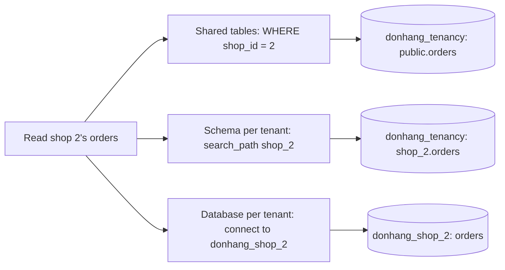

## Bạn cần biết trước

- [[backend.l3.multi-tenancy]] — bạn biết tenant là một cửa hàng dùng hệ thống chung, và chỉ một truy vấn quên cửa hàng là phá vỡ cách ly.
- [[backend.l2.composite-indexes]] — bạn biết index trên hai cột được sắp theo cột đầu, nên nó chỉ thu hẹp được những tìm kiếm có nêu cột đầu.
- [[design.l3.module-owns-its-tables]] — bạn biết hai phần của Đơn Hàng có thể sở hữu các bảng riêng mà vẫn dùng chung một database PostgreSQL.

## Tình huống

Chủ một cửa hàng thứ hai vừa đăng ký và muốn nhận đơn từ tuần sau, còn bạn phải quyết định đơn của họ sẽ nằm ở đâu. Bạn có thể thêm dòng của họ vào cùng bảng `orders` với cửa hàng thứ nhất. Bạn có thể cho họ một bộ bảng riêng, đặt cạnh bộ bảng của cửa hàng thứ nhất, trong cùng database. Hoặc bạn cho họ hẳn một database riêng. Cách nào cũng có vẻ ổn vào ngày quyết định. Nhưng mỗi cách làm thay đổi hậu quả của một bộ lọc bị quên, số lần một migration phải chạy, và số kết nối mà api mở ra.

Ranh giới giữa dữ liệu của cửa hàng này và cửa hàng kế tiếp nên nằm ở đâu, và mỗi chỗ đặt tốn những gì?

## Khái niệm cốt lõi

- **bảng dùng chung (multi-tenancy)** (shared tables) — dòng của mọi tenant nằm trong cùng các bảng, và mỗi dòng có một cột, ở đây là `shop_id`, cho biết dòng đó thuộc tenant nào.
- **mỗi tenant một schema** (schema per tenant) — mỗi tenant có schema riêng, tức một nhóm bảng có tên nằm trong một database dùng chung (khác nghĩa với "thay đổi schema" của migration), nên `shop_1.orders` và `shop_2.orders` là hai bảng khác nhau.
- **mỗi tenant một database** (database per tenant) — mỗi tenant có database riêng trên server. Code giống nhau cho mọi tenant, nhưng không có bảng nào dùng chung.

## Cơ chế hoạt động

Ở stage-3, database của chính Đơn Hàng vẫn chỉ phục vụ một cửa hàng. Module này dựng các database thực hành thay vào đó: `donhang_tenancy` chứa hai cách bố trí đầu, còn `donhang_shop_1` và `donhang_shop_2` chứa cách thứ ba. Cả ba đều chứa cùng những đơn hàng, chia theo cửa hàng.



Mỗi nhánh trả lời cùng một câu hỏi, "dòng nào là của cửa hàng 2", nhưng ở một chỗ khác nhau.

Với bảng dùng chung, câu trả lời nằm trong từng truy vấn. Dòng của cả hai cửa hàng nằm trong một bảng `orders`, tức `public.orders`: `public` là schema mà mọi database PostgreSQL mới đều có sẵn, và bảng tạo ra không kèm tên schema sẽ nằm ở đó. Mệnh đề `WHERE shop_id = 2` chọn ra dòng của cửa hàng 2. Đó là lý do `shop_id` đứng đầu trong các khóa và index của bảng: khi đó truy vấn cho một cửa hàng chỉ đọc phần index của cửa hàng đó.

Với mỗi tenant một schema, câu trả lời nằm trong một thiết lập của kết nối. Thiết lập `search_path` là danh sách các schema mà PostgreSQL lần lượt tìm khi gặp một tên bảng không kèm schema. `SET` chỉ đổi nó cho kết nối hiện tại. Sau `SET search_path TO shop_2`, cái tên trần `orders` nghĩa là `shop_2.orders`, nên bản thân truy vấn không nêu cửa hàng nào.

Với mỗi tenant một database, câu trả lời nằm ở database mà kết nối mở ra. Một kết nối PostgreSQL mở tới đúng một database, và truy vấn không đọc được bảng của database khác. Muốn đọc cửa hàng 2 thì phải kết nối tới `donhang_shop_2`.

Đi dần xuống sơ đồ, ranh giới giữa các cửa hàng chuyển từ một mệnh đề trong mỗi truy vấn thành cả một database. Sự cách ly mạnh dần lên, và phần việc bạn phải lặp lại cho từng cửa hàng cũng nhiều dần lên.

## Trong hệ thống Đơn Hàng

Cách bố trí bảng dùng chung, trích từ file dựng nó:

```sql file=db/tenancy/shared-schema.sql tag=stage-3 lines=9-29
-- lesson: backend.l3.tenant-isolation-models
-- shop_id comes first in every key and index: a query for one shop reads
-- only that shop's part of each index, each shop numbers its own rows from
-- 1, and an order can only point at a customer of the same shop.
CREATE TABLE customers (
    shop_id   integer NOT NULL REFERENCES shops (id),
    id        integer NOT NULL,
    full_name text    NOT NULL,
    PRIMARY KEY (shop_id, id)
);

CREATE TABLE orders (
    shop_id     integer     NOT NULL REFERENCES shops (id),
    id          integer     NOT NULL,
    customer_id integer     NOT NULL,
    placed_at   timestamptz NOT NULL,
    status      text        NOT NULL,
    PRIMARY KEY (shop_id, id),
    FOREIGN KEY (shop_id, customer_id) REFERENCES customers (shop_id, id)
);
CREATE INDEX orders_shop_id_customer_id ON orders (shop_id, customer_id);
```

`shops` là bảng có một dòng cho mỗi cửa hàng. Hãy nhìn ba chỗ `shop_id` đứng đầu. Khóa chính `(shop_id, id)` cho phép mỗi cửa hàng tự đánh số đơn từ 1. Dòng `FOREIGN KEY (shop_id, customer_id)` ghép `customer_id` với chính `shop_id` của đơn, nên đơn của cửa hàng 2 chỉ trỏ được tới khách của cửa hàng 2. Dòng `CREATE INDEX` phục vụ truy vấn đơn của một khách trong một cửa hàng. `db/tenancy/schema-per-shop.sql`, không trích ở đây, tạo hai schema `shop_1` và `shop_2`, mỗi schema có một bảng `orders` không có cột `shop_id`.

Script đọc đơn của cửa hàng 2 trong từng cách bố trí. Hàm `sql` của nó, định nghĩa phía trên đoạn trích, chạy `psql`, client dòng lệnh của PostgreSQL, trên server thực hành. `--dbname` cho biết kết nối mở tới database nào:

```bash file=scripts/backend/tenancy-models.sh tag=stage-3 lines=15-28
# lesson: backend.l3.tenant-isolation-models
echo "== shared tables: every query names its shop"
sql --dbname donhang_tenancy --command \
  "SELECT id, customer_id, status FROM orders WHERE shop_id = 2 ORDER BY id"
echo "== a schema per shop: search_path picks the shop"
sql --dbname donhang_tenancy --command "SET search_path TO shop_2" --command \
  "SELECT id, customer_id, status FROM orders ORDER BY id"
echo "== a database per shop: the connection picks the shop"
sql --dbname donhang_shop_2 --command \
  "SELECT id, customer_id, status FROM orders ORDER BY id"

echo "== one query over two shops' databases"
sql --dbname donhang_shop_1 --command \
  "SELECT count(*) FROM orders JOIN donhang_shop_2.public.orders AS other USING (id)" || true
```

```text output=true
== shared tables: every query names its shop
SELECT id, customer_id, status FROM orders WHERE shop_id = 2 ORDER BY id
 id | customer_id | status
----+-------------+--------
  1 |           1 | paid
  2 |           2 | new
...
== one query over two shops' databases
SELECT count(*) FROM orders JOIN donhang_shop_2.public.orders AS other USING (id)
ERROR:  cross-database references are not implemented: "donhang_shop_2.public.orders"
...
== add a gift_note column to the orders of every shop
shared tables, 1 ALTER TABLE:
  donhang_tenancy: ALTER TABLE public.orders ADD COLUMN gift_note text
a schema per shop, 1 ALTER TABLE per shop:
  donhang_tenancy: ALTER TABLE shop_1.orders ADD COLUMN gift_note text
  donhang_tenancy: ALTER TABLE shop_2.orders ADD COLUMN gift_note text
a database per shop, 1 ALTER TABLE per shop:
  donhang_shop_1: ALTER TABLE orders ADD COLUMN gift_note text
  donhang_shop_2: ALTER TABLE orders ADD COLUMN gift_note text
```

Ba lần đọc trả về cùng hai đơn, dấu `...` đầu tiên che hai bản lặp còn lại. Truy vấn cuối nối đơn của cửa hàng 1 với đơn của cửa hàng 2 qua hai database, và PostgreSQL từ chối. `|| true` giúp script chạy tiếp sau lỗi đã biết trước này. Từ giờ, một báo cáo trên mọi cửa hàng cần mỗi database một truy vấn. Phần còn lại của script, nằm ngoài đoạn trích, thêm cột `gift_note` vào từng cách bố trí bên trong một giao dịch rồi rollback nó. Bảng dùng chung chỉ cần một `ALTER TABLE`. Hai cách còn lại cần mỗi cửa hàng một lệnh, tức một trăm lệnh cho một trăm cửa hàng.

Chi phí tăng theo cùng kiểu đó, không chỉ ở migration. Database của mỗi cửa hàng cần kết nối riêng, các phép kiểm tra monitoring riêng, và một mục riêng trong mọi script đụng tới tất cả cửa hàng. Đổi lại, mỗi cửa hàng một database giữ bảng của cửa hàng này ngoài tầm với của truy vấn gửi tới database của cửa hàng khác, và cho phép bạn backup riêng từng cửa hàng.

Các cách bố trí có thể dùng kết hợp. Khi một cửa hàng lớn hơn hẳn phần còn lại, nó có thể có database riêng trong khi các cửa hàng nhỏ vẫn dùng chung bảng, và api chọn kết nối theo cửa hàng.

## Senior hay nhầm rằng…

- **"Mỗi cửa hàng một schema cách ly các cửa hàng mạnh ngang mỗi cửa hàng một database."** → Thực ra mọi schema đều nằm trong một database, và một tên có kèm schema như `shop_1.orders` luôn đọc schema đó, bất kể `search_path` đang là gì. Một kết nối không bao giờ đặt `search_path` cũng không báo lỗi: đường tìm mặc định kết thúc bằng `public`, nên trong `donhang_tenancy` nó đọc `public.orders`, chính bảng dùng chung chứa dòng của mọi cửa hàng. Mỗi cửa hàng một database loại bỏ cả hai sai sót này, vì truy vấn không đọc được bảng của database khác. Bạn sẽ nhận ra khi một báo cáo viết bằng `shop_1.orders` trả về dòng của cửa hàng 1 trên một kết nối đã đặt sang `shop_2`.
- **"Mỗi cửa hàng một database luôn an toàn nhất, nên nó phải là mặc định."** → Thực ra đó là mức cách ly mạnh nhất nhưng cũng tốn chi phí vận hành cao nhất: mọi migration, bộ kết nối và phép kiểm tra monitoring đều lặp lại theo từng cửa hàng. Khi có nhiều cửa hàng nhỏ, sự lặp lại đó là nguồn sự cố thường gặp. Nó là lựa chọn đúng khi hợp đồng buộc phải tách riêng một cửa hàng, hoặc khi có ít cửa hàng và cửa hàng nào cũng lớn. Bạn sẽ nhận ra cái giá khi một migration đã chạy trên database của vài cửa hàng nhưng chưa chạy trên các cửa hàng khác, và api gặp hai phiên bản của `orders`.
- **"Bảng dùng chung chỉ cần thêm cột `shop_id`, các khóa và index cũ cứ giữ nguyên."** → Thực ra khóa chỉ trên `id` ép mọi cửa hàng dùng chung một dãy số, còn khóa ngoại chỉ trên `customer_id` cho phép một đơn trỏ tới khách của cửa hàng khác. Index không bắt đầu bằng `shop_id` thì không thu hẹp được tìm kiếm về một cửa hàng. Bạn sẽ nhận ra khi một đơn của cửa hàng 2 hiện tên khách của cửa hàng 1.

## Thử ngay (3 phút)

1. Khi hệ thống ví dụ đang chạy (`scripts/up.sh`), chạy `scripts/backend/tenancy-models.sh` từ thư mục gốc của repository. Nếu chưa có `donhang_tenancy`, script sẽ dựng các database thực hành trước.
2. So ba bảng kết quả ở đầu, rồi đếm các dòng `ALTER TABLE` ở cuối.

Kết quả mong đợi: cùng hai đơn của cửa hàng 2 xuất hiện ba lần, sau đó là lỗi `cross-database references are not implemented`, rồi một dòng `ALTER TABLE` cho bảng dùng chung và hai dòng cho mỗi cách bố trí còn lại.

## Liên hệ

- [[backend.l3.multi-tenancy]] — vấn đề mà bài này đặt vào database: dòng nào thuộc cửa hàng nào.
- [[backend.l3.row-level-security]] — bài kế tiếp: với bảng dùng chung, chính PostgreSQL có thể thêm điều kiện cửa hàng vào các truy vấn, nên một mệnh đề bị quên không nhất thiết làm lộ dòng.
- [[backend.l3.payments-service]] — cùng kiểu tách nhưng vì lý do khác: `DonHang.Payments` có database riêng, `donhang_payments`, trên cùng server.
- [[backend.l1.migrations]] — một migration là gì. Với mỗi cửa hàng một schema hay một database, bạn chạy nó một lần cho mỗi cửa hàng.
- [[design.l3.module-owns-its-tables]] — điểm xuất phát ngược lại: các module sở hữu bảng riêng nhưng dùng chung một database.

## Tóm tắt 5 dòng

1. Có thể tách các cửa hàng bằng một cột trong bảng dùng chung, mỗi cửa hàng một schema, hoặc mỗi cửa hàng một database, mỗi bước cách ly mạnh hơn.
2. Với bảng dùng chung, `shop_id` đứng đầu mọi khóa và index, nên tìm kiếm nằm gọn trong một cửa hàng và đơn không tham chiếu được khách của cửa hàng khác.
3. Với mỗi cửa hàng một schema, `search_path` chọn bảng của cửa hàng, nhưng tên có kèm schema hay đường tìm chưa đặt vẫn chạm tới dòng của cửa hàng khác.
4. Với mỗi cửa hàng một database, kết nối chọn cửa hàng, và PostgreSQL từ chối truy vấn nêu tên bảng ở database khác.
5. Mỗi bước tiến tới database riêng lặp lại migration, kết nối và monitoring theo từng cửa hàng, nên cửa hàng lớn có thể có database riêng còn cửa hàng nhỏ dùng chung.
