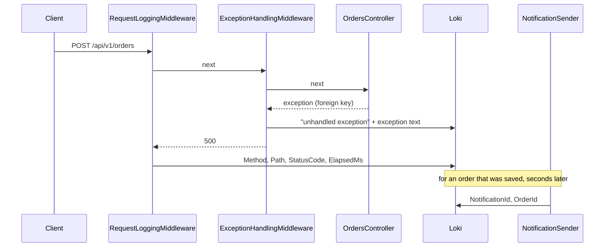

## Before you start

- [[devops.l2.centralized-logs]] — you know that Alloy sends every line the api writes to Loki, and that `| json` lets a LogQL query filter on a line's fields.
- [[devops.l2.grafana-dashboards]] — you know the `Đơn Hàng API` dashboard, whose panels count requests, `5xx` per second and response time across all requests.
- [[backend.l2.database-job-queue]] — you know that an order's email is a `notifications` row that `NotificationSender` sends a few seconds after the request has answered.
- [[backend.l3.choreography-vs-orchestration]] — you know that one refund runs through `DonHang.Api`, RabbitMQ, Payments and Notifications, and that no single file lists its steps.

## The situation

A customer writes that checkout failed with an error a minute ago. You open Grafana. The `5xx` panel shows failures in that minute, but only as a rate. In Loki you find two lines `POST /api/v1/orders responded 500` and two lines `unhandled exception`, all within a second. The request lines hold no customer and no order, and the exception lines hold no path. In the same minute another customer's order went through, and a few seconds later the email sender logged a line for it that names its order but no request.

Which of these lines belong to this customer's request, and what would the system have to send out for you to know?

## Core concepts

- **observability** — how well you can tell what happened inside a running system from the data it sends out, including for questions nobody planned for when the code was written.
- **telemetry** — the data a program sends out about its own work: in Đơn Hàng at `stage-2`, the log lines in Loki and the metrics in Prometheus.
- metric — a number counted or measured across many requests, such as the `5xx` rate; it says how many and how fast, never which one.
- log line — one record of one event, with the fields its log call chose to write; another line is linked to it only through a field they share.

## How it works



Suppose the failing checkout above was an order for a product that does not exist. The client posts it through `RequestLoggingMiddleware` and `ExceptionHandlingMiddleware` to `OrdersController`, whose call to save the order breaks a foreign key, so an exception comes back out of it. `ExceptionHandlingMiddleware` catches it and writes its line first, with the exception text but no method or path. It answers `500`, and `RequestLoggingMiddleware`, which wraps it, writes the second line, with method, path, status code and time taken. A successful request saves its order instead, and seconds later `NotificationSender` writes a line with a notification id and an order id.

All of this is telemetry, and none of it is wrong. The `5xx` panel counts failures across every request: roughly how often, not which order.

The gap is between lines. Among the lines Đơn Hàng's own code writes, a failed request leaves a request line and an exception line; a successful one leaves a request line and an email line. In either pair, no field names the request, so only the time Loki stores with each line links them. With one request a minute, that is enough. Two requests in the same second can run at once, so their lines can reach Loki mixed, and pairing by time is a guess.

Observability names that gap. A system is observable when its telemetry lets you answer a question about one request that no panel or log call was written to answer. Đơn Hàng at `stage-2` is only partly observable: you can count failures, but not follow one.

The saga lessons' refund is worse: it crosses `DonHang.Api`, RabbitMQ, `DonHang.Payments` and `DonHang.Notifications`, each adding lines to match by time. This module adds a third kind of telemetry that follows one request across all of them.

## In the Đơn Hàng system

The line every request leaves:

```csharp file=DonHang.Api/Middleware/RequestLoggingMiddleware.cs tag=stage-2 lines=11-23
    public async Task InvokeAsync(HttpContext context)
    {
        var stopwatch = Stopwatch.StartNew();
        await next(context);
        stopwatch.Stop();

        logger.LogInformation(
            "{Method} {Path} responded {StatusCode} in {ElapsedMs}ms",
            context.Request.Method,
            context.Request.Path,
            context.Response.StatusCode,
            stopwatch.ElapsedMilliseconds);
    }
```

It logs only after `await next(context)` returns, which is why its line comes after the exception line. The first argument to `LogInformation` is the message template, the string with `{Name}` placeholders; each placeholder becomes a named field under the line's `State` object. The values this call chooses are exactly those four: `Method`, `Path`, `StatusCode` and `ElapsedMs`. The rest of the line, such as `LogLevel`, `Category` and `Message`, is what every log call gets: `Category` names the class whose logger wrote the line, and `Message` is the template with the values filled in.

For `POST /api/v1/orders` the path holds no order id, because the order does not exist until the request creates it. Nothing in this call names the customer or the order.

The line the email sender leaves:

```csharp file=DonHang.Api/Jobs/NotificationSender.cs tag=stage-2 lines=67-76
        try
        {
            var customer = notification.Order!.Customer!;
            await email.SendAsync(customer.Email, $"Order {notification.OrderId}: {notification.Subject}",
                $"Hello {customer.FullName}, this is about your order {notification.OrderId}: {notification.Subject}.",
                stoppingToken);
            notification.Status = "sent";
            notification.SentAt = DateTimeOffset.UtcNow;
            logger.LogInformation("Sent notification {NotificationId} for order {OrderId}", notification.Id, notification.OrderId);
        }
```

This line has `NotificationId` and `OrderId`, and no `Method` or `Path`. The request line has the opposite. The two share no field that names the request or the order, so only their times say that one came from the other.

The third line comes from the last `catch` in `ExceptionHandlingMiddleware`, outside these excerpts: `logger.LogError(ex, "unhandled exception")`. Its message names no method and no path. Its exception text describes the failure, but nothing in the line says which request it came from.

## Seniors often assume…

- **"Observability is a new name for monitoring: it just means more dashboards."** → Actually monitoring, as the dashboard lessons use it, watches answers you decided in advance, such as the `5xx` rate. Observability asks whether the telemetry can answer a question you did not plan for, such as what happened to this customer's order. More panels add more planned answers. You notice this when the dashboard shows the failure clearly and still cannot tell you whose it was.
- **"With enough log lines I can always rebuild what happened to one order."** → Actually lines connect only through fields they share, and each log call picks its fields alone. Adding lines without a shared field adds more lines to match by hand. You notice this when the request line and the email line for one order sit next to each other in Loki and nothing in either names the other.
- **"Searching Loki for the order id finds every line about that order."** → Actually only lines whose log call wrote the order id carry it. The `POST /api/v1/orders` line and the `unhandled exception` line do not. You notice this when a search for an order returns its email line but not the request that created it.
- **"Matching log lines by their timestamps is precise enough to follow one request."** → Actually time links lines only while requests do not overlap. Two failures in the same second give you two request lines and two exception lines, and nothing to pair them. You notice this when two people point at the same `500` line as the cause of two different reports.

## Try it (3 minutes)

With the monitoring services started (`docker compose --profile monitoring up -d`), from the root folder of the example repository:

1. Run `scripts/devops/loki-query.sh`. It posts an order for product 999, gets `500`, and prints the request line from Loki.
2. Open Explore, Grafana's page for running one query against a data source without a dashboard. Choose the `Loki` data source and switch the query editor from `Builder` to `Code`, the mode where you type a LogQL query as text. Run `{service="api"} | json | Message = "unhandled exception"` and open the newest line.
3. Look for a field that says which request this line belongs to.

Expected result: the script prints `-> 500` and a line whose `Message` is `POST /api/v1/orders responded 500 in ...ms`. The newest `unhandled exception` line has `LogLevel` `Error`, `Category` ending in `ExceptionHandlingMiddleware` and `Message` `unhandled exception`, plus the exception text. None of its fields holds the method or the path.

<details><summary>Suggested answer</summary>

Nothing in the exception line names the request. You link the two lines only because their times are a few milliseconds apart and you ran one request. Run the script twice at the same moment in two terminals, and you can no longer tell which exception line goes with which request line.

</details>

## Connections

- [[devops.l2.why-monitoring]] — the planned questions monitoring answers; this lesson is about the questions it cannot.
- [[backend.l1.structured-logging]] — the reason each line has named fields; observability depends on which fields lines share.
- [[backend.l1.exception-handling-middleware]] — the source of the `unhandled exception` line, seen here from the reader's side.
- [[backend.l3.traces-and-spans]] — the third kind of telemetry this module adds: one record that follows a request across services.

## Five-line summary

1. Observability is how well you can tell what happened inside a running system from its telemetry, including for questions nobody planned.
2. Telemetry is what a program sends out about its own work; at `stage-2` Đơn Hàng sends log lines and metrics.
3. Metrics such as the `5xx` rate count across all requests and cannot say what happened to one order.
4. The request line, the exception line and the email line share no field that identifies the request, so only their times link them.
5. Matching by time breaks when requests overlap and gets harder with every service, as in the refund.
