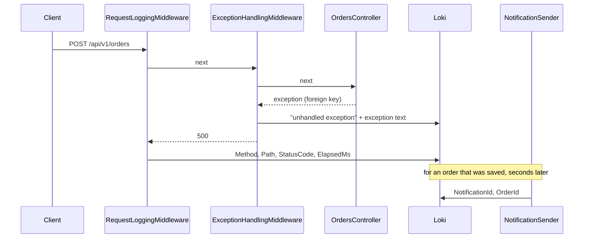

## Bạn cần biết trước

- [[devops.l2.centralized-logs]] — bạn biết rằng Alloy gửi mọi dòng api ghi ra tới Loki, và `| json` cho phép một câu truy vấn LogQL lọc theo các trường của dòng.
- [[devops.l2.grafana-dashboards]] — bạn biết dashboard `Đơn Hàng API`, với các panel đếm request, số `5xx` mỗi giây và thời gian phản hồi trên mọi request.
- [[backend.l2.database-job-queue]] — bạn biết rằng email của một đơn hàng là một dòng trong `notifications`, được `NotificationSender` gửi đi vài giây sau khi request đã trả lời.
- [[backend.l3.choreography-vs-orchestration]] — bạn biết rằng một lần hoàn tiền chạy qua `DonHang.Api`, RabbitMQ, Payments và Notifications, và không file nào liệt kê đủ các bước của nó.

## Tình huống

Một khách hàng nhắn rằng thanh toán vừa báo lỗi cách đây một phút. Bạn mở Grafana. Panel `5xx` có lỗi trong phút đó, nhưng chỉ dưới dạng một tỉ lệ. Trong Loki, bạn thấy hai dòng `POST /api/v1/orders responded 500` và hai dòng `unhandled exception`, tất cả trong cùng một giây. Các dòng request không có khách hàng hay đơn hàng nào, còn các dòng exception không có path. Cũng trong phút đó, đơn của một khách khác đã đặt thành công, và vài giây sau bộ gửi email ghi một dòng cho đơn ấy, có tên đơn nhưng không có request nào.

Dòng nào trong số này thuộc về request của khách hàng kia, và hệ thống phải gửi ra những gì thì bạn mới biết được?

## Khái niệm cốt lõi

- **observability** (mức độ có thể biết chuyện gì đã xảy ra bên trong hệ thống đang chạy chỉ từ dữ liệu nó gửi ra) — bạn biết được tới đâu chuyện gì đã xảy ra bên trong một hệ thống đang chạy, chỉ từ dữ liệu nó gửi ra, kể cả với những câu hỏi không ai tính tới lúc viết code.
- **telemetry** (dữ liệu một chương trình gửi ra về chính công việc của nó: log, metric và trace) — dữ liệu một chương trình gửi ra về chính công việc của nó: trong Đơn Hàng ở `stage-2`, đó là các dòng log trong Loki và các metric trong Prometheus.
- metric — một con số được đếm hoặc đo trên nhiều request, như tỉ lệ `5xx`. Nó cho biết bao nhiêu và nhanh tới đâu, không bao giờ cho biết request nào.
- dòng log — bản ghi của một sự kiện, với các trường mà lời gọi log của nó chọn ghi. Một dòng khác chỉ nối được với nó qua một trường cả hai cùng có.

## Cơ chế hoạt động



Giả sử lần thanh toán lỗi ở trên là một đơn đặt sản phẩm không tồn tại. Client gửi đơn qua `RequestLoggingMiddleware` và `ExceptionHandlingMiddleware` tới `OrdersController`. Lệnh lưu đơn trong controller này vi phạm một khóa ngoại, nên một exception bị ném ngược ra. `ExceptionHandlingMiddleware` bắt nó và ghi dòng của mình trước, có nội dung exception nhưng không có method hay path. Nó trả `500`, rồi `RequestLoggingMiddleware`, lớp bọc bên ngoài, ghi dòng thứ hai với method, path, status code và thời gian xử lý. Một request thành công thì lưu được đơn, và vài giây sau `NotificationSender` ghi một dòng có id thông báo và id đơn hàng.

Tất cả đều là telemetry, và không dòng nào sai. Panel `5xx` đếm lỗi trên mọi request: nó cho biết lỗi xảy ra thường tới đâu, không cho biết đơn nào.

Chỗ hổng nằm giữa các dòng. Trong số các dòng do chính code Đơn Hàng ghi, một request lỗi để lại một dòng request và một dòng exception, còn một request thành công để lại một dòng request và một dòng email. Ở cả hai cặp, không trường nào gọi tên request, nên chỉ có thời điểm Loki lưu kèm mỗi dòng nối được chúng với nhau. Khi mỗi phút chỉ có một request, vậy là đủ. Hai request trong cùng một giây có thể chạy song song, nên các dòng của chúng có thể tới Loki xen lẫn nhau, và ghép theo thời gian chỉ còn là đoán.

Observability gọi tên chính chỗ hổng đó. Một hệ thống có observability khi telemetry của nó giúp bạn trả lời được một câu hỏi về một request mà không panel hay lời gọi log nào được viết ra để trả lời. Đơn Hàng ở `stage-2` mới có observability một phần: bạn đếm được lỗi, nhưng không lần theo được một lỗi cụ thể.

Lần hoàn tiền trong các bài về saga còn tệ hơn: nó đi qua `DonHang.Api`, RabbitMQ, `DonHang.Payments` và `DonHang.Notifications`, nơi nào cũng thêm các dòng phải ghép theo thời gian. Module này bổ sung loại telemetry thứ ba, lần theo một request qua tất cả các nơi đó.

## Trong hệ thống Đơn Hàng

Dòng mà mọi request đều để lại:

```csharp file=DonHang.Api/Middleware/RequestLoggingMiddleware.cs tag=stage-2 lines=11-23
    public async Task InvokeAsync(HttpContext context)
    {
        var stopwatch = Stopwatch.StartNew();
        await next(context);
        stopwatch.Stop();

        logger.LogInformation(
            "{Method} {Path} responded {StatusCode} in {ElapsedMs}ms",
            context.Request.Method,
            context.Request.Path,
            context.Response.StatusCode,
            stopwatch.ElapsedMilliseconds);
    }
```

Nó chỉ ghi log sau khi `await next(context)` trả về, nên dòng của nó đến sau dòng exception. Tham số đầu tiên của `LogInformation` là message template, tức chuỗi có các chỗ trống dạng `{Name}`. Mỗi chỗ trống trở thành một trường có tên nằm trong object `State` của dòng. Lời gọi này chọn đúng bốn giá trị: `Method`, `Path`, `StatusCode` và `ElapsedMs`. Phần còn lại của dòng, như `LogLevel`, `Category` và `Message`, là thứ lời gọi log nào cũng có: `Category` là tên class có logger đã ghi dòng, còn `Message` là template đã điền giá trị.

Với `POST /api/v1/orders`, path không chứa id đơn hàng, vì đơn chưa tồn tại cho tới khi request tạo ra nó. Không gì trong lời gọi này gọi tên khách hàng hay đơn hàng.

Dòng mà bộ gửi email để lại:

```csharp file=DonHang.Api/Jobs/NotificationSender.cs tag=stage-2 lines=67-76
        try
        {
            var customer = notification.Order!.Customer!;
            await email.SendAsync(customer.Email, $"Order {notification.OrderId}: {notification.Subject}",
                $"Hello {customer.FullName}, this is about your order {notification.OrderId}: {notification.Subject}.",
                stoppingToken);
            notification.Status = "sent";
            notification.SentAt = DateTimeOffset.UtcNow;
            logger.LogInformation("Sent notification {NotificationId} for order {OrderId}", notification.Id, notification.OrderId);
        }
```

Dòng này có `NotificationId` và `OrderId`, không có `Method` hay `Path`. Dòng request thì ngược lại. Hai dòng không có chung trường nào gọi tên request hay đơn hàng, nên chỉ thời điểm của chúng cho biết dòng này sinh ra từ dòng kia.

Dòng thứ ba đến từ khối `catch` cuối cùng trong `ExceptionHandlingMiddleware`, nằm ngoài các đoạn trích trên: `logger.LogError(ex, "unhandled exception")`. Message của nó không có method hay path. Nội dung exception mô tả lỗi, nhưng không gì trong dòng cho biết nó đến từ request nào.

## Senior hay nhầm rằng…

- **"Observability chỉ là tên mới của monitoring: nghĩa là thêm dashboard."** → Thực ra monitoring, theo nghĩa trong các bài về dashboard, theo dõi những câu trả lời bạn đã định sẵn, như tỉ lệ `5xx`. Observability hỏi xem telemetry có trả lời được câu hỏi bạn không lường trước hay không, như chuyện gì đã xảy ra với đơn của khách hàng này. Thêm panel chỉ thêm câu trả lời định sẵn. Bạn sẽ nhận ra khi dashboard thấy rõ lỗi mà vẫn không cho biết lỗi đó của ai.
- **"Có đủ dòng log thì lúc nào cũng dựng lại được chuyện đã xảy ra với một đơn hàng."** → Thực ra các dòng chỉ nối với nhau qua trường chung, mà mỗi lời gọi log tự chọn trường của mình. Thêm dòng mà không có trường chung chỉ thêm dòng phải ghép bằng tay. Bạn sẽ nhận ra khi dòng request và dòng email của cùng một đơn nằm sát nhau trong Loki mà không dòng nào gọi tên dòng kia.
- **"Tìm id đơn hàng trong Loki là ra mọi dòng về đơn đó."** → Thực ra chỉ dòng nào có lời gọi log ghi id đơn hàng mới mang nó. Dòng `POST /api/v1/orders` và dòng `unhandled exception` thì không. Bạn sẽ nhận ra khi tìm một đơn hàng ra được dòng email của nó nhưng không ra request đã tạo nó.
- **"Ghép các dòng log theo timestamp là đủ chính xác để lần theo một request."** → Thực ra thời gian chỉ nối được các dòng khi các request không chồng lên nhau. Hai lỗi trong cùng một giây cho bạn hai dòng request, hai dòng exception, và không có gì để ghép cặp. Bạn sẽ nhận ra khi hai người cùng chỉ vào một dòng `500` làm nguyên nhân của hai báo lỗi khác nhau.

## Thử ngay (3 phút)

Khi các service monitoring đã chạy (`docker compose --profile monitoring up -d`), từ thư mục gốc của repo ví dụ:

1. Chạy `scripts/devops/loki-query.sh`. Script gửi một đơn hàng cho sản phẩm 999, nhận `500`, rồi in dòng request lấy từ Loki.
2. Mở Explore, trang của Grafana để chạy một câu truy vấn trên một data source mà không cần dashboard. Chọn data source `Loki` và chuyển trình soạn truy vấn từ `Builder` sang `Code`, chế độ gõ câu truy vấn LogQL dạng văn bản. Chạy `{service="api"} | json | Message = "unhandled exception"` rồi mở dòng mới nhất.
3. Tìm một trường cho biết dòng này thuộc về request nào.

Kết quả mong đợi: script in `-> 500` và một dòng có `Message` là `POST /api/v1/orders responded 500 in ...ms`. Dòng `unhandled exception` mới nhất có `LogLevel` `Error`, `Category` kết thúc bằng `ExceptionHandlingMiddleware` và `Message` `unhandled exception`, kèm nội dung exception. Không trường nào của nó chứa method hay path.

<details><summary>Gợi ý đáp án</summary>

Không gì trong dòng exception gọi tên request. Bạn nối hai dòng chỉ vì thời điểm của chúng cách nhau vài mili giây và bạn chỉ chạy một request. Chạy script hai lần cùng lúc ở hai terminal, bạn sẽ không còn biết dòng exception nào đi với dòng request nào.

</details>

## Liên hệ

- [[devops.l2.why-monitoring]] — những câu hỏi định sẵn mà monitoring trả lời, còn bài này nói về những câu nó không trả lời được.
- [[backend.l1.structured-logging]] — lý do mỗi dòng có các trường có tên. Observability phụ thuộc vào việc các dòng có chung những trường nào.
- [[backend.l1.exception-handling-middleware]] — nguồn của dòng `unhandled exception`, ở đây nhìn từ phía người đọc log.
- [[backend.l3.traces-and-spans]] — loại telemetry thứ ba mà module này bổ sung: một bản ghi lần theo request qua các service.

## Tóm tắt 5 dòng

1. Observability là mức độ bạn biết được chuyện gì đã xảy ra bên trong hệ thống đang chạy từ telemetry của nó, kể cả với câu hỏi không ai lường trước.
2. Telemetry là những gì một chương trình gửi ra về chính công việc của nó. Ở `stage-2`, Đơn Hàng gửi dòng log và metric.
3. Metric như tỉ lệ `5xx` đếm trên mọi request và không cho biết chuyện gì đã xảy ra với một đơn hàng.
4. Dòng request, dòng exception và dòng email không có chung trường nào xác định request, nên chỉ thời điểm nối được chúng.
5. Ghép theo thời gian hỏng khi các request chồng lên nhau, và càng khó khi có thêm service, như lần hoàn tiền.
