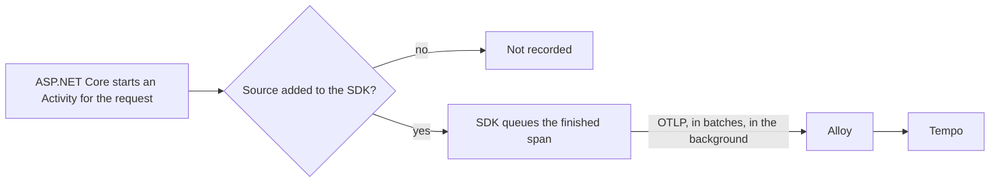

## Before you start

- [[backend.l3.traces-and-spans]] — you know that the refund's trace is a tree of spans from four services, stored in Tempo by trace id.
- [[devops.l2.centralized-logs]] — you know Alloy, the lab's container that gathers telemetry and passes it on; it already sends every container's log lines to Loki.
- [[backend.l1.hosting-and-program-cs]] — you know that `Program.cs` registers services on `builder.Services` before `Build()` and `Run()`.

## The situation

The refund trace from the previous lesson showed a span for the request, one for each SQL command and one for the call to the gateway. You open `OrdersController` to see where the request span starts. Nothing in it starts or stops anything. `OrderService` and the EF Core code have no such lines either.

Yet the spans exist, with the right names and times, and they reached Tempo, a container the api never mentions by name.

Who records these spans, and how do they leave each service?

## Core concepts

- **OpenTelemetry** — an open standard with libraries for producing telemetry: an API that code calls, an SDK that collects spans and, through its exporter, sends them on, and OTLP, the protocol for sending the data on.
- `Activity` and `ActivitySource` — in .NET a span is a `System.Diagnostics.Activity`, started from an `ActivitySource`; the OpenTelemetry SDK records only activities from the sources it has been told to listen to. In .NET these two types play the part of that API, so libraries call them, not an OpenTelemetry package.
- **instrumentation** — code that creates spans for a library, so the code that uses the library need not; in the situation above, the ASP.NET Core instrumentation is why the request became a recorded span.
- **OTLP (OpenTelemetry Protocol)** — OpenTelemetry's protocol for sending telemetry from a program to a receiver; in Đơn Hàng, every service sends its spans over it to Alloy.

## How it works



In the situation above, the request span starts when the request reaches `DonHang.Api`. No controller code starts it. ASP.NET Core does: it starts an `Activity` when the request arrives and stops it when the response is sent, and the ASP.NET Core instrumentation makes the SDK record it. `HttpClient` does the same for each outgoing call, and so does Npgsql, the library EF Core uses to send SQL to PostgreSQL, for each SQL command; each has its own instrumentation.

Each of these activities comes from an `ActivitySource` with a name. The SDK listens only to the sources added to it at startup. Adding an instrumentation adds its source; Đơn Hàng's own message spans come from a source it adds by name. A library whose source nobody added still runs, but its activities never become spans in Tempo.

When a recorded span ends, the SDK does not send it at once. It puts the span in a queue, and the SDK's OTLP exporter sends the queued spans in batches from a background thread. The request has already been answered by then. If the receiver cannot be reached, spans can be lost, but the request is not delayed or failed.

The exporter sends to one address: Alloy. Alloy forwards the spans to Tempo. The services know nothing about Tempo, so storing traces somewhere else changes Alloy's configuration, not their code.

OpenTelemetry stores and shows nothing: storing and showing traces is the job of Tempo and Grafana.

## In the Đơn Hàng system

The api turns tracing on in `Program.cs`:

```csharp file=DonHang.Api/Program.cs tag=stage-3 lines=93-116
// lesson: backend.l3.opentelemetry-sdk
// From stage-3 the api records spans and sends them on. Instrumentation
// makes them, with no change to controllers: ASP.NET Core for each request
// (except health checks and /metrics, asked for every few seconds), HttpClient
// for each outgoing call, Npgsql for each SQL command; and Đơn Hàng's own
// ActivitySource for messages. The OTLP exporter sends them in batches, in
// the background, to OTEL_EXPORTER_OTLP_ENDPOINT: Alloy, in the lab.
// Metrics stay with prometheus-net (/metrics); logs stay on the console.
// lesson: backend.l3.trace-sampling
// Which traces are kept: a span with a parent follows the parent's decision,
// the sampled flag of the traceparent it came with, so a trace is kept or
// dropped whole. A trace that starts here is kept with the probability
// Telemetry:SampleRatio, 0.1 unless configured; the lab keeps every trace.
var sampleRatio = builder.Configuration.GetValue("Telemetry:SampleRatio", 0.1);
builder.Services.AddOpenTelemetry()
    .ConfigureResource(resource => resource.AddService("donhang-api"))
    .WithTracing(tracing => tracing
        .SetSampler(new ParentBasedSampler(new TraceIdRatioBasedSampler(sampleRatio)))
        .AddAspNetCoreInstrumentation(options => options.Filter = context =>
            !context.Request.Path.StartsWithSegments("/health") && !context.Request.Path.StartsWithSegments("/metrics"))
        .AddHttpClientInstrumentation()
        .AddNpgsql()
        .AddSource(MessageTracing.SourceName)
        .AddOtlpExporter());
```

`AddOpenTelemetry()` registers the SDK like any other service. `AddService("donhang-api")` names the service (here the "resource" means the service the spans come from, not a URL resource), which is the name each span shows in Tempo; Payments and Notifications pass their own names in their own `Program.cs`. Inside `WithTracing`, the three instrumentation calls add the request, outgoing-call and SQL sources; the `Filter` leaves out `/health` and `/metrics`.

`AddSource(MessageTracing.SourceName)` adds Đơn Hàng's own source, defined in `DonHang.Messaging/MessageTracing.cs` outside the excerpt. The comment starting `// lesson: backend.l3.trace-sampling`, the `sampleRatio` line and `SetSampler` decide which traces are kept, which is a later lesson.

`AddOtlpExporter()` names no address. It reads the environment variable `OTEL_EXPORTER_OTLP_ENDPOINT`, which `docker-compose.yml` sets to `http://alloy:4317` for each service. Alloy's side is in its configuration file:

```text file=deploy/monitoring/alloy/config.alloy tag=stage-3 lines=63-79
// ...Alloy groups them into batches...
otelcol.processor.batch "spans" {
  output {
    traces = [otelcol.exporter.otlp.tempo.input]
  }
}

// ...and sends them on to Tempo. Storing traces somewhere else would change
// only this block, not the services.
otelcol.exporter.otlp "tempo" {
  client {
    endpoint = "tempo:4317"
    tls {
      insecure = true
    }
  }
}
```

Above the excerpt, a receiver block listens for OTLP on port `4317` and hands every span to the batch block. The batch block gathers the batches of every service into its own batches, and its `output` hands them to the `tempo` exporter block; `insecure = true` means Alloy talks to Tempo without TLS inside the lab's Docker network. The last block is the only place that names Tempo. To move traces to another store, you change its `endpoint`; no service is rebuilt.

## Seniors often assume…

- **"OpenTelemetry is a product like Grafana that stores traces and shows them."** → Actually OpenTelemetry is a standard and a set of libraries that produce telemetry and send it over OTLP. It stores nothing and has no page. You notice this when you look for an OpenTelemetry container in `docker-compose.yml` and find only Alloy and Tempo receiving the spans.
- **"To get spans, every controller action has to start and stop its own."** → Actually instrumentation creates spans for the libraries the code already uses: ASP.NET Core for requests, `HttpClient` for outgoing calls, Npgsql for SQL. You notice this when the refund trace shows SQL spans although no line of `OrderService` mentions tracing.
- **"Sending spans makes every request wait for Tempo, and fails it when Tempo is down."** → Actually the exporter sends finished spans in batches from a background thread, to Alloy, after the request has been answered. When nothing receives them, spans are lost and requests are answered as usual. You notice this when the lab runs without the monitoring profile: there is no Alloy at all, and the api still answers every request.

## Try it (3 minutes)

With the lab running with the monitoring profile (`docker compose --profile monitoring up -d`), in the root folder of the example repository:

1. Stop the receiver: `docker compose stop alloy`.
2. Ask the api for the product list: `curl -s -o /dev/null -w '%{http_code}\n' http://localhost:8080/api/v1/products`.
3. Start it again: `docker compose start alloy`.

Expected result: step 2 prints `200`, with no error and no wait for Alloy. The api's exporter had nowhere to send the request's spans, and the request did not notice.

## Connections

- [[backend.l3.traces-and-spans]] — the trees this lesson explains the origin of: every span in them was started by instrumentation or by `MessageTracing`.
- [[devops.l2.centralized-logs]] — the same container, Alloy, now receiving a second kind of telemetry next to the log lines it already ships.
- [[devops.l2.metrics-endpoint]] — the contrast: metrics are scraped from `/metrics` by Prometheus, while spans are pushed by each service over OTLP.
- [[backend.l3.payments-service]] — the second service whose `Program.cs` repeats the same setup with its own service name.
- [[backend.l3.trace-context-propagation]] — the next question: how a span in Payments learns the trace id of the api's span.

## Five-line summary

1. OpenTelemetry is a standard with libraries that turn each service's work into spans and send them on over OTLP.
2. In .NET a span is an `Activity` from an `ActivitySource`; the SDK records only sources it has been told about.
3. Instrumentation for ASP.NET Core, `HttpClient` and Npgsql creates spans for requests, outgoing calls and SQL without changes to controllers.
4. At stage-3 each `Program.cs` calls `AddOpenTelemetry()` with its own service name and exports to Alloy, which forwards to Tempo.
5. The exporter sends spans in batches in the background, so requests never wait for Tempo, and a new store changes only Alloy.
