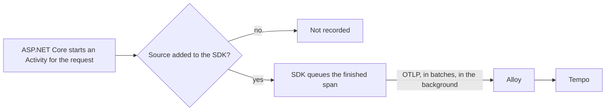

## Bạn cần biết trước

- [[backend.l3.traces-and-spans]] — bạn biết rằng trace của lần hoàn tiền là một cây span từ bốn service, được Tempo lưu theo trace id.
- [[devops.l2.centralized-logs]] — bạn biết Alloy, container của lab chuyên gom telemetry rồi chuyển tiếp đi. Nó vốn đã gửi các dòng log của mọi container tới Loki.
- [[backend.l1.hosting-and-program-cs]] — bạn biết rằng `Program.cs` đăng ký service trên `builder.Services` trước khi gọi `Build()` và `Run()`.

## Tình huống

Trace hoàn tiền ở bài trước có một span cho request, một span cho mỗi câu lệnh SQL và một span cho lời gọi tới cổng thanh toán. Bạn mở `OrdersController` để xem span của request bắt đầu ở đâu. Trong đó không có dòng nào bắt đầu hay kết thúc thứ gì cả. `OrderService` và phần code EF Core cũng không có.

Vậy mà các span vẫn có, đúng tên, đúng thời gian, và chúng đã tới Tempo, một container mà api chưa từng gọi tên.

Ai ghi lại các span này, và chúng rời khỏi mỗi service bằng đường nào?

## Khái niệm cốt lõi

- **OpenTelemetry** (chuẩn mở kèm thư viện để tạo và gửi telemetry: API cho code gọi, SDK thu và xuất, giao thức OTLP) — gồm một API để code gọi, một SDK thu các span rồi gửi đi qua exporter của nó, và OTLP, giao thức dùng để gửi dữ liệu đi.
- `Activity` và `ActivitySource` — trong .NET, một span là một `System.Diagnostics.Activity`, được bắt đầu từ một `ActivitySource`. SDK của OpenTelemetry chỉ ghi lại activity từ những source mà nó đã được dặn lắng nghe. Trong .NET, hai kiểu này đóng vai trò của API nói trên, nên các thư viện gọi chúng chứ không gọi một package OpenTelemetry nào.
- **instrumentation** (code tạo span hoặc số đo cho một thư viện, để code dùng thư viện đó không phải tự viết) — ở tình huống trên, instrumentation của ASP.NET Core là lý do request trở thành một span được ghi lại.
- **OTLP (OpenTelemetry Protocol)** (giao thức của OpenTelemetry để gửi telemetry từ chương trình tới nơi nhận) — trong Đơn Hàng, mọi service gửi span của mình qua giao thức này tới Alloy.

## Cơ chế hoạt động



Trong tình huống trên, span của request bắt đầu khi request tới `DonHang.Api`. Không đoạn code controller nào bắt đầu nó. ASP.NET Core làm việc đó: nó bắt đầu một `Activity` khi request đến và dừng lại khi response được gửi đi, còn instrumentation của ASP.NET Core khiến SDK ghi lại activity đó. `HttpClient` cũng làm như vậy cho mỗi lời gọi đi ra, và Npgsql, thư viện EF Core dùng để gửi SQL tới PostgreSQL, cũng vậy cho mỗi câu lệnh SQL. Mỗi thư viện có instrumentation riêng.

Mỗi activity này đến từ một `ActivitySource` có tên. SDK chỉ lắng nghe những source được thêm vào lúc khởi động. Thêm một instrumentation là thêm source của nó. Các span message của chính Đơn Hàng đến từ một source mà hệ thống thêm vào theo tên. Thư viện có source không ai thêm vẫn chạy bình thường, nhưng activity của nó không bao giờ thành span trong Tempo.

Khi một span được ghi lại kết thúc, SDK không gửi nó đi ngay. SDK đặt span vào một hàng đợi, và OTLP exporter của SDK gửi các span trong hàng đợi theo từng lô từ một thread chạy nền. Lúc đó request đã được trả lời rồi. Nếu không tới được nơi nhận, span có thể bị mất, nhưng request không bị chậm lại hay thất bại.

Exporter gửi tới đúng một địa chỉ: Alloy. Alloy chuyển tiếp span tới Tempo. Các service không biết gì về Tempo, nên muốn lưu trace ở nơi khác thì chỉ đổi cấu hình của Alloy, không đổi code của chúng.

OpenTelemetry không lưu và không hiển thị gì cả: lưu và hiển thị trace là phần của Tempo và Grafana.

## Trong hệ thống Đơn Hàng

Api bật tracing trong `Program.cs`:

```csharp file=DonHang.Api/Program.cs tag=stage-3 lines=93-116
// lesson: backend.l3.opentelemetry-sdk
// From stage-3 the api records spans and sends them on. Instrumentation
// makes them, with no change to controllers: ASP.NET Core for each request
// (except health checks and /metrics, asked for every few seconds), HttpClient
// for each outgoing call, Npgsql for each SQL command; and Đơn Hàng's own
// ActivitySource for messages. The OTLP exporter sends them in batches, in
// the background, to OTEL_EXPORTER_OTLP_ENDPOINT: Alloy, in the lab.
// Metrics stay with prometheus-net (/metrics); logs stay on the console.
// lesson: backend.l3.trace-sampling
// Which traces are kept: a span with a parent follows the parent's decision,
// the sampled flag of the traceparent it came with, so a trace is kept or
// dropped whole. A trace that starts here is kept with the probability
// Telemetry:SampleRatio, 0.1 unless configured; the lab keeps every trace.
var sampleRatio = builder.Configuration.GetValue("Telemetry:SampleRatio", 0.1);
builder.Services.AddOpenTelemetry()
    .ConfigureResource(resource => resource.AddService("donhang-api"))
    .WithTracing(tracing => tracing
        .SetSampler(new ParentBasedSampler(new TraceIdRatioBasedSampler(sampleRatio)))
        .AddAspNetCoreInstrumentation(options => options.Filter = context =>
            !context.Request.Path.StartsWithSegments("/health") && !context.Request.Path.StartsWithSegments("/metrics"))
        .AddHttpClientInstrumentation()
        .AddNpgsql()
        .AddSource(MessageTracing.SourceName)
        .AddOtlpExporter());
```

`AddOpenTelemetry()` đăng ký SDK như mọi service khác. `AddService("donhang-api")` đặt tên cho service (ở đây "resource" là service phát ra span, không phải một resource theo nghĩa URL), và đó là tên hiện trên mỗi span trong Tempo. Payments và Notifications truyền tên riêng của chúng trong `Program.cs` của mỗi bên. Bên trong `WithTracing`, ba lời gọi instrumentation thêm các source cho request, lời gọi đi ra và SQL. `Filter` bỏ qua `/health` và `/metrics`.

`AddSource(MessageTracing.SourceName)` thêm source riêng của Đơn Hàng, định nghĩa trong `DonHang.Messaging/MessageTracing.cs` ngoài đoạn trích. Comment bắt đầu bằng `// lesson: backend.l3.trace-sampling`, dòng `sampleRatio` và `SetSampler` quyết định trace nào được giữ lại, đó là chuyện của một bài sau.

`AddOtlpExporter()` không ghi địa chỉ nào. Nó đọc biến môi trường `OTEL_EXPORTER_OTLP_ENDPOINT`, được `docker-compose.yml` đặt thành `http://alloy:4317` cho từng service. Phía Alloy nằm trong file cấu hình của nó:

```text file=deploy/monitoring/alloy/config.alloy tag=stage-3 lines=63-79
// ...Alloy groups them into batches...
otelcol.processor.batch "spans" {
  output {
    traces = [otelcol.exporter.otlp.tempo.input]
  }
}

// ...and sends them on to Tempo. Storing traces somewhere else would change
// only this block, not the services.
otelcol.exporter.otlp "tempo" {
  client {
    endpoint = "tempo:4317"
    tls {
      insecure = true
    }
  }
}
```

Phía trên đoạn trích, một block receiver lắng nghe OTLP ở cổng `4317` và chuyển mọi span cho block batch. Block batch gom các lô của mọi service thành lô của riêng nó, rồi `output` của nó chuyển chúng cho block exporter `tempo`. `insecure = true` nghĩa là Alloy nói chuyện với Tempo không qua TLS, bên trong Docker network của lab. Block cuối là nơi duy nhất nhắc tới Tempo. Muốn chuyển trace sang kho khác, bạn đổi `endpoint` của nó, không service nào phải build lại.

## Senior hay nhầm rằng…

- **"OpenTelemetry là một sản phẩm như Grafana, dùng để lưu và hiển thị trace."** → Thực ra OpenTelemetry là một chuẩn cùng bộ thư viện tạo telemetry và gửi nó đi qua OTLP. Nó không lưu gì và không có trang nào. Bạn sẽ nhận ra khi tìm một container OpenTelemetry trong `docker-compose.yml` và chỉ thấy Alloy với Tempo nhận span.
- **"Muốn có span, action nào của controller cũng phải tự bắt đầu và kết thúc span của mình."** → Thực ra instrumentation tạo span cho các thư viện mà code vốn đã dùng: ASP.NET Core cho request, `HttpClient` cho lời gọi đi ra, Npgsql cho SQL. Bạn sẽ nhận ra khi trace hoàn tiền có span SQL dù không dòng nào trong `OrderService` nhắc tới tracing.
- **"Gửi span khiến mọi request phải chờ Tempo, và thất bại khi Tempo sập."** → Thực ra exporter gửi các span đã kết thúc theo lô, từ một thread chạy nền, tới Alloy, sau khi request đã được trả lời. Khi không có gì nhận, span bị mất còn request vẫn được trả lời như thường. Bạn sẽ nhận ra khi lab chạy không có profile monitoring: hoàn toàn không có Alloy, mà api vẫn trả lời mọi request.

## Thử ngay (3 phút)

Khi lab đang chạy với profile monitoring (`docker compose --profile monitoring up -d`), ở thư mục gốc của repo ví dụ:

1. Dừng nơi nhận: `docker compose stop alloy`.
2. Hỏi api danh sách sản phẩm: `curl -s -o /dev/null -w '%{http_code}\n' http://localhost:8080/api/v1/products`.
3. Khởi động lại nó: `docker compose start alloy`.

Kết quả mong đợi: bước 2 in ra `200`, không lỗi và không phải chờ Alloy. Exporter của api không có chỗ nào để gửi span của request, và request không hề hay biết.

## Liên hệ

- [[backend.l3.traces-and-spans]] — những cây span mà bài này giải thích nguồn gốc: mọi span trong đó đều do instrumentation hoặc `MessageTracing` bắt đầu.
- [[devops.l2.centralized-logs]] — vẫn container Alloy đó, giờ nhận thêm loại telemetry thứ hai bên cạnh các dòng log nó vốn đã chuyển đi.
- [[devops.l2.metrics-endpoint]] — điểm tương phản: metric được Prometheus scrape từ `/metrics`, còn span do mỗi service chủ động đẩy đi qua OTLP.
- [[backend.l3.payments-service]] — service thứ hai có `Program.cs` lặp lại đúng cách thiết lập này với tên service riêng.
- [[backend.l3.trace-context-propagation]] — câu hỏi tiếp theo: làm sao một span ở Payments biết trace id của span bên api.

## Tóm tắt 5 dòng

1. OpenTelemetry là một chuẩn kèm thư viện, biến việc của mỗi service thành span và gửi chúng đi qua OTLP.
2. Trong .NET, span là một `Activity` từ một `ActivitySource`, và SDK chỉ ghi lại những source mà nó được báo.
3. Instrumentation cho ASP.NET Core, `HttpClient` và Npgsql tạo span cho request, lời gọi đi ra và SQL mà không phải sửa controller.
4. Ở stage-3, mỗi `Program.cs` gọi `AddOpenTelemetry()` với tên service riêng và xuất span tới Alloy, nơi chuyển tiếp chúng tới Tempo.
5. Exporter gửi span theo lô từ một thread chạy nền, nên request không bao giờ chờ Tempo, và đổi sang kho mới chỉ cần sửa Alloy.
