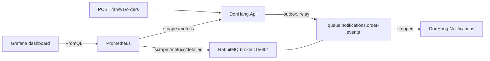

## Before you start

- [[backend.l3.dead-letter-queue]] — you know that a message Notifications cannot handle ends in `notifications.order-events.dead`, and that nothing retries it on its own.
- [[devops.l2.counters-and-rate]] — you know that a counter is read through `rate()`, while a gauge's current value is the answer.
- [[devops.l2.grafana-dashboards]] — you know that each panel of `donhang-api.json` is one PromQL query that Grafana sends to Prometheus.
- [[backend.l3.observability]] — you know that metrics count across all requests and that each service sends its own telemetry.

## The situation

You keep Đơn Hàng's Grafana dashboard open while you work in the lab. Requests per second look steady, the `5xx` panel is flat at zero, and p95 is where it always is. Then you open Mailpit, the lab's fake mail server that shows every email it receives, and find none for the last few orders.

You check with `docker compose ps`: Notifications is no longer running. Every order still returned `201`, and none of the panels you were watching moved, because each of them measures the api. The emails for those orders are waiting somewhere.

Where are they waiting, and what number would have shown you that they were piling up?

## Core concepts

- backlog — the messages in a queue that no consumer has taken yet; in the situation above, the order messages in `notifications.order-events`.
- `rabbitmq_prometheus` — the RabbitMQ plugin that serves the broker's own numbers, in the text format Prometheus scrapes, on port `15692`.
- per-queue series — what the plugin's `/metrics/detailed` path returns when asked for the `queue_coarse_metrics` family: one time series per queue, with the queue's name in the `queue` label. A family is a named group of metrics; `/metrics/detailed` returns only the families named in the URL.
- `rabbitmq_detailed_queue_messages_ready` — a gauge of the messages in a queue that are ready to be delivered, that is, not yet handed to a consumer.
- `rabbitmq_detailed_queue_messages` — a gauge of all the messages in a queue, those ready plus those handed to a consumer and not yet acknowledged. Notifications acknowledges a message by telling RabbitMQ it has finished with it; only then does RabbitMQ remove it.

## How it works



In the situation above, `POST /api/v1/orders` is finished once the api has saved the order and its outbox row in one transaction. Afterwards, background code in the api, the relay, reads the outbox row and publishes the message to RabbitMQ, which keeps it in `notifications.order-events` until Notifications takes it. No step of the request waits for Notifications. So the api's request rate, errors and p95 stay the same whether the consumer is reading the queue or not, and the api's metrics cannot show a stopped consumer.

The queue can. The number of messages waiting in it is a gauge. Each published message adds one and each message Notifications takes removes one. While messages arrive faster than the consumer handles them, the number rises; when the consumer catches up, it falls back. A stopped consumer makes it rise with every order, and a slow one makes it rise more gently. Its current value is the answer.

Prometheus has to get that number from RabbitMQ, which serves it through its Prometheus plugin on port `15692`. On the default path, `/metrics`, the plugin adds the numbers of all queues together, so the backlog of one queue would be mixed with the others. Đơn Hàng's scrape job asks for `/metrics/detailed` with the `queue_coarse_metrics` family instead, which returns one series per queue.

## In the Đơn Hàng system

The scrape job for RabbitMQ, added at stage-3 under the api's job:

```yaml file=deploy/monitoring/prometheus.yml tag=stage-3 lines=13-23
  # lesson: backend.l3.queue-backlog-metrics
  # From stage-3, RabbitMQ's own numbers, from its Prometheus plugin on port
  # 15692. Its /metrics adds all queues together; /metrics/detailed with the
  # queue_coarse_metrics family gives one series per queue, such as
  #   rabbitmq_detailed_queue_messages_ready{queue="notifications.order-events"}
  - job_name: rabbitmq
    metrics_path: /metrics/detailed
    params:
      family: [queue_coarse_metrics]
    static_configs:
      - targets: ["rabbitmq:15692"]
```

`metrics_path` replaces the default `/metrics`, and `params` adds `family=queue_coarse_metrics` to the URL of each scrape. The target is the `rabbitmq` service by name: in `docker-compose.yml` the image turns the plugin on, and port `15692` is reached only from the `donhang` network, not from your machine.

`donhang-api.json` gains two panels at stage-3. "Order emails waiting in RabbitMQ" draws `rabbitmq_detailed_queue_messages_ready{queue="notifications.order-events"}`. A line that rises and comes back down is a burst being worked off; a line that only rises is a consumer that is stopped or too slow.

"Dead-lettered order messages" draws `rabbitmq_detailed_queue_messages{queue="notifications.order-events.dead"}`. No consumer reads that queue, so nothing in it is handed out and the total equals the ready count. Any value above zero is a reason for a person to look, because those messages wait until someone handles them.

Neither panel uses `rate()`.

The lab script repeats the situation. `promql` and `wait_for`, defined above the excerpt, ask Prometheus for a query's value and wait until it reaches a number; `keycloak_access_token`, from `scripts/lib/keycloak.sh`, signs in as a lab user. `$waiting` is the query of the first panel; `$errors` sums the api's `http_requests_received_total` for `5xx` codes. The script first waits until the queue is empty, so the count starts at `0`. `trap … EXIT` makes the shell start Notifications again when the script ends, even if it fails halfway.

```bash file=scripts/backend/queue-backlog.sh tag=stage-3 lines=27-48
wait_for "$waiting" 0
errors_before=$(promql "$errors")
docker compose stop notifications 2>/dev/null
trap 'docker compose start notifications 2>/dev/null' EXIT
echo "notifications is stopped: order messages wait in notifications.order-events"

token=$(keycloak_access_token anh.tran@example.com)
echo "== POST /api/v1/orders, 5 times"
for _ in $(seq 5); do
  curl -sS -w '\n%{http_code}\n' -X POST http://localhost:8080/api/v1/orders \
    -H 'Content-Type: application/json' -H "Authorization: Bearer $token" \
    -d '{"items":[{"productId":8,"quantity":1}]}' | tail -n 1 | sed 's/^/  -> /'
done

# lesson: backend.l3.queue-backlog-metrics
# Messages waiting in a queue is a gauge, read as it is, not with rate():
# it rises while nothing consumes and falls as the consumer catches up. The
# api, meanwhile, answered every order: its 5xx count did not move.
wait_for "$waiting" 5
echo "promql> $waiting"
echo "  value: $(promql "$waiting")"
echo "5xx responses from the api meanwhile: $(awk "BEGIN { print $(promql "$errors") - $errors_before }")"
```

```text output=true
notifications is stopped: order messages wait in notifications.order-events
== POST /api/v1/orders, 5 times
  -> 201
  -> 201
  -> 201
  -> 201
  -> 201
promql> rabbitmq_detailed_queue_messages_ready{queue="notifications.order-events"}
  value: 5
5xx responses from the api meanwhile: 0
notifications is back
promql> rabbitmq_detailed_queue_messages_ready{queue="notifications.order-events"}
  value: 0
```

With Notifications stopped, all five orders return `201`, the waiting count reaches `5`, and the `5xx` count does not move. The last three lines come from the end of the script, after the excerpt: it starts Notifications and waits until the count is back to `0`.

## Seniors often assume…

- **"If the API's dashboard looks healthy, every part of Đơn Hàng is working."** → Actually the api's panels count only the api's own requests, and the work it hands to a queue finishes later, in another service. You notice this when `queue-backlog.sh` prints five `201` lines and `0` errors while five order emails wait.
- **"Notifications is fine as long as its container is running."** → Actually a running container says nothing about whether it takes messages off its queue as fast as they arrive; the queue's count does. You notice this when the waiting panel keeps rising while `docker compose ps` lists the service as running.
- **"The number of messages in a queue is a counter, so I should read it with `rate()`."** → Actually it is a gauge, because it falls every time the consumer takes a message. When a series drops, `rate()` assumes a counter restarted from zero and counts the new value as growth, so every fall reads as an increase and the queue draining never shows. You notice this when a `rate()` panel of the queue still shows values above zero while the backlog is shrinking.

## Try it (3 minutes)

With the lab running with the monitoring profile (`docker compose --profile monitoring up -d`), in the root folder of the example repository:

1. Open Đơn Hàng's dashboard in Grafana and find the panel "Order emails waiting in RabbitMQ".
2. Run `scripts/backend/queue-backlog.sh` and watch that panel and the `5xx` panel while it runs.

Expected result: the script prints five `-> 201` lines, a waiting count of `5`, `0` for `5xx`, and finally a count of `0`. On the dashboard, the waiting line steps up to `5` and back down to `0`, while the `5xx` panel stays flat.

## Connections

- [[backend.l3.message-broker]] — prerequisite in practice: the queue that lets the api answer without waiting for Notifications is exactly what hides a stopped consumer from the api's metrics.
- [[backend.l3.eventual-consistency]] — the same delay, measured: the waiting count is how far the email side is behind the orders already placed.
- [[devops.l2.prometheus-scraping]] — the same scrape one target further: a second job, with its own path and parameters, next to the api's.
- [[devops.l2.counters-and-rate]] — the contrast: the waiting count is a gauge read as it stands, not a counter read through `rate()`.
- [[backend.l3.dead-letter-queue]] — the queue whose second panel turns "a message waits for a person" into a number you can see.

## Five-line summary

1. When a consumer stops or slows down, the api's metrics stay normal; the number of messages waiting in its queue is what shows it.
2. That number is a gauge: it rises while messages arrive faster than they are handled and falls as the consumer catches up.
3. RabbitMQ's Prometheus plugin serves it on port `15692`; `/metrics` adds all queues together, so Đơn Hàng scrapes `/metrics/detailed` for per-queue series.
4. The dashboard shows messages waiting in `notifications.order-events` and in `notifications.order-events.dead`, where any message at all needs a person.
5. `queue-backlog.sh` stops Notifications, places five orders, and shows the count reach `5` while the api's `5xx` count stays at `0`.
