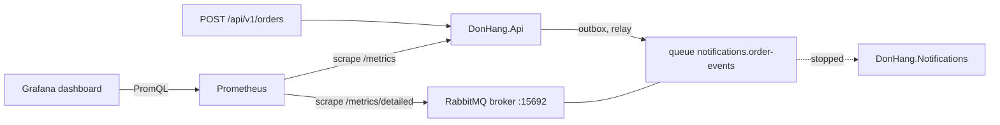

## Bạn cần biết trước

- [[backend.l3.dead-letter-queue]] — bạn biết rằng message nào Notifications không xử lý được sẽ kết thúc ở `notifications.order-events.dead`, và không có gì tự thử lại nó.
- [[devops.l2.counters-and-rate]] — bạn biết rằng counter phải đọc qua `rate()`, còn với gauge thì giá trị hiện tại chính là câu trả lời.
- [[devops.l2.grafana-dashboards]] — bạn biết rằng mỗi panel của `donhang-api.json` là một câu PromQL mà Grafana gửi tới Prometheus.
- [[backend.l3.observability]] — bạn biết rằng metric đếm trên toàn bộ request, và mỗi service tự gửi telemetry của riêng nó.

## Tình huống

Bạn vừa làm việc trong lab vừa mở dashboard Grafana của Đơn Hàng. Số request mỗi giây đều đặn, panel `5xx` nằm phẳng ở 0, p95 vẫn ở chỗ quen thuộc. Rồi bạn mở Mailpit, mail server giả của lab, nơi hiện mọi email nó nhận được, và không thấy email nào cho mấy đơn hàng gần nhất.

Bạn kiểm tra bằng `docker compose ps`: Notifications không còn chạy. Đơn nào cũng vẫn trả về `201`, và không panel nào bạn đang nhìn nhúc nhích, vì panel nào cũng đo api. Email của các đơn đó đang nằm chờ ở đâu đó.

Chúng chờ ở đâu, và con số nào lẽ ra đã cho bạn thấy chúng đang dồn lại?

## Khái niệm cốt lõi

- backlog — các message trong một queue mà chưa consumer nào lấy đi. Trong tình huống trên, đó là các message đơn hàng trong `notifications.order-events`.
- `rabbitmq_prometheus` — plugin của RabbitMQ phục vụ các con số của chính broker, theo định dạng văn bản mà Prometheus scrape, trên cổng `15692`.
- per-queue series — thứ mà đường dẫn `/metrics/detailed` của plugin trả về khi được hỏi họ `queue_coarse_metrics`: mỗi queue một time series, tên queue nằm trong label `queue`. Một họ (family) là một nhóm metric có tên. `/metrics/detailed` chỉ trả về các họ được ghi trong URL.
- `rabbitmq_detailed_queue_messages_ready` — gauge đếm các message trong queue đã sẵn sàng để giao, tức là chưa trao cho consumer nào.
- `rabbitmq_detailed_queue_messages` — gauge đếm mọi message trong queue, gồm các message sẵn sàng cộng với các message đã trao cho consumer mà chưa được acknowledge. Notifications acknowledge một message bằng cách báo cho RabbitMQ rằng nó đã xử lý xong. Chỉ khi đó RabbitMQ mới xóa message.

## Cơ chế hoạt động



Trong tình huống trên, `POST /api/v1/orders` xong ngay khi api đã lưu đơn hàng và dòng outbox của nó trong cùng một giao dịch. Sau đó, phần code chạy nền trong api, tức relay, đọc dòng outbox và publish message lên RabbitMQ. RabbitMQ giữ message trong `notifications.order-events` cho tới khi Notifications lấy đi. Không bước nào của request chờ Notifications. Vì vậy request rate, lỗi và p95 của api vẫn y nguyên dù consumer có đọc queue hay không, và metric của api không thể cho thấy một consumer đã dừng.

Queue thì cho thấy được. Số message đang chờ trong queue là một gauge. Mỗi message được publish cộng thêm một, mỗi message Notifications lấy đi trừ đi một. Khi message đến nhanh hơn tốc độ consumer xử lý, con số tăng lên. Khi consumer đuổi kịp, nó giảm xuống lại. Consumer dừng hẳn khiến con số tăng theo từng đơn hàng, còn consumer chậm khiến nó tăng thoai thoải hơn. Giá trị hiện tại của nó chính là câu trả lời.

Prometheus phải lấy con số đó từ RabbitMQ, nơi phục vụ nó qua plugin Prometheus trên cổng `15692`. Ở đường dẫn mặc định, `/metrics`, plugin cộng dồn số liệu của mọi queue, nên backlog của một queue sẽ lẫn với các queue khác. Thay vào đó, scrape job của Đơn Hàng hỏi `/metrics/detailed` với họ `queue_coarse_metrics`, và nhận về mỗi queue một series.

## Trong hệ thống Đơn Hàng

Scrape job cho RabbitMQ, thêm vào ở stage-3, ngay dưới job của api:

```yaml file=deploy/monitoring/prometheus.yml tag=stage-3 lines=13-23
  # lesson: backend.l3.queue-backlog-metrics
  # From stage-3, RabbitMQ's own numbers, from its Prometheus plugin on port
  # 15692. Its /metrics adds all queues together; /metrics/detailed with the
  # queue_coarse_metrics family gives one series per queue, such as
  #   rabbitmq_detailed_queue_messages_ready{queue="notifications.order-events"}
  - job_name: rabbitmq
    metrics_path: /metrics/detailed
    params:
      family: [queue_coarse_metrics]
    static_configs:
      - targets: ["rabbitmq:15692"]
```

`metrics_path` thay cho `/metrics` mặc định, còn `params` thêm `family=queue_coarse_metrics` vào URL của mỗi lần scrape. Target là service `rabbitmq`, gọi theo tên: trong `docker-compose.yml`, image bật sẵn plugin, và cổng `15692` chỉ truy cập được từ network `donhang`, không phải từ máy của bạn.

Ở stage-3, `donhang-api.json` có thêm hai panel. "Order emails waiting in RabbitMQ" vẽ `rabbitmq_detailed_queue_messages_ready{queue="notifications.order-events"}`. Đường tăng lên rồi giảm xuống là một đợt dồn đang được xử lý dần. Đường chỉ tăng mà không giảm là consumer đã dừng hoặc quá chậm.

"Dead-lettered order messages" vẽ `rabbitmq_detailed_queue_messages{queue="notifications.order-events.dead"}`. Không consumer nào đọc queue này, nên không message nào trong đó được trao đi, và tổng số bằng đúng số message sẵn sàng. Chỉ cần giá trị lớn hơn 0 là đủ lý do để một người vào xem, vì các message đó nằm chờ cho tới khi có người xử lý.

Cả hai panel đều không dùng `rate()`.

Script của lab tái hiện tình huống trên. `promql` và `wait_for`, định nghĩa phía trên đoạn trích, hỏi Prometheus giá trị của một câu truy vấn và chờ tới khi nó đạt một con số. `keycloak_access_token`, lấy từ `scripts/lib/keycloak.sh`, đăng nhập bằng một user của lab. `$waiting` là câu truy vấn của panel thứ nhất, còn `$errors` cộng `http_requests_received_total` của api cho các mã `5xx`. Script chờ queue rỗng trước, để con số bắt đầu từ `0`. `trap … EXIT` khiến shell khởi động lại Notifications khi script kết thúc, kể cả khi nó lỗi giữa chừng.

```bash file=scripts/backend/queue-backlog.sh tag=stage-3 lines=27-48
wait_for "$waiting" 0
errors_before=$(promql "$errors")
docker compose stop notifications 2>/dev/null
trap 'docker compose start notifications 2>/dev/null' EXIT
echo "notifications is stopped: order messages wait in notifications.order-events"

token=$(keycloak_access_token anh.tran@example.com)
echo "== POST /api/v1/orders, 5 times"
for _ in $(seq 5); do
  curl -sS -w '\n%{http_code}\n' -X POST http://localhost:8080/api/v1/orders \
    -H 'Content-Type: application/json' -H "Authorization: Bearer $token" \
    -d '{"items":[{"productId":8,"quantity":1}]}' | tail -n 1 | sed 's/^/  -> /'
done

# lesson: backend.l3.queue-backlog-metrics
# Messages waiting in a queue is a gauge, read as it is, not with rate():
# it rises while nothing consumes and falls as the consumer catches up. The
# api, meanwhile, answered every order: its 5xx count did not move.
wait_for "$waiting" 5
echo "promql> $waiting"
echo "  value: $(promql "$waiting")"
echo "5xx responses from the api meanwhile: $(awk "BEGIN { print $(promql "$errors") - $errors_before }")"
```

```text output=true
notifications is stopped: order messages wait in notifications.order-events
== POST /api/v1/orders, 5 times
  -> 201
  -> 201
  -> 201
  -> 201
  -> 201
promql> rabbitmq_detailed_queue_messages_ready{queue="notifications.order-events"}
  value: 5
5xx responses from the api meanwhile: 0
notifications is back
promql> rabbitmq_detailed_queue_messages_ready{queue="notifications.order-events"}
  value: 0
```

Khi Notifications dừng, cả năm đơn đều trả về `201`, số message đang chờ lên tới `5`, và số `5xx` không đổi. Ba dòng cuối đến từ phần cuối script, sau đoạn trích: script khởi động Notifications và chờ con số về lại `0`.

## Senior hay nhầm rằng…

- **"Dashboard của API trông ổn thì mọi phần của Đơn Hàng đều đang chạy tốt."** → Thực ra các panel của api chỉ đếm request của chính api, còn phần việc nó giao cho queue thì xong sau, ở một service khác. Bạn sẽ nhận ra khi `queue-backlog.sh` in năm dòng `201` và `0` lỗi trong lúc năm email đơn hàng vẫn đang chờ.
- **"Container của Notifications còn chạy thì Notifications vẫn ổn."** → Thực ra container đang chạy không nói gì về việc nó có lấy message khỏi queue kịp tốc độ message đến hay không. Số message trong queue mới nói được điều đó. Bạn sẽ nhận ra khi panel message đang chờ cứ tăng mãi trong khi `docker compose ps` vẫn liệt kê service là đang chạy.
- **"Số message trong queue là counter, nên phải đọc bằng `rate()`."** → Thực ra nó là gauge, vì nó giảm mỗi khi consumer lấy đi một message. Khi một series giảm, `rate()` coi như counter vừa khởi động lại từ 0 và tính giá trị mới là phần tăng thêm. Thế là mỗi lần giảm lại thành một lần tăng, và bạn không bao giờ thấy queue đang vơi dần. Bạn sẽ nhận ra khi một panel `rate()` của queue vẫn hiện giá trị lớn hơn 0 trong lúc backlog đang thu nhỏ.

## Thử ngay (3 phút)

Khi lab đang chạy cùng profile monitoring (`docker compose --profile monitoring up -d`), ở thư mục gốc của repo ví dụ:

1. Mở dashboard của Đơn Hàng trong Grafana và tìm panel "Order emails waiting in RabbitMQ".
2. Chạy `scripts/backend/queue-backlog.sh`, vừa chạy vừa theo dõi panel đó và panel `5xx`.

Kết quả mong đợi: script in năm dòng `-> 201`, số message đang chờ là `5`, `0` cho `5xx`, và cuối cùng là con số `0`. Trên dashboard, đường message đang chờ bước lên `5` rồi xuống lại `0`, còn panel `5xx` vẫn nằm phẳng.

## Liên hệ

- [[backend.l3.message-broker]] — bài cần học trước trên thực tế: chính queue giúp api trả lời mà không phải chờ Notifications là thứ giấu consumer đã dừng khỏi metric của api.
- [[backend.l3.eventual-consistency]] — cùng độ trễ đó, giờ được đo: số message đang chờ cho biết phía email đang chậm hơn các đơn đã đặt bao xa.
- [[devops.l2.prometheus-scraping]] — cùng kiểu scrape, thêm một target: job thứ hai, có đường dẫn và tham số riêng, đặt cạnh job của api.
- [[devops.l2.counters-and-rate]] — điểm tương phản: số message đang chờ là gauge, đọc nguyên giá trị, không phải counter đọc qua `rate()`.
- [[backend.l3.dead-letter-queue]] — queue có panel thứ hai biến "một message đang chờ người xử lý" thành con số bạn nhìn thấy được.

## Tóm tắt 5 dòng

1. Khi consumer dừng hoặc chậm lại, metric của api vẫn bình thường, chỉ số message đang chờ trong queue của nó mới cho thấy điều đó.
2. Con số đó là gauge: tăng khi message đến nhanh hơn tốc độ xử lý, giảm khi consumer đuổi kịp.
3. Plugin Prometheus của RabbitMQ phục vụ nó trên cổng `15692`. `/metrics` cộng dồn mọi queue, nên Đơn Hàng scrape `/metrics/detailed` để có series theo từng queue.
4. Dashboard hiện số message đang chờ trong `notifications.order-events` và trong `notifications.order-events.dead`, nơi chỉ cần có message là cần người vào xem.
5. `queue-backlog.sh` dừng Notifications, đặt năm đơn hàng, và cho thấy con số lên tới `5` trong khi số `5xx` của api vẫn ở `0`.
