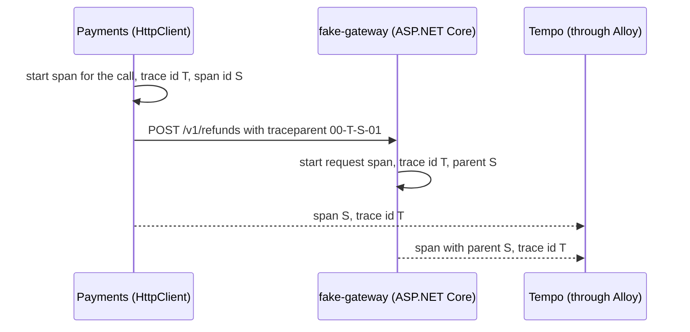

## Before you start

- [[backend.l3.opentelemetry-sdk]] — you know that ASP.NET Core starts a span for each request, `HttpClient` one for each outgoing call, and instrumentation makes the SDK record and export them.
- [[backend.l3.safe-to-repeat-saga-steps]] — you know that `RefundSender` asks the gateway for each refund through `GatewayRefundClient`, which sends an `Idempotency-Key` header.
- [[foundation.l1.http-request-response]] — you know that headers are `Name: value` lines that travel with every request.

## The situation

The refund's trace in Tempo shows a span from `fake-gateway`, `POST /v1/refunds`, nested under the `POST` span of `DonHang.Payments`. The gateway is a separate process in its own container. You open `GatewayRefundClient`, the only class that talks to it. It builds the URL, the JSON body and an `Idempotency-Key` header. Nothing in it mentions a trace, a span or an id, and `RefundAsync` has no trace parameter.

Yet the gateway's span has the same trace id as Payments' span, and it names Payments' call as its parent.

How does a span in another process learn which trace it belongs to?

## Core concepts

- **trace context** — the trace id and the id of the span current at the moment of a call: the two values a receiver needs to put its own spans in the right trace, under the right parent.
- **context propagation** — passing the trace context from one process to the next with each call, so the receiver's spans join the sender's trace instead of starting a new one; in the situation above, it is how the gateway learned Payments' trace id.
- `traceparent` — the HTTP header, defined by a shared web standard named Trace Context, that carries the trace context: a version, a 32-hex-digit trace id, a 16-hex-digit parent span id and flags, joined by dashes.
- parent span id — the part of `traceparent` that names the sender's span that made the call; the receiver makes it the parent of the span it starts for the request.

## How it works



In the situation above, `GatewayRefundClient` calls `SendAsync`, and `HttpClient` starts a span for the outgoing call. That span has the refund's trace id, T in the diagram, and its own span id, S. T comes from the refund row: it keeps the trace context of the request that asked for the refund, and `RefundSender` starts a `refund attempt` span from it before calling the client (`Payment.cs`, `RefundSender.cs`, outside the excerpts; saving trace context in a row is [[backend.l3.tracing-through-the-outbox]]). Before the request leaves, `HttpClient` writes T and S into a `traceparent` header: `00` for the version, then T, then S, then the flags. The lab uses flags `01`, which the script's comment calls `sampled`: that is the decision the flags carry, taught in [[backend.l3.trace-sampling]].

The gateway's ASP.NET Core reads that header when it starts the span for the request. It does not make up a trace id: it takes T, and it records S as its span's parent. Each service then exports its spans on its own, to Alloy, which forwards them to Tempo. Tempo files every span under its trace id, so both spans arrive under T, and Grafana nests the gateway's span under S.

Those two ids are the trace context, and handing them on with each call is context propagation. A request that arrives with no `traceparent` has nothing to join, so ASP.NET Core starts a new trace with a new trace id.

Neither side's code touches the header: `HttpClient` writes it on each outgoing call and ASP.NET Core reads it on each request; the instrumentation records the spans. Inside one process, .NET keeps track of the current span across `await`, so `RefundAsync` needs no trace id parameter.

## In the Đơn Hàng system

The call to the gateway, in Payments:

```csharp file=DonHang.Payments/GatewayRefundClient.cs tag=stage-3 lines=59-75
    public async Task<GatewayRefundResult> RefundAsync(Payment refund, CancellationToken cancellationToken)
    {
        using var request = new HttpRequestMessage(HttpMethod.Post, "v1/refunds")
        {
            Content = JsonContent.Create(new { orderId = refund.OrderId, amountVnd = refund.AmountVnd }),
        };
        request.Headers.Add("Idempotency-Key", IdempotencyKeyFor(refund));
        try
        {
            using var response = await http.SendAsync(request, cancellationToken);
            if (response.IsSuccessStatusCode) return new(RefundOutcome.Refunded);
            if (response.StatusCode == HttpStatusCode.UnprocessableEntity)
                return new(RefundOutcome.Refused, await ReadReasonAsync(response, cancellationToken));
            return new(RefundOutcome.TryAgainLater, $"the gateway answered {(int)response.StatusCode}");
        }
        catch (HttpRequestException ex)
        {
```

The method adds one header itself, `Idempotency-Key`; the `Authorization` header comes from the client's default headers in `DonHang.Payments/Program.cs`. There is no `traceparent` here. `HttpClient` adds it inside `http.SendAsync`, from the span current at that moment; .NET does this by default. `AddHttpClientInstrumentation()` in `Program.cs` makes the SDK record that call's span, the one whose id travels. The class knows every header the gateway expects, yet the one that ties the trace together is not its concern.

The lab proves the receiving side with a header you control:

```bash file=scripts/backend/traceparent.sh tag=stage-3 lines=14-32
# lesson: backend.l3.trace-context-propagation
# version - trace id (32 hex digits) - parent span id (16) - flags (01: sampled)
# A read first, so that product 3 is in Redis and the traced read runs no SQL.
curl -sS -o /dev/null http://localhost:8080/api/v1/products/3
traceparent=$(new_traceparent)
echo "== GET /api/v1/products/3 with the header"
echo "traceparent: $traceparent"
curl -sS -o /dev/null -w '  -> %{http_code}\n' http://localhost:8080/api/v1/products/3 -H "traceparent: $traceparent"

# ASP.NET Core instrumentation read the header: the api's spans went into
# the trace the header names, under the parent span id it gave.
id=$(trace_id "$traceparent")
wait_for_spans "$id" 1
echo "== spans Tempo has under trace id $id"
print_trace_tree "$id"
parent=$(echo "$traceparent" | cut -d- -f3)
echo "== the api's span names the header's span id as its parent: $(tempo_trace "$id"   | jq -r --arg parent "$(span_id_base64 "$parent")" '
      [.batches[].scopeSpans[].spans[] | select(.kind == "SPAN_KIND_SERVER") | .parentSpanId]
      | if index($parent) then "yes" else "no" end')"
```

```text output=true
== GET /api/v1/products/3 with the header
traceparent: 00-...-01
  -> 200
== spans Tempo has under trace id ...
donhang-api: GET api/v1/products/{id:int}
== the api's span names the header's span id as its parent: yes

== POST /api/v1/orders/10/refund, with a new traceparent
  -> 202
== Payments' call to the gateway, and the gateway's span, in that trace
  donhang-payments: POST
    fake-gateway: POST /v1/refunds
  the gateway span's parent is Payments' call: yes
```

The script plays a caller that already has a trace. The first `curl` puts product 3 in Redis, so the traced read runs no SQL and stays one span. `new_traceparent` builds the header from random hex digits with flags `01`. It and the other helpers live in `scripts/lib/tempo.sh`, outside the excerpt: they cut the trace id from the header, wait until Tempo has the spans, print them as a tree and fetch the trace as JSON.

The last lines check the parent. `cut -d- -f3` splits the header at each dash and keeps the third part, the parent span id. `jq`, a command-line tool that picks fields out of JSON, takes the api's request span, the one of kind `SPAN_KIND_SERVER`, and checks its parent id against that span id, converted by `span_id_base64` to the form Tempo's JSON uses. The api has never seen that trace id, yet Tempo lists its span under it, with the made-up span id as its parent. The script looks the trace up by id only; it never compares times.

The second half of the script, outside the excerpt, requests a refund and checks one hop further: the gateway's span names Payments' `POST` span as its parent. In the output, `...` stands for ids that differ on every run. The gateway sends its spans to Alloy only because it is a lab stand-in with tracing set up; a real payment gateway would not send its spans to Đơn Hàng.

## Seniors often assume…

- **"Tempo puts spans from different services into one trace by matching their times."** → Actually Tempo groups spans by the trace id each one carries, and the receiver got that id from `traceparent`. Timing plays no part. You notice this when two requests run at the same instant and Tempo still shows them as two separate traces, or when `traceparent.sh` finds the api's span under an id it made up seconds before.
- **"Each service creates its own trace id, and the ids get linked later."** → Actually only the process where a trace starts creates its trace id; every process after it reuses the id from the incoming `traceparent`; Tempo never merges two trace ids into one trace afterwards. You notice this when a caller sends no `traceparent`: the receiver's spans appear as a separate trace that the caller's trace never shows.
- **"Passing the trace along means adding a trace id parameter to every method and endpoint."** → Actually `HttpClient` writes the header and ASP.NET Core reads it, and inside a process .NET tracks the current span across `await`. You notice this when the gateway's span nests under Payments' call although `GatewayRefundClient` contains no trace code: the span current when `RefundSender` calls it, its `refund attempt` span, becomes the parent of `HttpClient`'s span.

## Try it (3 minutes)

With the lab running with the monitoring profile (`docker compose --profile monitoring up -d`), in the root folder of the example repository:

1. Run `scripts/backend/traceparent.sh`.
2. In its output, compare the 32 hex digits after `traceparent: 00-` with the id on the line `== spans Tempo has under trace id`.
3. Run the script again and compare the new trace id with the first one.

Expected result: within one run the two ids are the same, and both checks end in `yes`. The second run shows a different trace id, because the script made up a new header and the api joined whatever trace the header named.

## Connections

- [[backend.l3.opentelemetry-sdk]] — prerequisite: the spans that `HttpClient` and ASP.NET Core start are the ones whose ids travel in `traceparent`.
- [[foundation.l1.http-request-response]] — the same plain `Name: value` header line, now carrying two ids instead of a content type or a cookie.
- [[design.l3.anti-corruption-layer]] — the contrast: `GatewayRefundClient` owns every header the gateway's contract needs, while `traceparent` is added below it by `HttpClient`.
- [[backend.l3.tracing-through-the-outbox]] — the same idea where there is no HTTP call to carry the header: the trace context is saved with the outbox row.
- [[backend.l3.trace-sampling]] — what the flags at the end of `traceparent` decide, and why every service follows them.

## Five-line summary

1. Context propagation passes the trace id and current span id to the next process, so the receiver's spans join the sender's trace.
2. Over HTTP the trace context travels in the Trace Context standard's `traceparent` header: version, 32-hex-digit trace id, 16-hex-digit parent span id, flags.
3. `HttpClient` writes `traceparent` on each call and ASP.NET Core reads it on each request; your code never touches it.
4. At stage-3 the gateway's span joins the refund's trace because the call from `GatewayRefundClient` carries `traceparent`.
5. `traceparent.sh` sends a made-up `traceparent` and finds the api's span in Tempo under that same trace id.
