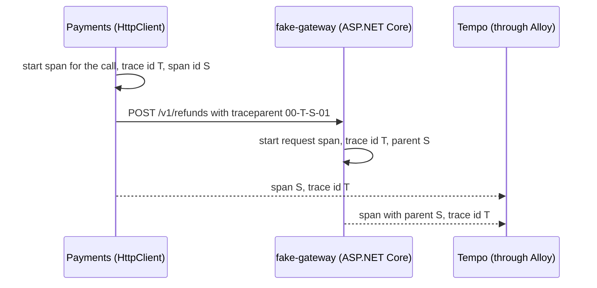

## Bạn cần biết trước

- [[backend.l3.opentelemetry-sdk]] — bạn biết rằng ASP.NET Core bắt đầu một span cho mỗi request, `HttpClient` bắt đầu một span cho mỗi lời gọi đi ra, và instrumentation khiến SDK ghi lại rồi xuất các span đó.
- [[backend.l3.safe-to-repeat-saga-steps]] — bạn biết rằng `RefundSender` yêu cầu cổng thanh toán hoàn từng khoản tiền qua `GatewayRefundClient`, lớp gửi kèm header `Idempotency-Key`.
- [[foundation.l1.http-request-response]] — bạn biết rằng header là những dòng `Name: value` đi kèm mỗi request.

## Tình huống

Trong Tempo, trace của lần hoàn tiền có một span từ `fake-gateway`, `POST /v1/refunds`, nằm lồng dưới span `POST` của `DonHang.Payments`. Cổng thanh toán là một process riêng, chạy trong container riêng. Bạn mở `GatewayRefundClient`, lớp duy nhất nói chuyện với nó. Lớp này dựng URL, body JSON và header `Idempotency-Key`. Trong đó không chỗ nào nhắc tới trace, span hay id, và `RefundAsync` cũng không có tham số nào cho trace.

Vậy mà span của cổng thanh toán có cùng trace id với span của Payments, và nó ghi lời gọi của Payments là cha của mình.

Làm sao một span ở process khác biết mình thuộc trace nào?

## Khái niệm cốt lõi

- **trace context** (trace id và span id hiện tại, được chuyển sang process kế tiếp, ví dụ trong header traceparent) — trace id và id của span đang là span hiện tại lúc gọi: hai giá trị bên nhận cần để đặt span của chính nó vào đúng trace, dưới đúng span cha.
- **truyền ngữ cảnh trace** (context propagation) — chuyển trace context từ process này sang process kế tiếp theo mỗi lời gọi, để span của bên nhận nhập vào trace của bên gửi thay vì mở một trace mới. Ở tình huống trên, đây là cách cổng thanh toán biết trace id của Payments.
- `traceparent` — header HTTP mà một chuẩn web chung tên là Trace Context định nghĩa để mang trace context: một phiên bản, một trace id 32 chữ số hex, một parent span id 16 chữ số hex và các cờ, nối với nhau bằng dấu gạch ngang.
- parent span id — phần của `traceparent` chỉ ra span của bên gửi đã thực hiện lời gọi. Bên nhận lấy span này làm cha cho span nó bắt đầu cho request.

## Cơ chế hoạt động



Trong tình huống trên, `GatewayRefundClient` gọi `SendAsync`, và `HttpClient` bắt đầu một span cho lời gọi đi ra. Span này mang trace id của lần hoàn tiền, T trong sơ đồ, và span id của riêng nó, S. T đến từ dòng hoàn tiền: dòng này giữ trace context của request đã yêu cầu hoàn tiền, và `RefundSender` bắt đầu một span `refund attempt` từ đó trước khi gọi client (`Payment.cs`, `RefundSender.cs`, ngoài các đoạn trích; lưu trace context vào một dòng dữ liệu là chuyện của [[backend.l3.tracing-through-the-outbox]]). Trước khi request rời đi, `HttpClient` ghi T và S vào header `traceparent`: `00` là phiên bản, rồi T, rồi S, rồi các cờ. Lab dùng cờ `01`, mà comment trong script gọi là `sampled`: đó là quyết định mà các cờ mang theo, được dạy ở [[backend.l3.trace-sampling]].

ASP.NET Core bên cổng thanh toán đọc header đó khi bắt đầu span cho request. Nó không tự nghĩ ra trace id nào: nó lấy T, và ghi S làm cha cho span của mình. Sau đó mỗi service tự xuất span của mình tới Alloy, nơi chuyển tiếp chúng tới Tempo. Tempo xếp mỗi span theo trace id của nó, nên cả hai span đều nằm dưới T, và Grafana lồng span của cổng thanh toán dưới S.

Hai id đó là trace context, và chuyển chúng đi theo mỗi lời gọi là truyền ngữ cảnh trace. Một request đến mà không có `traceparent` thì không có trace nào để nhập vào, nên ASP.NET Core mở một trace mới với trace id mới.

Code của cả hai bên đều không động tới header: `HttpClient` ghi nó vào mỗi lời gọi đi ra và ASP.NET Core đọc nó ở mỗi request, còn instrumentation ghi lại các span. Bên trong một process, .NET theo dõi span hiện tại qua các lần `await`, nên `RefundAsync` không cần tham số trace id.

## Trong hệ thống Đơn Hàng

Lời gọi tới cổng thanh toán, trong Payments:

```csharp file=DonHang.Payments/GatewayRefundClient.cs tag=stage-3 lines=59-75
    public async Task<GatewayRefundResult> RefundAsync(Payment refund, CancellationToken cancellationToken)
    {
        using var request = new HttpRequestMessage(HttpMethod.Post, "v1/refunds")
        {
            Content = JsonContent.Create(new { orderId = refund.OrderId, amountVnd = refund.AmountVnd }),
        };
        request.Headers.Add("Idempotency-Key", IdempotencyKeyFor(refund));
        try
        {
            using var response = await http.SendAsync(request, cancellationToken);
            if (response.IsSuccessStatusCode) return new(RefundOutcome.Refunded);
            if (response.StatusCode == HttpStatusCode.UnprocessableEntity)
                return new(RefundOutcome.Refused, await ReadReasonAsync(response, cancellationToken));
            return new(RefundOutcome.TryAgainLater, $"the gateway answered {(int)response.StatusCode}");
        }
        catch (HttpRequestException ex)
        {
```

Method này tự thêm đúng một header, `Idempotency-Key`. Header `Authorization` đến từ các header mặc định của client trong `DonHang.Payments/Program.cs`. Ở đây không có `traceparent`. `HttpClient` thêm nó bên trong `http.SendAsync`, từ span đang là span hiện tại lúc đó, và .NET làm vậy theo mặc định. `AddHttpClientInstrumentation()` trong `Program.cs` khiến SDK ghi lại span của lời gọi đó, chính là span có id được gửi đi. Lớp này biết mọi header mà cổng thanh toán cần, nhưng header nối trace lại với nhau thì không phải việc của nó.

Lab chứng minh phía nhận bằng một header do bạn kiểm soát:

```bash file=scripts/backend/traceparent.sh tag=stage-3 lines=14-32
# lesson: backend.l3.trace-context-propagation
# version - trace id (32 hex digits) - parent span id (16) - flags (01: sampled)
# A read first, so that product 3 is in Redis and the traced read runs no SQL.
curl -sS -o /dev/null http://localhost:8080/api/v1/products/3
traceparent=$(new_traceparent)
echo "== GET /api/v1/products/3 with the header"
echo "traceparent: $traceparent"
curl -sS -o /dev/null -w '  -> %{http_code}\n' http://localhost:8080/api/v1/products/3 -H "traceparent: $traceparent"

# ASP.NET Core instrumentation read the header: the api's spans went into
# the trace the header names, under the parent span id it gave.
id=$(trace_id "$traceparent")
wait_for_spans "$id" 1
echo "== spans Tempo has under trace id $id"
print_trace_tree "$id"
parent=$(echo "$traceparent" | cut -d- -f3)
echo "== the api's span names the header's span id as its parent: $(tempo_trace "$id"   | jq -r --arg parent "$(span_id_base64 "$parent")" '
      [.batches[].scopeSpans[].spans[] | select(.kind == "SPAN_KIND_SERVER") | .parentSpanId]
      | if index($parent) then "yes" else "no" end')"
```

```text output=true
== GET /api/v1/products/3 with the header
traceparent: 00-...-01
  -> 200
== spans Tempo has under trace id ...
donhang-api: GET api/v1/products/{id:int}
== the api's span names the header's span id as its parent: yes

== POST /api/v1/orders/10/refund, with a new traceparent
  -> 202
== Payments' call to the gateway, and the gateway's span, in that trace
  donhang-payments: POST
    fake-gateway: POST /v1/refunds
  the gateway span's parent is Payments' call: yes
```

Script đóng vai một bên gọi đã có sẵn trace. Lệnh `curl` đầu tiên đưa sản phẩm 3 vào Redis, để lần đọc có trace không chạy SQL và chỉ gồm một span. `new_traceparent` dựng header từ các chữ số hex ngẫu nhiên với cờ `01`. Hàm này và các hàm hỗ trợ khác nằm trong `scripts/lib/tempo.sh`, ngoài đoạn trích: chúng cắt trace id ra khỏi header, chờ tới khi Tempo có span, in span ra dạng cây và lấy trace về dưới dạng JSON.

Mấy dòng cuối kiểm tra span cha. `cut -d- -f3` tách header ở mỗi dấu gạch ngang và giữ phần thứ ba, tức parent span id. `jq`, công cụ dòng lệnh để lấy trường ra khỏi JSON, lấy span request của api, span có kind `SPAN_KIND_SERVER`, rồi so id cha của nó với span id đó, sau khi `span_id_base64` đổi span id sang dạng mà JSON của Tempo dùng. Api chưa từng thấy trace id đó, vậy mà Tempo liệt kê span của nó dưới trace id ấy, với span id tự nghĩ ra làm cha. Script chỉ tra trace theo id, không bao giờ so thời gian.

Nửa sau của script, ngoài đoạn trích, yêu cầu một lần hoàn tiền và kiểm tra thêm một chặng: span của cổng thanh toán ghi span `POST` của Payments là cha. Trong output, `...` thay cho các id thay đổi sau mỗi lần chạy. Cổng thanh toán gửi span tới Alloy chỉ vì nó là bản thay thế trong lab đã được thiết lập tracing. Một cổng thanh toán thật sẽ không gửi span của nó cho Đơn Hàng.

## Senior hay nhầm rằng…

- **"Tempo ghép span từ các service khác nhau vào một trace bằng cách khớp thời gian của chúng."** → Thực ra Tempo gom span theo trace id mà mỗi span mang theo, và bên nhận lấy id đó từ `traceparent`. Thời gian không đóng vai trò gì. Bạn sẽ nhận ra khi hai request chạy cùng một lúc mà Tempo vẫn hiện chúng thành hai trace riêng, hoặc khi `traceparent.sh` tìm thấy span của api dưới một id mà script vừa tự nghĩ ra vài giây trước.
- **"Mỗi service tự tạo trace id riêng, rồi các id được nối với nhau sau."** → Thực ra chỉ process nơi trace bắt đầu mới tạo trace id. Mọi process sau nó dùng lại id từ `traceparent` đến kèm request, và Tempo không bao giờ gộp hai trace id thành một trace về sau. Bạn sẽ nhận ra khi một bên gọi không gửi `traceparent`: span của bên nhận hiện thành một trace riêng mà trace của bên gọi không bao giờ thấy.
- **"Chuyển trace đi nghĩa là thêm tham số trace id vào mọi method và endpoint."** → Thực ra `HttpClient` ghi header và ASP.NET Core đọc nó, còn bên trong một process, .NET theo dõi span hiện tại qua các lần `await`. Bạn sẽ nhận ra khi span của cổng thanh toán lồng dưới lời gọi của Payments dù `GatewayRefundClient` không có dòng code trace nào: span đang là span hiện tại khi `RefundSender` gọi nó, tức span `refund attempt`, trở thành cha của span do `HttpClient` tạo.

## Thử ngay (3 phút)

Khi lab đang chạy với profile monitoring (`docker compose --profile monitoring up -d`), ở thư mục gốc của repo ví dụ:

1. Chạy `scripts/backend/traceparent.sh`.
2. Trong output, so 32 chữ số hex sau `traceparent: 00-` với id trên dòng `== spans Tempo has under trace id`.
3. Chạy script lần nữa và so trace id mới với trace id lần đầu.

Kết quả mong đợi: trong cùng một lần chạy, hai id giống nhau, và cả hai lần kiểm tra đều kết thúc bằng `yes`. Lần chạy thứ hai cho ra trace id khác, vì script đã tự nghĩ ra header mới và api nhập vào đúng trace mà header chỉ tới.

## Liên hệ

- [[backend.l3.opentelemetry-sdk]] — bài tiên quyết: các span do `HttpClient` và ASP.NET Core bắt đầu chính là những span có id được gửi đi trong `traceparent`.
- [[foundation.l1.http-request-response]] — vẫn là dòng header `Name: value` quen thuộc, giờ mang hai id thay vì content type hay cookie.
- [[design.l3.anti-corruption-layer]] — điểm tương phản: `GatewayRefundClient` nắm mọi header mà hợp đồng của cổng thanh toán cần, còn `traceparent` được `HttpClient` thêm vào ở tầng dưới nó.
- [[backend.l3.tracing-through-the-outbox]] — cùng ý tưởng đó khi không có lời gọi HTTP nào để mang header: trace context được lưu cùng dòng outbox.
- [[backend.l3.trace-sampling]] — các cờ ở cuối `traceparent` quyết định điều gì, và vì sao mọi service đều làm theo chúng.

## Tóm tắt 5 dòng

1. Truyền ngữ cảnh trace chuyển trace id và span id hiện tại sang process kế tiếp, để span của bên nhận nhập vào trace của bên gửi.
2. Qua HTTP, trace context đi trong header `traceparent` của chuẩn Trace Context: phiên bản, trace id 32 chữ số hex, parent span id 16 chữ số hex, các cờ.
3. `HttpClient` ghi `traceparent` vào mỗi lời gọi và ASP.NET Core đọc nó ở mỗi request, code của bạn không bao giờ động tới nó.
4. Ở stage-3, span của cổng thanh toán nhập vào trace của lần hoàn tiền vì lời gọi từ `GatewayRefundClient` mang theo `traceparent`.
5. `traceparent.sh` gửi một `traceparent` tự nghĩ ra và tìm thấy span của api trong Tempo dưới đúng trace id đó.
