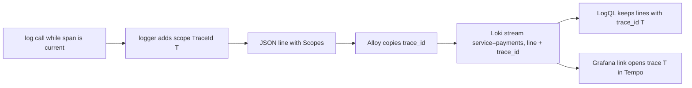

## Before you start

- [[backend.l3.tracing-through-the-outbox]] — you know that one refund's spans in `DonHang.Api`, Payments and Notifications all carry the same trace id, even those that run after the `202`.
- [[devops.l2.json-logs]] — you know that the console logger can write each log event as one JSON object per line, with fields such as `Message` and `Category`.
- [[devops.l2.centralized-logs]] — you know that Alloy sends every container's lines to Loki with a `service` label, and that a LogQL query picks streams by label, then reads their lines.

## The situation

`trace-refund.sh`, the script that sends one refund and prints its trace, has just shown you one refund of order 10 as a trace in Tempo, with spans from three services. Now you want to read what each service logged while it handled that refund. In Grafana you query `{service="payments"}` and get every line Payments wrote in the last hour, from every refund, mixed together. At stage-2 the only thing linking a request's lines was their time. The trace, though, already has an id that every one of its spans carries.

How do you get exactly this refund's log lines, from all three services, without lining them up by time?

## Core concepts

- **correlation id** — an id that every record of one piece of work carries, so the records can be gathered later; once tracing is in place, the trace id is that id.
- log scope — in .NET logging, a set of names and values attached to every line written while the scope is open; while a span is current, the logging library opens one by itself that holds the span's `TraceId` and `SpanId` (and its `ParentId`).
- `Scopes` — the field in which the JSON console formatter lists a line's open log scopes, one JSON object per scope, written only when its `IncludeScopes` option is on.
- structured metadata — names and values that Loki keeps next to each line; unlike labels, they are not part of the stream and are not indexed.
- derived field — a setting of Grafana's Loki data source that turns a value of each log line, taken from its text or, as here, from its `trace_id` metadata, into a link, here to a trace in Tempo.

## How it works



In the situation above, Payments writes `Refund ... for order 10 is done` inside a span of the refund's trace T. The log call passes only its message and values. The logging library sees that a span is current and adds a log scope holding that span's `TraceId` and `SpanId`. Because `IncludeScopes` is on, the JSON formatter writes the scope into the line's `Scopes` field. Every service in Đơn Hàng does the same, so the trace id has become the correlation id of the refund: one value, present in every line of the work.

From stage-3, Alloy also pulls the trace id out of `Scopes` and attaches it to the line as structured metadata named `trace_id`. The line goes to Loki in its usual stream, such as `{service="payments"}`; no new label is added.

To find the refund's lines, a LogQL query first picks streams by label, as before. A filter written `| trace_id="T"` after the stream selector then keeps only the lines whose `trace_id` is T. Such a filter checks a line's structured metadata as well as its labels, so it works although `trace_id` is not a label. The same query returns lines from all three services, because all three wrote T.

Grafana's Loki data source then uses the value that spans and lines share: its derived field shows each line's `trace_id` as a link that opens trace T in Tempo.

## In the Đơn Hàng system

The logging side is one setting per service in `docker-compose.yml`: `Logging__Console__FormatterOptions__IncludeScopes: "true"`, next to the `json` formatter setting from stage-2. No log call changed.

Alloy's new step sits between reading the containers and writing to Loki:

```alloy file=deploy/monitoring/alloy/config.alloy tag=stage-3 lines=29-42
// lesson: backend.l3.trace-ids-in-logs
// ...from stage-3, copy the trace id out of each JSON line's Scopes into
// structured metadata, trace_id, kept next to the line but not indexed. Not
// a label: a label with a new value for every request would make a new
// stream for every request. A line with no trace id passes through as it is...
loki.process "trace_ids" {
  stage.json {
    expressions = { trace_id = "Scopes[?TraceId] | [0].TraceId" }
  }
  stage.structured_metadata {
    values = { trace_id = "" }
  }
  forward_to = [loki.write.loki.receiver]
}
```

`stage.json` parses the line and evaluates the expression. `Scopes` is a list with one object per open scope, so the expression takes the first object that has a `TraceId` and reads its value. `stage.structured_metadata` attaches that value to the line as `trace_id`; the empty string means "use the extracted value of the same name". A line written while no span is current has no `TraceId`; the config's comment says such a line passes through as it is, without `trace_id`.

The query, from the script that reads one refund's lines:

```bash file=scripts/backend/logs-for-trace.sh tag=stage-3 lines=25-31
# lesson: backend.l3.trace-ids-in-logs
# Every service's JSON lines carry the current span's TraceId in "Scopes";
# Alloy copies it into structured metadata, trace_id, which a LogQL label
# filter can match after the stream selector. Line filters leave out the
# lines EF Core and HttpClient write for each SQL command and HTTP call.
query="{service=~\"api|payments|notifications\"} | trace_id=\"$id\" != \"Microsoft.EntityFrameworkCore\" != \"System.Net.Http\""
echo "logql> $query"
```

```text output=true
== POST /api/v1/orders/10/refund as customer 1
  -> 202
logql> {service=~"api|payments|notifications"} | trace_id="..." != "Microsoft.EntityFrameworkCore" != "System.Net.Http"
api: POST /api/v1/orders/10/refund responded 202 in ...ms
notifications: Saved the refund requested email for order 10
payments: Refund ... for order 10 is done
notifications: Saved the order refunded email for order 10
```

`$id` is the trace id of the `traceparent` the script sent with the refund request. Each `!= "text"` is a line filter: it drops the lines that contain that text, here the lines the ORM (EF Core) and the HTTP client library write for each SQL command and HTTP call inside the same trace. The rest of the script, outside the excerpt, sends the query to Loki's HTTP API and prints each line's service and `Message` in time order. The request gives only a start time, the moment the script began, so the window holds many refunds' lines; the trace id, not the time, picks these four.

The link side is in `datasources.yml`, the file that sets up Grafana's data sources, outside the excerpts. In Grafana's Loki data source, a derived field of type Label matches a label key of each line (Loki returns structured metadata among a line's labels); set as an internal link with a target data source, it opens the value as a query there, here a trace in Tempo. Đơn Hàng's derived field `TraceId` matches `trace_id` and targets the Tempo data source (its id in the file is `tempo`).

## Seniors often assume…

- **"To find one request's logs, I must pass a request id into every log call."** → Actually the logging library adds the current span's `TraceId` to every line written while that span is current, as a log scope, and context propagation already carries that id across services. You notice this at stage-3: `RequestLoggingMiddleware`, the middleware in `DonHang.Api` that writes the `... responded 202 in ...ms` line, still passes only method, path, status and time, yet its line has a `TraceId` in `Scopes`.
- **"The trace id should be a Loki label, so that looking it up is fast."** → Actually each new label value makes a new stream, so a label with one value per request would make a stream per request, and Loki indexes every stream. Structured metadata keeps the value with the line instead. You notice this in the query above: it still needs a stream selector, and `trace_id` only narrows the lines inside those streams.
- **"Logs and traces live in separate tools, so I have to line them up by time."** → Actually both carry the same trace id, so one exact value finds both. You notice this when the Notifications line written after the `202` comes back in the output with no time matching at all.

## Try it (3 minutes)

With the lab running with the monitoring profile (`docker compose --profile monitoring up -d`), in the root folder of the example repository:

1. Run `scripts/backend/logs-for-trace.sh`; it asks for a refund of order 10, waits for it, then queries Loki for that refund's trace id.
2. Look at the `service:` prefix of each line printed under the `logql>` line.

Expected result: after `-> 202` and the query, four lines appear: one from `api`, one from `payments` and two from `notifications`, ending with `notifications: Saved the order refunded email for order 10`. The stream selector and the line filters only narrow the services and drop the ORM and HTTP client lines; among the rest, the trace id alone picks this refund's lines.

## Connections

- [[backend.l3.tracing-through-the-outbox]] — the reason the consumers' lines carry the refund's trace id at all.
- [[devops.l2.centralized-logs]] — the streams and labels this lesson keeps unchanged; the trace id rides alongside them.
- [[backend.l1.structured-logging]] — the same idea of named fields, with one field the logging library now fills in for you.
- [[devops.l2.prometheus-scraping]] — labels split metrics into separate series in the same way, which is why a per-request value stays out of labels there too.
- [[backend.l3.trace-sampling]] — next: keeping only some traces, while each kept trace stays whole.

## Five-line summary

1. Once tracing is in place, the trace id is the correlation id: every log line of one request carries it, so one value gathers them.
2. At stage-3 each service's JSON lines list the current span's `TraceId` and `SpanId` in `Scopes`, turned on by `IncludeScopes` alone.
3. Alloy copies the trace id into structured metadata, `trace_id`, not a label, since a per-request label makes a stream per request.
4. `logs-for-trace.sh` picks streams by `service`, then keeps lines whose `trace_id` matches, and gets one refund's lines from three services.
5. Grafana's Loki data source turns each line's `trace_id` into a link that opens the same trace in Tempo.
