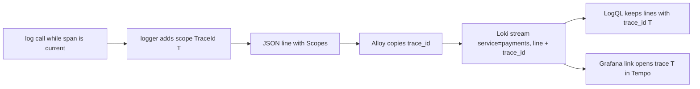

## Bạn cần biết trước

- [[backend.l3.tracing-through-the-outbox]] — bạn biết rằng các span của một lần hoàn tiền trong `DonHang.Api`, Payments và Notifications đều mang cùng một trace id, kể cả những span chạy sau `202`.
- [[devops.l2.json-logs]] — bạn biết rằng console logger có thể ghi mỗi log event thành một object JSON trên một dòng, với các trường như `Message` và `Category`.
- [[devops.l2.centralized-logs]] — bạn biết rằng Alloy gửi mọi dòng của mọi container tới Loki kèm label `service`, và một truy vấn LogQL chọn stream theo label rồi mới đọc các dòng của chúng.

## Tình huống

`trace-refund.sh`, script gửi một lần hoàn tiền rồi in trace của nó, vừa cho bạn xem một lần hoàn tiền của đơn 10 dưới dạng trace trong Tempo, với span từ ba service. Giờ bạn muốn đọc những gì mỗi service đã log khi xử lý lần hoàn tiền đó. Trong Grafana, bạn truy vấn `{service="payments"}` và nhận về mọi dòng Payments đã ghi trong một giờ qua, của mọi lần hoàn tiền, lẫn lộn vào nhau. Ở stage-2, thứ duy nhất nối các dòng của một request là thời gian của chúng. Thế nhưng trace đã có sẵn một id mà span nào của nó cũng mang.

Làm sao lấy đúng các dòng log của lần hoàn tiền này, từ cả ba service, mà không phải xếp chúng theo thời gian?

## Khái niệm cốt lõi

- **correlation id** (mã mà mọi bản ghi của cùng một việc mang theo, để gom chúng lại sau) — một id mà mọi bản ghi của cùng một việc đều mang, để sau này gom chúng lại được. Khi đã có tracing, trace id chính là id đó.
- log scope — trong logging của .NET, một tập tên và giá trị gắn vào mọi dòng được ghi trong lúc scope còn mở. Khi có một span đang là span hiện tại, thư viện logging tự mở một scope chứa `TraceId` và `SpanId` của span đó (cùng `ParentId` của nó).
- `Scopes` — trường mà JSON console formatter dùng để liệt kê các log scope đang mở của một dòng, mỗi scope một object JSON. Trường này chỉ được ghi khi option `IncludeScopes` của formatter được bật.
- structured metadata — các cặp tên và giá trị mà Loki giữ cạnh mỗi dòng. Khác với label, chúng không thuộc về stream và không được index.
- derived field — một thiết lập của data source Loki trong Grafana, biến một giá trị của mỗi dòng log thành một link, ở đây là link tới một trace trong Tempo. Giá trị đó có thể lấy từ text của dòng, hoặc như ở đây, từ metadata `trace_id`.

## Cơ chế hoạt động



Trong tình huống trên, Payments ghi `Refund ... for order 10 is done` bên trong một span thuộc trace T của lần hoàn tiền. Lời gọi log chỉ truyền message và các giá trị của nó. Thư viện logging thấy có một span đang là span hiện tại, nên thêm một log scope chứa `TraceId` và `SpanId` của span đó. Vì `IncludeScopes` đang bật, JSON formatter ghi scope này vào trường `Scopes` của dòng. Service nào trong Đơn Hàng cũng làm như vậy, nên trace id trở thành correlation id của lần hoàn tiền: một giá trị duy nhất, có mặt trong mọi dòng của việc đó.

Từ stage-3, Alloy còn lấy trace id ra khỏi `Scopes` và gắn nó vào dòng dưới dạng structured metadata tên `trace_id`. Dòng vẫn tới Loki trong stream quen thuộc của nó, ví dụ `{service="payments"}`. Không có label mới nào được thêm vào.

Để tìm các dòng của lần hoàn tiền, truy vấn LogQL vẫn chọn stream theo label trước, như cũ. Sau stream selector, một bộ lọc viết là `| trace_id="T"` chỉ giữ lại những dòng có `trace_id` bằng T. Bộ lọc kiểu này kiểm tra cả structured metadata của dòng lẫn label của nó, nên vẫn chạy được dù `trace_id` không phải label. Cùng một truy vấn trả về dòng từ cả ba service, vì cả ba đều đã ghi T.

Sau đó, data source Loki của Grafana dùng chính giá trị mà span và dòng log cùng có: derived field của nó hiện `trace_id` của mỗi dòng thành một link mở trace T trong Tempo.

## Trong hệ thống Đơn Hàng

Phía logging chỉ là một thiết lập cho mỗi service trong `docker-compose.yml`: `Logging__Console__FormatterOptions__IncludeScopes: "true"`, nằm cạnh thiết lập formatter `json` từ stage-2. Không lời gọi log nào thay đổi.

Bước mới của Alloy nằm giữa chỗ đọc các container và chỗ ghi tới Loki:

```alloy file=deploy/monitoring/alloy/config.alloy tag=stage-3 lines=29-42
// lesson: backend.l3.trace-ids-in-logs
// ...from stage-3, copy the trace id out of each JSON line's Scopes into
// structured metadata, trace_id, kept next to the line but not indexed. Not
// a label: a label with a new value for every request would make a new
// stream for every request. A line with no trace id passes through as it is...
loki.process "trace_ids" {
  stage.json {
    expressions = { trace_id = "Scopes[?TraceId] | [0].TraceId" }
  }
  stage.structured_metadata {
    values = { trace_id = "" }
  }
  forward_to = [loki.write.loki.receiver]
}
```

`stage.json` phân tích dòng và tính biểu thức. `Scopes` là một danh sách, mỗi scope đang mở là một object, nên biểu thức lấy object đầu tiên có `TraceId` và đọc giá trị của nó. `stage.structured_metadata` gắn giá trị đó vào dòng với tên `trace_id`. Chuỗi rỗng nghĩa là "dùng giá trị đã trích ra có cùng tên". Một dòng được ghi khi không có span hiện tại nào thì không có `TraceId`. Comment trong config nói dòng như vậy đi qua nguyên vẹn, không có `trace_id`.

Truy vấn, lấy từ script đọc các dòng của một lần hoàn tiền:

```bash file=scripts/backend/logs-for-trace.sh tag=stage-3 lines=25-31
# lesson: backend.l3.trace-ids-in-logs
# Every service's JSON lines carry the current span's TraceId in "Scopes";
# Alloy copies it into structured metadata, trace_id, which a LogQL label
# filter can match after the stream selector. Line filters leave out the
# lines EF Core and HttpClient write for each SQL command and HTTP call.
query="{service=~\"api|payments|notifications\"} | trace_id=\"$id\" != \"Microsoft.EntityFrameworkCore\" != \"System.Net.Http\""
echo "logql> $query"
```

```text output=true
== POST /api/v1/orders/10/refund as customer 1
  -> 202
logql> {service=~"api|payments|notifications"} | trace_id="..." != "Microsoft.EntityFrameworkCore" != "System.Net.Http"
api: POST /api/v1/orders/10/refund responded 202 in ...ms
notifications: Saved the refund requested email for order 10
payments: Refund ... for order 10 is done
notifications: Saved the order refunded email for order 10
```

`$id` là trace id của `traceparent` mà script gửi kèm request hoàn tiền. Mỗi `!= "text"` là một line filter: nó bỏ những dòng chứa text đó, ở đây là các dòng mà ORM (EF Core) và thư viện HTTP client ghi cho từng câu lệnh SQL và từng lời gọi HTTP trong cùng trace. Phần còn lại của script, ngoài đoạn trích, gửi truy vấn tới HTTP API của Loki và in service cùng `Message` của từng dòng theo thứ tự thời gian. Request chỉ đưa thời điểm bắt đầu, là lúc script khởi chạy, nên khoảng thời gian đó chứa dòng của nhiều lần hoàn tiền. Chính trace id, không phải thời gian, chọn ra bốn dòng này.

Phía link nằm trong `datasources.yml`, file thiết lập các data source của Grafana, ngoài các đoạn trích. Trong data source Loki của Grafana, một derived field kiểu Label khớp với một label key của mỗi dòng (Loki trả structured metadata về chung với các label của dòng). Khi được đặt là internal link với một data source đích, nó mở giá trị đó thành một truy vấn ở đích, ở đây là một trace trong Tempo. Derived field `TraceId` của Đơn Hàng khớp với `trace_id` và trỏ tới data source Tempo (id của nó trong file là `tempo`).

## Senior hay nhầm rằng…

- **"Muốn tìm log của một request thì phải truyền request id vào mọi lời gọi log."** → Thực ra thư viện logging tự thêm `TraceId` của span hiện tại vào mọi dòng được ghi trong lúc span đó là span hiện tại, dưới dạng một log scope, và truyền ngữ cảnh trace vốn đã mang id đó qua các service. Bạn sẽ nhận ra ở stage-3: `RequestLoggingMiddleware`, middleware trong `DonHang.Api` ghi dòng `... responded 202 in ...ms`, vẫn chỉ truyền method, path, status và thời gian, vậy mà dòng của nó có `TraceId` trong `Scopes`.
- **"Trace id nên là một label của Loki, để tra cho nhanh."** → Thực ra mỗi giá trị label mới tạo ra một stream mới, nên một label có một giá trị cho mỗi request sẽ tạo một stream cho mỗi request, và Loki index mọi stream. Structured metadata thì giữ giá trị đó cùng với dòng. Bạn sẽ nhận ra ở truy vấn phía trên: nó vẫn cần stream selector, còn `trace_id` chỉ thu hẹp các dòng bên trong những stream đó.
- **"Log và trace nằm ở hai công cụ riêng, nên phải xếp chúng khớp theo thời gian."** → Thực ra cả hai đều mang cùng một trace id, nên một giá trị chính xác tìm được cả hai. Bạn sẽ nhận ra khi dòng của Notifications, ghi sau `202`, vẫn hiện trong output mà không cần khớp thời gian gì cả.

## Thử ngay (3 phút)

Khi lab đang chạy với profile monitoring (`docker compose --profile monitoring up -d`), ở thư mục gốc của repo ví dụ:

1. Chạy `scripts/backend/logs-for-trace.sh`. Script yêu cầu hoàn tiền cho đơn 10, chờ xong, rồi truy vấn Loki theo trace id của lần hoàn tiền đó.
2. Xem tiền tố `service:` của từng dòng được in dưới dòng `logql>`.

Kết quả mong đợi: sau `-> 202` và truy vấn, bốn dòng hiện ra: một từ `api`, một từ `payments` và hai từ `notifications`, kết thúc bằng `notifications: Saved the order refunded email for order 10`. Stream selector và các line filter chỉ thu hẹp service và bỏ các dòng của ORM và HTTP client. Trong số còn lại, chỉ riêng trace id chọn ra các dòng của lần hoàn tiền này.

## Liên hệ

- [[backend.l3.tracing-through-the-outbox]] — lý do các dòng của consumer mang được trace id của lần hoàn tiền.
- [[devops.l2.centralized-logs]] — stream và label mà bài này giữ nguyên. Trace id đi kèm bên cạnh chúng.
- [[backend.l1.structured-logging]] — cùng ý tưởng về các trường có tên, giờ có thêm một trường do thư viện logging tự điền cho bạn.
- [[devops.l2.prometheus-scraping]] — label cũng tách metric thành các series riêng theo cùng cách đó, nên ở đó một giá trị theo từng request cũng không được đưa vào label.
- [[backend.l3.trace-sampling]] — bài tiếp theo: chỉ giữ một phần các trace, trong khi mỗi trace được giữ vẫn còn nguyên vẹn.

## Tóm tắt 5 dòng

1. Khi đã có tracing, trace id chính là correlation id: mọi dòng log của một request đều mang nó, nên một giá trị gom được tất cả.
2. Ở stage-3, các dòng JSON của mỗi service liệt kê `TraceId` và `SpanId` của span hiện tại trong `Scopes`, chỉ nhờ bật `IncludeScopes`.
3. Alloy chép trace id vào structured metadata `trace_id`, không phải label, vì label theo từng request tạo một stream cho mỗi request.
4. `logs-for-trace.sh` chọn stream theo `service`, rồi giữ các dòng có `trace_id` khớp, và nhận về các dòng của một lần hoàn tiền từ ba service.
5. Data source Loki của Grafana biến `trace_id` của mỗi dòng thành link mở chính trace đó trong Tempo.
