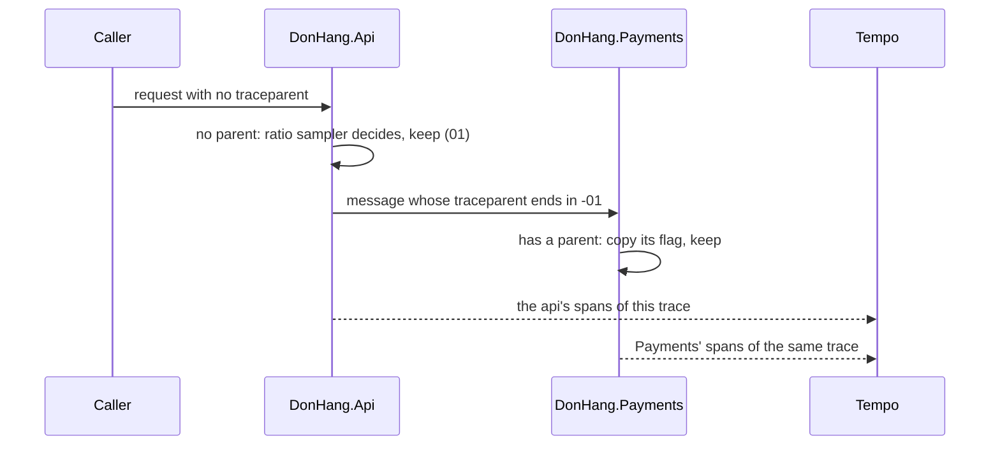

## Before you start

- [[backend.l3.trace-context-propagation]] — you know that `traceparent` carries a trace id, a parent span id and two hex digits of flags, and that ASP.NET Core reads it on each request.
- [[backend.l3.trace-ids-in-logs]] — you know that one refund's spans and log lines in `DonHang.Api`, Payments and Notifications all share one trace id.

## The situation

In the lab, with the monitoring profile up, every request you send to the api's endpoints without a `traceparent` leaves a trace in Tempo. You open `DonHang.Api/Program.cs` and find a number you did not expect: `Telemetry:SampleRatio`, `0.1` unless configured. Outside the lab, the api would keep only about one trace in ten.

A refund's trace runs through the api, Payments and Notifications, and each of them exports its own spans. If each service picked its own one in ten, a kept trace could hold the api's spans but miss those of Payments, and the tree in Grafana would have holes.

How do all the services agree on which traces to keep, so that every kept trace is whole?

## Core concepts

- **sampling (tracing)** — keeping only some traces, because recording, sending and storing every span of every request costs CPU, network and storage in step with traffic; in the situation above, `0.1` is the share the api would keep.
- head sampling — sampling in which the service where a trace starts decides once, before the work has run, whether the whole trace is kept.
- sampled flag — the lowest bit of the flags at the end of `traceparent`: `...-01` says the trace is kept, `...-00` that it is dropped; it carries the head decision to every later process.
- parent-based sampler — `ParentBasedSampler`: for a span that has a parent it copies the parent's decision, and only for the first span of a trace does it ask another sampler.
- ratio sampler — `TraceIdRatioBasedSampler`: keeps a new trace with a given probability.

## How it works



In the situation above, a request reaches `DonHang.Api` with no `traceparent`, so the api's span is the first of a new trace. The parent-based sampler finds no parent and hands the question to the ratio sampler, which keeps the trace with probability `Telemetry:SampleRatio`. That is head sampling: one decision, at the head of the trace, before anything else has happened.

The decision does not stay in the api. The trace context it passes on, in an HTTP header or in a message's `traceparent`, ends with the sampled flag. When Payments starts a span for that message, its own parent-based sampler finds a parent and copies the parent's flag; Payments' ratio plays no part. Notifications does the same one hop further. Every service that receives the flag keeps or drops the same trace, so a kept trace reaches Tempo with all its spans.

Early is what makes the decision cheap, and it is also its limit. Because the decision comes first, the services never record or send the spans of a dropped trace. When the api decides, the request has not run yet, so the sampler cannot know that this one will end in a `500`. With a ratio of `0.1`, the trace of a rare error is dropped nine times in ten on average. Keeping traces by how they ended needs a component that waits until a trace is complete before choosing; Đơn Hàng has none at stage-3.

## In the Đơn Hàng system

The sampler, in the api's tracing setup:

```csharp file=DonHang.Api/Program.cs tag=stage-3 lines=101-116
// lesson: backend.l3.trace-sampling
// Which traces are kept: a span with a parent follows the parent's decision,
// the sampled flag of the traceparent it came with, so a trace is kept or
// dropped whole. A trace that starts here is kept with the probability
// Telemetry:SampleRatio, 0.1 unless configured; the lab keeps every trace.
var sampleRatio = builder.Configuration.GetValue("Telemetry:SampleRatio", 0.1);
builder.Services.AddOpenTelemetry()
    .ConfigureResource(resource => resource.AddService("donhang-api"))
    .WithTracing(tracing => tracing
        .SetSampler(new ParentBasedSampler(new TraceIdRatioBasedSampler(sampleRatio)))
        .AddAspNetCoreInstrumentation(options => options.Filter = context =>
            !context.Request.Path.StartsWithSegments("/health") && !context.Request.Path.StartsWithSegments("/metrics"))
        .AddHttpClientInstrumentation()
        .AddNpgsql()
        .AddSource(MessageTracing.SourceName)
        .AddOtlpExporter());
```

Look at `SetSampler`: the ratio sampler sits inside the parent-based one, so it is asked only about traces that start in the api. `GetValue` reads the ratio from configuration with `0.1` as the fallback. In `docker-compose.yml`, the environment variable `Telemetry__SampleRatio: "1.0"`, which configuration reads as `Telemetry:SampleRatio`, overrides it, so the lab keeps every trace that starts there. Payments, Notifications and the fake gateway set the same sampler in their own `Program.cs`, outside the excerpt, so all of them follow the flag in the same way.

The lab shows the flag at work with two requests that differ only in it. `new_traceparent` makes a `traceparent` with a fresh trace id and the given flags; `wait_for_spans` and `span_count` ask Tempo for a trace's spans.

```bash file=scripts/backend/trace-sampling.sh tag=stage-3 lines=17-37
# lesson: backend.l3.trace-sampling
# The last two digits of traceparent are its flags: 01 means the caller
# kept (sampled) this trace, 00 that it dropped it. The api's sampler is
# parent-based: for a request that arrives with a traceparent it follows
# that decision, whatever Telemetry__SampleRatio says for traces that start
# in the api (1.0 in the lab: all of them).
before=$(product_reads)
sampled=$(new_traceparent 01)
dropped=$(new_traceparent 00)
for traceparent in "$sampled" "$dropped"; do
  echo "== GET /api/v1/products/3 with traceparent ...-$(echo "$traceparent" | cut -d- -f4)"
  curl -sS -o /dev/null -w '  -> %{http_code}\n' http://localhost:8080/api/v1/products/3 -H "traceparent: $traceparent"
done

# Spans reach Tempo in batches within seconds; the second trace never does.
wait_for_spans "$(trace_id "$sampled")" 1
sleep 10
echo "== spans in Tempo for the trace marked 01: $(span_count "$(trace_id "$sampled")")"
echo "== spans in Tempo for the trace marked 00: $(span_count "$(trace_id "$dropped")")"
# The request metrics do not come from spans: both reads are counted.
echo "== product reads the api counted meanwhile (http_requests_received_total): $(( $(product_reads) - before ))"
```

```text output=true
== GET /api/v1/products/3 with traceparent ...-01
  -> 200
== GET /api/v1/products/3 with traceparent ...-00
  -> 200
== spans in Tempo for the trace marked 01: 1
== spans in Tempo for the trace marked 00: 0
== product reads the api counted meanwhile (http_requests_received_total): 2
```

The script plays a caller that has already decided. Both requests answer `200`: sampling never changes how a request is handled. The api keeps its span for the `01` trace and none for the `00` trace, although its own ratio is `1.0`, because the parent's decision wins. The script waits until the `01` trace, sent just before, has arrived in Tempo, then waits ten more seconds before counting. So the `0` is not a batch still on its way.

The last line takes `http_requests_received_total` from the api's `/metrics` through `product_reads`, a helper above the excerpt. prometheus-net, the library in the api that counts requests and serves them on `/metrics` for Prometheus to scrape, keeps that counter. It grows on every request, traced or not, so it counts both reads. Sampling traces leaves the request counts on the dashboard exact.

## Seniors often assume…

- **"Keeping 10% of traces means each trace keeps 10% of its spans."** → Actually the decision is made per trace, and every span of a kept trace is recorded. You notice this when every trace you open in Tempo has its full tree, with no gaps, even though most traces are missing from the search.
- **"Each service can keep 10% of its spans on its own, and the traces still come out whole."** → Actually nothing makes separate decisions match: each service has its own sampler and ratio in its own configuration, so a trace kept by the api could lose Payments' spans. Each service needs to follow the flag it receives, which the parent-based sampler does. You would notice it as traces in Tempo whose tree has the api's spans but no Payments' spans.
- **"Once traces are sampled, the request rate on the dashboard is sampled too."** → Actually Đơn Hàng's request metrics come from prometheus-net, which counts every request whether or not its trace is kept. You notice this when `trace-sampling.sh` prints `2` for the counter, with one of the two traces missing from Tempo.

## Try it (3 minutes)

With the lab running with the monitoring profile (`docker compose --profile monitoring up -d`), in the root folder of the example repository:

1. Run `scripts/backend/trace-sampling.sh`.
2. Compare the two `spans in Tempo` lines with the last line of the output.

Expected result: the trace marked `01` has `1` span, the trace marked `00` has `0`, and the counter line shows `2`. Both requests were served and counted, but only the one whose caller said "keep" left a trace.

## Connections

- [[backend.l3.trace-context-propagation]] — prerequisite: the flags at the end of `traceparent`, which that lesson left aside, are where the sampling decision travels.
- [[backend.l3.opentelemetry-sdk]] — the same SDK setup one step further: `SetSampler` decides which of the spans the instrumentation makes are recorded and exported.
- [[devops.l2.counters-and-rate]] — the contrast: a counter counts every request, so rates stay exact while traces are only a sample.
- [[backend.l3.trace-ids-in-logs]] — prerequisite: the trace id that gathers one refund's log lines is the same id whose trace sampling keeps or drops.

## Five-line summary

1. Sampling keeps whole traces, not parts of them, and the decision is made once, by the service where the trace starts.
2. With head sampling that decision travels to every later service in the sampled flag at the end of `traceparent`.
3. A parent-based sampler copies the parent's flag, so every service keeps or drops the same trace and kept traces stay whole.
4. At stage-3 the ratio of the service where a trace starts is `Telemetry:SampleRatio`, `1.0` in the lab; `trace-sampling.sh` shows only the `01` trace.
5. Request metrics come from prometheus-net, not from traces, so sampling does not change the counts; a rare error's trace may be dropped.
