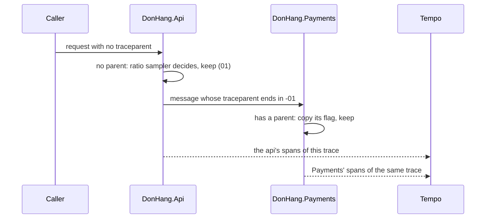

## Bạn cần biết trước

- [[backend.l3.trace-context-propagation]] — bạn biết rằng `traceparent` mang một trace id, một parent span id và hai chữ số hex làm cờ, và ASP.NET Core đọc header này ở mỗi request.
- [[backend.l3.trace-ids-in-logs]] — bạn biết rằng các span và dòng log của một lần hoàn tiền trong `DonHang.Api`, Payments và Notifications đều chung một trace id.

## Tình huống

Trong lab, khi profile monitoring đang chạy, mọi request bạn gửi tới các endpoint của api mà không kèm `traceparent` đều để lại một trace trong Tempo. Bạn mở `DonHang.Api/Program.cs` và gặp một con số không ngờ tới: `Telemetry:SampleRatio`, mặc định là `0.1` nếu không cấu hình. Ra ngoài lab, api sẽ chỉ giữ khoảng một trace trên mười.

Trace của một lần hoàn tiền đi qua api, Payments và Notifications, và mỗi service tự export span của mình. Nếu mỗi service tự chọn lấy một trên mười theo cách riêng, một trace được giữ có thể có span của api nhưng thiếu span của Payments, và cây span trong Grafana sẽ bị thủng lỗ.

Làm sao để mọi service thống nhất giữ những trace nào, sao cho trace nào được giữ cũng còn nguyên vẹn?

## Khái niệm cốt lõi

- **lấy mẫu trace** (sampling) — chỉ giữ lại một phần các trace, vì ghi, gửi và lưu mọi span của mọi request tốn CPU, mạng và dung lượng lưu trữ tăng theo lưu lượng. Trong tình huống trên, `0.1` là tỉ lệ api sẽ giữ.
- head sampling — kiểu lấy mẫu trong đó service nơi trace bắt đầu quyết định một lần, trước khi công việc chạy, xem có giữ cả trace hay không.
- sampled flag — bit thấp nhất trong phần cờ ở cuối `traceparent`: `...-01` nghĩa là trace được giữ, `...-00` là bị bỏ. Cờ này mang quyết định ở đầu trace tới mọi process phía sau.
- parent-based sampler — `ParentBasedSampler`: với span có parent, nó chép lại quyết định của parent, và chỉ với span đầu tiên của một trace nó mới hỏi một sampler khác.
- ratio sampler — `TraceIdRatioBasedSampler`: giữ một trace mới với một xác suất cho trước.

## Cơ chế hoạt động



Trong tình huống trên, một request tới `DonHang.Api` mà không có `traceparent`, nên span của api là span đầu tiên của một trace mới. Parent-based sampler không thấy parent nào và chuyển câu hỏi cho ratio sampler. Ratio sampler giữ trace với xác suất `Telemetry:SampleRatio`. Đó là head sampling: một quyết định duy nhất, ở đầu trace, trước khi mọi chuyện khác xảy ra.

Quyết định đó không nằm lại trong api. Trace context mà api chuyển đi, trong header HTTP hay trong `traceparent` của một message, kết thúc bằng sampled flag. Khi Payments mở một span cho message đó, parent-based sampler của chính Payments thấy có parent và chép lại cờ của parent. Tỉ lệ của Payments không tham gia gì. Notifications cũng làm vậy ở chặng tiếp theo. Service nào nhận cờ cũng giữ hoặc bỏ cùng một trace, nên trace được giữ tới Tempo với đủ mọi span.

Quyết sớm khiến quyết định rẻ, và đó cũng là giới hạn của nó. Vì quyết định có trước, các service không bao giờ ghi hay gửi span của một trace đã bị bỏ. Lúc api quyết, request còn chưa chạy, nên sampler không thể biết request này sẽ kết thúc bằng `500`. Với tỉ lệ `0.1`, trace của một lỗi hiếm trung bình bị bỏ chín lần trên mười. Muốn giữ trace theo kết cục của nó thì cần một thành phần chờ tới khi trace hoàn tất rồi mới chọn. Ở stage-3, Đơn Hàng chưa có thành phần nào như vậy.

## Trong hệ thống Đơn Hàng

Sampler nằm trong phần thiết lập tracing của api:

```csharp file=DonHang.Api/Program.cs tag=stage-3 lines=101-116
// lesson: backend.l3.trace-sampling
// Which traces are kept: a span with a parent follows the parent's decision,
// the sampled flag of the traceparent it came with, so a trace is kept or
// dropped whole. A trace that starts here is kept with the probability
// Telemetry:SampleRatio, 0.1 unless configured; the lab keeps every trace.
var sampleRatio = builder.Configuration.GetValue("Telemetry:SampleRatio", 0.1);
builder.Services.AddOpenTelemetry()
    .ConfigureResource(resource => resource.AddService("donhang-api"))
    .WithTracing(tracing => tracing
        .SetSampler(new ParentBasedSampler(new TraceIdRatioBasedSampler(sampleRatio)))
        .AddAspNetCoreInstrumentation(options => options.Filter = context =>
            !context.Request.Path.StartsWithSegments("/health") && !context.Request.Path.StartsWithSegments("/metrics"))
        .AddHttpClientInstrumentation()
        .AddNpgsql()
        .AddSource(MessageTracing.SourceName)
        .AddOtlpExporter());
```

Nhìn vào `SetSampler`: ratio sampler nằm bên trong parent-based sampler, nên nó chỉ được hỏi về những trace bắt đầu ở api. `GetValue` đọc tỉ lệ từ cấu hình, lấy `0.1` khi không có giá trị. Trong `docker-compose.yml`, biến môi trường `Telemetry__SampleRatio: "1.0"`, được cấu hình đọc thành `Telemetry:SampleRatio`, ghi đè giá trị này, nên lab giữ mọi trace bắt đầu ở api. Payments, Notifications và cổng thanh toán giả đặt cùng sampler đó trong `Program.cs` của riêng chúng, ngoài đoạn trích, nên tất cả đều làm theo cờ như nhau.

Lab cho thấy cờ hoạt động thế nào bằng hai request chỉ khác nhau ở cờ. `new_traceparent` tạo một `traceparent` với trace id mới và phần cờ được truyền vào. `wait_for_spans` và `span_count` hỏi Tempo các span của một trace.

```bash file=scripts/backend/trace-sampling.sh tag=stage-3 lines=17-37
# lesson: backend.l3.trace-sampling
# The last two digits of traceparent are its flags: 01 means the caller
# kept (sampled) this trace, 00 that it dropped it. The api's sampler is
# parent-based: for a request that arrives with a traceparent it follows
# that decision, whatever Telemetry__SampleRatio says for traces that start
# in the api (1.0 in the lab: all of them).
before=$(product_reads)
sampled=$(new_traceparent 01)
dropped=$(new_traceparent 00)
for traceparent in "$sampled" "$dropped"; do
  echo "== GET /api/v1/products/3 with traceparent ...-$(echo "$traceparent" | cut -d- -f4)"
  curl -sS -o /dev/null -w '  -> %{http_code}\n' http://localhost:8080/api/v1/products/3 -H "traceparent: $traceparent"
done

# Spans reach Tempo in batches within seconds; the second trace never does.
wait_for_spans "$(trace_id "$sampled")" 1
sleep 10
echo "== spans in Tempo for the trace marked 01: $(span_count "$(trace_id "$sampled")")"
echo "== spans in Tempo for the trace marked 00: $(span_count "$(trace_id "$dropped")")"
# The request metrics do not come from spans: both reads are counted.
echo "== product reads the api counted meanwhile (http_requests_received_total): $(( $(product_reads) - before ))"
```

```text output=true
== GET /api/v1/products/3 with traceparent ...-01
  -> 200
== GET /api/v1/products/3 with traceparent ...-00
  -> 200
== spans in Tempo for the trace marked 01: 1
== spans in Tempo for the trace marked 00: 0
== product reads the api counted meanwhile (http_requests_received_total): 2
```

Script đóng vai một caller đã quyết định sẵn. Cả hai request đều trả `200`: lấy mẫu trace không bao giờ đổi cách xử lý request. Api giữ span của nó cho trace `01` và không giữ span nào cho trace `00`, dù tỉ lệ của chính api là `1.0`, vì quyết định của parent thắng. Script chờ tới khi trace `01`, gửi ngay trước đó, đã tới Tempo, rồi chờ thêm mười giây mới đếm. Vì vậy số `0` không phải một batch còn đang trên đường tới.

Dòng cuối lấy `http_requests_received_total` từ `/metrics` của api qua `product_reads`, một helper nằm phía trên đoạn trích. Counter này do prometheus-net giữ, thư viện trong api đếm request và phục vụ chúng ở `/metrics` để Prometheus scrape. Nó tăng ở mọi request, có trace hay không, nên đếm đủ cả hai lần đọc. Lấy mẫu trace không làm sai số request trên dashboard.

## Senior hay nhầm rằng…

- **"Giữ 10% trace nghĩa là mỗi trace giữ 10% span của nó."** → Thực ra quyết định được đưa ra cho từng trace, và mọi span của một trace được giữ đều được ghi lại. Bạn sẽ nhận ra khi trace nào mở trong Tempo cũng có cây span đầy đủ, không có lỗ hổng, dù phần lớn trace không có trong kết quả tìm kiếm.
- **"Mỗi service có thể tự giữ 10% span của mình, trace vẫn ra nguyên vẹn."** → Thực ra không có gì khiến các quyết định riêng lẻ khớp nhau: mỗi service có sampler và tỉ lệ riêng trong cấu hình riêng, nên một trace được api giữ có thể mất span của Payments. Mỗi service cần làm theo cờ mà nó nhận được, và parent-based sampler làm đúng điều đó. Bạn sẽ nhận ra khi thấy trong Tempo những trace có span của api mà không có span nào của Payments.
- **"Đã lấy mẫu trace thì request rate trên dashboard cũng bị lấy mẫu theo."** → Thực ra metric request của Đơn Hàng đến từ prometheus-net, thư viện đếm mọi request dù trace của nó có được giữ hay không. Bạn sẽ nhận ra khi `trace-sampling.sh` in `2` cho counter, trong khi một trong hai trace không có trong Tempo.

## Thử ngay (3 phút)

Khi lab đang chạy với profile monitoring (`docker compose --profile monitoring up -d`), ở thư mục gốc của repo ví dụ:

1. Chạy `scripts/backend/trace-sampling.sh`.
2. So hai dòng `spans in Tempo` với dòng cuối của output.

Kết quả mong đợi: trace đánh dấu `01` có `1` span, trace đánh dấu `00` có `0`, và dòng counter hiện `2`. Cả hai request đều được phục vụ và được đếm, nhưng chỉ request mà caller bảo "giữ" mới để lại trace.

## Liên hệ

- [[backend.l3.trace-context-propagation]] — kiến thức cần trước: phần cờ ở cuối `traceparent`, mà bài đó để ngỏ, chính là nơi quyết định lấy mẫu đi theo.
- [[backend.l3.opentelemetry-sdk]] — cùng phần thiết lập SDK, đi thêm một bước: `SetSampler` quyết định span nào trong số span mà instrumentation tạo ra được ghi lại và export.
- [[devops.l2.counters-and-rate]] — điểm tương phản: counter đếm mọi request, nên rate vẫn chính xác trong khi trace chỉ là một mẫu.
- [[backend.l3.trace-ids-in-logs]] — kiến thức cần trước: trace id gom các dòng log của một lần hoàn tiền cũng chính là id của trace mà lấy mẫu trace giữ lại hoặc bỏ đi.

## Tóm tắt 5 dòng

1. Lấy mẫu trace giữ trọn trace chứ không giữ từng phần, và quyết định được đưa ra một lần, bởi service nơi trace bắt đầu.
2. Với head sampling, quyết định đó đi tới mọi service phía sau trong sampled flag ở cuối `traceparent`.
3. Parent-based sampler chép cờ của parent, nên mọi service giữ hoặc bỏ cùng một trace và trace được giữ luôn nguyên vẹn.
4. Ở stage-3, tỉ lệ của service nơi trace bắt đầu là `Telemetry:SampleRatio`, `1.0` trong lab. `trace-sampling.sh` cho thấy chỉ trace `01` được giữ.
5. Metric request đến từ prometheus-net, không từ trace, nên lấy mẫu không làm đổi số đếm, còn trace của một lỗi hiếm thì có thể bị bỏ.
