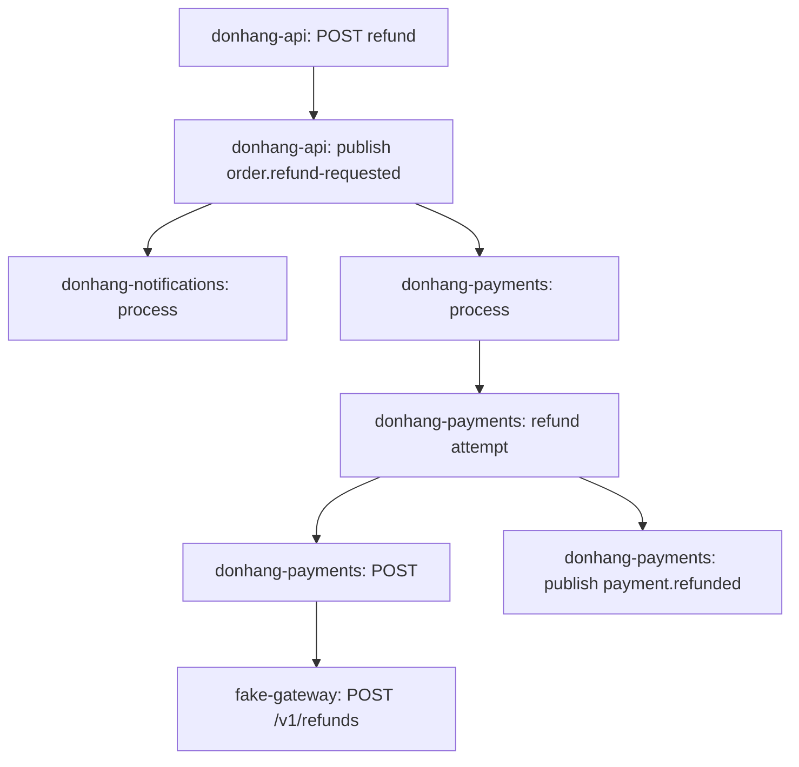

## Before you start

- [[backend.l3.observability]] — you know that the log lines of one request share no field across services, so only their times link them.
- [[backend.l3.saga]] — you know the refund's four steps: `DonHang.Api`, then Payments and the gateway, then `DonHang.Api` again, with Notifications sending an email on the way.

## The situation

Customer 1 asks for order 10's money back. `POST /api/v1/orders/10/refund` answers `202` at once, and the "order refunded" email arrives a little later. In between, the refund passed through `DonHang.Api`, RabbitMQ, `DonHang.Payments`, the gateway and `DonHang.Notifications`, each writing its own log lines.

You want to know what actually happened: which services handled this refund, which step started which, and how long each took. Matching log lines of four services by their timestamps is the guesswork the previous lesson ended on.

How can one record hold everything this refund caused, in every service, with its order and its times?

## Core concepts

- **trace (distributed tracing)** — the record of one piece of work, such as one request, across every process it reaches; every span in it carries the same trace id, the refund's in the situation above.
- **span (tracing)** — one timed operation inside a trace, such as handling one HTTP request or running one SQL command, with a name, a start time, a duration and attributes, name–value pairs that describe it.
- parent span — the span whose operation caused this one; every span except the one that started the trace names its parent.
- **Tempo** — a store for traces that keeps spans by trace id; Grafana queries it as a third data source next to Prometheus and Loki.

## How it works



Each box is one span; each arrow points from parent to child. Some spans of the real trace are left out.

In the situation above, the refund is one trace. Every span recorded for it carries the same trace id; that id gathers spans from four services into one record.

The top span is `DonHang.Api` handling the refund request, and each SQL command the api runs meanwhile is its child. Publishing `order.refund-requested` is another child, recorded by the api's outbox relay, a background loop that publishes saved outbox rows about once a second. Each service that processes that message records a span whose parent is the publish span: one in Notifications, one in Payments. Payments' refund attempt is a child of its consumer span. The attempt has two children: its outgoing call to the gateway, and publishing `payment.refunded`, its result. The gateway's handling of that call is a child of the outgoing call, although it runs in another process.

Because every span names its parent, the spans form a tree. The trace id says which spans belong together; the parent link says which operation caused which.

Every service sends its spans to Alloy, a collector container in the lab that forwards them to Tempo. Tempo stores them by trace id, so asking it for one id returns the whole tree.

A span's times need not nest inside its parent's. The api answers `202` as soon as step 1 has committed. The message is published later, when the relay picks up the row on its next pass; the publish span and the consumer spans normally start after the `202`, so a span lower in the tree can end long after the request span above it has ended.

## In the Đơn Hàng system

`scripts/backend/trace-refund.sh` asks for a refund of order 10, then prints its trace from Tempo:

```bash file=scripts/backend/trace-refund.sh tag=stage-3 lines=24-38
traceparent=$(new_traceparent)
echo "== POST /api/v1/orders/10/refund as customer 1"
curl -sS -o /dev/null -w '  -> %{http_code}\n' -X POST http://localhost:8080/api/v1/orders/10/refund \
  -H "Authorization: Bearer $token" -H "traceparent: $traceparent"
wait_for_status 10 cancelled

# lesson: backend.l3.traces-and-spans
# Every span below has the same trace id. Each line is one span, indented
# under the span that caused it: the request, the messages through RabbitMQ
# (publish, then process in another service), RefundSender's attempt and its
# call to the gateway. The consumers' spans start after the request has
# answered 202, so they end long after their parent.
wait_for_spans "$(trace_id "$traceparent")" 20
echo "== the trace in Tempo, one line per span (service: span name)"
print_trace_tree "$(trace_id "$traceparent")"
```

```text output=true
== POST /api/v1/orders/10/refund as customer 1
  -> 202
== the trace in Tempo, one line per span (service: span name)
donhang-api: POST api/v1/orders/{id:int}/refund  (5 SQL)
  donhang-api: publish order.refund-requested
    donhang-notifications: process notifications.order-events  (1 SQL)
    donhang-payments: process payments.refund-requests  (2 SQL)
      donhang-payments: refund attempt
        donhang-payments: POST
          fake-gateway: POST /v1/refunds
        donhang-payments: publish payment.refunded
          donhang-api: process orders.payment-events  (4 SQL)
            donhang-api: publish order.refunded
              donhang-notifications: process notifications.order-events  (1 SQL)
```

`traceparent` is a header value that carries the trace id. Line 24 makes one up, with a trace id and a parent span id that no span in Tempo has. Lines 26–27 send the refund request with curl, a command-line HTTP client, with customer 1's access token and the `traceparent` header, and print only the status code. Without that header, the api would make up its own trace id and the script would not know which one to ask for. How the id travels from one process to the next is a later lesson.

After the request, line 36 (`wait_for_spans`) waits until Tempo holds at least 20 spans for the id and the count stops growing. `print_trace_tree`, in `scripts/lib/tempo.sh` outside the excerpt, prints each span under its parent and counts the SQL spans on their parent's line instead of printing them. The api's span is printed at the top because its parent, the made-up one, was never recorded.

The 11 lines come from four services under one trace id; with the 13 counted SQL spans they make the 24 spans the script waited for. A consumer span is named after the queue it reads, so `payments.refund-requests` is where Payments receives `order.refund-requested`. `donhang-payments: POST` is Payments' outgoing call; the line under it is the same call as `fake-gateway` handled it, in another process. RefundSender, in the comment, is the background job in Payments that makes the refund attempt.

Grafana finds Tempo through its data source file:

```yaml file=deploy/monitoring/grafana/provisioning/datasources/datasources.yml tag=stage-3 lines=34-41
  # lesson: backend.l3.traces-and-spans
  # From stage-3, the third data source: Tempo, for traces. Explore → Tempo
  # finds a trace by its id and draws its spans as a tree on a timeline.
  - name: Tempo
    uid: tempo
    type: tempo
    access: proxy
    url: http://tempo:3200
```

Prometheus and Loki are the two entries above it in the same file. Of Tempo's keys, only `url` matters here: Grafana reaches Tempo at `tempo:3200`, the same address `scripts/lib/tempo.sh` asks for the script's trace.

## Seniors often assume…

- **"A trace is just a more detailed log file of one service."** → Actually one trace covers every process the work reached, and each span records its parent and its duration, which a log line does not. You notice this when the refund's tree shows `donhang-api`, `donhang-payments`, `donhang-notifications` and `fake-gateway` under one id.
- **"Each service keeps its own trace of a request, and someone matches them up later."** → Actually every service records its spans with the same trace id and a parent, and sends them to one store. The link is made when each span is recorded, not afterwards. You notice this when the script asks Tempo for one id and gets spans from four services back.
- **"Tracing records every line of code that ran, like a debugger does."** → Actually a trace holds only the operations something recorded as spans: requests, messages, SQL commands, the refund attempt. Whatever runs between them shows only as part of a parent's duration. You notice this when the whole refund comes back as 11 spans plus SQL counts, not one line per method.
- **"A child span always ends before its parent does."** → Actually that holds only when the parent waits for the child's work to finish. Work handed over to run later, here the outbox row the api's relay publishes and the messages the consumers process, keeps running after the request has answered `202`. You notice this in Grafana's Explore page with Tempo chosen as the data source, where the same trace's timeline shows the Payments spans starting after the request span has ended.

## Try it (3 minutes)

With the lab running with the monitoring profile (`docker compose --profile monitoring up -d`), in the root folder of the example repository:

1. Run `scripts/backend/trace-refund.sh`.
2. Find the line `fake-gateway` recorded and the line directly above it.
3. Using what "How it works" said about the `202`, decide: is the top span's duration the time the whole refund took?

Expected result: `202`, then 11 indented lines; `fake-gateway: POST /v1/refunds` sits under `donhang-payments: POST`. For item 3, check your answer below.

<details><summary>Suggested answer</summary>

No. The top span ends when `DonHang.Api` answers `202`. The consumer spans of Payments and Notifications, and everything below them, normally start after that answer. The whole refund runs from the top span's start to the end of whichever span finishes last.

</details>

## Connections

- [[backend.l3.observability]] — the problem this lesson answers: log lines with no shared field, linked only by time.
- [[backend.l3.saga]] — the refund saga whose steps appear here as branches of one tree.
- [[design.l1.tracing-a-request-through-layers]] — the same idea one level down: following a request through the layers of one process by reading code, where a trace records it while running, across processes.
- [[backend.l2.efcore-generated-sql]] — where you saw the SQL that EF Core sends; here each such command is a span, counted on its parent's line.
- [[devops.l2.grafana-dashboards]] — the data source file that gains Tempo as its third entry.
- [[backend.l3.opentelemetry-sdk]] — the next question: how each service creates its spans and sends them.

## Five-line summary

1. A trace records one piece of work across every process it reaches, and every span in it carries the same trace id.
2. A span is one timed operation, such as a request or an SQL command, with a name, start, duration and attributes.
3. Every span except the first names its parent, so a trace forms a tree showing which operation caused which.
4. At stage-3 every service sends its spans through Alloy to Tempo, which Grafana queries next to Prometheus and Loki.
5. The refund's consumer spans normally start after the request has answered `202`, so a span below another can end long after it.
