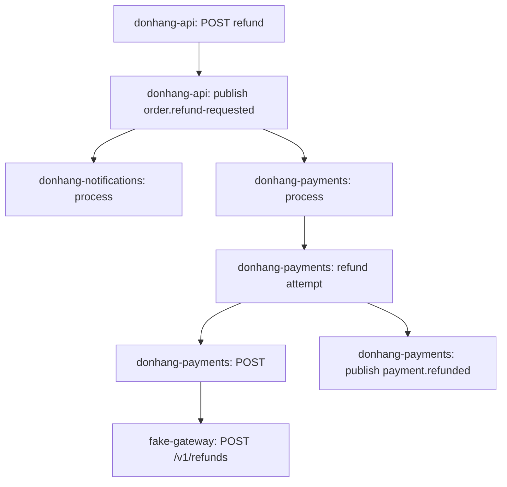

## Bạn cần biết trước

- [[backend.l3.observability]] — bạn biết rằng các dòng log của một request ở các service khác nhau không có trường nào chung, nên chỉ thời điểm ghi mới nối được chúng.
- [[backend.l3.saga]] — bạn biết bốn bước của lần hoàn tiền: `DonHang.Api`, rồi Payments và cổng thanh toán, rồi lại `DonHang.Api`, còn Notifications gửi email dọc đường.

## Tình huống

Khách hàng 1 yêu cầu hoàn tiền cho đơn 10. `POST /api/v1/orders/10/refund` trả về `202` ngay, và email "order refunded" tới sau đó một lúc. Ở giữa, lần hoàn tiền đã đi qua `DonHang.Api`, RabbitMQ, `DonHang.Payments`, cổng thanh toán và `DonHang.Notifications`, mỗi nơi ghi các dòng log riêng.

Bạn muốn biết chuyện gì đã thật sự xảy ra: những service nào đã xử lý lần hoàn tiền này, bước nào khởi động bước nào, và mỗi bước mất bao lâu. Ghép các dòng log của bốn service theo timestamp chính là kiểu đoán mò mà bài trước dừng lại.

Làm sao một bản ghi duy nhất chứa được mọi thứ lần hoàn tiền này gây ra, ở mọi service, kèm thứ tự và thời gian?

## Khái niệm cốt lõi

- **trace (distributed tracing)** — bản ghi của một việc, như một request, qua mọi process mà việc đó đi tới. Mọi span trong đó mang cùng một trace id, ở tình huống trên là id của lần hoàn tiền.
- **span (tracing)** — một thao tác có thời gian bên trong trace, như xử lý một HTTP request hay chạy một câu lệnh SQL. Span có tên, thời điểm bắt đầu, thời lượng và các attribute, tức các cặp tên–giá trị mô tả nó.
- span cha — span có thao tác đã gây ra span này. Mọi span đều ghi tên span cha, trừ span đã bắt đầu trace.
- **Tempo** — kho lưu trace, giữ các span theo trace id. Grafana truy vấn nó như data source thứ ba, cạnh Prometheus và Loki.

## Cơ chế hoạt động



Mỗi ô là một span, mỗi mũi tên chỉ từ span cha sang span con. Một số span của trace thật không được vẽ ở đây.

Trong tình huống trên, lần hoàn tiền là một trace. Mọi span ghi cho nó đều mang cùng một trace id, và chính id đó gom span từ bốn service thành một bản ghi.

Span trên cùng là `DonHang.Api` xử lý request hoàn tiền, và mỗi câu lệnh SQL mà api chạy trong lúc đó là con của nó. Publish `order.refund-requested` là một span con khác, do outbox relay của api ghi lại. Relay là một vòng lặp chạy nền, khoảng mỗi giây publish các dòng outbox đã lưu. Mỗi service xử lý message đó ghi một span có cha là span publish: một ở Notifications, một ở Payments. Lần thử hoàn tiền của Payments là con của span consumer. Lần thử này có hai con: lời gọi ra cổng thanh toán, và publish `payment.refunded`, tức kết quả của nó. Phần xử lý lời gọi đó ở cổng thanh toán là con của lời gọi đi ra, dù nó chạy trong một process khác.

Vì span nào cũng ghi tên span cha, các span tạo thành một cây. Trace id cho biết span nào thuộc về nhau, còn liên kết tới span cha cho biết thao tác nào gây ra thao tác nào.

Mọi service gửi span của mình tới Alloy, một container thu gom trong lab, rồi Alloy chuyển tiếp chúng tới Tempo. Tempo lưu span theo trace id, nên hỏi nó một id là nhận về cả cây.

Thời gian của một span không nhất thiết nằm gọn trong thời gian của span cha. Api trả `202` ngay khi bước 1 đã commit. Message được publish sau đó, khi relay nhặt dòng outbox ở lượt chạy kế tiếp. Span publish và các span consumer thường bắt đầu sau `202`, nên một span ở dưới trong cây có thể kết thúc rất lâu sau khi span request phía trên đã kết thúc.

## Trong hệ thống Đơn Hàng

`scripts/backend/trace-refund.sh` yêu cầu hoàn tiền cho đơn 10, rồi in trace của lần đó từ Tempo:

```bash file=scripts/backend/trace-refund.sh tag=stage-3 lines=24-38
traceparent=$(new_traceparent)
echo "== POST /api/v1/orders/10/refund as customer 1"
curl -sS -o /dev/null -w '  -> %{http_code}\n' -X POST http://localhost:8080/api/v1/orders/10/refund \
  -H "Authorization: Bearer $token" -H "traceparent: $traceparent"
wait_for_status 10 cancelled

# lesson: backend.l3.traces-and-spans
# Every span below has the same trace id. Each line is one span, indented
# under the span that caused it: the request, the messages through RabbitMQ
# (publish, then process in another service), RefundSender's attempt and its
# call to the gateway. The consumers' spans start after the request has
# answered 202, so they end long after their parent.
wait_for_spans "$(trace_id "$traceparent")" 20
echo "== the trace in Tempo, one line per span (service: span name)"
print_trace_tree "$(trace_id "$traceparent")"
```

```text output=true
== POST /api/v1/orders/10/refund as customer 1
  -> 202
== the trace in Tempo, one line per span (service: span name)
donhang-api: POST api/v1/orders/{id:int}/refund  (5 SQL)
  donhang-api: publish order.refund-requested
    donhang-notifications: process notifications.order-events  (1 SQL)
    donhang-payments: process payments.refund-requests  (2 SQL)
      donhang-payments: refund attempt
        donhang-payments: POST
          fake-gateway: POST /v1/refunds
        donhang-payments: publish payment.refunded
          donhang-api: process orders.payment-events  (4 SQL)
            donhang-api: publish order.refunded
              donhang-notifications: process notifications.order-events  (1 SQL)
```

`traceparent` là một giá trị header mang trace id. Dòng 24 tự tạo một giá trị, với trace id và id span cha mà không span nào trong Tempo có. Dòng 26–27 dùng curl, một HTTP client chạy trên dòng lệnh, gửi request hoàn tiền kèm access token của khách hàng 1 và header `traceparent`, rồi chỉ in status code. Không có header đó, api sẽ tự tạo trace id riêng và script không biết phải hỏi id nào. Trace id đi từ process này sang process khác bằng cách nào là chuyện của một bài sau.

Sau request, dòng 36 (`wait_for_spans`) chờ tới khi Tempo giữ ít nhất 20 span cho id đó và số span ngừng tăng. `print_trace_tree`, nằm trong `scripts/lib/tempo.sh` ngoài đoạn trích, in mỗi span dưới span cha của nó, còn các span SQL thì không in ra mà được đếm trên dòng của span cha. Span của api được in trên cùng vì span cha của nó, cái span tự tạo kia, chưa bao giờ được ghi lại.

11 dòng này đến từ bốn service dưới cùng một trace id. Cộng với 13 span SQL được đếm, chúng thành 24 span mà script đã chờ. Span consumer được đặt tên theo queue mà nó đọc, nên `payments.refund-requests` là nơi Payments nhận `order.refund-requested`. `donhang-payments: POST` là lời gọi đi ra của Payments, còn dòng dưới nó là cùng lời gọi đó nhưng do `fake-gateway` xử lý, trong một process khác. RefundSender, nhắc trong comment, là background job trong Payments thực hiện lần thử hoàn tiền.

Grafana tìm thấy Tempo qua file data source:

```yaml file=deploy/monitoring/grafana/provisioning/datasources/datasources.yml tag=stage-3 lines=34-41
  # lesson: backend.l3.traces-and-spans
  # From stage-3, the third data source: Tempo, for traces. Explore → Tempo
  # finds a trace by its id and draws its spans as a tree on a timeline.
  - name: Tempo
    uid: tempo
    type: tempo
    access: proxy
    url: http://tempo:3200
```

Prometheus và Loki là hai mục phía trên nó trong cùng file. Trong các key của Tempo, ở đây chỉ `url` là đáng chú ý: Grafana gọi Tempo ở `tempo:3200`, cũng là địa chỉ mà `scripts/lib/tempo.sh` hỏi để lấy trace của script.

## Senior hay nhầm rằng…

- **"Trace chỉ là một file log chi tiết hơn của một service."** → Thực ra một trace bao trùm mọi process mà việc đó đi tới, và mỗi span ghi lại span cha cùng thời lượng của nó, điều mà một dòng log không có. Bạn sẽ nhận ra khi cây của lần hoàn tiền hiện `donhang-api`, `donhang-payments`, `donhang-notifications` và `fake-gateway` dưới cùng một id.
- **"Mỗi service giữ trace riêng của một request, rồi có người ghép chúng lại sau."** → Thực ra service nào cũng ghi span của mình với cùng trace id và một span cha, rồi gửi tới cùng một kho. Liên kết được tạo ngay lúc ghi từng span, không phải về sau. Bạn sẽ nhận ra khi script hỏi Tempo một id và nhận lại span từ bốn service.
- **"Tracing ghi lại mọi dòng code đã chạy, giống như debugger."** → Thực ra trace chỉ chứa những thao tác có thứ gì đó ghi lại thành span: request, message, câu lệnh SQL, lần thử hoàn tiền. Phần chạy giữa chúng chỉ hiện ra như một phần thời lượng của span cha. Bạn sẽ nhận ra khi cả lần hoàn tiền trả về chỉ 11 span cộng số đếm SQL, không phải mỗi method một dòng.
- **"Span con luôn kết thúc trước span cha."** → Thực ra điều đó chỉ đúng khi span cha chờ phần việc của span con xong. Phần việc được giao lại để chạy sau, ở đây là dòng outbox mà relay của api publish và các message mà consumer xử lý, vẫn tiếp tục chạy sau khi request đã trả `202`. Bạn sẽ nhận ra trong trang Explore của Grafana, chọn Tempo làm data source: timeline của cùng trace đó cho thấy các span của Payments bắt đầu sau khi span request đã kết thúc.

## Thử ngay (3 phút)

Khi lab đang chạy với profile monitoring (`docker compose --profile monitoring up -d`), ở thư mục gốc của repo ví dụ:

1. Chạy `scripts/backend/trace-refund.sh`.
2. Tìm dòng do `fake-gateway` ghi và dòng ngay phía trên nó.
3. Dựa vào điều "Cơ chế hoạt động" đã nói về `202`, hãy xác định: thời lượng của span trên cùng có phải là toàn bộ thời gian lần hoàn tiền đã mất không?

Kết quả mong đợi: `202`, rồi 11 dòng thụt lề, trong đó `fake-gateway: POST /v1/refunds` nằm dưới `donhang-payments: POST`. Ở mục 3, hãy đối chiếu với đáp án bên dưới.

<details><summary>Gợi ý đáp án</summary>

Không. Span trên cùng kết thúc khi `DonHang.Api` trả `202`. Các span consumer của Payments và Notifications, cùng mọi thứ bên dưới chúng, thường bắt đầu sau câu trả lời đó. Toàn bộ lần hoàn tiền kéo dài từ lúc span trên cùng bắt đầu tới lúc span kết thúc muộn nhất kết thúc.

</details>

## Liên hệ

- [[backend.l3.observability]] — vấn đề mà bài này trả lời: các dòng log không có trường chung, chỉ nối được với nhau bằng thời gian.
- [[backend.l3.saga]] — saga hoàn tiền, với các bước hiện ra ở đây thành các nhánh của một cây.
- [[design.l1.tracing-a-request-through-layers]] — cùng ý tưởng ở một mức thấp hơn: lần theo một request qua các tầng của một process bằng cách đọc code, còn trace ghi lại điều đó khi đang chạy, qua nhiều process.
- [[backend.l2.efcore-generated-sql]] — nơi bạn đã thấy SQL mà EF Core gửi đi. Ở đây mỗi câu lệnh như vậy là một span, được đếm trên dòng của span cha.
- [[devops.l2.grafana-dashboards]] — file data source có thêm Tempo làm mục thứ ba.
- [[backend.l3.opentelemetry-sdk]] — câu hỏi tiếp theo: mỗi service tạo span và gửi chúng đi như thế nào.

## Tóm tắt 5 dòng

1. Trace ghi lại một việc qua mọi process mà việc đó đi tới, và mọi span trong đó mang cùng một trace id.
2. Span là một thao tác có thời gian, như một request hay một câu lệnh SQL, có tên, thời điểm bắt đầu, thời lượng và các attribute.
3. Mọi span trừ span đầu tiên đều ghi tên span cha, nên một trace tạo thành cây cho thấy thao tác nào gây ra thao tác nào.
4. Ở stage-3, mọi service gửi span qua Alloy tới Tempo, và Grafana truy vấn Tempo cạnh Prometheus và Loki.
5. Các span consumer của lần hoàn tiền thường bắt đầu sau khi request đã trả `202`, nên một span ở dưới có thể kết thúc rất lâu sau span phía trên nó.
