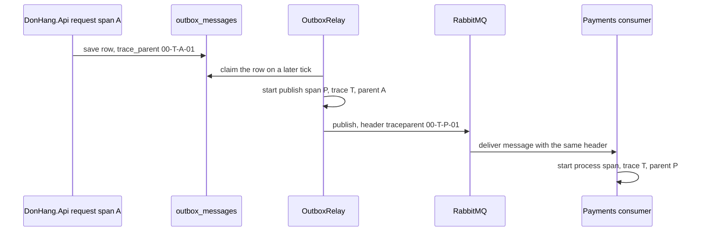

## Before you start

- [[backend.l3.trace-context-propagation]] — you know that `traceparent` carries the trace id and the sender's span id, and that the receiver's span takes them as its trace and its parent.
- [[backend.l3.outbox-relay]] — you know that `OutboxRelay`, a hosted service, claims unpublished `outbox_messages` rows every second and publishes each one to RabbitMQ.
- [[backend.l3.consumer-acknowledgements]] — you know that a consumer such as `OrderEventsConsumer` handles each delivery from its queue inside its own hosted service.

## The situation

`trace-refund.sh` prints one refund's trace from Tempo. Under `POST api/v1/orders/{id:int}/refund` sits `publish order.refund-requested`, and under that, `process payments.refund-requests` from `DonHang.Payments`. Yet the request never called Payments. It saved an outbox row and answered `202`. `OutboxRelay` published the row on a later tick of its own timer, in a hosted service that never saw the request. No HTTP call crossed from the API to Payments, so no `traceparent` header went along.

How does a publish that runs after the request, in a loop that never saw it, land in that request's trace?

## Core concepts

- message headers — names and values that the publisher sets next to a message's body; RabbitMQ stores them with the message and delivers them to every consumer. It does not create a `traceparent` (it may add its own `x-` headers, such as a delivery count on a redelivery), so a `traceparent` can travel there, just as it does on an HTTP request.
- saved trace context — the `traceparent` of the span current when an outbox row is created, kept in the row's `trace_parent` column so the trace can continue when the row is published.
- publish span — the relay's span for one message, started as a child of the row's saved context, not of whatever the relay is doing at that moment.
- process span — a consumer's span for one delivery, started as a child of the context in the message's `traceparent` header.

## How it works



In the situation above, the refund request runs inside its ASP.NET Core span, A in the diagram, in trace T. While it runs, the code adds an outbox row, and the row copies the `traceparent` of the current span into its `trace_parent` column; `00-T-A-01` is that `traceparent`, with trace id T and span id A written short. The request commits and answers, and the context now sits in PostgreSQL, next to the message body.

The relay can see the row only after that commit. It claims the row on its next tick, in its own loop, started by its timer and not by the request. In Đơn Hàng no span is current in the relay's loop, so a span started there would begin a new trace with no link to the request. So the relay parses the saved `traceparent` and starts a publish span, P, whose trace is T and whose parent is A.

While P is current, the publisher writes P's own `traceparent` into the message headers. RabbitMQ stores the headers with the message and delivers them with it; it does not touch `traceparent`. The Payments consumer reads the header and starts its process span in trace T, with parent P. The chain goes on: Payments saves a refund row inside that span, and its `trace_parent` carries T one hop further, to `RefundSender`.

Nothing here compares times. Each hop hands on two ids, through a column or a header, and Tempo files every span under T.

## In the Đơn Hàng system

The row, in `DonHang.Messaging`, shared by `DonHang.Api` and `DonHang.Payments`:

```csharp file=DonHang.Messaging/OutboxMessage.cs tag=stage-3 lines=24-29
    // lesson: backend.l3.tracing-through-the-outbox
    // From stage-3: the traceparent of the span current when the row was
    // created, such as the request that placed the order, so that the relay
    // can publish it later as part of that trace. Null when no span was
    // current, and in every row saved before the column existed.
    public string? TraceParent { get; init; } = MessageTracing.CurrentTraceParent();
```

The initial value runs when code creates the row object, so the row takes the `traceparent` of the span current at that moment; no caller passes it. In the API that is the request's span, or a consumer's span. Both services map the property to a `trace_parent` column, added at stage-3 by a migration.

A refund row in Payments' `payments` table keeps a `trace_parent` too. `RefundSender`, a hosted service in Payments, later claims each due refund row, calls the gateway and saves an outbox row with the result, such as `payment.refunded`. It starts its `refund attempt` span from the refund row's `trace_parent`, so that outbox row takes the refund's trace (`Payment.cs`, `RefundSender.cs`, outside the excerpts).

The relay's side and the consumers' side:

```csharp file=DonHang.Messaging/MessageTracing.cs tag=stage-3 lines=25-47
    // lesson: backend.l3.tracing-through-the-outbox
    // The relay's span for one message: a child of the context saved in the
    // row, not of the relay's own work. A row saved before trace_parent existed
    // has none, and its message starts a new trace instead.
    public static Activity? StartPublish(OutboxMessage message, string exchange)
    {
        var activity = StartChildOf(message.TraceParent, $"publish {message.RoutingKey}", ActivityKind.Producer);
        activity?.SetTag("messaging.system", "rabbitmq");
        activity?.SetTag("messaging.destination.name", exchange);
        activity?.SetTag("messaging.message.id", message.Id.ToString());
        return activity;
    }

    // lesson: backend.l3.tracing-through-the-outbox
    // A consumer's span for one delivery: a child of the publish span that
    // the message's traceparent header names.
    public static Activity? StartConsume(IReadOnlyBasicProperties properties, string queue)
    {
        var activity = StartChildOf(Read(properties), $"process {queue}", ActivityKind.Consumer);
        activity?.SetTag("messaging.system", "rabbitmq");
        activity?.SetTag("messaging.message.id", properties.MessageId);
        return activity;
    }
```

In .NET a span is an `Activity`; `ActivityKind.Producer` and `ActivityKind.Consumer` mark it as the sending or receiving side, and `SetTag` adds name–value details to it. `StartPublish` hands the row's saved `TraceParent` to `StartChildOf`, further down the same file and outside the excerpt: it parses the string into a trace context and starts the span with that context as its parent. `OutboxRelay` calls `StartPublish` once per message, just before `PublishAsync`, and `RabbitMqPublisher` then puts the publish span's `traceparent` in the message headers (both files outside the excerpts).

`StartConsume` gets the delivered message's properties, which hold its headers; `Read`, outside the excerpt, returns the `traceparent` header from them, and `StartChildOf` starts the span under it. The consumers in `DonHang.Api`, `DonHang.Payments` and `DonHang.Notifications` call it for each delivery.

When `TraceParent` is null, as in a row saved before the column existed, there is no context to parse. With no span current in the relay's loop, the publish span starts a new trace, and the message is still published. `TracePropagationTests` checks both cases against a real PostgreSQL and RabbitMQ.

## Seniors often assume…

- **"RabbitMQ passes the trace along by itself, so nothing needs to be done."** → Actually RabbitMQ delivers the headers the publisher set; it does not create a `traceparent`. In Đơn Hàng, `RabbitMqPublisher` writes it and `StartConsume` reads it. You notice this when a consumer's spans appear in Tempo as a trace of their own, with no publish span above them.
- **"The relay publishes the request's row, so its publish belongs to that request's trace automatically."** → Actually the relay runs on its own timer after the request has committed, so the request's span is not current in the relay's loop. Only the `trace_parent` saved in the row connects them. You notice this with rows saved before the column existed: their messages appear in Tempo as new traces that begin with a publish span.
- **"A trace has to end when the HTTP response is sent."** → Actually a trace holds every span that carries its trace id, whenever that span starts, so it goes on after `202` through the relay, Payments and the gateway call. You notice this in `trace-refund.sh`'s output: spans from Payments and Notifications sit in the refund's trace, though they ran after the response.

## Try it (3 minutes)

With the lab running with the monitoring profile (`docker compose --profile monitoring up -d`), in the root folder of the example repository:

1. Run `scripts/backend/trace-refund.sh`; it asks for a refund of order 10, waits, then prints that refund's trace.
2. In the tree it prints, find each line whose span name starts with `publish` and look at the lines indented directly under it.

Expected result: every `publish` line has a `process` line from another service under it, all in one trace. `donhang-api: publish order.refund-requested` has `process payments.refund-requests` from `donhang-payments` and `process notifications.order-events` from `donhang-notifications` under it. `donhang-payments: publish payment.refunded` sits under `refund attempt` and has `donhang-api: process orders.payment-events` under it.

## Connections

- [[backend.l3.trace-context-propagation]] — the same idea over HTTP, where the header leaves with the call; here the context waits in a row first.
- [[backend.l3.outbox-pattern]] — the row this lesson adds one column to: the context is saved by the same `SaveChangesAsync` as the message.
- [[backend.l3.dual-write]] — why the API does not publish during the request; saving the context is what tracing then costs.
- [[backend.l3.saga]] — the refund saga, whose steps across services now appear as one trace.
- [[backend.l3.trace-ids-in-logs]] — next: the trace id carried this way also gathers the log lines of every service.

## Five-line summary

1. Through an outbox, the trace context is saved in the message's row, so a publish that runs later still joins the request's trace.
2. RabbitMQ messages carry headers, so a `traceparent` there lets a consumer's span continue the publisher's trace.
3. At stage-3 each new outbox row in `DonHang.Api` and `DonHang.Payments` stores the current `traceparent` in its `trace_parent` column.
4. `OutboxRelay` starts a publish span as a child of the saved context, and that span's `traceparent` goes in the message headers.
5. Consumers start their span from that header; a row without `trace_parent` starts a new trace instead of failing.
