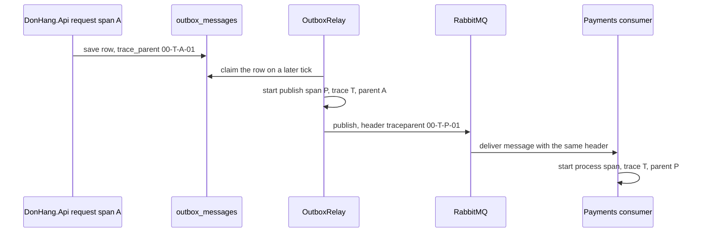

## Bạn cần biết trước

- [[backend.l3.trace-context-propagation]] — bạn biết rằng `traceparent` mang trace id và span id của bên gửi, và span của bên nhận lấy chúng làm trace và span cha của mình.
- [[backend.l3.outbox-relay]] — bạn biết rằng `OutboxRelay`, một hosted service, mỗi giây nhận về các dòng `outbox_messages` chưa publish và publish từng dòng lên RabbitMQ.
- [[backend.l3.consumer-acknowledgements]] — bạn biết rằng một consumer như `OrderEventsConsumer` xử lý từng delivery từ hàng đợi của nó, bên trong hosted service riêng.

## Tình huống

`trace-refund.sh` in ra trace của một lần hoàn tiền từ Tempo. Dưới `POST api/v1/orders/{id:int}/refund` là `publish order.refund-requested`, và dưới đó là `process payments.refund-requests` của `DonHang.Payments`. Thế nhưng request chưa hề gọi Payments. Nó lưu một dòng outbox rồi trả `202`. `OutboxRelay` publish dòng đó ở một nhịp sau của timer riêng, trong một hosted service chưa từng thấy request. Không có lời gọi HTTP nào đi từ API sang Payments, nên cũng không có header `traceparent` nào đi theo.

Một lần publish chạy sau request, trong một vòng lặp chưa từng thấy request, làm sao lại nằm trong trace của request đó?

## Khái niệm cốt lõi

- message header — các cặp tên và giá trị mà bên publish đặt cạnh body của message. RabbitMQ lưu chúng cùng message và giao chúng tới mọi consumer. RabbitMQ không tạo `traceparent` (nó có thể thêm header `x-` của riêng nó, ví dụ số lần giao khi giao lại), nên `traceparent` có thể đi trong đó, giống như trên một request HTTP.
- trace context đã lưu — `traceparent` của span đang là span hiện tại lúc dòng outbox được tạo, giữ trong cột `trace_parent` của dòng, để trace đi tiếp được khi dòng được publish.
- publish span — span của relay cho một message, bắt đầu làm con của trace context đã lưu trong dòng, chứ không phải con của việc relay đang làm lúc đó.
- process span — span của consumer cho một delivery, bắt đầu làm con của trace context trong header `traceparent` của message.

## Cơ chế hoạt động



Trong tình huống trên, request hoàn tiền chạy bên trong span ASP.NET Core của nó, A trong sơ đồ, thuộc trace T. Trong lúc đó, code thêm một dòng outbox, và dòng này chép `traceparent` của span hiện tại vào cột `trace_parent`. `00-T-A-01` chính là `traceparent` đó, với trace id T và span id A viết tắt. Request commit rồi trả lời, và trace context giờ nằm trong PostgreSQL, ngay cạnh body của message.

Relay chỉ thấy dòng đó sau khi commit. Nó nhận dòng ở nhịp kế tiếp, trong vòng lặp của riêng nó, do timer khởi động chứ không phải request. Trong Đơn Hàng, vòng lặp của relay không có span hiện tại nào, nên span bắt đầu ở đó sẽ mở một trace mới, không dính gì tới request. Vì vậy relay đọc `traceparent` đã lưu và bắt đầu một publish span, P, có trace là T và cha là A.

Trong lúc P là span hiện tại, bên publish ghi `traceparent` của chính P vào message header. RabbitMQ lưu header cùng message và giao chúng đi kèm, không động tới `traceparent`. Consumer của Payments đọc header và bắt đầu process span trong trace T, với cha là P. Chuỗi còn tiếp: Payments lưu một dòng hoàn tiền bên trong span đó, và `trace_parent` của dòng này mang T đi thêm một chặng, tới `RefundSender`.

Không chỗ nào so thời gian. Mỗi chặng chuyển tiếp hai id, qua một cột hoặc một header, và Tempo xếp mọi span vào T.

## Trong hệ thống Đơn Hàng

Dòng outbox, trong `DonHang.Messaging`, dùng chung bởi `DonHang.Api` và `DonHang.Payments`:

```csharp file=DonHang.Messaging/OutboxMessage.cs tag=stage-3 lines=24-29
    // lesson: backend.l3.tracing-through-the-outbox
    // From stage-3: the traceparent of the span current when the row was
    // created, such as the request that placed the order, so that the relay
    // can publish it later as part of that trace. Null when no span was
    // current, and in every row saved before the column existed.
    public string? TraceParent { get; init; } = MessageTracing.CurrentTraceParent();
```

Giá trị khởi tạo chạy khi code tạo object của dòng, nên dòng lấy `traceparent` của span đang là span hiện tại lúc đó. Không bên gọi nào phải truyền nó vào. Trong API, đó là span của request, hoặc span của một consumer. Cả hai service đều map property này vào cột `trace_parent`, do một migration thêm vào ở stage-3.

Dòng hoàn tiền trong bảng `payments` của Payments cũng giữ một `trace_parent`. `RefundSender`, một hosted service trong Payments, sau đó nhận từng dòng hoàn tiền đã tới hạn, gọi cổng thanh toán và lưu một dòng outbox chứa kết quả, ví dụ `payment.refunded`. Nó bắt đầu span `refund attempt` từ `trace_parent` của dòng hoàn tiền, nên dòng outbox đó nhận trace của lần hoàn tiền (`Payment.cs`, `RefundSender.cs`, ngoài các đoạn trích).

Phía relay và phía consumer:

```csharp file=DonHang.Messaging/MessageTracing.cs tag=stage-3 lines=25-47
    // lesson: backend.l3.tracing-through-the-outbox
    // The relay's span for one message: a child of the context saved in the
    // row, not of the relay's own work. A row saved before trace_parent existed
    // has none, and its message starts a new trace instead.
    public static Activity? StartPublish(OutboxMessage message, string exchange)
    {
        var activity = StartChildOf(message.TraceParent, $"publish {message.RoutingKey}", ActivityKind.Producer);
        activity?.SetTag("messaging.system", "rabbitmq");
        activity?.SetTag("messaging.destination.name", exchange);
        activity?.SetTag("messaging.message.id", message.Id.ToString());
        return activity;
    }

    // lesson: backend.l3.tracing-through-the-outbox
    // A consumer's span for one delivery: a child of the publish span that
    // the message's traceparent header names.
    public static Activity? StartConsume(IReadOnlyBasicProperties properties, string queue)
    {
        var activity = StartChildOf(Read(properties), $"process {queue}", ActivityKind.Consumer);
        activity?.SetTag("messaging.system", "rabbitmq");
        activity?.SetTag("messaging.message.id", properties.MessageId);
        return activity;
    }
```

Trong .NET, một span là một `Activity`. `ActivityKind.Producer` và `ActivityKind.Consumer` đánh dấu nó là phía gửi hay phía nhận, còn `SetTag` gắn thêm các chi tiết dạng tên–giá trị. `StartPublish` đưa `TraceParent` đã lưu của dòng cho `StartChildOf`, nằm phía dưới trong cùng file, ngoài đoạn trích: hàm này phân tích chuỗi thành trace context rồi bắt đầu span với trace context đó làm cha. `OutboxRelay` gọi `StartPublish` một lần cho mỗi message, ngay trước `PublishAsync`, rồi `RabbitMqPublisher` đặt `traceparent` của publish span vào message header (cả hai file đều ngoài các đoạn trích).

`StartConsume` nhận các property của message vừa được giao, nơi chứa header của nó. `Read`, ngoài đoạn trích, lấy header `traceparent` từ đó, và `StartChildOf` bắt đầu span dưới nó. Các consumer trong `DonHang.Api`, `DonHang.Payments` và `DonHang.Notifications` gọi hàm này cho mỗi delivery.

Khi `TraceParent` là null, như ở một dòng lưu trước khi có cột, không có trace context nào để phân tích. Vòng lặp của relay lại không có span hiện tại, nên publish span mở một trace mới, và message vẫn được publish. `TracePropagationTests` kiểm tra cả hai trường hợp với PostgreSQL và RabbitMQ thật.

## Senior hay nhầm rằng…

- **"RabbitMQ tự chuyển trace đi, nên không cần làm gì."** → Thực ra RabbitMQ chỉ giao những header mà bên publish đã đặt, nó không tạo `traceparent`. Trong Đơn Hàng, `RabbitMqPublisher` ghi header này và `StartConsume` đọc nó. Bạn sẽ nhận ra khi span của một consumer hiện trong Tempo thành một trace riêng, không có publish span nào bên trên.
- **"Relay publish dòng của request, nên lần publish đó tự động thuộc trace của request."** → Thực ra relay chạy theo timer riêng, sau khi request đã commit, nên span của request không phải span hiện tại trong vòng lặp của relay. Chỉ `trace_parent` lưu trong dòng mới nối hai bên lại. Bạn sẽ nhận ra với những dòng lưu trước khi có cột: message của chúng hiện trong Tempo thành trace mới, mở đầu bằng một publish span.
- **"Trace phải kết thúc khi response HTTP được gửi đi."** → Thực ra một trace gồm mọi span mang trace id của nó, bất kể span đó bắt đầu lúc nào, nên trace còn tiếp sau `202`, qua relay, Payments và lời gọi tới cổng thanh toán. Bạn sẽ nhận ra trong output của `trace-refund.sh`: span từ Payments và Notifications nằm trong trace của lần hoàn tiền, dù chúng chạy sau response.

## Thử ngay (3 phút)

Khi lab đang chạy với profile monitoring (`docker compose --profile monitoring up -d`), ở thư mục gốc của repo ví dụ:

1. Chạy `scripts/backend/trace-refund.sh`. Script yêu cầu hoàn tiền cho đơn 10, chờ, rồi in trace của lần hoàn tiền đó.
2. Trong cây được in ra, tìm từng dòng có tên span bắt đầu bằng `publish` và xem các dòng thụt vào ngay bên dưới nó.

Kết quả mong đợi: dòng `publish` nào cũng có một dòng `process` từ service khác bên dưới, tất cả trong cùng một trace. `donhang-api: publish order.refund-requested` có `process payments.refund-requests` từ `donhang-payments` và `process notifications.order-events` từ `donhang-notifications` bên dưới. `donhang-payments: publish payment.refunded` nằm dưới `refund attempt` và có `donhang-api: process orders.payment-events` bên dưới.

## Liên hệ

- [[backend.l3.trace-context-propagation]] — cùng ý tưởng đó qua HTTP, nơi header rời đi cùng lời gọi. Ở đây trace context phải chờ trong một dòng trước.
- [[backend.l3.outbox-pattern]] — dòng mà bài này thêm một cột: trace context được lưu bởi chính lần `SaveChangesAsync` lưu message.
- [[backend.l3.dual-write]] — vì sao API không publish ngay trong request. Lưu trace context là cái giá tracing phải trả cho điều đó.
- [[backend.l3.saga]] — saga hoàn tiền, giờ các bước của nó qua nhiều service hiện thành một trace.
- [[backend.l3.trace-ids-in-logs]] — bài tiếp theo: trace id được mang đi theo cách này cũng gom được các dòng log của mọi service.

## Tóm tắt 5 dòng

1. Qua outbox, trace context được lưu trong dòng của message, nên lần publish chạy sau vẫn nhập vào trace của request.
2. Message RabbitMQ có header, nên một `traceparent` đặt ở đó cho phép span của consumer nối tiếp trace của bên publish.
3. Ở stage-3, mỗi dòng outbox mới trong `DonHang.Api` và `DonHang.Payments` lưu `traceparent` hiện tại vào cột `trace_parent`.
4. `OutboxRelay` bắt đầu một publish span làm con của trace context đã lưu, và `traceparent` của span đó được đặt vào message header.
5. Consumer bắt đầu span của mình từ header đó. Dòng không có `trace_parent` thì mở trace mới thay vì báo lỗi.
