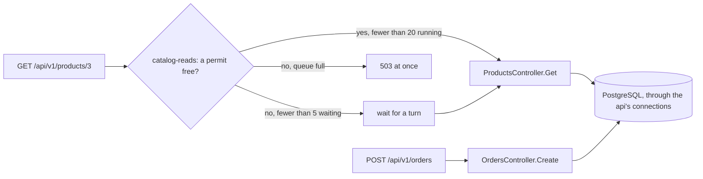

## Before you start

- [[backend.l3.rate-limiting]] — you know the api's rate limiting middleware refuses a request before the controller runs, and answers `503` unless told otherwise.
- [[backend.l3.graceful-degradation]] — you know that with Redis down, every single-product read becomes a PostgreSQL query, safe only while PostgreSQL can carry it.
- [[backend.l3.slow-dependencies]] — you know that when one kind of request piles up, a shared limit runs out and unrelated requests fail too: a cascading failure.
- [[backend.l3.payments-service]] — you know that at stage-3 Payments runs as its own service, next to the api and Notifications.

## The situation

It is stage-3, and Redis has stopped, so the api answers each product read from PostgreSQL. Then a sale starts, and customers open product pages by the hundred in the same second. Each read needs one of the api's database connections for its query. Customers who reach checkout send `POST /api/v1/orders`, and each order needs a database connection too, from the same api process. If the reads take every connection, the orders wait behind them. The part of Đơn Hàng that takes money stalls because of the part that only shows prices.

How can the api keep a flood of product reads from using up what orders need?

## Core concepts

- **bulkhead** — splitting shared capacity into separate parts, like the sealed compartments of a ship's hull, so that a flood of one kind of work fills only its own part and the rest keeps working.
- concurrency limiter — a limiter that counts the requests running right now, not how many arrived in a period; a request takes a permit when it starts and gives it back when it ends.
- permit limit — for a concurrency limiter, how many requests may run at once; in Đơn Hàng, 20 product reads.
- queue limit — how many more requests may wait for a permit to come free; a request that finds the queue full is refused at once.

## How it works



Đơn Hàng has compartments at two levels. The first is the process. At stage-3 Payments and Notifications run as separate processes in their own containers, each with its own memory, threads and database connections. When the mail server hangs, Notifications' sends wait and its resources fill up. The api sends no email at stage-3, so none of its resources wait on the mail server.

The second level is inside the api, one process. Product reads and orders open their connections to the same PostgreSQL database from the same api process. The api can keep only a limited number of database connections open at once; Npgsql, the library the api uses to talk to PostgreSQL, sets that maximum to 100 by default, and the stage-3 lab does not change it. With Redis down, every product read needs one. The diagram shows the compartment Đơn Hàng adds for product reads.

In the situation above, each product read asks the `catalog-reads` concurrency limiter for a permit before `ProductsController` runs. While fewer than 20 reads run, it takes a permit and runs. When 20 run, up to 5 more wait for one of them to end. A read that finds 20 running and 5 waiting gets `503` at once. Orders never ask this limiter. However many product reads arrive, at most 20 of them run at once, so at most 20 can be querying PostgreSQL at the same time; reads of the same product already queue behind one another in `ProductCache`, so the limit matters most when many different products are read.

The rate limiting lesson counted orders per customer per window. This limit counts something else: requests in progress, for every caller together.

## In the Đơn Hàng system

The limiter, in `DonHang.Api/Program.cs`:

```csharp file=DonHang.Api/Program.cs tag=stage-3 lines=143-166
// lesson: backend.l3.bulkhead
// "catalog-reads": at most PermitLimit product reads run at once and QueueLimit
// more wait for a turn; any read beyond that is refused at once. With Redis
// down every product read needs a database connection, and orders need them too.
var catalogReads = new ConcurrencyLimiterOptions { PermitLimit = 20, QueueLimit = 5 };
builder.Configuration.GetSection("RateLimiting:CatalogReads").Bind(catalogReads);

builder.Services.AddRateLimiter(options =>
{
    options.AddPolicy("orders", context =>
    {
        var customer = context.User.FindFirst("sub")?.Value;
        if (customer is null) return RateLimitPartition.GetNoLimiter("signed-out");
        return RateLimitPartition.GetFixedWindowLimiter(customer, _ => new FixedWindowRateLimiterOptions
        {
            PermitLimit = ordersLimit.PermitLimit,
            Window = ordersLimit.Window,
        });
    });
    options.AddConcurrencyLimiter("catalog-reads", limiter =>
    {
        limiter.PermitLimit = catalogReads.PermitLimit;
        limiter.QueueLimit = catalogReads.QueueLimit;
    });
```

Line 147 sets 20 running and 5 waiting; line 148 lets configuration change them, and the lab's `docker-compose.yml` sets no value, so 20 and 5 apply. Lines 152–161 are the `orders` policy from the rate limiting lesson. Lines 162–166 register `catalog-reads`. Unlike `orders`, it has no key per customer: one limiter counts every request that uses the policy.

A refused read stays `503`, the middleware's default. The `OnRejected` handler further down sets `429` only when the refusal says how long to wait, and a concurrency limiter's refusal cannot, because it cannot know when one of the running reads will end and free a permit.

Which requests use it, in `DonHang.Api/Controllers/ProductsController.cs`:

```csharp file=DonHang.Api/Controllers/ProductsController.cs tag=stage-3 lines=35-48
    // lesson: backend.l2.cache-aside
    // Catalog reads one product through its ProductCache, so a repeat of this
    // request within the TTL is answered from Redis.
    // lesson: backend.l3.bulkhead
    // Both product reads share the "catalog-reads" concurrency limit
    // (Program.cs): a read over it gets 503 at once. Orders do not count.
    [HttpGet("{id:int}")]
    [EnableRateLimiting("catalog-reads")]
    public async Task<ActionResult<ProductDto>> Get(int id)
    {
        var product = await catalog.FindAsync(id);
        if (product is null) return NotFound();
        return Ok(ToDto(product));
    }
```

Line 42 puts the single-product read under `catalog-reads`; line 24, outside this excerpt, does the same for the product list. Both share the same 20 permits. `OrdersController.Create` names only the `orders` policy, so an order never waits for a product read's permit. An order still reads each product's price through Catalog, so with Redis down it queries PostgreSQL for its products too, outside this limit; `bulkhead.sh` orders product 8 while the reads ask for product 3. The limit is there all the time, not only while Redis is down; with Redis up, most single-product reads are answered from the cache and end quickly, while the product list queries PostgreSQL every time.

## Seniors often assume…

- **"Splitting the system into services is the only way to keep one failure from spreading."** → Actually a separate process is one kind of bulkhead, the kind Payments and Notifications get at stage-3. Inside one process, a cap on how many of one kind of request run at once draws a similar line: `catalog-reads` keeps product reads from taking what orders need, and the api stays one program to deploy. Extracting a service for this reason alone adds a network call and one more thing to deploy and watch. You notice this when `bulkhead.sh` places an order with `201` while product reads in the same process are refused.
- **"A bulkhead makes product reads more reliable."** → Actually it makes some product reads fail sooner: once 20 run and 5 wait, the next one gets `503` instead of a slower answer. What it protects is everything else in the api, and PostgreSQL behind it. You notice this when the api's count of `5xx` answers rises during a Redis outage, all of them on product reads, while orders keep answering `201`.
- **"Rejecting a request at once is worse than letting it wait, because a waiting request succeeds in the end."** → Actually a waiting request is still in progress: it waits in the limiter's queue until a permit comes free, and its caller has no answer yet. With no cap, reads that arrive later wait longer, and a caller that gives up has waited for nothing. A `503` at once ends the request before `ProductsController` runs, with no query and no wait, and tells the caller now, so it can try again later. The short queue of 5 is for brief bursts, where a wait is short. You notice this when, during an outage with no cap, every endpoint slows down together instead of a share of one endpoint's requests failing fast.

## Try it (3 minutes)

With the lab running (`scripts/up.sh`), in a terminal on your machine, in the root folder of the example repository:

1. Run `scripts/backend/bulkhead.sh`. It stops Redis, sends 100 reads of product 3 at the same moment and one order at that same moment, then starts Redis again.
2. Read the lines under each `==` heading: what the 100 reads got, and what the order got.

Expected result: the script first prints `redis is stopped: every product read now queries PostgreSQL`. The 100 reads were answered only `200` or `503`, and both appear: the reads over 20 running and 5 waiting were refused. All 100 ask for the same product, so `ProductCache` lets them query one at a time; the reads holding the 20 permits wait there. The order, sent at the same moment, prints `-> 201`.

## Connections

- [[backend.l3.rate-limiting]] — the same middleware with a different count: that lesson caps how often one customer orders, this one caps how many product reads run at once for all callers.
- [[backend.l3.slow-dependencies]] — the problem this lesson fixes: a pile-up of one kind of request using up a shared limit, so unrelated requests fail too.
- [[backend.l3.graceful-degradation]] — the fallback this limit guards: reading PostgreSQL when Redis is down is safe only while that extra load stays bounded.
- [[k8s.l1.requests-and-limits]] — the same idea one layer down: a container's resource limit keeps one container from taking what the others on the node need.
- [[backend.l3.queue-backlog-metrics]] — the bulkhead between processes seen from a dashboard: Notifications falls behind while the api keeps answering.
- [[design.l3.when-to-extract-a-service]] — where keeping one kind of failure apart becomes one reason, among others, to run work as a separate service.

## Five-line summary

1. A bulkhead splits shared capacity into separate parts, so a flood of one kind of work fills only its own part.
2. At stage-3 Payments and Notifications run as separate processes, so a hanging mail server ties up Notifications' resources, not the api's.
3. Inside the api, product reads and orders share database connections, and with Redis down every product read needs one.
4. The `catalog-reads` concurrency limiter lets 20 product reads run and 5 wait; any read beyond that gets `503` at once.
5. `bulkhead.sh` stops Redis and sends 100 product reads at once: some get `503`, while an order sent alongside gets `201`.
