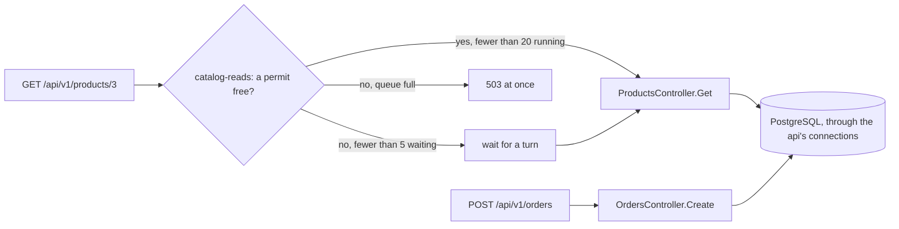

## Bạn cần biết trước

- [[backend.l3.rate-limiting]] — bạn biết middleware rate limiting của api từ chối request trước khi controller chạy, và trả lời `503` nếu không được chỉ định khác.
- [[backend.l3.graceful-degradation]] — bạn biết khi Redis ngừng, mọi lần đọc một sản phẩm đều thành một truy vấn PostgreSQL, và điều đó chỉ an toàn khi PostgreSQL còn gánh nổi.
- [[backend.l3.slow-dependencies]] — bạn biết khi một loại request dồn ứ, một giới hạn dùng chung bị cạn và cả những request không liên quan cũng hỏng theo: đó là cascading failure.
- [[backend.l3.payments-service]] — bạn biết ở stage-3, Payments chạy thành service riêng, bên cạnh api và Notifications.

## Tình huống

Đơn Hàng đang ở stage-3, và Redis đã ngừng, nên api trả lời mỗi lần đọc sản phẩm bằng PostgreSQL. Rồi một đợt giảm giá bắt đầu, và hàng trăm khách mở trang sản phẩm trong cùng một giây. Mỗi lần đọc cần một kết nối database của api để chạy truy vấn. Khách nào tới bước thanh toán thì gửi `POST /api/v1/orders`, và mỗi đơn cũng cần một kết nối database, lấy từ chính tiến trình api đó. Nếu các lần đọc chiếm hết kết nối, các đơn phải chờ sau chúng. Phần của Đơn Hàng thu tiền bị kẹt chỉ vì phần hiển thị giá.

Làm sao để api không cho một cơn lũ đọc sản phẩm dùng hết thứ mà các đơn hàng cần?

## Khái niệm cốt lõi

- **bulkhead** (chia tài nguyên chung thành các phần riêng để một loại việc quá tải chỉ làm đầy phần của nó) — chia tài nguyên dùng chung thành những phần tách biệt, giống các khoang kín trong thân tàu, để khi một loại việc tràn vào thì nó chỉ làm đầy phần của mình, còn phần còn lại vẫn chạy.
- limiter đồng thời (concurrency limiter) — limiter đếm số request đang chạy ngay lúc này, không đếm số request đã tới trong một khoảng thời gian. Request lấy một lượt khi bắt đầu và trả lại khi kết thúc.
- số lượt cho phép (permit limit) — với limiter đồng thời, đây là số request được chạy cùng lúc. Trong Đơn Hàng là 20 lần đọc sản phẩm.
- giới hạn hàng đợi (queue limit) — số request được đứng chờ thêm cho tới khi có lượt trống. Request nào gặp hàng đợi đã đầy thì bị từ chối ngay.

## Cơ chế hoạt động



Đơn Hàng có khoang ngăn ở hai tầng. Tầng thứ nhất là tiến trình. Ở stage-3, Payments và Notifications chạy thành các tiến trình riêng trong container của chúng, mỗi cái có bộ nhớ, thread và kết nối database riêng. Khi mail server bị treo, các lần gửi của Notifications phải chờ và tài nguyên của nó đầy dần. Ở stage-3, api không gửi email nào, nên không tài nguyên nào của api phải chờ mail server.

Tầng thứ hai nằm bên trong api, một tiến trình duy nhất. Lần đọc sản phẩm và đơn hàng mở kết nối tới cùng một database PostgreSQL, từ cùng một tiến trình api. Api chỉ giữ mở được một số kết nối database giới hạn cùng lúc. Npgsql, thư viện api dùng để nói chuyện với PostgreSQL, đặt mức tối đa đó là 100 theo mặc định, và lab stage-3 không đổi giá trị này. Khi Redis ngừng, mỗi lần đọc sản phẩm cần một kết nối. Sơ đồ cho thấy khoang ngăn mà Đơn Hàng thêm cho các lần đọc sản phẩm.

Trong tình huống trên, mỗi lần đọc sản phẩm xin limiter đồng thời `catalog-reads` một lượt trước khi `ProductsController` chạy. Khi đang có ít hơn 20 lần đọc chạy, nó lấy một lượt và chạy. Khi đã đủ 20, tối đa 5 lần đọc nữa đứng chờ một trong số đó kết thúc. Lần đọc nào gặp 20 đang chạy và 5 đang chờ thì nhận `503` ngay. Đơn hàng không bao giờ xin limiter này. Dù bao nhiêu lần đọc sản phẩm ập tới, cùng lúc chỉ có tối đa 20 cái chạy, nên tối đa 20 cái truy vấn PostgreSQL cùng một thời điểm. Các lần đọc cùng một sản phẩm vốn đã xếp hàng sau nhau trong `ProductCache`, nên giới hạn này quan trọng nhất khi có nhiều sản phẩm khác nhau được đọc.

Bài rate limiting đếm số đơn của mỗi khách trong mỗi cửa sổ. Giới hạn này đếm thứ khác: số request đang xử lý, gộp chung mọi người gọi.

## Trong hệ thống Đơn Hàng

Limiter, trong `DonHang.Api/Program.cs`:

```csharp file=DonHang.Api/Program.cs tag=stage-3 lines=143-166
// lesson: backend.l3.bulkhead
// "catalog-reads": at most PermitLimit product reads run at once and QueueLimit
// more wait for a turn; any read beyond that is refused at once. With Redis
// down every product read needs a database connection, and orders need them too.
var catalogReads = new ConcurrencyLimiterOptions { PermitLimit = 20, QueueLimit = 5 };
builder.Configuration.GetSection("RateLimiting:CatalogReads").Bind(catalogReads);

builder.Services.AddRateLimiter(options =>
{
    options.AddPolicy("orders", context =>
    {
        var customer = context.User.FindFirst("sub")?.Value;
        if (customer is null) return RateLimitPartition.GetNoLimiter("signed-out");
        return RateLimitPartition.GetFixedWindowLimiter(customer, _ => new FixedWindowRateLimiterOptions
        {
            PermitLimit = ordersLimit.PermitLimit,
            Window = ordersLimit.Window,
        });
    });
    options.AddConcurrencyLimiter("catalog-reads", limiter =>
    {
        limiter.PermitLimit = catalogReads.PermitLimit;
        limiter.QueueLimit = catalogReads.QueueLimit;
    });
```

Dòng 147 đặt 20 lần chạy và 5 lần chờ. Dòng 148 cho phép cấu hình đổi hai số này, và `docker-compose.yml` của lab không đặt giá trị nào, nên 20 và 5 được dùng. Dòng 152–161 là policy `orders` từ bài rate limiting. Dòng 162–166 đăng ký `catalog-reads`. Khác với `orders`, nó không có khóa theo từng khách: một limiter duy nhất đếm mọi request dùng policy này.

Lần đọc bị từ chối vẫn nhận `503`, mặc định của middleware. Handler `OnRejected` ở phía dưới chỉ đặt `429` khi lần từ chối cho biết phải chờ bao lâu. Lần từ chối của limiter đồng thời không cho biết được điều đó, vì limiter không thể biết khi nào một lần đọc đang chạy sẽ kết thúc và trả lại lượt.

Những request nào dùng nó, trong `DonHang.Api/Controllers/ProductsController.cs`:

```csharp file=DonHang.Api/Controllers/ProductsController.cs tag=stage-3 lines=35-48
    // lesson: backend.l2.cache-aside
    // Catalog reads one product through its ProductCache, so a repeat of this
    // request within the TTL is answered from Redis.
    // lesson: backend.l3.bulkhead
    // Both product reads share the "catalog-reads" concurrency limit
    // (Program.cs): a read over it gets 503 at once. Orders do not count.
    [HttpGet("{id:int}")]
    [EnableRateLimiting("catalog-reads")]
    public async Task<ActionResult<ProductDto>> Get(int id)
    {
        var product = await catalog.FindAsync(id);
        if (product is null) return NotFound();
        return Ok(ToDto(product));
    }
```

Dòng 42 đặt lần đọc một sản phẩm dưới `catalog-reads`. Dòng 24, ngoài đoạn trích này, làm tương tự cho danh sách sản phẩm. Cả hai dùng chung 20 lượt đó. `OrdersController.Create` chỉ ghi tên policy `orders`, nên đơn hàng không bao giờ phải chờ lượt của lần đọc sản phẩm. Đơn hàng vẫn đọc giá từng sản phẩm qua Catalog, nên khi Redis ngừng, nó cũng truy vấn PostgreSQL cho các sản phẩm của mình, nằm ngoài giới hạn này. Vì thế `bulkhead.sh` đặt sản phẩm 8 trong khi các lần đọc hỏi sản phẩm 3. Giới hạn luôn có mặt, không chỉ khi Redis ngừng. Khi Redis chạy, phần lớn lần đọc một sản phẩm được trả lời từ cache và kết thúc nhanh, còn danh sách sản phẩm thì lần nào cũng truy vấn PostgreSQL.

## Senior hay nhầm rằng…

- **"Tách hệ thống thành các service là cách duy nhất để một sự cố không lan ra."** → Thực ra một tiến trình riêng chỉ là một kiểu bulkhead, kiểu mà Payments và Notifications có ở stage-3. Bên trong một tiến trình, giới hạn số request cùng loại chạy cùng lúc cũng vạch ra một ranh giới tương tự: `catalog-reads` giữ cho lần đọc sản phẩm không chiếm thứ đơn hàng cần, và api vẫn là một chương trình để deploy. Tách service chỉ vì lý do này sẽ thêm một lời gọi qua mạng và thêm một thứ phải deploy và theo dõi. Bạn sẽ nhận ra khi `bulkhead.sh` đặt một đơn và nhận `201` trong khi các lần đọc sản phẩm trong cùng tiến trình bị từ chối.
- **"Bulkhead làm lần đọc sản phẩm đáng tin cậy hơn."** → Thực ra nó khiến một số lần đọc sản phẩm hỏng sớm hơn: khi đã có 20 cái chạy và 5 cái chờ, lần kế tiếp nhận `503` thay vì một câu trả lời chậm hơn. Thứ nó bảo vệ là mọi phần còn lại của api, và PostgreSQL đứng sau. Bạn sẽ nhận ra khi số câu trả lời `5xx` của api tăng lên trong lúc Redis ngừng, toàn bộ nằm ở lần đọc sản phẩm, còn đơn hàng vẫn trả lời `201`.
- **"Từ chối request ngay thì tệ hơn để nó chờ, vì request đang chờ rồi cũng sẽ thành công."** → Thực ra request đang chờ vẫn là request đang xử lý: nó chờ trong hàng đợi của limiter cho tới khi có lượt trống, và người gọi chưa có câu trả lời. Không có giới hạn, các lần đọc tới sau phải chờ lâu hơn, và người gọi nào bỏ cuộc thì đã chờ vô ích. `503` trả ngay sẽ kết thúc request trước khi `ProductsController` chạy, không truy vấn, không chờ, và báo cho người gọi biết ngay để họ thử lại sau. Hàng đợi ngắn gồm 5 chỗ dành cho những đợt dồn ngắn, khi thời gian chờ ngắn. Bạn sẽ nhận ra khi, trong một sự cố mà không có giới hạn, mọi endpoint cùng chậm đi thay vì chỉ một phần request của một endpoint hỏng nhanh.

## Thử ngay (3 phút)

Khi lab đang chạy (`scripts/up.sh`), trong terminal trên máy bạn, ở thư mục gốc của repo ví dụ:

1. Chạy `scripts/backend/bulkhead.sh`. Script dừng Redis, gửi 100 lần đọc sản phẩm 3 cùng một thời điểm và một đơn hàng cũng đúng lúc đó, rồi khởi động lại Redis.
2. Đọc các dòng dưới mỗi tiêu đề `==`: 100 lần đọc nhận được gì, và đơn hàng nhận được gì.

Kết quả mong đợi: đầu tiên script in `redis is stopped: every product read now queries PostgreSQL`. 100 lần đọc chỉ nhận `200` hoặc `503`, và có cả hai: những lần đọc vượt quá 20 đang chạy và 5 đang chờ bị từ chối. Cả 100 lần đều hỏi cùng một sản phẩm, nên `ProductCache` cho chúng truy vấn lần lượt từng cái. Những lần đọc đang giữ 20 lượt chờ ở đó. Đơn hàng gửi cùng lúc in ra `-> 201`.

## Liên hệ

- [[backend.l3.rate-limiting]] — cùng middleware nhưng đếm thứ khác: bài đó giới hạn tần suất một khách đặt đơn, bài này giới hạn số lần đọc sản phẩm chạy cùng lúc cho mọi người gọi.
- [[backend.l3.slow-dependencies]] — vấn đề mà bài này giải quyết: một loại request dồn ứ dùng hết giới hạn chung, khiến cả những request không liên quan cũng hỏng theo.
- [[backend.l3.graceful-degradation]] — phương án dự phòng mà giới hạn này canh giữ: đọc PostgreSQL khi Redis ngừng chỉ an toàn khi tải thêm đó còn bị chặn trên.
- [[k8s.l1.requests-and-limits]] — cùng ý tưởng ở tầng thấp hơn: giới hạn tài nguyên của một container giữ cho nó không chiếm thứ các container khác trên node cần.
- [[backend.l3.queue-backlog-metrics]] — bulkhead giữa các tiến trình nhìn từ dashboard: Notifications bị tụt lại phía sau trong khi api vẫn trả lời.
- [[design.l3.when-to-extract-a-service]] — khi nào nhu cầu cô lập một loại sự cố trở thành một lý do, bên cạnh các lý do khác, để chạy một phần việc thành service riêng.

## Tóm tắt 5 dòng

1. Bulkhead chia tài nguyên chung thành các phần riêng, để một loại việc tràn vào chỉ làm đầy phần của nó.
2. Ở stage-3, Payments và Notifications chạy thành tiến trình riêng, nên mail server bị treo chỉ giữ chân tài nguyên của Notifications, không đụng tới api.
3. Bên trong api, lần đọc sản phẩm và đơn hàng dùng chung kết nối database, và khi Redis ngừng, mỗi lần đọc sản phẩm cần một kết nối.
4. Limiter đồng thời `catalog-reads` cho 20 lần đọc sản phẩm chạy và 5 lần chờ. Lần đọc nào vượt quá thì nhận `503` ngay.
5. `bulkhead.sh` dừng Redis và gửi 100 lần đọc sản phẩm cùng lúc: một số nhận `503`, còn đơn hàng gửi kèm vẫn nhận `201`.
