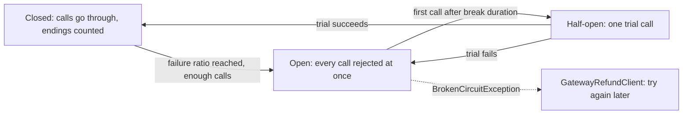

## Before you start

- [[backend.l3.resilience-pipeline]] — you know Payments sends every gateway call through a pipeline which holds a timeout.
- [[backend.l3.slow-dependencies]] — you know a caller that keeps waiting on a failing dependency holds its resources the whole time.

## The situation

It is stage-3, and the payment gateway has been down for twenty minutes. A customer asks for a refund of order 10, and `RefundSender` tries it, records a failed attempt, waits, and tries again, as it always does. Every other due refund does the same. Each attempt is a gateway call you already expect to fail. If the gateway hangs instead of refusing connections, each call also holds a connection until the timeout ends it. Nothing in `RefundSender` or the timeout notices that the last ten calls all failed.

What lets Payments stop calling a gateway that keeps failing, and start calling it again by itself once it recovers?

## Core concepts

- **circuit breaker** — a strategy that watches how the calls to one dependency end and, once too many fail, stops sending calls for a while, so they fail at once without reaching the dependency.
- closed, open, half-open — the breaker's three states: closed lets calls through and counts how they end; open rejects every call until the break duration passes; half-open lets a trial call through.
- failure ratio — the share of the calls in the sampling duration, a window of recent time, that failed; the circuit opens when it reaches the configured value, but only once a minimum number of calls was counted.
- break duration — how long the circuit stays open before it lets a trial call through.
- handled outcome — a way a call can end that the breaker counts as failed; every other ending is not counted as a failure.

## How it works



In the situation above, this lesson adds the circuit breaker as the first strategy of the gateway pipeline from the last lesson, before its timeout. It starts closed. Every call `GatewayRefundClient` sends goes through, and the breaker records whether it ended as a handled outcome. In Payments, handled means a failed connection (`HttpRequestException`), the timeout's `TimeoutRejectedException`, or an answer with a `5xx`, `408` (the request took too long) or `429` (too many requests) status. A `422`, the gateway refusing one refund, is an answer like `200`: the gateway works, it only said no.

The breaker can see the timeout's exception because it was added before the timeout and wraps it. Once at least half of the calls in the last minute failed, and there were at least 3 of them, the circuit opens.

While the circuit is open, the breaker does not pass a call on. It throws `BrokenCircuitException` at once, and `GatewayRefundClient` turns that into try again later, as it does with a timeout. No connection is opened and no timeout is waited out, so the gateway gets no calls from Payments while it recovers.

When the break duration has passed, the next call moves the circuit to half-open and goes through as a trial. If the trial succeeds, the circuit closes and calls go through again. If it fails, the circuit opens for another break duration. Nobody has to step in either way.

## In the Đơn Hàng system

The breaker in the gateway pipeline, in `DonHang.Payments/Program.cs`:

```csharp file=DonHang.Payments/Program.cs tag=stage-3 lines=107-125
        client.AddResilienceHandler("gateway", (pipeline, context) =>
        {
            var logger = context.ServiceProvider.GetRequiredService<ILoggerFactory>().CreateLogger("DonHang.Payments.GatewayCircuit");
            // lesson: backend.l3.circuit-breaker
            // Counts as failed: an exception (no connection, the timeout) or a
            // 5xx, 408 or 429 answer. A 422 refusal is an answer like 200.
            pipeline.AddCircuitBreaker(new HttpCircuitBreakerStrategyOptions
            {
                FailureRatio = gateway.FailureRatio,
                MinimumThroughput = gateway.MinimumThroughput,
                SamplingDuration = gateway.SamplingDuration,
                BreakDuration = gateway.BreakDuration,
                OnOpened = args => Log(() => logger.LogWarning(
                    "Circuit to the gateway opened: no calls for {BreakSeconds} s", args.BreakDuration.TotalSeconds)),
                OnHalfOpened = _ => Log(() => logger.LogInformation("Circuit to the gateway half-open: one trial call")),
                OnClosed = _ => Log(() => logger.LogInformation("Circuit to the gateway closed: calls go through again")),
            });
            pipeline.AddTimeout(gateway.Timeout);
        });
```

Line 113 adds the breaker with `HttpCircuitBreakerStrategyOptions`, whose handled outcomes are the ones the comment on lines 111–112 sums up; the code sets no rule of its own. Lines 115–118 take the four numbers from `gateway`, the `GatewaySettings` object declared in `GatewayRefundClient.cs` and shown next. Lines 119–122 log each change of state; `Log`, defined lower in the file, only writes the line. Those lines are what you watch in "Try it". Line 124 adds the timeout after the breaker, inside it.

The numbers, in `DonHang.Payments/GatewayRefundClient.cs`:

```csharp file=DonHang.Payments/GatewayRefundClient.cs tag=stage-3 lines=29-36
    // lesson: backend.l3.circuit-breaker
    // The circuit opens once at least half of the calls in the last minute
    // failed, counting only once there were 3 calls: RefundSender makes few.
    // It stays open BreakDuration, then lets one trial call through.
    public double FailureRatio { get; set; } = 0.5;
    public int MinimumThroughput { get; set; } = 3;
    public TimeSpan SamplingDuration { get; set; } = TimeSpan.FromMinutes(1);
    public TimeSpan BreakDuration { get; set; } = TimeSpan.FromSeconds(30);
```

`MinimumThroughput` is 3 because `RefundSender` sends a handful of calls a minute; a minimum it never reaches would keep the circuit closed through a whole outage. `GatewaySettings` keeps the circuit open 30 seconds, and 10 seconds in the lab, where `Gateway__BreakDuration` in `docker-compose.yml` sets it. Outside this excerpt, the same file catches `BrokenCircuitException` on lines 82–85 and returns try again later. For `RefundSender`, a call the open circuit refused is one more failed attempt, scheduled again with backoff until its give-up time has passed. `GatewayCircuitBreakerTests` builds the same pipeline in front of a fake handler: after three `500` answers, a fourth call comes back as try again later, and the handler has counted 3 calls.

## Seniors often assume…

- **"A circuit breaker is a retry with a limit on the number of tries."** → Actually it never repeats a call; it decides whether a call is sent at all. A retry repeats one call after it fails, while the breaker watches many calls and stops new ones. In Payments the retry is `RefundSender`'s, and the breaker refuses those attempts while the circuit is open. You notice this when `RefundSender` logs an attempt for a refund and the gateway received no call for it.
- **"Once the circuit opens, someone has to close it by hand."** → Actually the first call after the break duration finds the circuit half-open and goes through as a trial, and if it succeeds the circuit closes. Payments has no code that opens or closes it. You notice this when the Payments log shows "half-open" and then "closed" a few seconds after the gateway is back, with nobody touching anything.
- **"Any failed answer should open the circuit, including the gateway refusing a refund."** → Actually a `422` refusal means the gateway is up and answering. If refusals counted, a few refused bank-transfer refunds (the fake gateway refuses them with `422`) could open the circuit, and card refunds the gateway would accept would then fail at once. `GatewayCircuitBreakerTests` sends five refusals and checks that all five calls reached the gateway. You notice this when refunds fail with "the circuit to the gateway is open" while the gateway answers every other request.
- **"When the circuit is open, the refunds waiting for the gateway are lost."** → Actually the open circuit only refuses one call, and `GatewayRefundClient` reports it as try again later. The refund row stays `pending` and `RefundSender` schedules it again with backoff until its give-up time has passed, so the refund goes through once a later attempt passes a closed circuit. You notice this when the row's status stays `pending` during the outage and its next attempt keeps moving later.

## Try it (3 minutes)

With the lab running (`scripts/up.sh`), in a terminal on your machine, in the root folder of the example repository:

1. Run `scripts/backend/circuit-breaker.sh`. It restarts Payments, so the breaker starts closed with no calls counted, stops `fake-gateway`, the lab's stand-in for the payment gateway, and requests a refund of order 10. It prints `RefundSender`'s attempts and the breaker's log lines, then starts the gateway again and prints the log lines once more.
2. Compare the attempt that was not sent with the three before it.

Expected result: the refund request gets `202`. Attempts 1 to 3 read `the call failed`, and attempt 4 reads `not sent, the circuit is open`: 3 failed calls in the last minute opened the circuit, and the fourth attempt never left Payments. The log shows `Circuit to the gateway opened: no calls for 10 s`. After `fake-gateway is back`, the log adds `Circuit to the gateway half-open: one trial call` and then `Circuit to the gateway closed: calls go through again`, and the script waits until order 10 is `cancelled` (the order becomes `cancelled` once its refund goes through). Nobody closed the circuit: the trial call did.

## Connections

- [[backend.l3.resilience-pipeline]] — the pipeline this breaker is the first strategy of, and the reason it sits outside the timeout.
- [[backend.l3.slow-dependencies]] — the problem this lesson limits: an open circuit stops Payments from waiting on a gateway that keeps failing.
- [[backend.l3.safe-to-repeat-saga-steps]] — why a refused call can safely be tried again later: every call for one refund carries the same refund key.
- [[backend.l3.compensating-action]] — the refund this breaker guards is the saga's compensating action; an open circuit delays it, it does not drop it.
- [[backend.l3.bulkhead]] — another way to keep one failing part from using up what the rest of the system needs.

## Five-line summary

1. A circuit breaker stops sending calls to a dependency that keeps failing, so they fail at once, and lets a trial call through later.
2. Closed counts endings, open rejects every call until the break duration passes, and half-open sends one trial that closes or reopens it.
3. Payments' breaker opens when at least half of the calls in the last minute failed, once there were at least 3.
4. Added before the timeout, it counts timeouts, failed connections and `5xx`, `408`, `429` answers as failures, but not a `422` refusal.
5. An open circuit turns each due refund into try again later, so it stays `pending` and is retried with backoff until `RefundSender` gives up.
