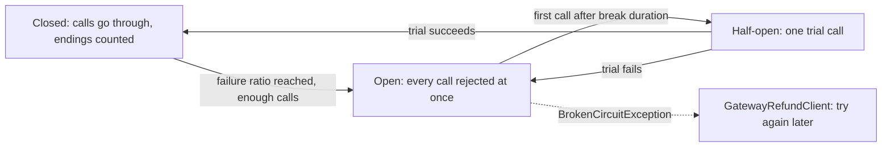

## Bạn cần biết trước

- [[backend.l3.resilience-pipeline]] — bạn biết Payments cho mọi lời gọi tới cổng thanh toán đi qua một pipeline có chứa timeout.
- [[backend.l3.slow-dependencies]] — bạn biết bên gọi cứ chờ một phụ thuộc đang hỏng thì giữ tài nguyên của mình suốt thời gian chờ.

## Tình huống

Đơn Hàng đang ở stage-3, và cổng thanh toán đã sập hai mươi phút. Một khách hàng yêu cầu hoàn tiền cho đơn 10. `RefundSender` gọi thử, ghi lại một lần thử thất bại, chờ, rồi thử tiếp, như mọi khi. Mọi lần hoàn tiền đến hạn khác cũng vậy. Lần thử nào cũng là một lời gọi tới cổng thanh toán mà bạn đã biết trước là sẽ hỏng. Nếu cổng thanh toán treo thay vì từ chối kết nối, mỗi lời gọi còn giữ một kết nối cho tới khi timeout chấm dứt nó. Cả `RefundSender` lẫn timeout đều không nhận ra mười lời gọi gần nhất đã hỏng hết.

Thứ gì giúp Payments ngừng gọi một cổng thanh toán cứ hỏng liên tục, rồi tự gọi lại khi nó hồi phục?

## Khái niệm cốt lõi

- **circuit breaker** (cơ chế ngừng gọi một phụ thuộc trong một lúc khi quá nhiều lời gọi tới nó thất bại, rồi gọi thử để mở lại) — một chiến lược theo dõi cách các lời gọi tới một phụ thuộc kết thúc. Khi quá nhiều lời gọi hỏng, nó ngừng gửi lời gọi trong một lúc, nên chúng hỏng ngay mà không tới được phụ thuộc.
- đóng, mở, nửa mở (closed, open, half-open) — ba trạng thái của breaker: đóng thì cho lời gọi đi qua và đếm cách chúng kết thúc, mở thì từ chối mọi lời gọi cho tới khi hết thời gian ngắt, nửa mở thì cho một lời gọi thử đi qua.
- tỉ lệ thất bại (failure ratio) — phần lời gọi bị hỏng trong khoảng lấy mẫu (sampling duration), tức một khoảng thời gian gần nhất. Mạch mở khi tỉ lệ này chạm giá trị đã cấu hình, nhưng chỉ khi đã đếm đủ một số lời gọi tối thiểu.
- thời gian ngắt (break duration) — mạch giữ trạng thái mở trong bao lâu trước khi cho một lời gọi thử đi qua.
- kết cục được tính (handled outcome) — kiểu kết thúc lời gọi mà breaker tính là hỏng. Mọi cách kết thúc khác đều không bị tính là hỏng.

## Cơ chế hoạt động



Trong tình huống trên, bài này thêm circuit breaker làm chiến lược đầu tiên của pipeline cổng thanh toán từ bài trước, đứng trước timeout. Ban đầu nó ở trạng thái đóng. Mọi lời gọi `GatewayRefundClient` gửi đi đều qua được, và breaker ghi lại lời gọi đó có kết thúc bằng một kết cục được tính hay không. Trong Payments, kết cục được tính là kết nối thất bại (`HttpRequestException`), `TimeoutRejectedException` của timeout, hoặc một câu trả lời có status `5xx`, `408` (request mất quá lâu) hay `429` (quá nhiều request). Còn `422`, khi cổng thanh toán từ chối một lần hoàn tiền, là một câu trả lời giống như `200`: cổng thanh toán vẫn chạy, nó chỉ nói không.

Breaker thấy được exception của timeout vì nó được thêm trước timeout và bọc lấy timeout. Khi ít nhất một nửa số lời gọi trong một phút gần nhất bị hỏng, và có ít nhất 3 lời gọi như thế, mạch mở.

Khi mạch mở, breaker không chuyển lời gọi đi tiếp. Nó ném `BrokenCircuitException` ngay lập tức, và `GatewayRefundClient` biến exception đó thành thử lại sau, giống như với timeout. Không kết nối nào được mở, không timeout nào phải chờ hết, nên cổng thanh toán không nhận lời gọi nào từ Payments trong lúc nó hồi phục.

Khi hết thời gian ngắt, lời gọi kế tiếp chuyển mạch sang nửa mở và đi qua như một lời gọi thử. Nếu lời gọi thử thành công, mạch đóng lại và lời gọi lại đi qua bình thường. Nếu nó hỏng, mạch mở thêm một thời gian ngắt nữa. Trường hợp nào cũng không cần ai can thiệp.

## Trong hệ thống Đơn Hàng

Breaker trong pipeline cổng thanh toán, ở `DonHang.Payments/Program.cs`:

```csharp file=DonHang.Payments/Program.cs tag=stage-3 lines=107-125
        client.AddResilienceHandler("gateway", (pipeline, context) =>
        {
            var logger = context.ServiceProvider.GetRequiredService<ILoggerFactory>().CreateLogger("DonHang.Payments.GatewayCircuit");
            // lesson: backend.l3.circuit-breaker
            // Counts as failed: an exception (no connection, the timeout) or a
            // 5xx, 408 or 429 answer. A 422 refusal is an answer like 200.
            pipeline.AddCircuitBreaker(new HttpCircuitBreakerStrategyOptions
            {
                FailureRatio = gateway.FailureRatio,
                MinimumThroughput = gateway.MinimumThroughput,
                SamplingDuration = gateway.SamplingDuration,
                BreakDuration = gateway.BreakDuration,
                OnOpened = args => Log(() => logger.LogWarning(
                    "Circuit to the gateway opened: no calls for {BreakSeconds} s", args.BreakDuration.TotalSeconds)),
                OnHalfOpened = _ => Log(() => logger.LogInformation("Circuit to the gateway half-open: one trial call")),
                OnClosed = _ => Log(() => logger.LogInformation("Circuit to the gateway closed: calls go through again")),
            });
            pipeline.AddTimeout(gateway.Timeout);
        });
```

Dòng 113 thêm breaker với `HttpCircuitBreakerStrategyOptions`, và các kết cục được tính của nó là những gì comment ở dòng 111–112 tóm lại. Code không tự đặt quy tắc nào. Dòng 115–118 lấy bốn con số từ `gateway`, object `GatewaySettings` khai báo trong `GatewayRefundClient.cs`, ở đoạn ngay sau. Dòng 119–122 ghi log mỗi lần trạng thái đổi. `Log`, định nghĩa ở phía dưới file, chỉ ghi dòng log đó ra. Đó là những dòng bạn sẽ theo dõi ở phần "Thử ngay". Dòng 124 thêm timeout sau breaker, tức nằm bên trong nó.

Các con số, trong `DonHang.Payments/GatewayRefundClient.cs`:

```csharp file=DonHang.Payments/GatewayRefundClient.cs tag=stage-3 lines=29-36
    // lesson: backend.l3.circuit-breaker
    // The circuit opens once at least half of the calls in the last minute
    // failed, counting only once there were 3 calls: RefundSender makes few.
    // It stays open BreakDuration, then lets one trial call through.
    public double FailureRatio { get; set; } = 0.5;
    public int MinimumThroughput { get; set; } = 3;
    public TimeSpan SamplingDuration { get; set; } = TimeSpan.FromMinutes(1);
    public TimeSpan BreakDuration { get; set; } = TimeSpan.FromSeconds(30);
```

`MinimumThroughput` là 3 vì `RefundSender` chỉ gửi vài lời gọi mỗi phút. Một mức tối thiểu mà nó không bao giờ chạm tới sẽ giữ mạch đóng suốt cả một lần sự cố. `GatewaySettings` giữ mạch mở 30 giây, còn trong lab là 10 giây, do `Gateway__BreakDuration` trong `docker-compose.yml` đặt. Ngoài đoạn trích này, cũng file đó bắt `BrokenCircuitException` ở dòng 82–85 và trả về thử lại sau. Với `RefundSender`, một lời gọi bị mạch mở từ chối chỉ là thêm một lần thử thất bại, được hẹn lại với backoff cho tới khi quá thời điểm bỏ cuộc của nó. `GatewayCircuitBreakerTests` dựng đúng pipeline đó trước một handler giả: sau ba câu trả lời `500`, lời gọi thứ tư nhận về thử lại sau, và handler chỉ đếm được 3 lời gọi.

## Senior hay nhầm rằng…

- **"Circuit breaker là retry có giới hạn số lần thử."** → Thực ra nó không bao giờ lặp lại một lời gọi, nó quyết định lời gọi có được gửi đi hay không. Retry lặp lại một lời gọi sau khi lời gọi đó hỏng, còn breaker theo dõi nhiều lời gọi và chặn những lời gọi mới. Trong Payments, retry là của `RefundSender`, và breaker từ chối các lần thử đó khi mạch đang mở. Bạn sẽ nhận ra khi `RefundSender` ghi log một lần thử cho một lần hoàn tiền, còn cổng thanh toán không nhận lời gọi nào cho nó.
- **"Mạch đã mở thì phải có người đóng lại bằng tay."** → Thực ra lời gọi đầu tiên sau thời gian ngắt thấy mạch ở trạng thái nửa mở và đi qua như một lời gọi thử, nếu thành công thì mạch đóng lại. Payments không có dòng code nào mở hay đóng mạch. Bạn sẽ nhận ra khi log của Payments hiện "half-open" rồi "closed" vài giây sau khi cổng thanh toán chạy lại, mà không ai đụng vào gì.
- **"Câu trả lời lỗi nào cũng nên làm mạch mở, kể cả khi cổng thanh toán từ chối hoàn tiền."** → Thực ra một lần từ chối `422` nghĩa là cổng thanh toán vẫn chạy và vẫn trả lời. Nếu tính cả từ chối, vài lần hoàn tiền chuyển khoản bị từ chối (cổng thanh toán giả từ chối chúng bằng `422`) có thể làm mạch mở, rồi những lần hoàn tiền qua thẻ mà cổng thanh toán lẽ ra chấp nhận sẽ hỏng ngay. `GatewayCircuitBreakerTests` gửi năm lần từ chối và kiểm tra cả năm lời gọi đều tới được cổng thanh toán. Bạn sẽ nhận ra khi các lần hoàn tiền hỏng với "the circuit to the gateway is open" trong khi cổng thanh toán vẫn trả lời mọi request khác.
- **"Khi mạch mở, các lần hoàn tiền đang chờ cổng thanh toán bị mất."** → Thực ra mạch mở chỉ từ chối một lời gọi, và `GatewayRefundClient` báo nó là thử lại sau. Dòng hoàn tiền vẫn ở `pending`, và `RefundSender` hẹn lại nó với backoff cho tới khi quá thời điểm bỏ cuộc, nên lần hoàn tiền sẽ thành công khi một lần thử sau đi qua lúc mạch đã đóng. Bạn sẽ nhận ra khi status của dòng vẫn là `pending` suốt lúc sự cố, còn lần thử kế tiếp của nó cứ lùi dần về sau.

## Thử ngay (3 phút)

Khi lab đang chạy (`scripts/up.sh`), trong terminal trên máy bạn, ở thư mục gốc của repo ví dụ:

1. Chạy `scripts/backend/circuit-breaker.sh`. Script khởi động lại Payments để breaker bắt đầu ở trạng thái đóng, chưa đếm lời gọi nào. Sau đó nó dừng `fake-gateway`, bản thay thế cổng thanh toán trong lab, rồi yêu cầu hoàn tiền cho đơn 10. Script in ra các lần thử của `RefundSender` và các dòng log của breaker, rồi bật lại cổng thanh toán và in các dòng log thêm một lần nữa.
2. So lần thử không được gửi đi với ba lần thử trước nó.

Kết quả mong đợi: request hoàn tiền nhận `202`. Lần thử 1 tới 3 ghi `the call failed`, còn lần thử 4 ghi `not sent, the circuit is open`: 3 lời gọi hỏng trong một phút gần nhất đã làm mạch mở, và lần thử thứ tư không hề rời khỏi Payments. Log hiện `Circuit to the gateway opened: no calls for 10 s`. Sau `fake-gateway is back`, log thêm `Circuit to the gateway half-open: one trial call` rồi `Circuit to the gateway closed: calls go through again`, và script chờ tới khi đơn 10 là `cancelled` (đơn chuyển sang `cancelled` khi lần hoàn tiền của nó thành công). Không ai đóng mạch cả: lời gọi thử đã làm việc đó.

## Liên hệ

- [[backend.l3.resilience-pipeline]] — pipeline mà breaker này là chiến lược đầu tiên, và lý do nó nằm ngoài timeout.
- [[backend.l3.slow-dependencies]] — vấn đề bài này giới hạn: mạch mở giữ cho Payments khỏi phải chờ một cổng thanh toán cứ hỏng liên tục.
- [[backend.l3.safe-to-repeat-saga-steps]] — vì sao một lời gọi bị từ chối có thể thử lại sau an toàn: mọi lời gọi cho một lần hoàn tiền đều mang cùng một key hoàn tiền.
- [[backend.l3.compensating-action]] — lần hoàn tiền mà breaker này bảo vệ là hành động bù của saga. Mạch mở làm nó chậm lại chứ không bỏ nó đi.
- [[backend.l3.bulkhead]] — cũng nhằm giữ cho một phần đang hỏng không dùng hết những gì phần còn lại của hệ thống cần.

## Tóm tắt 5 dòng

1. Circuit breaker ngừng gửi lời gọi tới một phụ thuộc cứ hỏng liên tục, để chúng hỏng ngay, rồi sau đó cho một lời gọi thử đi qua.
2. Đóng thì đếm cách lời gọi kết thúc, mở thì từ chối mọi lời gọi tới khi hết thời gian ngắt, nửa mở thì gửi một lời gọi thử để đóng lại hoặc mở lại mạch.
3. Breaker của Payments mở khi ít nhất một nửa số lời gọi trong một phút gần nhất bị hỏng, và đã có ít nhất 3 lời gọi.
4. Được thêm trước timeout, nó tính timeout, kết nối thất bại và câu trả lời `5xx`, `408`, `429` là hỏng, nhưng không tính một lần từ chối `422`.
5. Mạch mở biến mỗi lần hoàn tiền đến hạn thành thử lại sau, nên dòng vẫn ở `pending` và được thử lại với backoff cho tới khi `RefundSender` bỏ cuộc.
