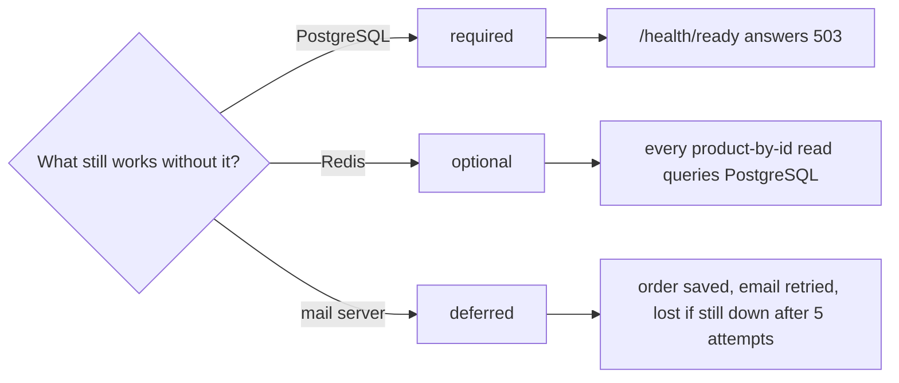

## Before you start

- [[backend.l3.timeouts]] — you know that a timeout turns a call that gets no answer into a failed call, so the code after it has to decide what to do next.
- [[backend.l2.cache-aside]] — you know that `ProductCache` asks Redis first and, on a cache miss, reads PostgreSQL and stores the answer.
- [[k8s.l1.health-endpoints]] — you know that `/health/ready` answers `200 Healthy` when its checks pass and `503 Unhealthy` when one fails.
- [[backend.l2.database-job-queue]] — you know that an order email is a `pending` row in `notifications`, saved with the order and sent later by `NotificationSender`.

## The situation

It is stage-2, during an evening sale. The `redis` container crashes, and a few minutes later Mailpit, the lab's mail server, stops too. Customers barely notice: product pages still open, orders still get `201`, and `/health/ready` keeps answering `200`; only the confirmation emails stop arriving. Later, PostgreSQL restarts and is unreachable for a short while. This time placing an order fails, and `/health/ready` answers `503`. Three dependencies failed, and each failure looked different from the outside.

Was that difference luck, or did someone choose it, and what does each choice cost?

## Core concepts

- **graceful degradation** — when a dependency fails, the system keeps its most important functions and loses only what needs that dependency, in a way chosen in advance; in the situation above, the reason orders kept working while emails stopped.
- required dependency — a dependency without which the api cannot do its main job, so the api reports itself not ready while that dependency is unreachable.
- optional dependency — a dependency the api can do without, by answering another way, for example more slowly.
- deferred dependency — a dependency whose work can wait: the api records what must be done and the work happens once the dependency is back.
- fallback — the other way the code answers when a dependency fails, such as reading PostgreSQL when Redis gives an error.

## How it works



Read the diagram as one decision per dependency. Graceful degradation is not code that wakes up during an outage. It is the answer to "what still works without this?", given before the outage and then built into the code.

PostgreSQL is required. Orders, products and email rows all live there, so without it the api has nothing useful to answer. The honest report is "not ready": the check behind `/health/ready` needs a database connection, so the endpoint answers `503` while PostgreSQL is unreachable. On Kubernetes, the readiness probe then stops the Service from sending that Pod requests.

Redis is optional. It holds only copies, so `ProductCache` treats any Redis error as a cache miss and reads PostgreSQL. The fallback is simply the query the cache usually saves. For the same reason Redis stays out of `/health/ready`: an api without Redis still serves.

The mail server is deferred. Placing an order sends no email; it saves a `pending` row with the order, and `NotificationSender` sends it later. While the mail server is down, orders still succeed and the rows are retried. The retries have a limit you chose too: a row that fails its fifth attempt, about 40 seconds of retries in all, is marked `failed`, so a longer outage still loses that email.

The Redis branch carries the cost. A fallback does not remove work; it moves it. With Redis down, every read of one product (`GET /api/v1/products/{id}`) becomes a PostgreSQL query until Redis is back. The fallback is safe only while PostgreSQL can carry that extra load. If it cannot, the failure of an optional dependency turns into a failure of the required one.

## In the Đơn Hàng system

The decision about readiness, in `DonHang.Api/Program.cs`:

```csharp file=DonHang.Api/Program.cs tag=stage-2 lines=75-80
// lesson: k8s.l1.health-endpoints
// One check: can EF Core open a connection to PostgreSQL? Tagged "ready" so
// only /health/ready runs it. Redis is left out on purpose: when it fails,
// the api still answers from PostgreSQL.
builder.Services.AddHealthChecks()
    .AddDbContextCheck<DonHangDbContext>(tags: ["ready"]);
```

Lines 79–80 register the only health check the api has, and it covers PostgreSQL alone. Lines 77–78 are the decision written down: Redis is left out on purpose, with the reason next to it. The mail server has no check at all, because no request waits for it. Reading the list of checks tells you which dependencies the team treats as required.

The fallback for Redis, in `DonHang.Infrastructure/ProductCache.cs`:

```csharp file=DonHang.Infrastructure/ProductCache.cs tag=stage-2 lines=61-76
    // lesson: backend.l2.cache-aside
    // Redis holds only copies, so any Redis error counts as a miss: product
    // reads get slower while Redis is down, not broken.
    private async Task<Product?> GetAsync(string key)
    {
        try
        {
            var json = await redis.GetDatabase().StringGetAsync(key);
            return json.IsNull ? null : JsonSerializer.Deserialize<Product>(json.ToString(), JsonSerializerOptions.Web);
        }
        catch (Exception ex) when (ex is RedisException or RedisTimeoutException)
        {
            logger.LogWarning(ex, "Redis read of {Key} failed; reading PostgreSQL instead", key);
            return null;
        }
    }
```

Line 71 catches only Redis's own errors, `RedisException` and `RedisTimeoutException`; any other exception still fails the request. Line 74 returns `null`, which `FindAsync`, above this excerpt, treats as a miss: it calls `inner.FindAsync`, one PostgreSQL query. Line 73 logs a warning for each failed read, so the degraded mode shows up in the logs instead of passing silently. Lines 62–63 state what was chosen: slower, not broken.

The deferred path is in `DonHang.Infrastructure/QueuedNotifier.cs`, outside these excerpts and quoted in the job-queue lesson. Its `Send` only adds a `pending` row to the `DbContext` the order is in; it never contacts the mail server. That is why `email-retry.sh`, from the previous lesson, which stops Mailpit and places an order, got `201`.

## Seniors often assume…

- **"If any dependency fails, the honest thing is for the whole API to report itself not ready."** → Actually readiness answers one question: can this api serve its requests now. Every api Pod uses the same Redis, so a Redis check in `/health/ready` would fail on all of them at once and leave the Service no Pod to send requests to. A slower product page would become no api at all. You notice this when a Redis outage makes every request through the Service fail, although PostgreSQL is up and could have served them.
- **"A fallback costs nothing, because it only runs when something is already broken."** → Actually it runs on every request while the dependency is down, and it moves the work somewhere else: in Đơn Hàng, onto PostgreSQL. A fallback never tried under real load can overload the required dependency, and then the degraded feature takes the rest of the api down with it, the cascading failure from earlier in this module. You notice this when the number of product queries jumps the moment Redis goes down, and requests that never touch Redis slow down too.
- **"Graceful degradation means catching every exception and returning an empty result."** → Actually it is a decision about what the user still gets, and an empty result is often a wrong answer, not a degraded one: an empty product list says the shop sells nothing. `ProductCache` catches only Redis errors and still returns the real product, read from PostgreSQL. Catching everything also hides failures that should reach the logs. You notice this when a page shows no orders for a customer who has some, and nothing in the logs explains it.

## Try it (3 minutes)

With the lab running (`scripts/up.sh`), in a terminal on your machine, in the root folder of the example repository:

1. Run `scripts/backend/cache-aside.sh`. It reads product 3 twice, then once more with the `redis` container stopped, and starts Redis again at the end.
2. Compare the three parts of the output: the status code after `->` and the line `queries PostgreSQL ran for it`.

Expected result: all three requests answer `200` with the same product 3. The first and the third each cost one PostgreSQL query, the second none. With Redis stopped, the request still succeeds, and the work the cache saved in part two lands on PostgreSQL again.

Then decide: while Redis is down, how many product queries does PostgreSQL run for 1,000 product page reads, compared with while Redis is up?

<details><summary>Suggested answer</summary>

While Redis is down, about one query per read: 1,000. While Redis is up, a product is queried again only after its copy expires, after the 5-minute TTL, or after a price change deletes it, so most of the 1,000 reads cost no query. The fallback keeps every read working, and PostgreSQL pays for all of them.

</details>

## Connections

- [[backend.l3.timeouts]] — the step before: a timeout turns a stuck call into a failed one, and this lesson decides what Đơn Hàng does after that failure.
- [[backend.l2.cache-aside]] — where Redis became optional: a Redis error counts as a miss.
- [[k8s.l1.health-endpoints]] — the endpoint that carries the "required" decision: `/health/ready` checks PostgreSQL only.
- [[backend.l2.database-job-queue]] — where the mail server became deferred: the email is a row saved with the order.
- [[k8s.l1.readiness-probes]] — what a `503` from `/health/ready` does on Kubernetes: the Pod gets no requests, and nothing restarts.
- [[backend.l3.eventual-consistency]] — the same deferral one step further: at stage-3 a refund request gets `202` while Payments is stopped, and finishes when Payments is back.
- [[backend.l3.bulkhead]] — the missing half of the Redis fallback: a cap on how many product reads run at once, so the load a fallback moves cannot use up shared capacity.

## Five-line summary

1. Graceful degradation is deciding in advance, for each dependency, what Đơn Hàng still does without it, and losing only what needs it.
2. PostgreSQL is required: `/health/ready` checks only the database, so the api reports itself not ready when PostgreSQL is unreachable.
3. Redis is optional: `ProductCache` treats a Redis error as a miss and reads PostgreSQL, and Redis stays out of the ready check on purpose.
4. The mail server is deferred: orders keep working while email rows are retried; an outage outlasting five attempts (about 40 s) loses them.
5. A fallback moves load: with Redis down every single-product read is a PostgreSQL query, safe only while PostgreSQL can carry it.
