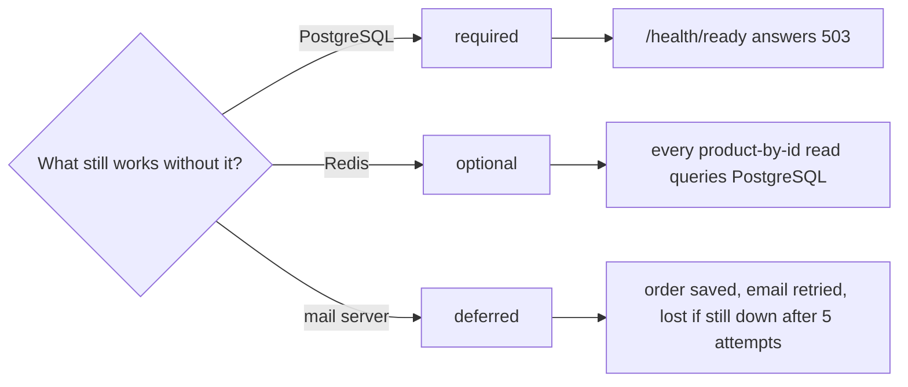

## Bạn cần biết trước

- [[backend.l3.timeouts]] — bạn biết timeout biến một lời gọi không nhận được trả lời thành một lời gọi lỗi, nên code phía sau phải quyết định làm gì tiếp.
- [[backend.l2.cache-aside]] — bạn biết `ProductCache` hỏi Redis trước, và khi cache miss thì đọc PostgreSQL rồi lưu câu trả lời lại.
- [[k8s.l1.health-endpoints]] — bạn biết `/health/ready` trả `200 Healthy` khi các check của nó đạt và `503 Unhealthy` khi một check hỏng.
- [[backend.l2.database-job-queue]] — bạn biết email của một đơn hàng là một dòng `pending` trong `notifications`, lưu cùng đơn hàng và được `NotificationSender` gửi sau.

## Tình huống

Đơn Hàng đang ở stage-2, giữa một đợt giảm giá buổi tối. Container `redis` sập, vài phút sau Mailpit, mail server của lab, cũng dừng. Khách gần như không thấy gì: trang sản phẩm vẫn mở, đặt hàng vẫn nhận `201`, và `/health/ready` vẫn trả `200`. Chỉ có email xác nhận là không tới nữa. Sau đó PostgreSQL khởi động lại và không với tới được trong một lúc ngắn. Lần này đặt hàng lỗi, và `/health/ready` trả `503`. Ba phụ thuộc cùng hỏng, nhưng nhìn từ bên ngoài, mỗi lần hỏng một khác.

Sự khác nhau đó là may mắn, hay có người đã chọn như vậy, và mỗi lựa chọn phải trả giá gì?

## Khái niệm cốt lõi

- **graceful degradation** (khi một phụ thuộc hỏng, hệ thống giữ chức năng chính và chỉ mất phần cần phụ thuộc đó, theo cách đã chọn trước) — khi một phụ thuộc hỏng, hệ thống giữ lại những chức năng quan trọng nhất và chỉ mất phần cần tới phụ thuộc đó, theo cách đã chọn từ trước. Trong tình huống trên, đây là lý do đặt hàng vẫn chạy trong khi email ngừng.
- phụ thuộc bắt buộc — thiếu nó thì api không làm được việc chính, nên trong lúc không với tới được nó, api tự báo mình chưa sẵn sàng.
- phụ thuộc tùy chọn — thiếu nó api vẫn xoay xở được bằng cách trả lời theo đường khác, chẳng hạn chậm hơn.
- phụ thuộc hoãn được — việc của nó chờ được: api ghi lại những gì cần làm, và việc đó diễn ra khi phụ thuộc quay lại.
- đường lui (fallback) — cách khác mà code dùng để trả lời khi một phụ thuộc hỏng, như đọc PostgreSQL khi Redis báo lỗi.

## Cơ chế hoạt động



Hãy đọc sơ đồ như một quyết định cho mỗi phụ thuộc. Graceful degradation không phải đoạn code tự bật lên khi có sự cố. Nó là câu trả lời cho câu hỏi "thiếu cái này thì còn gì chạy?", đưa ra trước sự cố rồi viết thẳng vào code.

PostgreSQL là phụ thuộc bắt buộc. Đơn hàng, sản phẩm và các dòng email đều nằm ở đó, nên thiếu nó thì api chẳng có gì hữu ích để trả lời. Báo cáo trung thực là "chưa sẵn sàng": check đứng sau `/health/ready` cần một kết nối database, nên endpoint trả `503` trong lúc không với tới được PostgreSQL. Trên Kubernetes, readiness probe khi đó khiến Service ngừng gửi request tới Pod ấy.

Redis là phụ thuộc tùy chọn. Nó chỉ giữ bản sao, nên `ProductCache` coi mọi lỗi Redis là một lần cache miss và đọc PostgreSQL. Đường lui chẳng qua là chính truy vấn mà cache thường giúp tiết kiệm. Cũng vì lý do đó, Redis không có mặt trong `/health/ready`: api thiếu Redis vẫn phục vụ được.

Mail server là phụ thuộc hoãn được. Đặt hàng không gửi email nào. Nó lưu một dòng `pending` cùng đơn hàng, và `NotificationSender` gửi sau. Trong lúc mail server sập, đặt hàng vẫn thành công và các dòng được thử lại. Số lần thử lại cũng là giới hạn do bạn chọn: dòng nào hỏng ở lần thử thứ năm, tổng cộng khoảng 40 giây thử lại, sẽ bị đánh dấu `failed`, nên một sự cố kéo dài hơn vẫn làm mất email đó.

Nhánh Redis là nơi phải trả giá. Đường lui không xóa bớt việc, nó chuyển việc đi chỗ khác. Khi Redis sập, mỗi lần đọc một sản phẩm (`GET /api/v1/products/{id}`) thành một truy vấn PostgreSQL cho tới khi Redis quay lại. Đường lui chỉ an toàn khi PostgreSQL gánh nổi phần tải thêm đó. Nếu không gánh nổi, một phụ thuộc tùy chọn hỏng sẽ kéo theo phụ thuộc bắt buộc hỏng.

## Trong hệ thống Đơn Hàng

Quyết định về readiness, trong `DonHang.Api/Program.cs`:

```csharp file=DonHang.Api/Program.cs tag=stage-2 lines=75-80
// lesson: k8s.l1.health-endpoints
// One check: can EF Core open a connection to PostgreSQL? Tagged "ready" so
// only /health/ready runs it. Redis is left out on purpose: when it fails,
// the api still answers from PostgreSQL.
builder.Services.AddHealthChecks()
    .AddDbContextCheck<DonHangDbContext>(tags: ["ready"]);
```

Dòng 79–80 đăng ký health check duy nhất của api, và nó chỉ kiểm tra PostgreSQL. Dòng 77–78 là quyết định được ghi thành chữ: Redis bị bỏ ra ngoài có chủ ý, lý do nằm ngay bên cạnh. Mail server không có check nào, vì không request nào chờ nó. Đọc danh sách check là biết team coi phụ thuộc nào là bắt buộc.

Đường lui cho Redis, trong `DonHang.Infrastructure/ProductCache.cs`:

```csharp file=DonHang.Infrastructure/ProductCache.cs tag=stage-2 lines=61-76
    // lesson: backend.l2.cache-aside
    // Redis holds only copies, so any Redis error counts as a miss: product
    // reads get slower while Redis is down, not broken.
    private async Task<Product?> GetAsync(string key)
    {
        try
        {
            var json = await redis.GetDatabase().StringGetAsync(key);
            return json.IsNull ? null : JsonSerializer.Deserialize<Product>(json.ToString(), JsonSerializerOptions.Web);
        }
        catch (Exception ex) when (ex is RedisException or RedisTimeoutException)
        {
            logger.LogWarning(ex, "Redis read of {Key} failed; reading PostgreSQL instead", key);
            return null;
        }
    }
```

Dòng 71 chỉ bắt lỗi riêng của Redis, `RedisException` và `RedisTimeoutException`. Exception nào khác vẫn làm request lỗi. Dòng 74 trả `null`, và `FindAsync`, nằm phía trên đoạn trích, coi đó là miss: nó gọi `inner.FindAsync`, một truy vấn PostgreSQL. Dòng 73 ghi một warning cho mỗi lần đọc hỏng, nên chế độ suy giảm hiện ra trong log thay vì lặng lẽ trôi qua. Dòng 62–63 nói rõ điều đã chọn: chậm hơn, không phải hỏng.

Đường hoãn nằm trong `DonHang.Infrastructure/QueuedNotifier.cs`, ngoài các đoạn trích này và đã được trích trong bài về job queue. `Send` của nó chỉ thêm một dòng `pending` vào `DbContext` đang chứa đơn hàng, và không bao giờ liên lạc với mail server. Đó là lý do `email-retry.sh` ở bài trước, script dừng Mailpit rồi đặt một đơn hàng, vẫn nhận `201`.

## Senior hay nhầm rằng…

- **"Phụ thuộc nào hỏng thì trung thực nhất là cả API tự báo chưa sẵn sàng."** → Thực ra readiness chỉ trả lời một câu hỏi: api này có phục vụ được request ngay bây giờ không. Mọi Pod api dùng chung một Redis, nên một check Redis trong `/health/ready` sẽ hỏng trên tất cả cùng lúc và Service không còn Pod nào để gửi request tới. Một trang sản phẩm chậm hơn sẽ thành không còn api nào. Bạn sẽ nhận ra khi Redis sập làm mọi request qua Service lỗi, dù PostgreSQL vẫn chạy và lẽ ra phục vụ được chúng.
- **"Đường lui không tốn gì, vì nó chỉ chạy khi có thứ đã hỏng rồi."** → Thực ra nó chạy trên mọi request trong suốt lúc phụ thuộc sập, và nó chuyển việc sang chỗ khác: trong Đơn Hàng là sang PostgreSQL. Một đường lui chưa từng thử dưới tải thật có thể làm quá tải phụ thuộc bắt buộc, rồi tính năng đang suy giảm kéo cả phần còn lại của api sập theo, đúng cascading failure đã gặp ở phần đầu module này. Bạn sẽ nhận ra khi số truy vấn sản phẩm vọt lên ngay lúc Redis sập, và cả những request không hề đụng tới Redis cũng chậm theo.
- **"Graceful degradation nghĩa là bắt mọi exception rồi trả về kết quả rỗng."** → Thực ra đó là quyết định về những gì người dùng vẫn nhận được, và kết quả rỗng thường là câu trả lời sai chứ không phải câu trả lời suy giảm: danh sách sản phẩm rỗng nói rằng cửa hàng không bán gì. `ProductCache` chỉ bắt lỗi Redis và vẫn trả sản phẩm thật, đọc từ PostgreSQL. Bắt mọi thứ còn che mất những lỗi lẽ ra phải hiện trong log. Bạn sẽ nhận ra khi một trang không hiện đơn hàng nào cho một khách thật ra có đơn, và log không có gì giải thích.

## Thử ngay (3 phút)

Khi lab đang chạy (`scripts/up.sh`), trong một terminal trên máy bạn, ở thư mục gốc của repo ví dụ:

1. Chạy `scripts/backend/cache-aside.sh`. Script đọc sản phẩm 3 hai lần, rồi đọc thêm một lần khi container `redis` bị dừng, và khởi động lại Redis ở cuối.
2. So sánh ba phần của output: status code sau `->` và dòng `queries PostgreSQL ran for it`.

Kết quả mong đợi: cả ba request đều trả `200` với cùng sản phẩm 3. Lần thứ nhất và lần thứ ba mỗi lần tốn một truy vấn PostgreSQL, lần thứ hai không tốn truy vấn nào. Khi Redis bị dừng, request vẫn thành công, và phần việc mà cache đã tiết kiệm ở phần hai lại đổ lên PostgreSQL.

Rồi hãy tự quyết: trong lúc Redis sập, PostgreSQL chạy bao nhiêu truy vấn sản phẩm cho 1.000 lần đọc trang sản phẩm, so với lúc Redis đang chạy?

<details><summary>Gợi ý đáp án</summary>

Trong lúc Redis sập, khoảng một truy vấn cho mỗi lần đọc: 1.000. Khi Redis đang chạy, một sản phẩm chỉ bị truy vấn lại khi bản sao của nó hết hạn, sau TTL 5 phút, hoặc khi một lần đổi giá xóa nó đi, nên phần lớn trong 1.000 lần đọc không tốn truy vấn nào. Đường lui giữ cho mọi lần đọc chạy được, và PostgreSQL trả giá cho tất cả.

</details>

## Liên hệ

- [[backend.l3.timeouts]] — bước ngay trước: timeout biến một lời gọi bị treo thành một lời gọi lỗi, còn bài này quyết định Đơn Hàng làm gì sau lần lỗi đó.
- [[backend.l2.cache-aside]] — nơi Redis trở thành tùy chọn: một lỗi Redis được tính là một lần miss.
- [[k8s.l1.health-endpoints]] — endpoint mang quyết định "bắt buộc": `/health/ready` chỉ kiểm tra PostgreSQL.
- [[backend.l2.database-job-queue]] — nơi mail server trở thành hoãn được: email là một dòng lưu cùng đơn hàng.
- [[k8s.l1.readiness-probes]] — `503` từ `/health/ready` gây ra gì trên Kubernetes: Pod không nhận request nào, và không có gì bị khởi động lại.
- [[backend.l3.eventual-consistency]] — cùng kiểu trì hoãn đó, đi xa thêm một bước: ở stage-3, một yêu cầu hoàn tiền nhận `202` trong lúc Payments bị dừng, và hoàn tất khi Payments quay lại.
- [[backend.l3.bulkhead]] — nửa còn thiếu của đường lui Redis: một giới hạn số lần đọc sản phẩm chạy cùng lúc, để phần tải mà đường lui chuyển đi không dùng cạn năng lực chung.

## Tóm tắt 5 dòng

1. Graceful degradation là quyết định trước, cho từng phụ thuộc, Đơn Hàng vẫn làm được gì khi thiếu nó, và chỉ mất phần cần tới nó.
2. PostgreSQL là bắt buộc: `/health/ready` chỉ kiểm tra database, nên api tự báo chưa sẵn sàng khi không với tới được PostgreSQL.
3. Redis là tùy chọn: `ProductCache` coi lỗi Redis là miss và đọc PostgreSQL, còn Redis được cố ý bỏ ra khỏi check ready.
4. Mail server là hoãn được: đặt hàng vẫn chạy trong khi các dòng email được thử lại, và sự cố kéo dài quá năm lần thử (khoảng 40 s) sẽ làm mất chúng.
5. Đường lui chuyển tải đi: khi Redis sập, mỗi lần đọc một sản phẩm là một truy vấn PostgreSQL, chỉ an toàn khi PostgreSQL gánh nổi.
