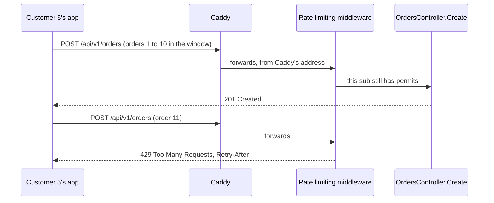

## Before you start

- [[backend.l3.graceful-degradation]] — you know Đơn Hàng decides in advance what keeps working when something fails, and that PostgreSQL is the part it cannot do without.
- [[backend.l1.middleware-pipeline]] — you know middleware runs in the order `Program.cs` adds it and can short-circuit before the controller runs.
- [[backend.l2.resource-based-authorization]] — you know the api learns who the caller is from the access token and checks named policies such as `OrderOwner`.
- [[devops.l1.reverse-proxy-basics]] — you know every request from outside reaches the api through Caddy, never directly.

## The situation

It is stage-3. A customer's app has a bug: when an order is slow to answer, it sends the request again with a new `Idempotency-Key`, over and over. In one minute the api receives hundreds of `POST /api/v1/orders` from that one customer. Each one is a full order: the api takes the prices from Catalog and writes to PostgreSQL, the same database every other customer needs to place theirs. Caddy forwards every request, and `OrdersController` handles each one as if it were the first.

How can the api refuse one customer's extra orders before they cost anything, while every other customer keeps ordering?

## Core concepts

- **rate limiting** — capping how many requests a client may make in a period, so that one client sending too many cannot take the capacity other clients need; requests over the cap are refused.
- fixed window — a way of counting in which time is cut into windows of one length; each request takes a permit, and when the window ends the count starts again at zero.
- permit limit — how many requests one window lets through; in Đơn Hàng, 10 orders per customer per minute.
- rejection status code — the status code the rate limiting middleware answers a refused request with.
- `Retry-After` — a response header telling the client how long to wait before it tries again, as a number of seconds (what Đơn Hàng sends) or a date.

## How it works



In the situation above, the rate limiting middleware sits between authentication and the controller. `POST /api/v1/orders` is marked with the `orders` policy, so each request to it asks the policy for a permit first. The policy reads the caller's `sub`, the field in the access token that names who signed in, and keeps one fixed window for each `sub` it has seen. Customer 5's first ten orders in a window each take a permit and reach `OrdersController.Create`, which answers `201`.

The eleventh finds no permit left. `Program.cs` sets no queue for the limiter (a queue would hold the request until the next window), and the eleventh is refused at once. The middleware short-circuits the pipeline: no controller, no price read, no row written. Left alone, it would answer `503 Service Unavailable`, its default rejection status code. Đơn Hàng answers `429 Too Many Requests` with a `Retry-After` header instead.

Customer 2 has a window of their own, so their order at the same moment goes through. When customer 5's window ends, their count starts again at zero.

The count is kept per customer, not per IP address. In the lab, every request reaches the api over a connection from Caddy, so the address the api sees is Caddy's, for every customer. A limit by address would put all customers in one window.

The windows live in the memory of the api process that counts them. When the api runs as more than one copy, as it will on a cluster with `replicas: 2`, each copy counts on its own. A customer whose requests reach both can place up to twice the limit in a window.

## In the Đơn Hàng system

The `orders` policy, in `DonHang.Api/Program.cs`:

```csharp file=DonHang.Api/Program.cs tag=stage-3 lines=150-161
builder.Services.AddRateLimiter(options =>
{
    options.AddPolicy("orders", context =>
    {
        var customer = context.User.FindFirst("sub")?.Value;
        if (customer is null) return RateLimitPartition.GetNoLimiter("signed-out");
        return RateLimitPartition.GetFixedWindowLimiter(customer, _ => new FixedWindowRateLimiterOptions
        {
            PermitLimit = ordersLimit.PermitLimit,
            Window = ordersLimit.Window,
        });
    });
```

Line 152 names the policy `orders`, the name that `[EnableRateLimiting("orders")]` on `OrdersController.Create` refers to (line 34 of `OrdersController.cs`, outside this excerpt). Line 154 reads `sub`, and line 156 gives each customer a fixed-window limiter of their own, kept under that value. Line 155 gives a caller without `sub` no limit: that request is signed out, and `[Authorize]` refuses it later in the pipeline.

`ordersLimit`, declared on line 140, holds 10 permits per minute; in the lab, `docker-compose.yml` shortens the window to 10 seconds so that the script in "Try it" waits seconds, not a minute.

What a refused request gets, a few lines further down:

```csharp file=DonHang.Api/Program.cs tag=stage-3 lines=168-181
    // lesson: backend.l3.rate-limiting
    // A refused request never reaches the controller: the middleware answers
    // it with RejectionStatusCode, 503 unless set. A fixed window knows when
    // its next permit comes, so that refusal becomes 429 with Retry-After in
    // whole seconds. The concurrency limiter cannot know: its refusals stay 503.
    options.OnRejected = (context, _) =>
    {
        if (context.Lease.TryGetMetadata(MetadataName.RetryAfter, out var retryAfter))
        {
            context.HttpContext.Response.StatusCode = StatusCodes.Status429TooManyRequests;
            context.HttpContext.Response.Headers.RetryAfter = ((int)Math.Ceiling(retryAfter.TotalSeconds)).ToString();
        }
        return ValueTask.CompletedTask;
    };
```

The middleware sets the rejection status code before it calls `OnRejected`, and Đơn Hàng never changes `RejectionStatusCode`, so the status is still `503` when line 173 starts. A fixed-window limiter's refusal carries how long to wait, and line 175 reads it from the lease, the limiter's answer for this request. Lines 177–178 then set `429` and write that wait as `Retry-After`, rounded up to whole seconds. The comment's last line is about a different limiter, the subject of the next lesson; this one, the fixed window, carries the wait. Outside this excerpt, line 210 adds `UseRateLimiter` after `UseAuthentication`, so that the policy can read `sub`. Line 133 lets `DonHang.App` in a browser read `Retry-After`: by default a browser hides most response headers from a page's script when the api is on another address.

## Seniors often assume…

- **"Limiting by IP address is the simplest fair rule, and it works the same behind a proxy."** → Actually behind a reverse proxy, ASP.NET Core reports the proxy's address as the caller's, unless the app is set up to read the client's address from headers the proxy adds. Đơn Hàng's api is not set up that way. A limit by address would give every customer one shared window: one busy customer would use it up, and everyone else would get `429` too. You notice this when customers who placed a single order are refused in the same minute as one customer who placed many.
- **"The limit holds across the whole system, however many copies of the API run."** → Actually each api process keeps its windows in its own memory, and no copy knows what another counted. With two copies, one customer can place up to 20 orders in one window instead of 10, and a restarted process starts every count at zero. That is acceptable when the limit only has to stop one customer from flooding the api, not count exactly. You notice this when a test against the cluster gets more `201` answers for one customer than the limit allows.
- **"A limited request should get `503`, since the server is too busy."** → Actually `503` says the server cannot handle the request right now, while here the api is fine and only this customer sent too many. Đơn Hàng answers `429 Too Many Requests`, the status the ASP.NET Core docs use for rate-limited requests, and `Retry-After` tells the client when its next order can succeed. `UseHttpMetrics` records the status code of every answer, so refusals answered `503` would be counted with the server errors. You notice this when the graph of `5xx` answers rises while every other customer orders normally.

## Try it (3 minutes)

With the lab running (`scripts/up.sh`), in a terminal on your machine, in the root folder of the example repository:

1. Run `scripts/backend/rate-limit.sh`. It gets an access token for customer 5 and places orders until the api refuses one, places one order as customer 2, waits the `Retry-After` seconds, and places one more order as customer 5.
2. Compare the refused answer with customer 2's answer, printed right after it.

Expected result: customer 5 gets `201 Created` 10 times, then `429` with `Retry-After` and a whole number of seconds. Customer 2's order at the same moment gets `201`: their window is their own. After the wait, customer 5's next order gets `201` again, because a new window has started.

## Connections

- [[backend.l3.bulkhead]] — the next lesson: it caps how many requests run at once for all callers, where this one caps how often one customer may order.
- [[foundation.l1.http-status-codes]] — the `4xx`/`5xx` split behind choosing `429` over `503`: a `4xx` points at the request, a `5xx` at the server.
- [[backend.l2.idempotent-endpoints]] — the other half of retrying safely: `Retry-After` says when to try again, and the `Idempotency-Key` makes trying again place one order.
- [[backend.l2.cache-stampede]] — a burst a per-customer limit does not stop, because it comes from many callers at once, each under their own limit.
- [[backend.l1.middleware-pipeline]] — the short-circuit this middleware uses: a refused order stops before the controller runs.
- [[devops.l1.reverse-proxy-basics]] — why the api sees Caddy's address: the client only ever connects to Caddy.

## Five-line summary

1. Rate limiting caps how many requests one client may make in a period, so one client sending too many cannot take capacity others need.
2. At stage-3 `POST /api/v1/orders` uses the `orders` policy: one fixed window per customer, kept under the access token's `sub`.
3. A refused request never reaches the controller; Đơn Hàng answers `429` with `Retry-After` instead of the middleware's default `503`.
4. The limit is per customer, not per IP address, because behind Caddy every request reaches the api from Caddy's address.
5. Each api process keeps its counts in memory, so with two copies one customer can place up to twice the limit in a window.
