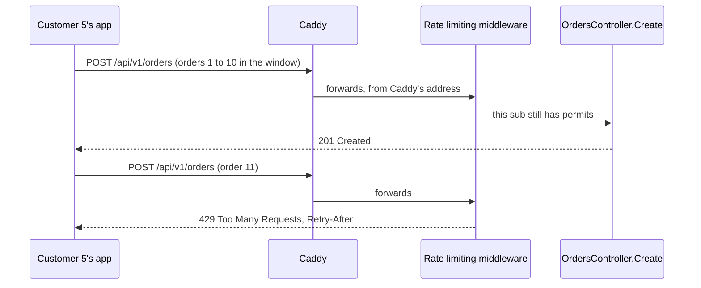

## Bạn cần biết trước

- [[backend.l3.graceful-degradation]] — bạn biết Đơn Hàng quyết định trước phần nào vẫn chạy khi có thứ hỏng, và PostgreSQL là phần nó không thể thiếu.
- [[backend.l1.middleware-pipeline]] — bạn biết middleware chạy theo thứ tự `Program.cs` thêm vào, và có thể short-circuit trước khi controller chạy.
- [[backend.l2.resource-based-authorization]] — bạn biết api lấy danh tính người gọi từ access token và kiểm tra các policy có tên như `OrderOwner`.
- [[devops.l1.reverse-proxy-basics]] — bạn biết mọi request từ bên ngoài tới api đều đi qua Caddy, không bao giờ tới thẳng.

## Tình huống

Đơn Hàng đang ở stage-3. App của một khách hàng có bug: khi một đơn trả lời chậm, app gửi lại request với một `Idempotency-Key` mới, hết lần này tới lần khác. Trong một phút, api nhận hàng trăm `POST /api/v1/orders` từ đúng khách đó. Mỗi request là một đơn đầy đủ: api lấy giá từ Catalog và ghi vào PostgreSQL, cũng là database mà mọi khách khác cần để đặt đơn của họ. Caddy chuyển tiếp mọi request, và `OrdersController` xử lý từng cái như thể đó là cái đầu tiên.

Làm sao để api từ chối các đơn thừa của một khách trước khi chúng tốn bất cứ thứ gì, trong khi mọi khách khác vẫn đặt đơn bình thường?

## Khái niệm cốt lõi

- **rate limiting** (giới hạn số request một client được gửi trong một khoảng thời gian; quá giới hạn thì bị từ chối) — chặn trên số request một client được gửi trong một khoảng thời gian, để một client gửi quá nhiều không chiếm mất phần năng lực mà các client khác cần. Request vượt mức bị từ chối.
- cửa sổ cố định (fixed window) — cách đếm chia thời gian thành các cửa sổ dài bằng nhau. Mỗi request lấy một lượt, và khi cửa sổ kết thúc, số đếm quay về 0.
- số lượt cho phép (permit limit) — số request một cửa sổ cho qua. Trong Đơn Hàng là 10 đơn cho mỗi khách mỗi phút.
- status code từ chối (rejection status code) — status code mà middleware rate limiting dùng để trả lời một request bị từ chối.
- `Retry-After` — response header cho client biết phải chờ bao lâu rồi mới thử lại, dưới dạng số giây (cách Đơn Hàng gửi) hoặc một ngày giờ.

## Cơ chế hoạt động



Trong tình huống trên, middleware rate limiting đứng giữa xác thực và controller. `POST /api/v1/orders` được gắn policy `orders`, nên mỗi request tới đó phải xin policy một lượt trước. Policy đọc `sub` của người gọi, tức trường trong access token cho biết ai đã đăng nhập, và giữ một cửa sổ cố định riêng cho mỗi `sub` nó từng gặp. Mười đơn đầu tiên của khách 5 trong một cửa sổ, mỗi đơn lấy một lượt và tới được `OrdersController.Create`, nơi trả lời `201`.

Đơn thứ mười một không còn lượt nào. `Program.cs` không đặt hàng đợi cho limiter (hàng đợi sẽ giữ request lại tới cửa sổ kế tiếp), nên đơn thứ mười một bị từ chối ngay. Middleware short-circuit pipeline: không controller, không đọc giá, không ghi dòng nào. Nếu để mặc định, nó sẽ trả lời `503 Service Unavailable`, status code từ chối mặc định của nó. Đơn Hàng trả lời `429 Too Many Requests` kèm header `Retry-After` thay vào đó.

Khách 2 có cửa sổ của riêng mình, nên đơn của họ vào cùng lúc đó vẫn qua. Khi cửa sổ của khách 5 kết thúc, số đếm của họ quay về 0.

Số đếm được giữ theo từng khách, không theo địa chỉ IP. Trong lab, mọi request tới api qua một kết nối từ Caddy, nên địa chỉ api thấy là của Caddy, với mọi khách. Giới hạn theo địa chỉ sẽ dồn tất cả khách vào chung một cửa sổ.

Các cửa sổ nằm trong bộ nhớ của tiến trình api đang đếm chúng. Khi api chạy nhiều hơn một bản, như trên cluster với `replicas: 2`, mỗi bản đếm riêng. Một khách có request tới được cả hai bản có thể đặt tới gấp đôi giới hạn trong một cửa sổ.

## Trong hệ thống Đơn Hàng

Policy `orders`, trong `DonHang.Api/Program.cs`:

```csharp file=DonHang.Api/Program.cs tag=stage-3 lines=150-161
builder.Services.AddRateLimiter(options =>
{
    options.AddPolicy("orders", context =>
    {
        var customer = context.User.FindFirst("sub")?.Value;
        if (customer is null) return RateLimitPartition.GetNoLimiter("signed-out");
        return RateLimitPartition.GetFixedWindowLimiter(customer, _ => new FixedWindowRateLimiterOptions
        {
            PermitLimit = ordersLimit.PermitLimit,
            Window = ordersLimit.Window,
        });
    });
```

Dòng 152 đặt tên policy là `orders`, đúng tên mà `[EnableRateLimiting("orders")]` trên `OrdersController.Create` tham chiếu tới (dòng 34 của `OrdersController.cs`, ngoài đoạn trích này). Dòng 154 đọc `sub`, và dòng 156 cho mỗi khách một limiter cửa sổ cố định riêng, giữ theo giá trị đó. Dòng 155 không giới hạn người gọi không có `sub`: request đó chưa đăng nhập, và `[Authorize]` sẽ từ chối nó ở bước sau trong pipeline.

`ordersLimit`, khai báo ở dòng 140, giữ 10 lượt mỗi phút. Trong lab, `docker-compose.yml` rút cửa sổ xuống 10 giây để script ở phần "Thử ngay" chỉ phải chờ vài giây, không phải một phút.

Request bị từ chối nhận được gì, vài dòng bên dưới:

```csharp file=DonHang.Api/Program.cs tag=stage-3 lines=168-181
    // lesson: backend.l3.rate-limiting
    // A refused request never reaches the controller: the middleware answers
    // it with RejectionStatusCode, 503 unless set. A fixed window knows when
    // its next permit comes, so that refusal becomes 429 with Retry-After in
    // whole seconds. The concurrency limiter cannot know: its refusals stay 503.
    options.OnRejected = (context, _) =>
    {
        if (context.Lease.TryGetMetadata(MetadataName.RetryAfter, out var retryAfter))
        {
            context.HttpContext.Response.StatusCode = StatusCodes.Status429TooManyRequests;
            context.HttpContext.Response.Headers.RetryAfter = ((int)Math.Ceiling(retryAfter.TotalSeconds)).ToString();
        }
        return ValueTask.CompletedTask;
    };
```

Middleware đặt status code từ chối trước khi gọi `OnRejected`, và Đơn Hàng không bao giờ đổi `RejectionStatusCode`, nên status vẫn là `503` khi dòng 173 bắt đầu. Lần từ chối của limiter cửa sổ cố định mang theo thời gian phải chờ, và dòng 175 đọc nó từ lease, tức câu trả lời của limiter cho request này. Sau đó dòng 177–178 đặt `429` và ghi thời gian chờ đó vào `Retry-After`, làm tròn lên thành số giây nguyên. Dòng cuối của comment nói về một limiter khác, chủ đề của bài sau. Limiter ở bài này, cửa sổ cố định, có mang thời gian chờ. Ngoài đoạn trích này, dòng 210 thêm `UseRateLimiter` sau `UseAuthentication`, để policy đọc được `sub`. Dòng 133 cho `DonHang.App` chạy trong trình duyệt đọc được `Retry-After`: mặc định, khi api ở một địa chỉ khác, trình duyệt giấu phần lớn response header khỏi script của trang.

## Senior hay nhầm rằng…

- **"Giới hạn theo địa chỉ IP là quy tắc công bằng đơn giản nhất, và đứng sau proxy thì vẫn chạy y như vậy."** → Thực ra đứng sau reverse proxy, ASP.NET Core báo địa chỉ của proxy là địa chỉ người gọi, trừ khi app được cấu hình để đọc địa chỉ client từ các header mà proxy thêm vào. Api của Đơn Hàng không cấu hình như vậy. Giới hạn theo địa chỉ sẽ cho mọi khách dùng chung một cửa sổ: một khách bận rộn dùng hết, và mọi người khác cũng nhận `429`. Bạn sẽ nhận ra khi những khách chỉ đặt một đơn bị từ chối cùng phút với một khách đặt rất nhiều.
- **"Giới hạn có hiệu lực trên toàn hệ thống, dù có bao nhiêu bản API đang chạy."** → Thực ra mỗi tiến trình api giữ các cửa sổ trong bộ nhớ riêng, và không bản nào biết bản kia đã đếm bao nhiêu. Với hai bản, một khách có thể đặt tới 20 đơn trong một cửa sổ thay vì 10, và một tiến trình vừa khởi động lại thì đếm lại mọi thứ từ 0. Điều đó chấp nhận được khi giới hạn chỉ cần ngăn một khách làm ngập api, không cần đếm chính xác. Bạn sẽ nhận ra khi một bài test trên cluster nhận được nhiều câu trả lời `201` cho một khách hơn mức giới hạn cho phép.
- **"Request bị giới hạn nên nhận `503`, vì server đang quá bận."** → Thực ra `503` nói server không xử lý được request lúc này, còn ở đây api vẫn ổn, chỉ có khách này gửi quá nhiều. Đơn Hàng trả lời `429 Too Many Requests`, status mà tài liệu ASP.NET Core dùng cho request bị rate limit, và `Retry-After` cho client biết khi nào đơn kế tiếp có thể thành công. `UseHttpMetrics` ghi lại status code của mọi câu trả lời, nên các lần từ chối trả `503` sẽ bị đếm chung với lỗi server. Bạn sẽ nhận ra khi biểu đồ câu trả lời `5xx` tăng lên trong khi mọi khách khác vẫn đặt đơn bình thường.

## Thử ngay (3 phút)

Khi lab đang chạy (`scripts/up.sh`), trong terminal trên máy bạn, ở thư mục gốc của repo ví dụ:

1. Chạy `scripts/backend/rate-limit.sh`. Script lấy access token cho khách 5 và đặt đơn cho tới khi api từ chối một đơn, đặt một đơn với tư cách khách 2, chờ đúng số giây trong `Retry-After`, rồi đặt thêm một đơn với tư cách khách 5.
2. So câu trả lời bị từ chối với câu trả lời của khách 2, in ngay sau nó.

Kết quả mong đợi: khách 5 nhận `201 Created` 10 lần, rồi `429` kèm `Retry-After` và một số giây nguyên. Đơn của khách 2 vào cùng lúc đó nhận `201`: cửa sổ của họ là của riêng họ. Sau thời gian chờ, đơn kế tiếp của khách 5 lại nhận `201`, vì một cửa sổ mới đã bắt đầu.

## Liên hệ

- [[backend.l3.bulkhead]] — bài kế tiếp: nó giới hạn số request chạy cùng lúc cho mọi người gọi, còn bài này giới hạn tần suất một khách được đặt đơn.
- [[foundation.l1.http-status-codes]] — cách chia `4xx`/`5xx` đứng sau lựa chọn `429` thay vì `503`: `4xx` chỉ vào request, `5xx` chỉ vào server.
- [[backend.l2.idempotent-endpoints]] — nửa còn lại của thử lại an toàn: `Retry-After` nói khi nào thử lại, còn `Idempotency-Key` khiến lần thử lại chỉ tạo một đơn.
- [[backend.l2.cache-stampede]] — một đợt dồn request mà giới hạn theo từng khách không chặn được, vì nó đến từ nhiều người gọi cùng lúc, mỗi người đều dưới giới hạn của mình.
- [[backend.l1.middleware-pipeline]] — kiểu short-circuit mà middleware này dùng: một đơn bị từ chối dừng lại trước khi controller chạy.
- [[devops.l1.reverse-proxy-basics]] — vì sao api thấy địa chỉ của Caddy: client chỉ kết nối tới Caddy.

## Tóm tắt 5 dòng

1. Rate limiting giới hạn số request một client được gửi trong một khoảng thời gian, để một client gửi quá nhiều không chiếm phần năng lực các client khác cần.
2. Ở stage-3, `POST /api/v1/orders` dùng policy `orders`: mỗi khách một cửa sổ cố định, giữ theo `sub` trong access token.
3. Request bị từ chối không bao giờ tới controller. Đơn Hàng trả lời `429` kèm `Retry-After` thay vì `503` mặc định của middleware.
4. Giới hạn tính theo từng khách, không theo địa chỉ IP, vì sau Caddy mọi request tới api đều mang địa chỉ của Caddy.
5. Mỗi tiến trình api giữ số đếm trong bộ nhớ, nên với hai bản, một khách có thể đặt tới gấp đôi giới hạn trong một cửa sổ.
