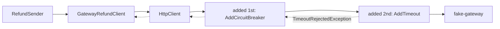

## Before you start

- [[backend.l3.timeouts]] — you know a timeout is the longest a caller waits for an answer, and that it ends the wait, not the work.
- [[backend.l3.retry-jitter]] — you know `RefundSender` tries a failed refund again on a later round, after a random wait that grows with every attempt.
- [[backend.l3.safe-to-repeat-saga-steps]] — you know `GatewayRefundClient` turns every gateway answer into refunded, refused or try again later, and sends the same refund key on every call.

## The situation

It is stage-3, and the payment gateway is in trouble: it still answers, but only after many seconds. `RefundSender` calls it for one refund row at a time, so every refund behind a slow call waits too. For email, the timeouts lesson set a timeout on the mail client in code. You could do the same here and write one into `GatewayRefundClient.RefundAsync`. But that class is the anti-corruption layer: its job is translating the gateway's status codes and JSON. Any call added to it later would need the same timeout code again.

Where does the limit on a gateway call go, so that every call gets it and `GatewayRefundClient` holds none of it?

## Core concepts

- strategy — one rule applied around a call, such as "give up after 3 seconds" or "try again on failure", that acts before the call starts and after it ends.
- **resilience pipeline** — a chain of strategies, such as a timeout or a retry, that every call to a dependency passes through, each strategy wrapping the ones added after it.
- resilience handler — what the package `Microsoft.Extensions.Http.Resilience` attaches to an `HttpClient` registration with `AddResilienceHandler`, so every request that client sends runs through one resilience pipeline.
- timeout strategy — the strategy `AddTimeout` adds: it ends a call that has no answer within the configured time by throwing `TimeoutRejectedException`.
- standard resilience handler — the handler `AddStandardResilienceHandler` adds: a ready-made pipeline of five strategies with default settings, among them a retry and two timeouts, one added before the retry and one after it.

## How it works



In the situation above, the limit goes on the `HttpClient`, not in the class that uses it. Payments registers the client that `GatewayRefundClient` receives and attaches a resilience handler to that registration. From then on, every request the client sends passes through the pipeline on its way out, and its answer or failure passes back through it on the way in. `GatewayRefundClient` only calls `SendAsync`; it does not know a pipeline is there.

The strategies run in the order they are added, and the first one added wraps all the ones after it. First added means outermost, leftmost in the diagram: a request meets it first on the way out and last on the way back. In Payments the first is the strategy `AddCircuitBreaker` adds, which counts how calls end and can stop sending calls for a while; the next lesson explains it. Because it is outside the timeout, it sees every call that passes through the strategies after it, and how each one ended, including the calls the timeout ended.

The second strategy is the timeout. When `fake-gateway`, the lab's stand-in for the payment gateway, has not answered within the configured time, the timeout strategy ends the call and throws `TimeoutRejectedException`. The exception travels back out through the first strategy to `SendAsync`, where `GatewayRefundClient` catches it and returns try again later. `RefundSender` then records a failed attempt and moves on to the next row.

What the pipeline leaves out matters as much. It has no retry strategy: one call to `SendAsync` is at most one call to the gateway. The retry lives one layer up, in `RefundSender`, which asks again on a later round.

## In the Đơn Hàng system

The registration of the gateway's `HttpClient` and its pipeline, in `DonHang.Payments/Program.cs`:

```csharp file=DonHang.Payments/Program.cs tag=stage-3 lines=102-125
        var client = services.AddHttpClient<GatewayRefundClient>(http =>
        {
            http.BaseAddress = new Uri(gateway.BaseAddress);
            http.DefaultRequestHeaders.Authorization = new("Bearer", gateway.ApiKey);
        });
        client.AddResilienceHandler("gateway", (pipeline, context) =>
        {
            var logger = context.ServiceProvider.GetRequiredService<ILoggerFactory>().CreateLogger("DonHang.Payments.GatewayCircuit");
            // lesson: backend.l3.circuit-breaker
            // Counts as failed: an exception (no connection, the timeout) or a
            // 5xx, 408 or 429 answer. A 422 refusal is an answer like 200.
            pipeline.AddCircuitBreaker(new HttpCircuitBreakerStrategyOptions
            {
                FailureRatio = gateway.FailureRatio,
                MinimumThroughput = gateway.MinimumThroughput,
                SamplingDuration = gateway.SamplingDuration,
                BreakDuration = gateway.BreakDuration,
                OnOpened = args => Log(() => logger.LogWarning(
                    "Circuit to the gateway opened: no calls for {BreakSeconds} s", args.BreakDuration.TotalSeconds)),
                OnHalfOpened = _ => Log(() => logger.LogInformation("Circuit to the gateway half-open: one trial call")),
                OnClosed = _ => Log(() => logger.LogInformation("Circuit to the gateway closed: calls go through again")),
            });
            pipeline.AddTimeout(gateway.Timeout);
        });
```

Line 102 registers the `HttpClient` that `GatewayRefundClient` receives in its constructor. Line 107 attaches the resilience handler, named `"gateway"`, to that registration, so the pipeline belongs to the client, not to the code that calls it. Line 113 adds the first strategy; lines 109–123 belong to the next lesson. Line 124 adds the timeout with `gateway.Timeout`: 10 seconds by default in `GatewaySettings`, 3 seconds in the lab through the environment variable `Gateway__Timeout`, which sets `gateway.Timeout`, in `docker-compose.yml`. No line adds a retry.

Where the timeout comes back, in `DonHang.Payments/GatewayRefundClient.cs`:

```csharp file=DonHang.Payments/GatewayRefundClient.cs tag=stage-3 lines=66-85
        try
        {
            using var response = await http.SendAsync(request, cancellationToken);
            if (response.IsSuccessStatusCode) return new(RefundOutcome.Refunded);
            if (response.StatusCode == HttpStatusCode.UnprocessableEntity)
                return new(RefundOutcome.Refused, await ReadReasonAsync(response, cancellationToken));
            return new(RefundOutcome.TryAgainLater, $"the gateway answered {(int)response.StatusCode}");
        }
        catch (HttpRequestException ex)
        {
            return new(RefundOutcome.TryAgainLater, ex.Message);
        }
        catch (TimeoutRejectedException)
        {
            return new(RefundOutcome.TryAgainLater, "the gateway did not answer in time");
        }
        catch (BrokenCircuitException)
        {
            return new(RefundOutcome.TryAgainLater, "the circuit to the gateway is open; not calling it");
        }
```

Line 68 is the only line that sends anything to the gateway, and it sets no time limit of its own. Lines 78–81 are where the pipeline's timeout arrives: `TimeoutRejectedException` becomes try again later, the same outcome as a broken connection on lines 74–77. Lines 82–85 catch an exception from the first strategy, which the next lesson covers.

## Seniors often assume…

- **"The standard resilience handler fits every client, since it was built for exactly this."** → Actually it is a general default: five strategies with default settings you can change, among them a retry that repeats a failed request up to 3 times, for every HTTP method unless you turn that off. It fits when the caller does not retry and the request is safe to repeat. Payments' caller already retries, so Payments builds its own pipeline with `AddResilienceHandler` and only the strategies it needs. You notice this when the gateway receives several calls with one `Idempotency-Key` within seconds, for what `RefundSender` logged as one attempt.
- **"Retrying inside the call and again from the background job is twice as safe."** → Actually the two layers multiply instead of add. With the standard handler's default of 3 retries, each `RefundSender` attempt can become up to 4 gateway calls, and every later round can send 4 more. The refund key keeps those calls from refunding twice, but not from loading the gateway while it tries to recover. You notice this when the gateway's request count climbs during an outage while the number of `pending` refunds stays the same.
- **"The order in which strategies are added does not matter, because each one works on its own."** → Actually each strategy wraps the ones added after it, so its position decides which calls it sees. In the standard handler, the timeout added before the retry limits the request with all its retries; the one added after it limits each attempt. You notice this when a timeout meant for each attempt was added before the retry: one slow attempt uses up the whole time, and the retries never run.

## Try it (3 minutes)

With the lab running (`scripts/up.sh`), in a terminal on your machine, in the root folder of the example repository:

1. Run `scripts/backend/gateway-slow.sh`. It makes `fake-gateway` answer each refund call after 6 seconds, requests a refund of order 10, and prints how `RefundSender`'s first attempt ended and the refund row's status. Then it makes the gateway answer at once again and waits for the refund to finish.
2. Compare the gateway's delay, 6 seconds, with the pipeline's timeout in the lab, 3 seconds.

Expected result: the refund request gets `202`. The first attempt line reads `attempt 1: the gateway did not answer in time`, the text `GatewayRefundClient` returns for a `TimeoutRejectedException`, and the row's status is `pending`. The script then lists one refund the gateway made for this row anyway, 6 seconds after the first call: the timeout ended Payments' wait, not the gateway's work. Once the gateway answers at once again, the row becomes `refunded`, and the gateway still lists one refund for it, because every call carried the same refund key.

## Connections

- [[backend.l3.timeouts]] — the same limit, moved from a setting in the calling code to a strategy in the client's pipeline.
- [[backend.l3.retry-jitter]] — the retry this pipeline leaves out on purpose: it lives in `RefundSender`, one layer up.
- [[backend.l3.safe-to-repeat-saga-steps]] — where `GatewayRefundClient` and its three outcomes come from; the pipeline adds one more way to reach try again later.
- [[design.l2.decorator-pattern]] — the same idea at class level: each strategy wraps the call and adds work before and after it, as a decorator wraps an object.
- [[design.l3.anti-corruption-layer]] — the pipeline keeps time limits out of the layer whose only job is translating the gateway's words.
- [[backend.l3.opentelemetry-sdk]] — the same `Program.cs` also traces `HttpClient` calls, the gateway's included, so a sampled refund attempt shows its gateway call as part of the trace.
- [[backend.l3.circuit-breaker]] — the next lesson: the first strategy in this pipeline, and why it sits outside the timeout.

## Five-line summary

1. A resilience pipeline is a chain of strategies that every call through one `HttpClient` passes, so the calling code holds none of them.
2. Payments attaches its pipeline with `AddResilienceHandler`, so every call `GatewayRefundClient` makes is limited without any timeout code in that class.
3. Strategies run in the order they are added; the first added wraps the rest and sees every call they make.
4. The timeout strategy ends a gateway call with no answer in time, and `GatewayRefundClient` turns it into try again later.
5. The pipeline has no retry, unlike the standard handler, because `RefundSender` already retries and two retry layers multiply gateway calls.
