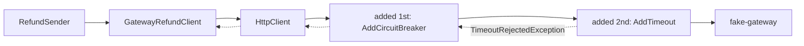

## Bạn cần biết trước

- [[backend.l3.timeouts]] — bạn biết timeout là thời gian dài nhất bên gọi chờ câu trả lời, và nó chấm dứt lần chờ chứ không chấm dứt công việc.
- [[backend.l3.retry-jitter]] — bạn biết `RefundSender` thử lại một lần hoàn tiền thất bại ở một lượt sau, sau một khoảng chờ ngẫu nhiên dài dần theo mỗi lần thử.
- [[backend.l3.safe-to-repeat-saga-steps]] — bạn biết `GatewayRefundClient` biến mọi câu trả lời của cổng thanh toán thành đã hoàn tiền, bị từ chối hoặc thử lại sau, và gửi cùng một key hoàn tiền trong mọi lời gọi.

## Tình huống

Đơn Hàng đang ở stage-3, và cổng thanh toán gặp sự cố: nó vẫn trả lời, nhưng phải sau nhiều giây. `RefundSender` gọi nó cho từng dòng hoàn tiền một, nên mọi lần hoàn tiền đứng sau một lời gọi chậm cũng phải chờ theo. Với email, bài timeout đặt timeout cho mail client ngay trong code. Ở đây bạn có thể làm y như vậy và viết timeout vào `GatewayRefundClient.RefundAsync`. Nhưng class đó là anti-corruption layer: nhiệm vụ của nó là dịch status code và JSON của cổng thanh toán. Mọi lời gọi thêm vào nó sau này lại phải lặp lại đoạn code timeout đó.

Giới hạn cho lời gọi tới cổng thanh toán nên đặt ở đâu, để lời gọi nào cũng nhận được mà `GatewayRefundClient` không phải giữ chút nào?

## Khái niệm cốt lõi

- chiến lược (strategy) — một quy tắc áp quanh một lời gọi, như "bỏ cuộc sau 3 giây" hay "thử lại khi lỗi", làm việc trước khi lời gọi bắt đầu và sau khi nó kết thúc.
- **resilience pipeline** (chuỗi chiến lược như timeout, retry, circuit breaker mà mọi lời gọi tới một phụ thuộc đều đi qua) — trong chuỗi đó, mỗi chiến lược bọc lấy những chiến lược được thêm sau nó.
- resilience handler — thứ mà package `Microsoft.Extensions.Http.Resilience` gắn vào một đăng ký `HttpClient` bằng `AddResilienceHandler`, để mọi request client đó gửi đi đều chạy qua một resilience pipeline.
- chiến lược timeout (timeout strategy) — chiến lược mà `AddTimeout` thêm vào: nó chấm dứt lời gọi không có câu trả lời trong khoảng thời gian đã cấu hình bằng cách ném `TimeoutRejectedException`.
- standard resilience handler — handler mà `AddStandardResilienceHandler` thêm vào: một pipeline dựng sẵn gồm năm chiến lược với thiết lập mặc định, trong đó có một retry và hai timeout, một cái thêm trước retry và một cái thêm sau.

## Cơ chế hoạt động



Trong tình huống trên, giới hạn được đặt trên `HttpClient`, không phải trong class dùng nó. Payments đăng ký client mà `GatewayRefundClient` nhận vào và gắn một resilience handler vào đăng ký đó. Từ đó trở đi, mọi request client gửi đi đều qua pipeline trên đường đi, và câu trả lời hay lỗi của nó cũng qua pipeline trên đường về. `GatewayRefundClient` chỉ gọi `SendAsync`, nó không biết có pipeline ở đó.

Các chiến lược chạy theo thứ tự được thêm vào, và chiến lược thêm đầu tiên bọc lấy mọi chiến lược sau nó. Thêm đầu tiên nghĩa là nằm ngoài cùng, bên trái nhất trong sơ đồ: request gặp nó đầu tiên trên đường đi và cuối cùng trên đường về. Trong Payments, chiến lược đầu tiên là chiến lược mà `AddCircuitBreaker` thêm vào, nó đếm cách các lời gọi kết thúc và có thể ngừng gửi lời gọi trong một lúc. Bài sau sẽ giải thích nó. Vì nằm ngoài timeout, nó thấy mọi lời gọi đi qua các chiến lược phía sau và biết từng lời gọi kết thúc ra sao, kể cả những lời gọi bị timeout chấm dứt.

Chiến lược thứ hai là timeout. Khi `fake-gateway`, bản thay thế cổng thanh toán trong lab, chưa trả lời trong thời gian đã cấu hình, chiến lược timeout chấm dứt lời gọi và ném `TimeoutRejectedException`. Exception đi ngược ra qua chiến lược đầu tiên tới `SendAsync`, nơi `GatewayRefundClient` bắt nó và trả về thử lại sau. Sau đó `RefundSender` ghi lại một lần thử thất bại rồi chuyển sang dòng tiếp theo.

Những gì pipeline không có cũng quan trọng không kém. Nó không có chiến lược retry: một lần gọi `SendAsync` là nhiều nhất một lời gọi tới cổng thanh toán. Retry nằm ở tầng trên một bậc, trong `RefundSender`, nơi hỏi lại ở một lượt sau.

## Trong hệ thống Đơn Hàng

Đăng ký `HttpClient` của cổng thanh toán cùng pipeline của nó, trong `DonHang.Payments/Program.cs`:

```csharp file=DonHang.Payments/Program.cs tag=stage-3 lines=102-125
        var client = services.AddHttpClient<GatewayRefundClient>(http =>
        {
            http.BaseAddress = new Uri(gateway.BaseAddress);
            http.DefaultRequestHeaders.Authorization = new("Bearer", gateway.ApiKey);
        });
        client.AddResilienceHandler("gateway", (pipeline, context) =>
        {
            var logger = context.ServiceProvider.GetRequiredService<ILoggerFactory>().CreateLogger("DonHang.Payments.GatewayCircuit");
            // lesson: backend.l3.circuit-breaker
            // Counts as failed: an exception (no connection, the timeout) or a
            // 5xx, 408 or 429 answer. A 422 refusal is an answer like 200.
            pipeline.AddCircuitBreaker(new HttpCircuitBreakerStrategyOptions
            {
                FailureRatio = gateway.FailureRatio,
                MinimumThroughput = gateway.MinimumThroughput,
                SamplingDuration = gateway.SamplingDuration,
                BreakDuration = gateway.BreakDuration,
                OnOpened = args => Log(() => logger.LogWarning(
                    "Circuit to the gateway opened: no calls for {BreakSeconds} s", args.BreakDuration.TotalSeconds)),
                OnHalfOpened = _ => Log(() => logger.LogInformation("Circuit to the gateway half-open: one trial call")),
                OnClosed = _ => Log(() => logger.LogInformation("Circuit to the gateway closed: calls go through again")),
            });
            pipeline.AddTimeout(gateway.Timeout);
        });
```

Dòng 102 đăng ký `HttpClient` mà `GatewayRefundClient` nhận trong constructor. Dòng 107 gắn resilience handler tên `"gateway"` vào đăng ký đó, nên pipeline thuộc về client chứ không thuộc về code gọi nó. Dòng 113 thêm chiến lược đầu tiên, dòng 109–123 thuộc về bài sau. Dòng 124 thêm timeout với `gateway.Timeout`: mặc định 10 giây trong `GatewaySettings`, còn trong lab là 3 giây, qua biến môi trường `Gateway__Timeout` trong `docker-compose.yml`, biến này đặt giá trị cho `gateway.Timeout`. Không dòng nào thêm retry.

Nơi timeout quay về, trong `DonHang.Payments/GatewayRefundClient.cs`:

```csharp file=DonHang.Payments/GatewayRefundClient.cs tag=stage-3 lines=66-85
        try
        {
            using var response = await http.SendAsync(request, cancellationToken);
            if (response.IsSuccessStatusCode) return new(RefundOutcome.Refunded);
            if (response.StatusCode == HttpStatusCode.UnprocessableEntity)
                return new(RefundOutcome.Refused, await ReadReasonAsync(response, cancellationToken));
            return new(RefundOutcome.TryAgainLater, $"the gateway answered {(int)response.StatusCode}");
        }
        catch (HttpRequestException ex)
        {
            return new(RefundOutcome.TryAgainLater, ex.Message);
        }
        catch (TimeoutRejectedException)
        {
            return new(RefundOutcome.TryAgainLater, "the gateway did not answer in time");
        }
        catch (BrokenCircuitException)
        {
            return new(RefundOutcome.TryAgainLater, "the circuit to the gateway is open; not calling it");
        }
```

Dòng 68 là dòng duy nhất gửi thứ gì đó tới cổng thanh toán, và nó không tự đặt giới hạn thời gian nào. Dòng 78–81 là nơi timeout của pipeline đổ về: `TimeoutRejectedException` thành thử lại sau, cùng kết quả với một kết nối bị đứt ở dòng 74–77. Dòng 82–85 bắt exception từ chiến lược đầu tiên, phần bài sau sẽ nói tới.

## Senior hay nhầm rằng…

- **"Standard resilience handler hợp với mọi client, vì nó được làm ra đúng cho việc này."** → Thực ra đó là một mặc định chung: năm chiến lược với thiết lập mặc định bạn có thể đổi, trong đó có một retry lặp lại request lỗi tới 3 lần, cho mọi HTTP method trừ khi bạn tắt đi. Nó hợp khi bên gọi không tự retry và request lặp lại được an toàn. Bên gọi của Payments đã retry rồi, nên Payments tự dựng pipeline bằng `AddResilienceHandler` với đúng những chiến lược nó cần. Bạn sẽ nhận ra khi cổng thanh toán nhận nhiều lời gọi cùng một `Idempotency-Key` trong vài giây, cho thứ mà `RefundSender` ghi log là một lần thử.
- **"Retry bên trong lời gọi rồi retry thêm từ background job thì an toàn gấp đôi."** → Thực ra hai tầng nhân lên chứ không cộng vào nhau. Với mặc định 3 lần retry của standard handler, mỗi lần thử của `RefundSender` có thể thành tới 4 lời gọi tới cổng thanh toán, và mỗi lượt sau lại gửi thêm tới 4 lời gọi nữa. Key hoàn tiền giữ cho các lời gọi đó không hoàn tiền hai lần, nhưng không giữ cho chúng khỏi đè tải lên cổng thanh toán đúng lúc nó đang cố hồi phục. Bạn sẽ nhận ra khi số request tới cổng thanh toán tăng vọt trong lúc sự cố, còn số lần hoàn tiền `pending` vẫn đứng yên.
- **"Thứ tự thêm các chiến lược không quan trọng, vì mỗi cái làm việc riêng."** → Thực ra mỗi chiến lược bọc lấy những chiến lược thêm sau nó, nên vị trí quyết định nó thấy những lời gọi nào. Trong standard handler, timeout thêm trước retry giới hạn cả request lẫn mọi lần retry của nó, còn timeout thêm sau retry giới hạn từng lần thử. Bạn sẽ nhận ra khi một timeout định dành cho từng lần thử lại bị thêm trước retry: một lần thử chậm dùng hết toàn bộ thời gian, và các lần retry không bao giờ chạy.

## Thử ngay (3 phút)

Khi lab đang chạy (`scripts/up.sh`), trong terminal trên máy bạn, ở thư mục gốc của repo ví dụ:

1. Chạy `scripts/backend/gateway-slow.sh`. Script cho `fake-gateway` trả lời mỗi lời gọi hoàn tiền sau 6 giây, yêu cầu hoàn tiền cho đơn 10, rồi in ra lần thử đầu tiên của `RefundSender` kết thúc thế nào và trạng thái của dòng hoàn tiền. Sau đó script cho cổng thanh toán trả lời ngay trở lại và chờ lần hoàn tiền hoàn tất.
2. So độ trễ của cổng thanh toán, 6 giây, với timeout của pipeline trong lab, 3 giây.

Kết quả mong đợi: request hoàn tiền nhận `202`. Dòng của lần thử đầu ghi `attempt 1: the gateway did not answer in time`, đúng câu `GatewayRefundClient` trả về cho một `TimeoutRejectedException`, và trạng thái của dòng là `pending`. Sau đó script liệt kê một lần hoàn tiền mà cổng thanh toán vẫn thực hiện cho dòng này, 6 giây sau lời gọi đầu: timeout chấm dứt lần chờ của Payments, không chấm dứt công việc của cổng thanh toán. Khi cổng thanh toán trả lời ngay trở lại, dòng chuyển sang `refunded`, và cổng thanh toán vẫn chỉ liệt kê một lần hoàn tiền cho nó, vì mọi lời gọi đều mang cùng một key hoàn tiền.

## Liên hệ

- [[backend.l3.timeouts]] — cùng một giới hạn, chuyển từ thiết lập trong code gọi sang một chiến lược trong pipeline của client.
- [[backend.l3.retry-jitter]] — retry mà pipeline này cố ý bỏ ra: nó nằm trong `RefundSender`, ở tầng trên một bậc.
- [[backend.l3.safe-to-repeat-saga-steps]] — nơi `GatewayRefundClient` và ba kết quả của nó xuất hiện. Pipeline thêm một đường nữa dẫn tới thử lại sau.
- [[design.l2.decorator-pattern]] — cùng ý tưởng ở mức class: mỗi chiến lược bọc lời gọi và làm thêm việc trước và sau nó, như một decorator bọc một object.
- [[design.l3.anti-corruption-layer]] — pipeline giữ giới hạn thời gian ra khỏi lớp mà nhiệm vụ duy nhất là dịch ngôn ngữ của cổng thanh toán.
- [[backend.l3.opentelemetry-sdk]] — cũng `Program.cs` đó trace các lời gọi `HttpClient`, kể cả lời gọi tới cổng thanh toán, nên một lần thử hoàn tiền được lấy mẫu sẽ cho thấy lời gọi tới cổng thanh toán là một phần của trace.
- [[backend.l3.circuit-breaker]] — bài tiếp theo: chiến lược đầu tiên trong pipeline này, và vì sao nó nằm ngoài timeout.

## Tóm tắt 5 dòng

1. Resilience pipeline là chuỗi chiến lược mà mọi lời gọi qua một `HttpClient` đều đi qua, nên code gọi không phải giữ chiến lược nào.
2. Payments gắn pipeline bằng `AddResilienceHandler`, nên mọi lời gọi `GatewayRefundClient` thực hiện đều bị giới hạn mà class đó không có dòng code timeout nào.
3. Các chiến lược chạy theo thứ tự được thêm vào. Chiến lược thêm đầu tiên bọc phần còn lại và thấy mọi lời gọi chúng thực hiện.
4. Chiến lược timeout chấm dứt lời gọi tới cổng thanh toán không có câu trả lời kịp lúc, và `GatewayRefundClient` biến nó thành thử lại sau.
5. Pipeline không có retry, khác với standard handler, vì `RefundSender` đã retry rồi và hai tầng retry nhân số lời gọi tới cổng thanh toán lên.
