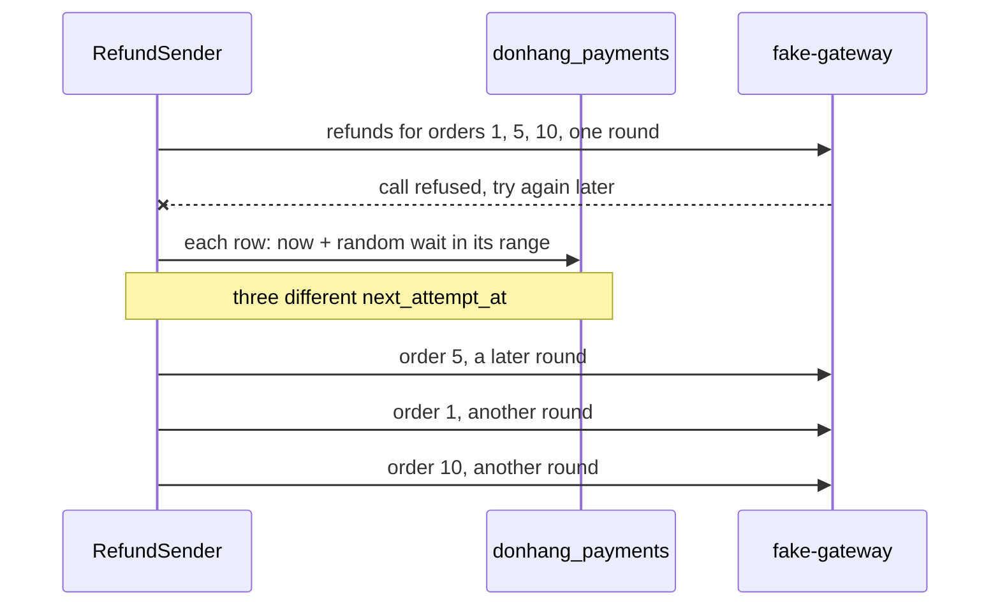

## Before you start

- [[backend.l3.safe-to-repeat-saga-steps]] — you know that `RefundSender` claims due `pending` refund rows, calls the gateway for each, and on try again later moves `next_attempt_at` later.
- [[backend.l2.retry-with-backoff]] — you know exponential backoff: the wait before the next attempt doubles after each failure, up to a cap.
- [[backend.l3.slow-dependencies]] — you know that a dependency in trouble gets worse when callers keep piling work onto it.

## The situation

It is stage-3, and the payment gateway is down: every call is refused at once. In one round, `RefundSender` claims ten due refund rows, calls the gateway for each, and gets try again later ten times. Suppose each row then waited exactly its backoff delay, as email rows in `NotificationSender` still do. All ten rows have one failed attempt, so all ten wait 1 minute and come due within a moment of each other. The gateway, just back, is asked for all ten refunds in one round. If it fails them again, they return together after 2 minutes, then after 4.

How do refunds that failed together come back spread out, while their waits still grow?

## Core concepts

- round — one pass of `RefundSender`, every 2 seconds, that claims up to 10 due refund rows and calls the gateway for each, one after another.
- backoff delay — the wait `BackoffDelay` returns for a number of failed attempts: `FirstRetryDelay` after the first, twice as long after each later one, never more than `MaxRetryDelay`.
- **jitter** — a random part added to each wait before a retry, so retries that failed together come back spread over a span of time instead of at one moment.
- jitter range — in `RefundSender`, from half the backoff delay up to the whole of it; the wait actually used is a random point inside it.

## How it works



The diagram shows three of the rows, orders 1, 5 and 10, failing against `fake-gateway`, the gateway the example system calls, in one round. Each gets its own random wait, so each comes back in its own later round, here order 5 first.

In the situation above, `RecordResult` gives each failed row its next attempt time: the moment it failed plus a wait, saved as the row's `next_attempt_at` in the `donhang_payments` database. The rows share a failed-attempt count, so with the backoff delay alone they share the wait too. When their calls fail quickly, they come due together and one later round claims them together. Backoff never separates them: on every later attempt they still share the count.

Jitter breaks that tie. For each row separately, `RefundSender` picks a random point in the jitter range. With the default first delay of 1 minute, each of the ten rows waits between 30 and 60 seconds, so they come due over half a minute and spread over many 2-second rounds instead of landing in one.

The waits still grow. After the second failure the range is 1 to 2 minutes, after the third 2 to 4: each range starts where the one before it ends, up to the cap of 1 hour, where every wait falls between 30 and 60 minutes. A refund that keeps failing still backs off, just not in step with the refunds that failed beside it.

## In the Đơn Hàng system

The backoff delay and the wait actually used, in `DonHang.Payments/RefundSender.cs`:

```csharp file=DonHang.Payments/RefundSender.cs tag=stage-3 lines=114-132
    // lesson: backend.l3.safe-to-repeat-saga-steps
    // Exponential backoff: FirstRetryDelay after the first failed attempt,
    // then twice as long each time, never more than MaxRetryDelay.
    public TimeSpan BackoffDelay(int attempts)
    {
        var delay = settings.FirstRetryDelay * Math.Pow(2, attempts - 1);
        return delay < settings.MaxRetryDelay ? delay : settings.MaxRetryDelay;
    }

    // lesson: backend.l3.retry-jitter
    // The wait actually used: a random point between half the backoff delay
    // and all of it. Refunds that failed in the same round would otherwise
    // all come due at the same moment and reach a recovering gateway as one
    // burst. The range doubles with every attempt, so the waits still grow.
    public TimeSpan NextDelay(int attempts)
    {
        var backoff = BackoffDelay(attempts);
        return backoff * (0.5 + Random.Shared.NextDouble() * 0.5);
    }
```

Lines 117–121 are the backoff from the saga lesson, unchanged; `NextDelay`, lines 123–132, is the part this lesson adds. Line 131 is the jitter: `Random.Shared.NextDouble()` returns a number from 0 up to, but not including, 1, so the factor runs from 0.5 to just under 1. `RecordResult`, outside this excerpt, calls `NextDelay` with the row's new attempt count and adds the result to the current time to set `NextAttemptAt`. The jitter never lengthens a wait; it only shortens it by up to half.

How a random wait is tested, in `DonHang.Tests/Payments/RefundSenderTests.cs`:

```csharp file=DonHang.Tests/Payments/RefundSenderTests.cs tag=stage-3 lines=89-107
    // lesson: backend.l3.retry-jitter
    // A random wait has no one right value to compare with, so the test asks
    // many times and checks that every answer falls inside the range: from
    // half the backoff delay up to the whole of it. And that the answers do
    // differ, or the jitter would spread nothing.
    [Theory]
    [InlineData(1, 1)]
    [InlineData(3, 4)]
    [InlineData(20, 60)]
    public void NextDelay_IsBetweenHalfAndAllOfTheBackoff(int attempts, int backoffMinutes)
    {
        var sender = NewSender();
        var backoff = TimeSpan.FromMinutes(backoffMinutes);

        var delays = Enumerable.Range(0, 1000).Select(_ => sender.NextDelay(attempts)).ToList();

        Assert.All(delays, delay => Assert.InRange(delay, backoff / 2, backoff));
        Assert.True(delays.Distinct().Count() > 1);
    }
```

Line 103 asks for 1,000 waits, and line 105 checks that every one falls between half the backoff delay and all of it. Line 106 checks that they are not all equal: a `NextDelay` that always returned half the backoff delay would pass line 105 and spread nothing. The three cases cover the first attempt, a middle one, and attempt 20, where the 1-hour cap applies; the second number in each `InlineData` is the backoff delay, in minutes, for that attempt.

## Seniors often assume…

- **"Exponential backoff already spreads the retries, so jitter adds nothing."** → Actually backoff spreads the attempts of one refund over time, not the refunds from each other. Rows that failed in one round have the same attempt count, get the same wait, and come due together on every later attempt. You notice this when the gateway's calls arrive in clumps after an outage, one clump per backoff step, with quiet in between.
- **"Jitter only matters when many servers retry, not for one background job."** → Actually one `RefundSender` is enough to make a clump: when its calls fail quickly, every row it failed in one round comes due at once, and the next round sends them all to the gateway back to back. The group never breaks up by itself, because its rows keep sharing an attempt count. You notice this when one round's log shows a run of attempts for different orders, all with the same attempt number.
- **"A random wait makes a refund less reliable, since it might wait much longer than planned."** → Actually the jitter range ends at the backoff delay, so a wait is never longer than without jitter, only up to half shorter. The deadline for giving up does not depend on the waits either: `RecordResult` marks the refund failed on the first try again later that comes at least `GiveUpAfter` (the 24-hour default limit from the saga lesson) after the request. You notice this when every wait `retry-jitter.sh` prints is at most the lab's backoff delay of 2 seconds.

## Try it (3 minutes)

With the lab running (`scripts/up.sh`), in a terminal on your machine, in the root folder of the example repository:

1. Run `scripts/backend/retry-jitter.sh`. It stops `fake-gateway`, requests refunds for orders 1, 5 and 10, makes the three rows due at the same moment so they fail in one round, and prints the wait `RefundSender` picked for each. When it ends, it puts the rows back and starts the gateway again.
2. Compare the three waits with each other and with the lab's backoff delay after a first failure: 2 seconds, set by `Refunds__FirstRetryDelay` in `docker-compose.yml`.

Expected result: each refund request gets `202`. Three lines follow, `for order 1 waits … s` and the same for orders 5 and 10, each with its own value between 1 and 2. The script ends with `different next attempt times among the three rows: 3` and `all between 1 s and 2 s? yes`. Your values change from run to run, and the script checks the waits, not the rounds: in the lab they differ by at most 1 second, less than one round, so the next attempts may still share a round. With the default first delay of 1 minute, the same spread covers 30 seconds, many rounds.

## Connections

- [[backend.l2.retry-with-backoff]] — the backoff this lesson keeps and randomises; `NotificationSender` there still waits the exact backoff delay.
- [[backend.l3.safe-to-repeat-saga-steps]] — where `RefundSender`, its rounds and its try again later come from; a retry that comes earlier is still safe because the refund key stays the same.
- [[backend.l2.cache-stampede]] — the same shape in another place: many callers arriving at one moment, solved there by letting one through and here by spreading them in time.
- [[backend.l3.timeouts]] — a timeout is one of the failures that leads to try again later and so to a jittered wait.
- [[backend.l3.resilience-pipeline]] — the next step: why the gateway's `HttpClient` adds no retry of its own on top of `RefundSender`'s.

## Five-line summary

1. Jitter adds a random part to each retry wait, so retries that failed together come back spread over time instead of at one moment.
2. Backoff alone gives every row that failed in one round the same wait, so the group reaches the recovering gateway together on every attempt.
3. `RefundSender.NextDelay` picks a random wait between half the backoff delay and all of it, so the waits still grow with every attempt.
4. `RefundSenderTests` asks for 1,000 waits and checks each falls inside the range and that they differ, since a random wait has no exact value.
5. `retry-jitter.sh` fails refunds for orders 1, 5 and 10 in one round and prints three different waits between 1 and 2 seconds.
