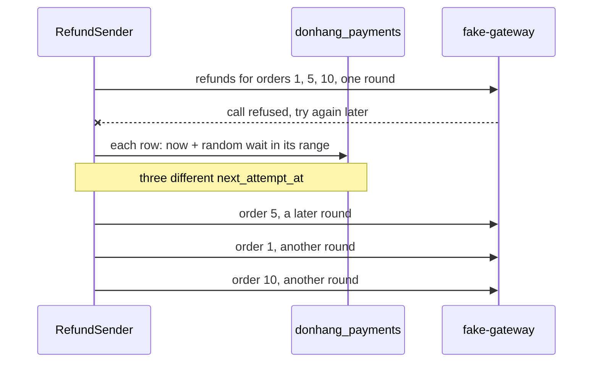

## Bạn cần biết trước

- [[backend.l3.safe-to-repeat-saga-steps]] — bạn biết `RefundSender` nhận các dòng hoàn tiền `pending` đã tới hạn, gọi cổng thanh toán cho từng dòng, và khi nhận thử lại sau thì đẩy `next_attempt_at` lùi lại.
- [[backend.l2.retry-with-backoff]] — bạn biết exponential backoff: thời gian chờ trước lần thử kế tiếp gấp đôi sau mỗi lần thất bại, cho tới một mức trần.
- [[backend.l3.slow-dependencies]] — bạn biết một phụ thuộc đang gặp sự cố sẽ tệ hơn khi bên gọi cứ dồn thêm việc cho nó.

## Tình huống

Đơn Hàng đang ở stage-3, và cổng thanh toán sập: mọi lời gọi đều bị từ chối ngay. Trong một lượt, `RefundSender` nhận mười dòng hoàn tiền đã tới hạn, gọi cổng thanh toán cho từng dòng, và nhận về thử lại sau cả mười lần. Giả sử mỗi dòng sau đó chờ đúng bằng thời gian chờ backoff, như các dòng email trong `NotificationSender` vẫn làm. Cả mười dòng đều có một lần thử thất bại, nên cả mười cùng chờ 1 phút và tới hạn gần như cùng lúc. Cổng thanh toán vừa hoạt động lại đã bị hỏi cả mười lần hoàn tiền trong một lượt. Nếu nó lại làm hỏng chúng, chúng cùng quay lại sau 2 phút, rồi sau 4 phút.

Làm sao để các lần hoàn tiền thất bại cùng nhau quay lại rải rác, mà thời gian chờ vẫn tăng dần?

## Khái niệm cốt lõi

- lượt (round) — một lần chạy của `RefundSender`, cứ 2 giây một lần, nhận tối đa 10 dòng hoàn tiền đã tới hạn và gọi cổng thanh toán cho từng dòng, hết dòng này tới dòng kia.
- thời gian chờ backoff (backoff delay) — khoảng chờ mà `BackoffDelay` trả về cho một số lần thử thất bại: `FirstRetryDelay` sau lần đầu, gấp đôi sau mỗi lần sau đó, không bao giờ quá `MaxRetryDelay`.
- **jitter** (phần ngẫu nhiên thêm vào thời gian chờ trước khi thử lại, để các lần thử lại không đến cùng lúc) — nhờ nó, các lần thử lại thất bại cùng nhau sẽ quay lại rải ra trong một khoảng thời gian thay vì dồn vào một thời điểm.
- khoảng jitter (jitter range) — trong `RefundSender`, từ một nửa thời gian chờ backoff tới trọn thời gian đó. Khoảng chờ thực sự được dùng là một điểm ngẫu nhiên trong khoảng này.

## Cơ chế hoạt động



Sơ đồ cho thấy ba trong số các dòng, của đơn 1, 5 và 10, thất bại trong cùng một lượt khi gọi `fake-gateway`, cổng thanh toán mà hệ thống ví dụ gọi tới. Mỗi dòng nhận một khoảng chờ ngẫu nhiên riêng, nên mỗi dòng quay lại ở một lượt sau riêng, ở đây đơn 5 đi trước.

Trong tình huống trên, `RecordResult` đặt thời điểm thử kế tiếp cho từng dòng thất bại: lúc nó thất bại cộng một khoảng chờ, lưu vào `next_attempt_at` của dòng trong database `donhang_payments`. Các dòng có cùng số lần thử thất bại, nên chỉ với thời gian chờ backoff thì chúng cũng chờ như nhau. Khi các lời gọi của chúng hỏng nhanh, chúng tới hạn cùng lúc và một lượt sau nhận cả nhóm. Backoff không bao giờ tách chúng ra: ở mọi lần thử sau, chúng vẫn có chung số lần thử.

Jitter phá thế hòa đó. Với từng dòng riêng, `RefundSender` chọn một điểm ngẫu nhiên trong khoảng jitter. Với thời gian chờ đầu mặc định là 1 phút, mỗi dòng trong mười dòng chờ từ 30 tới 60 giây, nên chúng tới hạn rải trong nửa phút và chia ra nhiều lượt 2 giây thay vì dồn vào một lượt.

Thời gian chờ vẫn tăng. Sau lần thất bại thứ hai, khoảng là 1 tới 2 phút, sau lần thứ ba là 2 tới 4 phút: mỗi khoảng bắt đầu ở chỗ khoảng trước kết thúc, cho tới mức trần 1 giờ, nơi mọi khoảng chờ nằm giữa 30 và 60 phút. Một lần hoàn tiền cứ thất bại mãi vẫn lùi dần, chỉ là không còn đi cùng nhịp với những lần hoàn tiền thất bại bên cạnh nó.

## Trong hệ thống Đơn Hàng

Thời gian chờ backoff và khoảng chờ thực sự được dùng, trong `DonHang.Payments/RefundSender.cs`:

```csharp file=DonHang.Payments/RefundSender.cs tag=stage-3 lines=114-132
    // lesson: backend.l3.safe-to-repeat-saga-steps
    // Exponential backoff: FirstRetryDelay after the first failed attempt,
    // then twice as long each time, never more than MaxRetryDelay.
    public TimeSpan BackoffDelay(int attempts)
    {
        var delay = settings.FirstRetryDelay * Math.Pow(2, attempts - 1);
        return delay < settings.MaxRetryDelay ? delay : settings.MaxRetryDelay;
    }

    // lesson: backend.l3.retry-jitter
    // The wait actually used: a random point between half the backoff delay
    // and all of it. Refunds that failed in the same round would otherwise
    // all come due at the same moment and reach a recovering gateway as one
    // burst. The range doubles with every attempt, so the waits still grow.
    public TimeSpan NextDelay(int attempts)
    {
        var backoff = BackoffDelay(attempts);
        return backoff * (0.5 + Random.Shared.NextDouble() * 0.5);
    }
```

Dòng 117–121 là backoff từ bài về saga, giữ nguyên. `NextDelay`, dòng 123–132, là phần bài này thêm vào. Dòng 131 là jitter: `Random.Shared.NextDouble()` trả về một số từ 0 tới sát 1 nhưng không bao giờ bằng 1, nên hệ số chạy từ 0,5 tới gần 1. `RecordResult`, nằm ngoài đoạn trích, gọi `NextDelay` với số lần thử mới của dòng rồi cộng kết quả vào thời điểm hiện tại để đặt `NextAttemptAt`. Jitter không bao giờ kéo dài khoảng chờ, nó chỉ rút ngắn tối đa một nửa.

Cách test một khoảng chờ ngẫu nhiên, trong `DonHang.Tests/Payments/RefundSenderTests.cs`:

```csharp file=DonHang.Tests/Payments/RefundSenderTests.cs tag=stage-3 lines=89-107
    // lesson: backend.l3.retry-jitter
    // A random wait has no one right value to compare with, so the test asks
    // many times and checks that every answer falls inside the range: from
    // half the backoff delay up to the whole of it. And that the answers do
    // differ, or the jitter would spread nothing.
    [Theory]
    [InlineData(1, 1)]
    [InlineData(3, 4)]
    [InlineData(20, 60)]
    public void NextDelay_IsBetweenHalfAndAllOfTheBackoff(int attempts, int backoffMinutes)
    {
        var sender = NewSender();
        var backoff = TimeSpan.FromMinutes(backoffMinutes);

        var delays = Enumerable.Range(0, 1000).Select(_ => sender.NextDelay(attempts)).ToList();

        Assert.All(delays, delay => Assert.InRange(delay, backoff / 2, backoff));
        Assert.True(delays.Distinct().Count() > 1);
    }
```

Dòng 103 lấy 1.000 khoảng chờ, và dòng 105 kiểm tra mỗi khoảng đều nằm giữa một nửa thời gian chờ backoff và trọn thời gian đó. Dòng 106 kiểm tra chúng không giống hệt nhau: một `NextDelay` lúc nào cũng trả về nửa thời gian chờ backoff vẫn qua được dòng 105 mà chẳng rải được gì. Ba trường hợp bao lần thử đầu, một lần ở giữa, và lần thử 20, nơi mức trần 1 giờ có hiệu lực. Số thứ hai trong mỗi `InlineData` là thời gian chờ backoff, tính bằng phút, cho lần thử đó.

## Senior hay nhầm rằng…

- **"Exponential backoff đã rải các lần thử lại rồi, jitter chẳng thêm được gì."** → Thực ra backoff rải các lần thử của một lần hoàn tiền theo thời gian, chứ không tách các lần hoàn tiền khỏi nhau. Các dòng thất bại trong cùng một lượt có cùng số lần thử, nhận cùng khoảng chờ, và tới hạn cùng nhau ở mọi lần thử sau. Bạn sẽ nhận ra khi sau một đợt sập, lời gọi tới cổng thanh toán đến thành từng cụm, mỗi bước backoff một cụm, xen giữa là khoảng lặng.
- **"Jitter chỉ quan trọng khi nhiều server cùng thử lại, không phải với một background job."** → Thực ra một `RefundSender` là đủ tạo ra một cụm: khi các lời gọi của nó hỏng nhanh, mọi dòng nó làm hỏng trong một lượt cùng tới hạn một lúc, và lượt kế tiếp gửi tất cả tới cổng thanh toán liền một mạch. Nhóm đó không bao giờ tự tan, vì các dòng của nó vẫn có chung số lần thử. Bạn sẽ nhận ra khi log của một lượt có một loạt lần thử cho nhiều đơn khác nhau, tất cả cùng một số thứ tự lần thử.
- **"Khoảng chờ ngẫu nhiên làm lần hoàn tiền kém tin cậy hơn, vì có thể phải chờ lâu hơn dự tính nhiều."** → Thực ra khoảng jitter kết thúc ở thời gian chờ backoff, nên khoảng chờ không bao giờ dài hơn khi không có jitter, chỉ ngắn hơn tối đa một nửa. Mốc bỏ cuộc cũng không phụ thuộc vào các khoảng chờ: `RecordResult` đánh dấu lần hoàn tiền là thất bại ở câu thử lại sau đầu tiên đến từ `GiveUpAfter` trở đi (giới hạn mặc định 24 giờ từ bài về saga) kể từ yêu cầu. Bạn sẽ nhận ra khi mọi khoảng chờ mà `retry-jitter.sh` in ra đều không quá thời gian chờ backoff 2 giây của lab.

## Thử ngay (3 phút)

Khi lab đang chạy (`scripts/up.sh`), trong terminal trên máy bạn, ở thư mục gốc của repo ví dụ:

1. Chạy `scripts/backend/retry-jitter.sh`. Script dừng `fake-gateway`, yêu cầu hoàn tiền cho đơn 1, 5 và 10, cho ba dòng tới hạn cùng một lúc để chúng thất bại trong cùng một lượt, rồi in khoảng chờ mà `RefundSender` chọn cho từng dòng. Khi xong, script trả các dòng về như cũ và khởi động lại cổng thanh toán.
2. So ba khoảng chờ với nhau và với thời gian chờ backoff của lab sau lần thất bại đầu: 2 giây, do `Refunds__FirstRetryDelay` trong `docker-compose.yml` đặt.

Kết quả mong đợi: mỗi yêu cầu hoàn tiền nhận `202`. Tiếp theo là ba dòng, `for order 1 waits … s` và tương tự cho đơn 5 và 10, mỗi dòng một giá trị riêng nằm giữa 1 và 2. Script kết thúc bằng `different next attempt times among the three rows: 3` và `all between 1 s and 2 s? yes`. Giá trị của bạn thay đổi sau mỗi lần chạy, và script kiểm tra các khoảng chờ chứ không kiểm tra các lượt: trong lab chúng lệch nhau tối đa 1 giây, chưa tới một lượt, nên các lần thử kế tiếp vẫn có thể rơi vào cùng một lượt. Với thời gian chờ đầu mặc định 1 phút, cùng mức rải đó trải ra 30 giây, tức nhiều lượt.

## Liên hệ

- [[backend.l2.retry-with-backoff]] — backoff mà bài này giữ lại và thêm phần ngẫu nhiên. `NotificationSender` ở bài đó vẫn chờ đúng bằng thời gian chờ backoff.
- [[backend.l3.safe-to-repeat-saga-steps]] — nơi `RefundSender`, các lượt của nó và câu thử lại sau xuất hiện. Một lần thử lại đến sớm hơn vẫn an toàn, vì key hoàn tiền giữ nguyên.
- [[backend.l2.cache-stampede]] — cùng một hình dạng ở chỗ khác: nhiều bên gọi ập tới cùng một lúc. Ở đó giải bằng cách cho một bên đi qua, ở đây bằng cách rải chúng ra theo thời gian.
- [[backend.l3.timeouts]] — timeout là một trong những lỗi dẫn tới thử lại sau, và từ đó tới một khoảng chờ có jitter.
- [[backend.l3.resilience-pipeline]] — bước tiếp theo: vì sao `HttpClient` của cổng thanh toán không tự thử lại thêm một lớp nữa chồng lên các lần thử lại của `RefundSender`.

## Tóm tắt 5 dòng

1. Jitter thêm một phần ngẫu nhiên vào mỗi khoảng chờ trước khi thử lại, nên các lần thử lại thất bại cùng nhau sẽ quay lại rải theo thời gian thay vì dồn vào một thời điểm.
2. Chỉ có backoff thì mọi dòng thất bại trong cùng một lượt nhận cùng khoảng chờ, nên cả nhóm cùng ập tới cổng thanh toán vừa hồi phục ở mọi lần thử.
3. `RefundSender.NextDelay` chọn một khoảng chờ ngẫu nhiên giữa một nửa thời gian chờ backoff và trọn thời gian đó, nên khoảng chờ vẫn tăng sau mỗi lần thử.
4. `RefundSenderTests` lấy 1.000 khoảng chờ và kiểm tra mỗi khoảng nằm trong khoảng jitter và chúng khác nhau, vì khoảng chờ ngẫu nhiên không có một giá trị chính xác.
5. `retry-jitter.sh` làm hỏng các lần hoàn tiền cho đơn 1, 5 và 10 trong cùng một lượt và in ra ba khoảng chờ khác nhau, đều nằm giữa 1 và 2 giây.
