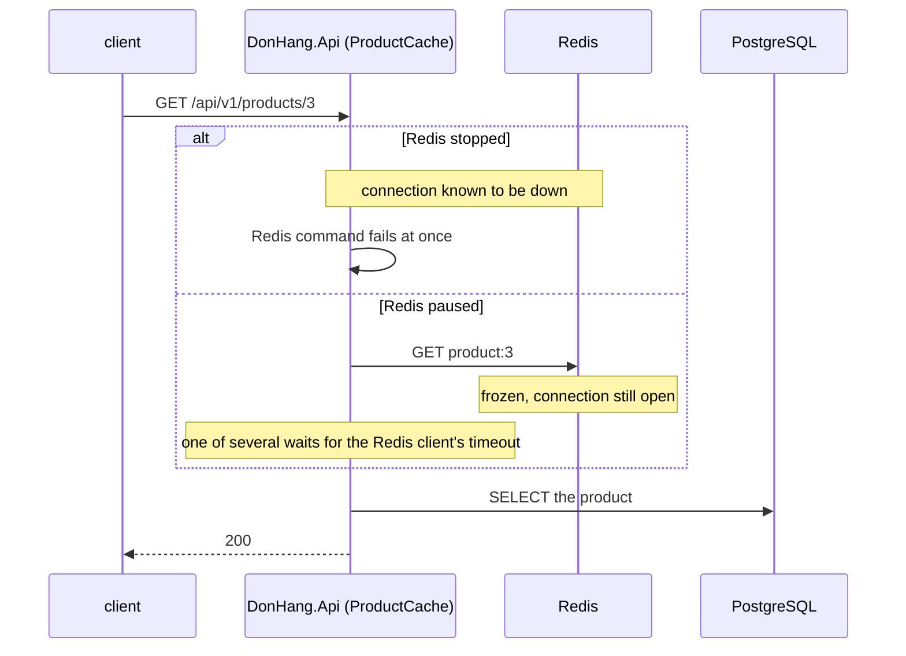

## Before you start

- [[backend.l2.cache-aside]] — you know that `ProductCache` counts any Redis error as a cache miss, so product reads fall back to PostgreSQL.
- [[backend.l2.cache-stampede]] — you know that `ProductCache` lets one request per key go on to PostgreSQL while the others wait for their turn.
- [[foundation.l1.threads-and-async-intro]] — you know that async/await hands the thread back while a call waits for the network.

## The situation

You are in the lab, checking how Đơn Hàng copes without Redis. First you stop it with `docker compose stop redis`. `GET /api/v1/products/3` still returns `200`, in well under a second, read from PostgreSQL. Good: that is what cache-aside promised.

Then you start Redis again and freeze it instead, with `docker compose pause redis`. The container is still there, but nothing inside it runs. The same read still returns `200`, but now it takes more than five seconds.

Same Redis, same fallback to PostgreSQL. Why does a Redis that never answers hurt more than one that is gone, and what does each waiting request cost the rest of the api?

## Core concepts

- failing fast — a call that cannot succeed ends at once with an error, so the caller can take its fallback straight away; in the situation above, the read with Redis stopped.
- slow dependency — a service your code calls that accepts the call but answers late or never; in the situation above, the paused Redis.
- held resources — what a request keeps while it waits: the client's connection to the api, the request's objects in memory, and any database connection it still holds open, for example inside a transaction.
- shared limit — a resource every request draws from, such as how many connections the api accepts, how many database connections exist, or the memory of the api process.
- **cascading failure** — a failure that spreads: one slow or broken dependency uses up a shared limit until requests that never use that dependency fail too.

## How it works



In the situation above, the stopped Redis is the cheap case. When the container stops, its connection to the api breaks, and StackExchange.Redis knows that Redis is unreachable. Each command then fails at once, `ProductCache` counts the error as a miss, and the read goes to PostgreSQL. Failing fast costs the request almost nothing.

The paused Redis is the expensive case. The connection stays open, so StackExchange.Redis sends the command and waits for an answer that never comes. Only the Redis client's timeout, the longest StackExchange.Redis lets one command wait before it gives up with an error, ends the wait. `ProductCache` counts that error as a miss, and the product arrives seconds late.

While a request awaits, async/await gives its thread back, but the request keeps the client's connection and its objects in memory, plus any database connection it is still holding open (for example inside a transaction) until the wait ends. The product read above holds none while it waits: EF Core closes its database connection after each query. None of these held resources does any work, and none is free for another request.

Suppose nothing limits how many requests of one kind run at once. When they arrive faster than they finish, requests in progress pile up until a shared limit (accepted connections, database connections, memory) runs out, and requests that never use the slow dependency wait or fail too: a cascading failure.

## In the Đơn Hàng system

The Catalog module creates the one Redis connection that every request shares:

```csharp file=DonHang.Catalog/CatalogModule.cs tag=stage-3 lines=19-33
        // lesson: backend.l2.cache-aside
        // lesson: backend.l3.slow-dependencies
        // One ConnectionMultiplexer for the whole app: it is built to be shared
        // by every request. abortConnect=false (in redisConfiguration) lets the
        // app start, and keep trying to connect, while Redis is down; FailFast
        // makes each command fail at once meanwhile, instead of waiting. Only
        // while the connection is known to be down: a Redis that keeps the
        // connection open and never answers makes each command wait for its
        // timeout instead (scripts/backend/slow-dependency.sh).
        services.AddSingleton<IConnectionMultiplexer>(_ =>
        {
            var options = ConfigurationOptions.Parse(redisConfiguration);
            options.BacklogPolicy = BacklogPolicy.FailFast;
            return ConnectionMultiplexer.Connect(options);
        });
```

`redisConfiguration` comes from `ConnectionStrings__Redis` in `docker-compose.yml`, which is `redis:6379,abortConnect=false`. With `abortConnect=false`, `ConnectionMultiplexer.Connect` returns even when Redis cannot be reached, and the multiplexer keeps trying to connect in the background. `BacklogPolicy.FailFast` decides what happens to a command while the connection is down: it fails at once instead of being held until the connection comes back.

Neither setting helps when the connection looks healthy and Redis simply does not answer.

The lab script reads product 3 three times. `read_product`, defined above the excerpt, sends `GET /api/v1/products/3` with `curl` and prints the status code with a time band instead of the exact time, so every run prints the same words. A `trap` above the excerpt unpauses and starts Redis when the script ends, even if it fails halfway.

```bash file=scripts/backend/slow-dependency.sh tag=stage-3 lines=15-34
echo "== GET /api/v1/products/3, Redis up"
read_product

# lesson: backend.l3.slow-dependencies
# Stopped: the container is gone, the connection breaks, and the api knows
# it. With abortConnect=false and BacklogPolicy.FailFast every Redis command
# fails at once, and ProductCache reads PostgreSQL instead.
docker compose stop redis 2>/dev/null
echo "== GET /api/v1/products/3, Redis stopped"
read_product
docker compose start redis 2>/dev/null
sleep 3 # the api reconnects by itself

# Paused: the container is frozen. The connection stays open and every
# command is accepted, but no answer ever comes: each of the read's Redis
# commands waits for StackExchange.Redis's timeout before the api moves on.
docker compose pause redis 2>/dev/null
echo "== GET /api/v1/products/3, Redis paused"
read_product
docker compose unpause redis 2>/dev/null
```

```text output=true
== GET /api/v1/products/3, Redis up
  -> 200 after less than 1 s
== GET /api/v1/products/3, Redis stopped
  -> 200 after less than 1 s
== GET /api/v1/products/3, Redis paused
  -> 200 after more than 5 s
```

With Redis stopped, the read is as fast as with Redis up. With Redis paused, it takes more than five seconds. All three return `200`: no request failed, and only the time spent shows the paused case. `ProductCache.FindAsync`, outside the excerpts, sends Redis more than one command per read, and as the script's comment says, each of them waits for its timeout.

## Seniors often assume…

- **"The worst thing a dependency can do is go down completely."** → Actually a dependency that is down is usually the cheap case, because the caller learns at once and takes its fallback. One that accepts the call and never answers keeps every caller waiting. You notice this when `slow-dependency.sh` prints `less than 1 s` for the stopped Redis and `more than 5 s` for the paused one.
- **"With async/await, a request that waits on a slow call costs the server nothing."** → Actually async/await frees only the thread. The client's connection, the request's memory and any database connection it still holds open stay taken until the wait ends. You notice this when the number of requests in progress keeps climbing during an incident while the CPU has little to do.
- **"A slow dependency only slows its own feature; the rest of the app is not affected."** → Actually its waiting requests draw from the same shared limits as every other request, and once one runs out, unrelated requests wait or fail too. You notice this when endpoints that never call the slow dependency start answering slowly or with errors during the same incident.

## Try it (3 minutes)

With the lab running, in the root folder of the example repository:

1. Run `scripts/backend/slow-dependency.sh`. Run it in a terminal on your own computer, the one where you ran `docker compose` to start the lab, because it stops and pauses Redis with `docker compose`.
2. Compare the time band printed for each of the three reads.

Expected result: three `-> 200` lines; the reads with Redis up and with Redis stopped take `less than 1 s`, and the read with Redis paused takes `more than 5 s`.

## Connections

- [[backend.l2.cache-aside]] — prerequisite: its rule that a Redis error counts as a miss is what makes the stopped case cheap.
- [[foundation.l1.tcp-vs-udp]] — the same idea one layer down: a refused connection is an answer, while a timeout is no answer at all.
- [[backend.l3.timeouts]] — a first fix for the problem in this lesson: deciding how long a call may keep a request waiting.
- [[backend.l3.queue-backlog-metrics]] — the contrast: with a queue between the api and a slow consumer, messages wait in the queue instead of requests waiting in the api.

## Five-line summary

1. A dependency that answers late or never does more harm than one that is down, because callers wait instead of failing at once.
2. A waiting request gives its thread back with async/await but keeps its client connection, its memory and any database connection it still holds open.
3. When requests start waiting faster than they finish, a shared limit runs out and requests that never use the dependency fail too: a cascading failure.
4. Đơn Hàng uses `abortConnect=false` and `BacklogPolicy.FailFast`, so while Redis is known to be down each command fails at once and PostgreSQL answers.
5. `slow-dependency.sh` reads product 3 in less than 1 s with Redis stopped and in more than 5 s with Redis paused.
