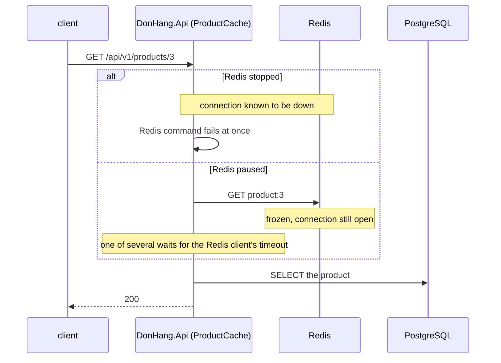

## Bạn cần biết trước

- [[backend.l2.cache-aside]] — bạn biết `ProductCache` coi mọi lỗi Redis là một lần cache miss, nên lần đọc sản phẩm chuyển sang PostgreSQL.
- [[backend.l2.cache-stampede]] — bạn biết `ProductCache` cho mỗi key một request đi tiếp tới PostgreSQL, các request còn lại chờ tới lượt.
- [[foundation.l1.threads-and-async-intro]] — bạn biết async/await trả thread lại trong lúc một lời gọi chờ mạng.

## Tình huống

Bạn đang ở trong lab, xem Đơn Hàng xoay xở ra sao khi không có Redis. Đầu tiên bạn dừng nó bằng `docker compose stop redis`. `GET /api/v1/products/3` vẫn trả `200`, chưa tới một giây, đọc từ PostgreSQL. Tốt: cache-aside hứa đúng như vậy.

Rồi bạn khởi động Redis lại, lần này đóng băng nó bằng `docker compose pause redis`. Container vẫn còn đó, nhưng không có gì bên trong chạy nữa. Cùng lần đọc ấy vẫn trả `200`, nhưng giờ mất hơn năm giây.

Cùng một Redis, cùng đường lui sang PostgreSQL. Vì sao một Redis không bao giờ trả lời lại gây hại nhiều hơn một Redis đã biến mất, và mỗi request đang chờ bắt phần còn lại của api trả giá gì?

## Khái niệm cốt lõi

- fail nhanh (failing fast) — một lời gọi không thể thành công thì kết thúc ngay bằng một lỗi, để bên gọi đi đường lui luôn. Trong tình huống trên, đó là lần đọc khi Redis bị dừng.
- phụ thuộc chậm — một service mà code của bạn gọi tới, nhận lời gọi nhưng trả lời muộn hoặc không bao giờ trả lời. Trong tình huống trên, đó là Redis bị pause.
- tài nguyên bị giữ — những gì một request giữ trong lúc chờ: kết nối của client tới api, các object của request trong bộ nhớ, và kết nối database nào nó còn mở, chẳng hạn bên trong một transaction.
- giới hạn chung — tài nguyên mà mọi request cùng rút từ đó, như số kết nối api nhận được, số kết nối database có sẵn, hay bộ nhớ của process api.
- **cascading failure** (lỗi lan dây chuyền: một phụ thuộc chậm hay hỏng làm cạn tài nguyên chung, kéo cả phần không dùng nó hỏng theo) — lỗi lan ra: một phụ thuộc chậm hay hỏng dùng cạn một giới hạn chung, tới mức cả những request không hề dùng phụ thuộc đó cũng lỗi theo.

## Cơ chế hoạt động



Trong tình huống trên, Redis bị dừng là trường hợp rẻ. Khi container dừng, kết nối của nó với api đứt, và StackExchange.Redis biết Redis không với tới được. Từ đó mỗi lệnh lỗi ngay, `ProductCache` coi lỗi là miss, và lần đọc chuyển sang PostgreSQL. Fail nhanh gần như không tốn gì của request.

Redis bị pause là trường hợp đắt. Kết nối vẫn mở, nên StackExchange.Redis gửi lệnh đi rồi chờ một câu trả lời không bao giờ tới. Chỉ timeout của Redis client mới chấm dứt lần chờ đó: thời gian dài nhất StackExchange.Redis để một lệnh chờ trước khi bỏ cuộc bằng một lỗi. `ProductCache` coi lỗi đó là miss, và sản phẩm tới muộn vài giây.

Trong lúc một request `await`, async/await trả thread của nó lại. Nhưng request vẫn giữ kết nối của client và các object của nó trong bộ nhớ, cùng kết nối database nào nó còn mở (chẳng hạn bên trong một transaction), cho tới khi lần chờ kết thúc. Lần đọc sản phẩm ở trên không giữ kết nối database nào trong lúc chờ: EF Core đóng kết nối database sau mỗi truy vấn. Không tài nguyên bị giữ nào làm việc gì, và cũng không cái nào rảnh cho request khác.

Giả sử không có gì giới hạn số request cùng loại chạy cùng lúc. Khi request tới nhanh hơn tốc độ chúng xong, số request đang chạy chồng lên cho tới khi một giới hạn chung (số kết nối được nhận, số kết nối database, bộ nhớ) cạn, và cả những request không hề dùng phụ thuộc chậm cũng phải chờ hoặc lỗi theo: một cascading failure.

## Trong hệ thống Đơn Hàng

Module Catalog tạo một kết nối Redis duy nhất mà mọi request dùng chung:

```csharp file=DonHang.Catalog/CatalogModule.cs tag=stage-3 lines=19-33
        // lesson: backend.l2.cache-aside
        // lesson: backend.l3.slow-dependencies
        // One ConnectionMultiplexer for the whole app: it is built to be shared
        // by every request. abortConnect=false (in redisConfiguration) lets the
        // app start, and keep trying to connect, while Redis is down; FailFast
        // makes each command fail at once meanwhile, instead of waiting. Only
        // while the connection is known to be down: a Redis that keeps the
        // connection open and never answers makes each command wait for its
        // timeout instead (scripts/backend/slow-dependency.sh).
        services.AddSingleton<IConnectionMultiplexer>(_ =>
        {
            var options = ConfigurationOptions.Parse(redisConfiguration);
            options.BacklogPolicy = BacklogPolicy.FailFast;
            return ConnectionMultiplexer.Connect(options);
        });
```

`redisConfiguration` lấy từ `ConnectionStrings__Redis` trong `docker-compose.yml`, có giá trị `redis:6379,abortConnect=false`. Với `abortConnect=false`, `ConnectionMultiplexer.Connect` vẫn trả về kể cả khi không với tới được Redis, và multiplexer tiếp tục thử kết nối ở nền. `BacklogPolicy.FailFast` quyết định chuyện gì xảy ra với một lệnh trong lúc kết nối đứt: lệnh lỗi ngay, thay vì bị giữ lại tới khi kết nối trở lại.

Cả hai thiết lập đều không giúp gì khi kết nối trông vẫn ổn mà Redis đơn giản là không trả lời.

Script lab đọc sản phẩm 3 ba lần. `read_product`, định nghĩa phía trên đoạn trích, gửi `GET /api/v1/products/3` bằng `curl` rồi in status code kèm một khoảng thời gian thay vì thời gian chính xác, nên lần chạy nào cũng in ra đúng những chữ đó. Một `trap` phía trên đoạn trích bỏ pause và khởi động Redis khi script kết thúc, kể cả khi script lỗi giữa chừng.

```bash file=scripts/backend/slow-dependency.sh tag=stage-3 lines=15-34
echo "== GET /api/v1/products/3, Redis up"
read_product

# lesson: backend.l3.slow-dependencies
# Stopped: the container is gone, the connection breaks, and the api knows
# it. With abortConnect=false and BacklogPolicy.FailFast every Redis command
# fails at once, and ProductCache reads PostgreSQL instead.
docker compose stop redis 2>/dev/null
echo "== GET /api/v1/products/3, Redis stopped"
read_product
docker compose start redis 2>/dev/null
sleep 3 # the api reconnects by itself

# Paused: the container is frozen. The connection stays open and every
# command is accepted, but no answer ever comes: each of the read's Redis
# commands waits for StackExchange.Redis's timeout before the api moves on.
docker compose pause redis 2>/dev/null
echo "== GET /api/v1/products/3, Redis paused"
read_product
docker compose unpause redis 2>/dev/null
```

```text output=true
== GET /api/v1/products/3, Redis up
  -> 200 after less than 1 s
== GET /api/v1/products/3, Redis stopped
  -> 200 after less than 1 s
== GET /api/v1/products/3, Redis paused
  -> 200 after more than 5 s
```

Khi Redis bị dừng, lần đọc nhanh như khi Redis đang chạy. Khi Redis bị pause, nó mất hơn năm giây. Cả ba đều trả `200`: không request nào lỗi, chỉ thời gian bỏ ra mới để lộ trường hợp pause. `ProductCache.FindAsync`, nằm ngoài các đoạn trích, gửi Redis nhiều hơn một lệnh cho mỗi lần đọc, và như comment của script nói, lệnh nào cũng chờ tới timeout của nó.

## Senior hay nhầm rằng…

- **"Điều tệ nhất một phụ thuộc có thể làm là sập hẳn."** → Thực ra một phụ thuộc đã sập thường là trường hợp rẻ, vì bên gọi biết ngay và đi đường lui. Phụ thuộc nhận lời gọi mà không bao giờ trả lời mới bắt mọi bên gọi phải chờ. Bạn sẽ nhận ra khi `slow-dependency.sh` in `less than 1 s` cho Redis bị dừng và `more than 5 s` cho Redis bị pause.
- **"Với async/await, request chờ một lời gọi chậm không tốn gì của server."** → Thực ra async/await chỉ giải phóng thread. Kết nối của client, bộ nhớ của request và kết nối database nào nó còn mở vẫn bị giữ cho tới khi lần chờ kết thúc. Bạn sẽ nhận ra khi số request đang chạy cứ tăng dần trong một sự cố, trong khi CPU gần như không có gì để làm.
- **"Một phụ thuộc chậm chỉ làm chậm tính năng của chính nó, phần còn lại của app không bị ảnh hưởng."** → Thực ra các request đang chờ nó rút từ cùng những giới hạn chung như mọi request khác, và khi một giới hạn cạn, cả những request không liên quan cũng phải chờ hoặc lỗi. Bạn sẽ nhận ra khi các endpoint không hề gọi phụ thuộc chậm bắt đầu trả lời chậm hoặc trả lỗi trong cùng sự cố đó.

## Thử ngay (3 phút)

Khi lab đang chạy, ở thư mục gốc của repo ví dụ:

1. Chạy `scripts/backend/slow-dependency.sh`. Chạy nó trong terminal trên chính máy bạn, máy mà bạn đã chạy `docker compose` để khởi động lab, vì script dừng và pause Redis bằng `docker compose`.
2. So sánh khoảng thời gian in ra cho từng lần đọc trong ba lần.

Kết quả mong đợi: ba dòng `-> 200`. Lần đọc khi Redis đang chạy và khi Redis bị dừng mất `less than 1 s`, còn lần đọc khi Redis bị pause mất `more than 5 s`.

## Liên hệ

- [[backend.l2.cache-aside]] — bài cần học trước: quy tắc coi lỗi Redis là một lần miss chính là thứ làm trường hợp Redis bị dừng rẻ như vậy.
- [[foundation.l1.tcp-vs-udp]] — cùng ý tưởng đó ở tầng thấp hơn: kết nối bị từ chối là một câu trả lời, còn timeout là không có câu trả lời nào.
- [[backend.l3.timeouts]] — cách sửa đầu tiên cho vấn đề trong bài này: quyết định một lời gọi được bắt request chờ bao lâu.
- [[backend.l3.queue-backlog-metrics]] — điểm tương phản: khi có queue nằm giữa api và một consumer chậm, message chờ trong queue thay vì request chờ trong api.

## Tóm tắt 5 dòng

1. Một phụ thuộc trả lời muộn hoặc không bao giờ trả lời gây hại nhiều hơn một phụ thuộc đã sập, vì bên gọi phải chờ thay vì lỗi ngay.
2. Request đang chờ trả thread lại nhờ async/await, nhưng vẫn giữ kết nối của client, bộ nhớ của nó và kết nối database nào nó còn mở.
3. Khi request bắt đầu chờ nhanh hơn tốc độ chúng xong, một giới hạn chung cạn và cả những request không dùng phụ thuộc đó cũng lỗi theo: một cascading failure.
4. Đơn Hàng dùng `abortConnect=false` và `BacklogPolicy.FailFast`, nên trong lúc Redis được biết là đã sập, mỗi lệnh lỗi ngay và PostgreSQL trả lời.
5. `slow-dependency.sh` đọc sản phẩm 3 mất chưa tới 1 s khi Redis bị dừng và hơn 5 s khi Redis bị pause.
