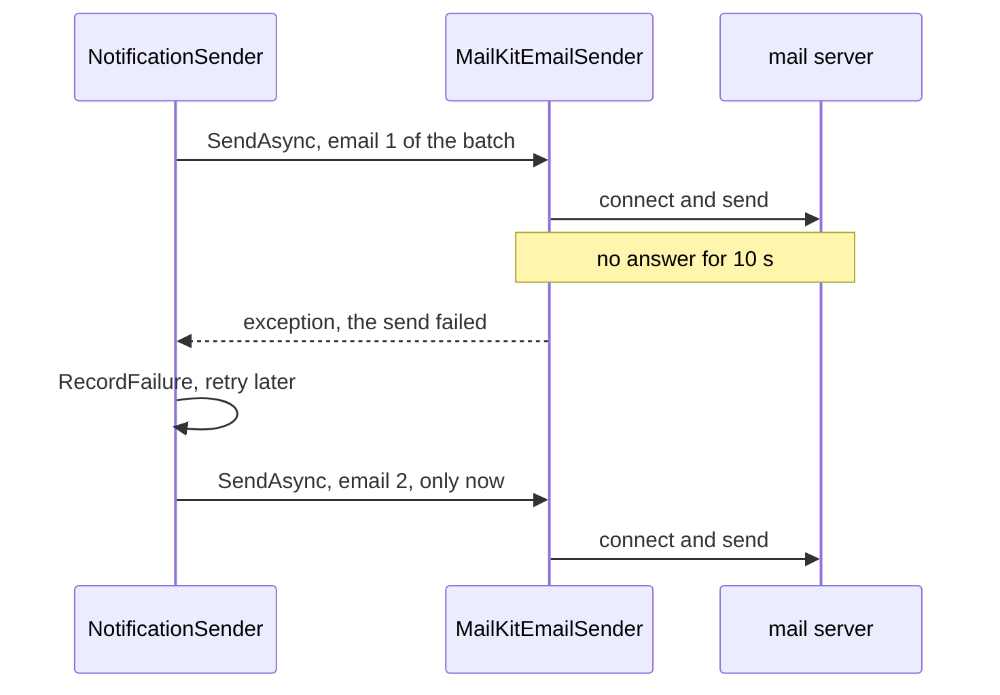

## Before you start

- [[backend.l3.slow-dependencies]] — you know that a dependency which accepts a call and never answers keeps the caller waiting, and that waiting callers can pile up into a cascading failure.
- [[backend.l2.retry-with-backoff]] — you know that `RecordFailure` keeps a failed email row `pending`, adds one to `attempts` and moves `next_attempt_at` later, until the fifth failure marks it `failed`.
- [[backend.l2.at-least-once-jobs]] — you know that a send which counts as failed after the mail server accepted the email can still be delivered, so its retry may send a second copy.

## The situation

It is stage-2. A customer places an order, and its `pending` email row lands in the same batch as nine others when `NotificationSender` next wakes up. This time the mail server does not refuse the connection. It accepts it and then says nothing, the way a stuck or overloaded server can. The first send of the batch sits there, waiting for a reply. The nine emails behind it wait too, and for now the log shows neither a "Sent" line nor a failure.

What ends that wait, and what does `NotificationSender` do when it ends?

## Core concepts

- timeout — the longest a caller waits for an answer before it stops waiting and treats the call as failed; in the situation above, the limit that ends the stuck send.
- network operation — one step of a conversation with another machine, such as opening a connection, writing a message or reading a reply; one email send to the mail server is several of them.
- timeout setting — an option of a client library that holds a timeout; each library that talks over the network has its own, often more than one, each with its own name and unit.
- default — the value a library uses for a setting your code never sets, chosen by the library's authors without knowing your app.

## How it works



In the situation above, the caller is `MailKitEmailSender`, and what it waits for is the mail server's reply. Without a limit, the wait lasts as long as the server stays silent, unless something below your code gives up: the client library's own default or the operating system's handling of the TCP connection. You cannot count on either to be short. A timeout turns "no answer yet" into "failed" after a fixed time.

MailKit is the client library `MailKitEmailSender` uses to talk to the mail server, and `MailKitEmailSender` gives its `SmtpClient` a timeout of 10 seconds. MailKit applies it to each network operation: when one gets no answer for 10 seconds, the call throws an exception. A send whose steps are each slow but answered can take longer than 10 seconds in total. `NotificationSender` catches the exception like any other failed send and records a failed attempt.

The diagram also shows the cost. `NotificationSender` sends the emails of a batch one after another, each awaited before the next starts. One send stuck until its timeout delays every email after it in that batch.

Ending the wait does not end the work. MailKit drops the connection, but nothing asks the mail server to undo what it already received: if it had the whole email and only its reply to the message was late, it may still deliver it. The row was recorded as failed, so the retry sends it again: the at-least-once behaviour you already know, reached through a timeout.

## In the Đơn Hàng system

Where the timeout is set, in `DonHang.Infrastructure/MailKitEmailSender.cs`:

```csharp file=DonHang.Infrastructure/MailKitEmailSender.cs tag=stage-2 lines=18-34
public sealed class MailKitEmailSender(SmtpSettings smtp) : IEmailSender
{
    public async Task SendAsync(string toAddress, string subject, string body, CancellationToken cancellationToken)
    {
        var message = new MimeMessage();
        message.From.Add(new MailboxAddress("Đơn Hàng", "orders@donhang.local"));
        message.To.Add(MailboxAddress.Parse(toAddress));
        message.Subject = subject;
        message.Body = new TextPart("plain") { Text = body };

        using var client = new SmtpClient { Timeout = 10_000 };
        // Mailpit in the lab speaks plain SMTP, without TLS.
        await client.ConnectAsync(smtp.Host, smtp.Port, SecureSocketOptions.None, cancellationToken);
        await client.SendAsync(message, cancellationToken);
        await client.DisconnectAsync(quit: true, cancellationToken);
    }
}
```

Line 28 sets `Timeout` in milliseconds, so `10_000` is 10 seconds. Lines 30–32 are the steps it limits: connect, send the message, then close the conversation politely with `quit: true`. The `cancellationToken` they receive is `stoppingToken`, passed down by `SendOneAsync` in `NotificationSender.cs`, outside this excerpt. That token is signalled only when the app shuts down, so it never ends a slow send by itself. The setting lives inside the adapter: `NotificationSender` sees only `IEmailSender` and knows neither MailKit nor its timeout.

Where the batch is sent, in `DonHang.Api/Jobs/NotificationSender.cs`:

```csharp file=DonHang.Api/Jobs/NotificationSender.cs tag=stage-2 lines=47-59
    private async Task SendDueAsync(CancellationToken stoppingToken)
    {
        using var scope = scopeFactory.CreateScope();
        var queue = scope.ServiceProvider.GetRequiredService<NotificationQueue>();
        var email = scope.ServiceProvider.GetRequiredService<IEmailSender>();

        var due = await queue.ClaimDueAsync(BatchSize, stoppingToken);
        foreach (var notification in due)
        {
            await SendOneAsync(email, notification, stoppingToken);
        }
        await queue.CompleteAsync(stoppingToken);
    }
```

Line 53 claims up to `BatchSize` rows, which is 10. Lines 54–57 await `SendOneAsync` for one row before starting the next, so a send stuck on a step for its 10 seconds holds up every row after it. Line 58 saves the whole round only after the last send. `SendOneAsync`, further down the file, catches the exception a timeout throws and calls `RecordFailure`, so the timed-out row counts one attempt, like any other failed send.

The other clients keep their defaults. Each reads a connection string, the text that tells a client library where the server is and which options to use. In `docker-compose.yml`, the Redis one is `redis:6379,abortConnect=false`, and `ServiceCollectionExtensions.cs` adds only `BacklogPolicy.FailFast` before connecting. Every Redis wait is therefore limited by a default of StackExchange.Redis, the client library the api uses to talk to Redis. The PostgreSQL connection string names no timeout either.

## Seniors often assume…

- **"Without a timeout, a call to a broken server still fails by itself sooner or later."** → Actually a server that accepts the connection and then stays silent gives the caller nothing to fail on. Whether anything below your code ends the wait depends on the library and the operating system, and it can take far longer than any caller would wait. You notice this when a background job stops logging both successes and failures, its rows stay `pending`, and the process still looks healthy.
- **"A longer timeout is always safer, because fewer calls end in an error."** → Actually every extra second is a second the caller keeps waiting and keeps what it holds. In `NotificationSender` it is also a second added to every email behind it in the batch; in a request, it feeds the pile-up from the previous lesson. A short timeout fails a few slow calls that would have succeeded, while a long one makes every stuck call expensive. You notice this when emails reach customers long after their orders while the log shows few errors.
- **"The library's default timeout was chosen for my app, so I never need to look at it."** → Actually a default is picked by the library's authors for every app at once, and each library picks its own, with its own name and unit. Đơn Hàng sets the email timeout in code and leaves Redis and PostgreSQL at their defaults; leaving a default is a decision too, and it needs knowing the value, which the library's documentation for that setting gives. You notice this when the dependency that slows requests down is one whose timeout nobody on the team ever set, as with Redis in the previous lesson.

## Try it (3 minutes)

With the lab running (`scripts/up.sh`), in a terminal on your machine, in the root folder of the example repository:

1. Run `scripts/backend/email-retry.sh`. It stops Mailpit, places an order as customer 1, waits while `NotificationSender` retries its email, and prints what the sender logged and the row's final state.
2. Then decide: if Mailpit were paused instead of stopped, so that it kept connections open and never answered, what would change in each attempt, and what would stay the same?

Expected result: the order gets `201`, the log shows attempts 1 to 4 followed by `next attempt in` 2, 4, 8 and 16 s, attempt 5 ends with `giving up`, and the row prints `failed | 5 | t`, where `t` means the email was never sent. Step 1 is kept for contrast: a stopped Mailpit is not there to accept the connection, so no silent server holds an attempt and no timeout is involved. For step 2, check your answer below.

<details><summary>Suggested answer</summary>

Each attempt would wait about 10 seconds, until the `SmtpClient` timeout, and then throw. Any other email in the same batch would wait behind it. The handling would stay the same: `SendOneAsync` catches the exception, `RecordFailure` counts the attempt, and the fifth failure marks the row `failed`. Without the line that sets `Timeout`, MailKit's own default would still end each attempt, but after a much longer wait, and every row behind it would wait that long too.

</details>

## Connections

- [[backend.l3.slow-dependencies]] — the problem this lesson starts to fix: a timeout is the limit on the wait that let callers pile up.
- [[backend.l2.at-least-once-jobs]] — why a timed-out send can still reach the customer, and why its retry may deliver a second copy.
- [[design.l2.adapter-pattern]] — the timeout is set inside the adapter, `MailKitEmailSender`, so the rest of Đơn Hàng never sees MailKit's setting.
- [[foundation.l1.tcp-vs-udp]] — the layer below: the TCP connection on which every step of a send waits.
- [[backend.l3.graceful-degradation]] — the next step: deciding what Đơn Hàng still does once a call has failed or timed out.
- [[backend.l3.resilience-pipeline]] — where the payment gateway's `HttpClient` calls get their timeout, set together with other rules for those calls.

## Five-line summary

1. A timeout is the longest a caller waits for an answer; when it passes, the call counts as failed instead of waiting on.
2. `MailKitEmailSender` sets `Timeout = 10_000`, so a step of the send without an answer for 10 seconds throws, and `NotificationSender` records a failed attempt.
3. `NotificationSender` sends a batch one email at a time, so one send stuck until its timeout delays every email after it.
4. Each network library has its own timeout setting and default; Đơn Hàng sets the email one in code and leaves Redis at its default.
5. A timeout ends the wait, not the work: the mail server may still deliver a timed-out email, so its retry can send it twice.
