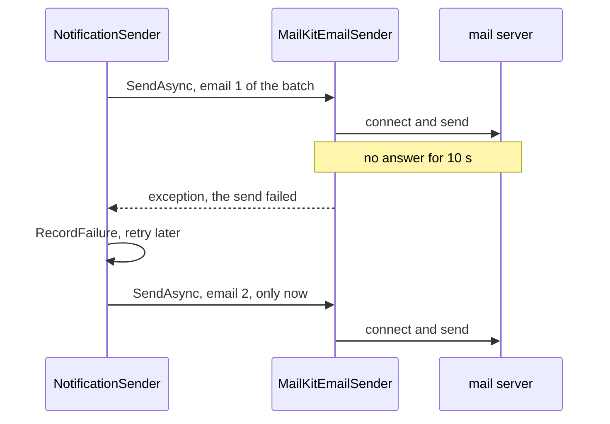

## Bạn cần biết trước

- [[backend.l3.slow-dependencies]] — bạn biết một phụ thuộc nhận lời gọi rồi không bao giờ trả lời sẽ bắt bên gọi phải chờ, và các bên gọi đang chờ có thể chồng lên thành một cascading failure.
- [[backend.l2.retry-with-backoff]] — bạn biết `RecordFailure` giữ dòng email lỗi ở `pending`, cộng một vào `attempts` và lùi `next_attempt_at` về sau, cho tới khi lần lỗi thứ năm đánh dấu nó là `failed`.
- [[backend.l2.at-least-once-jobs]] — bạn biết một lần gửi bị tính là lỗi sau khi mail server đã nhận email vẫn có thể tới tay người nhận, nên lần thử lại có thể gửi thêm một bản nữa.

## Tình huống

Đơn Hàng đang ở stage-2. Một khách hàng đặt đơn, và dòng email `pending` của đơn rơi vào cùng batch với chín dòng khác khi `NotificationSender` thức dậy lần tới. Lần này mail server không từ chối kết nối. Nó nhận kết nối rồi im lặng, như một server bị treo hay quá tải vẫn có thể làm. Lần gửi đầu tiên của batch nằm đó, chờ câu trả lời. Chín email phía sau cũng chờ theo, và lúc này log không có dòng "Sent" nào, cũng không có lỗi nào.

Cái gì chấm dứt lần chờ đó, và khi nó chấm dứt thì `NotificationSender` làm gì?

## Khái niệm cốt lõi

- timeout — thời gian dài nhất bên gọi chờ câu trả lời, quá mức đó thì thôi chờ và coi lời gọi là lỗi. Trong tình huống trên, đó là giới hạn chấm dứt lần gửi bị treo.
- thao tác mạng (network operation) — một bước trong cuộc trao đổi với máy khác, như mở kết nối, ghi một message hay đọc câu trả lời. Một lần gửi email tới mail server gồm nhiều bước như vậy.
- thiết lập timeout (timeout setting) — một tùy chọn của thư viện client chứa giá trị timeout. Mỗi thư viện giao tiếp qua mạng có thiết lập riêng, thường không chỉ một, mỗi cái một tên và một đơn vị.
- giá trị mặc định (default) — giá trị thư viện dùng cho một thiết lập mà code của bạn không bao giờ đặt, do tác giả thư viện chọn mà không biết gì về app của bạn.

## Cơ chế hoạt động



Trong tình huống trên, bên gọi là `MailKitEmailSender`, và thứ nó chờ là câu trả lời của mail server. Không có giới hạn, lần chờ kéo dài chừng nào server còn im lặng, trừ khi có thứ gì đó bên dưới code của bạn bỏ cuộc: giá trị mặc định của chính thư viện client, hoặc cách hệ điều hành xử lý kết nối TCP. Bạn không thể trông chờ thứ nào trong hai thứ đó sẽ ngắn. Timeout biến "chưa có câu trả lời" thành "lỗi" sau một khoảng thời gian cố định.

MailKit là thư viện client mà `MailKitEmailSender` dùng để nói chuyện với mail server, và `MailKitEmailSender` đặt cho `SmtpClient` của nó timeout 10 giây. MailKit áp giới hạn này cho từng thao tác mạng: khi một thao tác không có câu trả lời trong 10 giây, lời gọi ném exception. Một lần gửi mà từng bước đều chậm nhưng vẫn được trả lời thì tổng cộng có thể mất hơn 10 giây. `NotificationSender` bắt exception đó như mọi lần gửi lỗi khác và ghi lại một lần thử thất bại.

Sơ đồ cũng cho thấy cái giá phải trả. `NotificationSender` gửi các email của một batch lần lượt, chờ xong email này mới bắt đầu email sau. Một lần gửi bị treo tới khi hết timeout làm chậm mọi email đứng sau nó trong batch đó.

Chấm dứt lần chờ không có nghĩa là chấm dứt công việc. MailKit bỏ kết nối, nhưng không có gì yêu cầu mail server hoàn tác những gì nó đã nhận: nếu server đã có trọn email và chỉ câu trả lời cho message đó tới muộn, nó vẫn có thể gửi email đi. Dòng đã bị ghi là lỗi, nên lần thử lại gửi nó thêm lần nữa. Đó chính là hành vi at-least-once bạn đã biết, lần này đến từ một timeout.

## Trong hệ thống Đơn Hàng

Nơi đặt timeout, trong `DonHang.Infrastructure/MailKitEmailSender.cs`:

```csharp file=DonHang.Infrastructure/MailKitEmailSender.cs tag=stage-2 lines=18-34
public sealed class MailKitEmailSender(SmtpSettings smtp) : IEmailSender
{
    public async Task SendAsync(string toAddress, string subject, string body, CancellationToken cancellationToken)
    {
        var message = new MimeMessage();
        message.From.Add(new MailboxAddress("Đơn Hàng", "orders@donhang.local"));
        message.To.Add(MailboxAddress.Parse(toAddress));
        message.Subject = subject;
        message.Body = new TextPart("plain") { Text = body };

        using var client = new SmtpClient { Timeout = 10_000 };
        // Mailpit in the lab speaks plain SMTP, without TLS.
        await client.ConnectAsync(smtp.Host, smtp.Port, SecureSocketOptions.None, cancellationToken);
        await client.SendAsync(message, cancellationToken);
        await client.DisconnectAsync(quit: true, cancellationToken);
    }
}
```

Dòng 28 đặt `Timeout` theo mili giây, nên `10_000` là 10 giây. Dòng 30–32 là các bước mà nó giới hạn: kết nối, gửi message, rồi đóng cuộc trao đổi cho đàng hoàng bằng `quit: true`. `cancellationToken` mà các bước này nhận chính là `stoppingToken`, do `SendOneAsync` trong `NotificationSender.cs` truyền xuống, nằm ngoài đoạn trích. Token đó chỉ được kích hoạt khi app tắt, nên tự nó không bao giờ chấm dứt một lần gửi chậm. Thiết lập này nằm bên trong adapter: `NotificationSender` chỉ thấy `IEmailSender`, không biết MailKit lẫn timeout của nó.

Nơi gửi batch, trong `DonHang.Api/Jobs/NotificationSender.cs`:

```csharp file=DonHang.Api/Jobs/NotificationSender.cs tag=stage-2 lines=47-59
    private async Task SendDueAsync(CancellationToken stoppingToken)
    {
        using var scope = scopeFactory.CreateScope();
        var queue = scope.ServiceProvider.GetRequiredService<NotificationQueue>();
        var email = scope.ServiceProvider.GetRequiredService<IEmailSender>();

        var due = await queue.ClaimDueAsync(BatchSize, stoppingToken);
        foreach (var notification in due)
        {
            await SendOneAsync(email, notification, stoppingToken);
        }
        await queue.CompleteAsync(stoppingToken);
    }
```

Dòng 53 nhận tối đa `BatchSize` dòng, tức 10. Dòng 54–57 chờ `SendOneAsync` xong cho một dòng rồi mới bắt đầu dòng tiếp theo, nên một lần gửi bị treo ở một bước suốt 10 giây sẽ giữ chân mọi dòng sau nó. Dòng 58 chỉ lưu cả lượt sau lần gửi cuối cùng. `SendOneAsync`, ở phía dưới trong file, bắt exception mà timeout ném ra và gọi `RecordFailure`, nên dòng bị timeout được tính một lần thử, như mọi lần gửi lỗi khác.

Các client còn lại giữ giá trị mặc định. Mỗi client đọc một connection string, đoạn text cho thư viện client biết server ở đâu và dùng những tùy chọn nào. Trong `docker-compose.yml`, connection string của Redis là `redis:6379,abortConnect=false`, và `ServiceCollectionExtensions.cs` chỉ thêm `BacklogPolicy.FailFast` trước khi kết nối. Vì vậy mọi lần chờ Redis đều bị giới hạn bởi một giá trị mặc định của StackExchange.Redis, thư viện client mà api dùng để nói chuyện với Redis. Connection string của PostgreSQL cũng không ghi timeout nào.

## Senior hay nhầm rằng…

- **"Không có timeout thì lời gọi tới một server hỏng sớm muộn cũng tự lỗi."** → Thực ra một server nhận kết nối rồi im lặng không cho bên gọi lý do gì để lỗi. Có thứ gì bên dưới code của bạn chấm dứt lần chờ hay không là tùy thư viện và hệ điều hành, và có thể mất lâu hơn nhiều so với mức bất kỳ bên gọi nào chịu chờ. Bạn sẽ nhận ra khi một job nền ngừng ghi log cả thành công lẫn thất bại, các dòng của nó cứ nằm ở `pending`, mà process trông vẫn khỏe.
- **"Timeout dài hơn thì luôn an toàn hơn, vì ít lời gọi kết thúc bằng lỗi hơn."** → Thực ra mỗi giây thêm vào là một giây bên gọi phải chờ và giữ những gì nó đang giữ. Trong `NotificationSender`, đó còn là một giây cộng vào mọi email đứng sau trong batch. Trong một request, nó góp phần vào sự chồng chất ở bài trước. Timeout ngắn làm lỗi vài lời gọi chậm mà lẽ ra đã thành công, còn timeout dài làm lời gọi bị treo nào cũng đắt. Bạn sẽ nhận ra khi email tới tay khách hàng rất lâu sau khi họ đặt đơn, trong khi log chỉ có vài lỗi.
- **"Timeout mặc định của thư viện được chọn cho app của tôi, nên tôi không bao giờ cần xem tới."** → Thực ra giá trị mặc định do tác giả thư viện chọn cho mọi app cùng lúc, và mỗi thư viện chọn giá trị riêng, với tên và đơn vị riêng. Đơn Hàng đặt timeout cho email trong code và để Redis cùng PostgreSQL ở giá trị mặc định. Giữ giá trị mặc định cũng là một quyết định, và quyết định đó cần biết giá trị là bao nhiêu, điều mà tài liệu của thư viện cho thiết lập đó có ghi. Bạn sẽ nhận ra khi phụ thuộc làm chậm request lại là thứ mà timeout chưa ai trong nhóm từng đặt, như Redis ở bài trước.

## Thử ngay (3 phút)

Khi lab đang chạy (`scripts/up.sh`), trong terminal trên máy bạn, ở thư mục gốc của repo ví dụ:

1. Chạy `scripts/backend/email-retry.sh`. Script dừng Mailpit, đặt một đơn với tư cách khách hàng 1, chờ trong lúc `NotificationSender` thử gửi lại email của đơn, rồi in ra những gì sender đã ghi log và trạng thái cuối cùng của dòng.
2. Sau đó tự quyết định: nếu Mailpit bị pause thay vì bị dừng, tức vẫn giữ kết nối mở mà không bao giờ trả lời, thì điều gì thay đổi trong mỗi lần thử, và điều gì giữ nguyên?

Kết quả mong đợi: đơn nhận `201`, log cho thấy lần thử 1 tới 4, mỗi lần kèm `next attempt in` 2, 4, 8 và 16 s, lần thử 5 kết thúc bằng `giving up`, và dòng in ra `failed | 5 | t`, trong đó `t` nghĩa là email chưa bao giờ được gửi. Bước 1 được giữ lại để đối chiếu: Mailpit bị dừng thì không có mặt để nhận kết nối, nên không có server im lặng nào giữ chân một lần thử và timeout không dính dáng gì. Với bước 2, hãy so câu trả lời của bạn với gợi ý bên dưới.

<details><summary>Gợi ý đáp án</summary>

Mỗi lần thử sẽ chờ khoảng 10 giây, tới timeout của `SmtpClient`, rồi ném exception. Email nào khác trong cùng batch sẽ phải chờ sau nó. Cách xử lý giữ nguyên: `SendOneAsync` bắt exception, `RecordFailure` tính lần thử, và lần lỗi thứ năm đánh dấu dòng là `failed`. Nếu bỏ dòng đặt `Timeout`, giá trị mặc định của chính MailKit vẫn chấm dứt mỗi lần thử, nhưng sau một lần chờ lâu hơn nhiều, và mọi dòng phía sau cũng phải chờ lâu như vậy.

</details>

## Liên hệ

- [[backend.l3.slow-dependencies]] — vấn đề mà bài này bắt đầu sửa: timeout là giới hạn cho lần chờ đã khiến các bên gọi chồng lên nhau.
- [[backend.l2.at-least-once-jobs]] — vì sao một lần gửi bị timeout vẫn có thể tới tay khách hàng, và vì sao lần thử lại có thể gửi thêm một bản.
- [[design.l2.adapter-pattern]] — timeout được đặt bên trong adapter, `MailKitEmailSender`, nên phần còn lại của Đơn Hàng không bao giờ thấy thiết lập của MailKit.
- [[foundation.l1.tcp-vs-udp]] — tầng bên dưới: kết nối TCP mà mọi bước của một lần gửi chờ trên đó.
- [[backend.l3.graceful-degradation]] — bước tiếp theo: quyết định Đơn Hàng vẫn làm gì khi một lời gọi đã lỗi hoặc bị timeout.
- [[backend.l3.resilience-pipeline]] — nơi các lời gọi `HttpClient` tới payment gateway nhận timeout, đặt cùng với những quy tắc khác cho các lời gọi đó.

## Tóm tắt 5 dòng

1. Timeout là thời gian dài nhất bên gọi chờ câu trả lời. Quá mức đó, lời gọi bị tính là lỗi thay vì chờ tiếp.
2. `MailKitEmailSender` đặt `Timeout = 10_000`, nên một bước của lần gửi không có câu trả lời trong 10 giây sẽ ném exception, và `NotificationSender` ghi lại một lần thử thất bại.
3. `NotificationSender` gửi batch từng email một, nên một lần gửi bị treo tới khi hết timeout làm chậm mọi email sau nó.
4. Mỗi thư viện mạng có thiết lập timeout và giá trị mặc định riêng. Đơn Hàng đặt timeout cho email trong code và để Redis ở giá trị mặc định.
5. Timeout chấm dứt lần chờ, không chấm dứt công việc: mail server vẫn có thể gửi đi một email đã bị timeout, nên lần thử lại có thể gửi nó hai lần.
