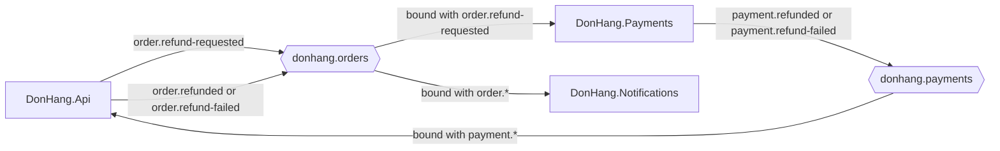

## Before you start

- [[backend.l3.safe-to-repeat-saga-steps]] — you know how Payments' step ends: `RefundSender` calls the gateway until it gets refunded, refused, or gives up after its retry window, then saves `payment.refunded` or `payment.refund-failed` in its outbox.
- [[backend.l3.exchanges-and-bindings]] — you know that a service subscribes by binding its own queue to an exchange, so the publisher never names the receiver.

## The situation

Order 10 has shown `refunding` for a while, and you want to read the code that runs its refund. In `DonHang.Api`, the refund endpoint saves the new status and an `order.refund-requested` outbox row, then answers `202`. It never calls Payments. In `DonHang.Payments`, `RefundRequestedConsumer` starts work when a message arrives, but no line in `DonHang.Api` tells it to. You search `DonHang.Api`, `DonHang.Payments` and `DonHang.Notifications` for one class that lists the refund's steps in order, and you find none.

So who decides, at each point of the refund, what happens next?

## Core concepts

- **choreography (saga)** — a way of running a saga with no part in charge: each service reacts to the other services' messages and decides its own next step; Đơn Hàng's refund runs this way.
- **orchestration (saga)** — a way of running a saga in which one orchestrator keeps the saga's state, sends each service a command, and picks the next step from each reply.
- orchestrator — the code that plays that part in orchestration; the word names a role, not a place where the code runs.
- event and command — an event says that something has happened, such as `order.refund-requested`, for whoever listens; a command asks one named receiver to do something, such as "refund order 10".

## How it works



In the situation above, follow the arrows. `DonHang.Api` publishes `order.refund-requested` to `donhang.orders`, and the message names no receiver. Payments gets a copy only because it bound its own queue to that routing key. Notifications gets another copy through `order.*` and emails the customer.

Payments then runs its step and publishes the result, `payment.refunded` or `payment.refund-failed`, to its own exchange, `donhang.payments`. `DonHang.Api` has bound its queue `orders.payment-events` there with `payment.*`. It decides by itself what each message means for the order: cancel it, or move it back to `paid`. Its `order.refunded` or `order.refund-failed` row then reaches Notifications the same way.

That is choreography: the next step is decided where the message arrives. The order of the saga is written in no single file; it is the sum of three services' bindings and consumers. To follow one refund, you read `RabbitMqTopology`, the class where each service declares its exchanges, queue and binding, in three projects, and the consumer behind each queue.

Orchestration turns this around. An orchestrator would keep each refund's state, the step it has reached. It would send Payments a command, "refund order 10", and wait for the reply. On "refunded" it would tell `DonHang.Api` to cancel the order; on "refused", to move it back to `paid`. The services would stop reacting to each other and answer only the orchestrator. The whole flow would sit in one place, at the price of one more part that every step depends on.

Đơn Hàng has no orchestrator: the design doc `docs/design/refund-design.md` chose choreography for a saga of three steps and two failure paths.

## In the Đơn Hàng system

The first link of the chain is a binding that Payments declares for itself:

```csharp file=DonHang.Payments/RabbitMqTopology.cs tag=stage-3 lines=15-29
    // lesson: backend.l3.choreography-vs-orchestration
    // Payments binds its own queue to donhang.orders with exactly
    // order.refund-requested: DonHang.Api publishes that event without
    // knowing which service acts on it, and nobody tells Payments to refund.
    // Its answers go to its own exchange, donhang.payments, for whoever binds
    // a queue there (DonHang.Api's PaymentEventsConsumer does).
    public static async Task DeclareAsync(IChannel channel, CancellationToken cancellationToken)
    {
        await channel.ExchangeDeclareAsync(OrdersExchange, ExchangeType.Topic, durable: true,
            cancellationToken: cancellationToken);
        await channel.ExchangeDeclareAsync(PaymentsExchange, ExchangeType.Topic, durable: true,
            cancellationToken: cancellationToken);
        await channel.QueueDeclareAsync(Queue, durable: true, exclusive: false, autoDelete: false,
            arguments: QueueArguments(), cancellationToken: cancellationToken);
        await channel.QueueBindAsync(Queue, OrdersExchange, "order.refund-requested", cancellationToken: cancellationToken);
```

The last line, `QueueBindAsync(Queue, OrdersExchange, "order.refund-requested", …)`, is Payments' side of the link between the first two steps. Payments, not `DonHang.Api`, chose to receive `order.refund-requested`, so the decision "a refund request means Payments acts" lives in Payments. `Queue` is `payments.refund-requests`, declared at the top of the file. The declare calls create the two exchanges, including `donhang.payments` where Payments' answers go, and its queue; their other arguments do not matter for this lesson.

The last step is chosen where Payments' answer arrives, in `PaymentEventsConsumer.HandleAsync`:

```csharp file=DonHang.Api/Messaging/PaymentEventsConsumer.cs tag=stage-3 lines=105-110
        try
        {
            if (routingKey == "payment.refunded") await orders.CompleteRefundAsync(message.OrderId);
            else if (routingKey == "payment.refund-failed") await orders.FailRefundAsync(message.OrderId);
            else throw new PoisonMessageException($"unknown routing key {routingKey}");
        }
```

The routing key alone decides between finishing the refund and compensating. In orchestration this `if` would sit in the orchestrator, and `DonHang.Api` would only carry out the command it was given. A routing key it does not know raises `PoisonMessageException`, which `OnReceivedAsync`, above this excerpt, turns into telling RabbitMQ to give up on the message instead of delivering it again, so it never changes the order.

## Seniors often assume…

- **"Choreography and orchestration are two libraries for building sagas."** → Actually they are two answers to one question: where the decision about the next step lives. Đơn Hàng's choreography is built from what the messaging module already gave it, a binding per service and a consumer behind each queue. An orchestrator, too, can be ordinary code that saves its state in a table. You notice this when `refund-design.md` names its choice, choreography, and the code behind it is one `QueueBindAsync` line and one consumer in each service.
- **"An orchestrator always has to be a separate service."** → Actually an orchestrator is a role: the code that keeps the saga's state and sends the next command. It can live inside a service that already takes part, such as `DonHang.Api` next to the order, as long as its state is saved and survives a restart. A separate service is one option, with its own deployment and database to run. You notice this when a design adds a new service only to hold the state of a three-step saga.
- **"Choreography is always better, because the services never depend on each other."** → Actually each consumer depends on the publisher's message names and fields: `DonHang.Api` acts only on the exact keys `payment.refunded` and `payment.refund-failed`. Choreography fits when, as with the refund, a saga has few steps and few failure paths. When steps and failure paths grow, a flow spread over many bindings is hard to change safely, and an orchestrator's single place tends to pay for its extra part. You notice this when Payments renames a key that `payment.*` still matches: `DonHang.Api` rejects the message, and the order stays `refunding`.

## Try it (3 minutes)

In the root folder of the example repository at `stage-3`:

1. Run `grep -rn "QueueBindAsync(Queue," --include=RabbitMqTopology.cs .` to list every service's main binding.
2. From the three lines alone, draw the refund: which exchange each service listens to, and with which pattern.
3. Then decide: which services get a copy of `order.refund-requested`, and where in this output is the refund's step order written?

Expected result: three lines, one per `RabbitMqTopology.cs`: `DonHang.Api` binds to `PaymentsExchange` with `"payment.*"`, `DonHang.Notifications` binds to `OrdersExchange` with `"order.*"`, and `DonHang.Payments` binds to `OrdersExchange` with `"order.refund-requested"`. The order of the lines may differ.

<details><summary>Suggested answer</summary>

Payments and Notifications both get a copy: Payments through its exact pattern, Notifications through `order.*`. The step order is written nowhere. It follows from which service binds to which exchange and from what each consumer does next, which is choreography. With an orchestrator, one class would hold that order.

</details>

## Connections

- [[backend.l3.saga]] — the same refund saga, seen from another angle: not what each step does, but who starts it.
- [[backend.l3.exchanges-and-bindings]] — the mechanism choreography is built from here: each service's binding is its own decision to take part.
- [[design.l3.domain-events]] — the same idea inside one process: an event says what happened, never what to do, and the reactions live elsewhere.
- [[design.l3.context-map]] — a way to draw what choreography leaves implicit: whose message names and fields each consumer must follow.
- [[backend.l3.observability]] — the next problem: following one request across services when its flow lives in no single place.

## Five-line summary

1. In choreography each service reacts to the others' messages; in orchestration one orchestrator keeps the saga's state and decides every next step.
2. Đơn Hàng's refund is choreographed through `order.refund-requested`, `payment.refunded` and `payment.refund-failed`; no part directs it.
3. Payments binds its own queue to `order.refund-requested` on `donhang.orders`, so `DonHang.Api` publishes without knowing who acts.
4. Choreography needs no extra part, but to follow one refund you read the bindings and consumers of three services.
5. Orchestration puts the flow in one place at the price of a part every step depends on; it tends to pay off with many steps.
