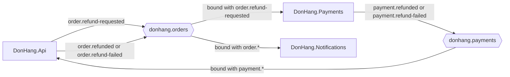

## Bạn cần biết trước

- [[backend.l3.safe-to-repeat-saga-steps]] — bạn biết bước của Payments kết thúc ra sao: `RefundSender` gọi cổng thanh toán cho tới khi được hoàn tiền, bị từ chối, hoặc bỏ cuộc khi hết khoảng thời gian thử lại, rồi lưu `payment.refunded` hoặc `payment.refund-failed` vào outbox của nó.
- [[backend.l3.exchanges-and-bindings]] — bạn biết rằng một service đăng ký nhận message bằng cách nối hàng đợi của chính nó vào một exchange, nên bên publish không bao giờ nêu tên bên nhận.

## Tình huống

Đơn 10 hiện `refunding` đã một lúc, và bạn muốn đọc phần code chạy lần hoàn tiền đó. Trong `DonHang.Api`, endpoint hoàn tiền lưu trạng thái mới cùng một dòng outbox `order.refund-requested`, rồi trả `202`. Nó không hề gọi Payments. Trong `DonHang.Payments`, `RefundRequestedConsumer` bắt đầu làm việc khi có message tới, nhưng không dòng nào trong `DonHang.Api` bảo nó làm. Bạn tìm trong `DonHang.Api`, `DonHang.Payments` và `DonHang.Notifications` một class liệt kê các bước hoàn tiền theo thứ tự, và không tìm thấy class nào.

Vậy ở mỗi điểm của lần hoàn tiền, ai quyết định điều gì xảy ra tiếp theo?

## Khái niệm cốt lõi

- **choreography (saga)** (cách chạy saga không có bên điều phối: mỗi service tự phản ứng với message của service khác) — cách chạy một saga mà không phần nào nắm quyền: mỗi service phản ứng với message của các service khác và tự quyết bước tiếp theo của mình. Lần hoàn tiền của Đơn Hàng chạy theo cách này.
- **orchestration (saga)** (cách chạy saga có một orchestrator giữ trạng thái, gửi lệnh cho từng service và chọn bước tiếp theo) — cách chạy một saga trong đó một orchestrator giữ trạng thái của saga, gửi lệnh cho từng service, và chọn bước tiếp theo dựa trên từng câu trả lời.
- orchestrator — phần code đóng vai trò đó trong orchestration. Từ này chỉ một vai trò, không chỉ nơi code chạy.
- sự kiện và lệnh — sự kiện báo rằng một điều đã xảy ra, chẳng hạn `order.refund-requested`, cho bất kỳ ai đang nghe. Lệnh yêu cầu một bên nhận cụ thể làm một việc, chẳng hạn "hoàn tiền đơn 10".

## Cơ chế hoạt động



Trong tình huống trên, hãy đi theo các mũi tên. `DonHang.Api` publish `order.refund-requested` tới `donhang.orders`, và message không nêu tên bên nhận nào. Payments nhận được một bản chỉ vì nó đã nối hàng đợi của chính nó với routing key đó. Notifications nhận một bản khác qua `order.*` và gửi email cho khách hàng.

Sau đó Payments chạy bước của mình và publish kết quả, `payment.refunded` hoặc `payment.refund-failed`, tới exchange riêng của nó, `donhang.payments`. `DonHang.Api` đã nối hàng đợi `orders.payment-events` của mình vào đó bằng `payment.*`. Nó tự quyết mỗi message có ý nghĩa gì với đơn: hủy đơn, hay đưa đơn về lại `paid`. Dòng `order.refunded` hoặc `order.refund-failed` của nó sau đó tới Notifications theo cùng cách.

Đó là choreography: bước tiếp theo được quyết định ở nơi message tới. Thứ tự của saga không nằm trong một file nào. Nó là tổng của các binding và consumer ở ba service. Muốn theo một lần hoàn tiền, bạn đọc `RabbitMqTopology`, class nơi mỗi service khai báo exchange, hàng đợi và binding của mình, trong ba project, cùng consumer đứng sau mỗi hàng đợi.

Orchestration đảo ngược điều này. Một orchestrator sẽ giữ trạng thái của từng lần hoàn tiền, tức bước mà nó đã tới. Nó sẽ gửi Payments một lệnh, "hoàn tiền đơn 10", và chờ câu trả lời. Nhận "đã hoàn", nó bảo `DonHang.Api` hủy đơn. Nhận "bị từ chối", nó bảo đưa đơn về lại `paid`. Các service sẽ thôi phản ứng với nhau và chỉ trả lời orchestrator. Toàn bộ luồng sẽ nằm ở một chỗ, đổi lại hệ thống có thêm một phần mà mọi bước đều phụ thuộc vào.

Đơn Hàng không có orchestrator: design doc `docs/design/refund-design.md` đã chọn choreography cho một saga ba bước với hai đường thất bại.

## Trong hệ thống Đơn Hàng

Mắt xích đầu tiên là một binding mà Payments tự khai báo cho chính nó:

```csharp file=DonHang.Payments/RabbitMqTopology.cs tag=stage-3 lines=15-29
    // lesson: backend.l3.choreography-vs-orchestration
    // Payments binds its own queue to donhang.orders with exactly
    // order.refund-requested: DonHang.Api publishes that event without
    // knowing which service acts on it, and nobody tells Payments to refund.
    // Its answers go to its own exchange, donhang.payments, for whoever binds
    // a queue there (DonHang.Api's PaymentEventsConsumer does).
    public static async Task DeclareAsync(IChannel channel, CancellationToken cancellationToken)
    {
        await channel.ExchangeDeclareAsync(OrdersExchange, ExchangeType.Topic, durable: true,
            cancellationToken: cancellationToken);
        await channel.ExchangeDeclareAsync(PaymentsExchange, ExchangeType.Topic, durable: true,
            cancellationToken: cancellationToken);
        await channel.QueueDeclareAsync(Queue, durable: true, exclusive: false, autoDelete: false,
            arguments: QueueArguments(), cancellationToken: cancellationToken);
        await channel.QueueBindAsync(Queue, OrdersExchange, "order.refund-requested", cancellationToken: cancellationToken);
```

Dòng cuối, `QueueBindAsync(Queue, OrdersExchange, "order.refund-requested", …)`, là phía Payments của mối nối giữa hai bước đầu. Chính Payments, chứ không phải `DonHang.Api`, chọn nhận `order.refund-requested`, nên quyết định "có yêu cầu hoàn tiền thì Payments ra tay" nằm trong Payments. `Queue` là `payments.refund-requests`, khai báo ở đầu file. Các lệnh declare tạo hai exchange, trong đó có `donhang.payments` nơi câu trả lời của Payments được gửi tới, cùng hàng đợi của nó. Các argument còn lại không quan trọng với bài này.

Bước cuối được chọn ở nơi câu trả lời của Payments tới, trong `PaymentEventsConsumer.HandleAsync`:

```csharp file=DonHang.Api/Messaging/PaymentEventsConsumer.cs tag=stage-3 lines=105-110
        try
        {
            if (routingKey == "payment.refunded") await orders.CompleteRefundAsync(message.OrderId);
            else if (routingKey == "payment.refund-failed") await orders.FailRefundAsync(message.OrderId);
            else throw new PoisonMessageException($"unknown routing key {routingKey}");
        }
```

Chỉ riêng routing key quyết định giữa hoàn tất hoàn tiền và chạy hành động bù. Trong orchestration, câu `if` này sẽ nằm trong orchestrator, còn `DonHang.Api` chỉ thực hiện lệnh được giao. Một routing key lạ gây ra `PoisonMessageException`. `OnReceivedAsync`, nằm phía trên đoạn trích, đổi exception đó thành yêu cầu RabbitMQ bỏ message thay vì giao lại, nên message đó không bao giờ thay đổi đơn.

## Senior hay nhầm rằng…

- **"Choreography và orchestration là hai thư viện để xây saga."** → Thực ra đó là hai câu trả lời cho cùng một câu hỏi: quyết định về bước tiếp theo nằm ở đâu. Choreography của Đơn Hàng được dựng từ những gì module messaging đã có sẵn, mỗi service một binding và một consumer sau mỗi hàng đợi. Một orchestrator cũng có thể chỉ là code bình thường lưu trạng thái vào một bảng. Bạn sẽ nhận ra khi `refund-design.md` gọi tên lựa chọn của nó, choreography, mà code đứng sau chỉ là một dòng `QueueBindAsync` và một consumer ở mỗi service.
- **"Orchestrator lúc nào cũng phải là một service riêng."** → Thực ra orchestrator là một vai trò: phần code giữ trạng thái của saga và gửi lệnh tiếp theo. Nó có thể nằm trong một service vốn đã tham gia saga, chẳng hạn `DonHang.Api` cạnh đơn hàng, miễn là trạng thái được lưu lại và còn nguyên sau khi khởi động lại. Service riêng chỉ là một lựa chọn, kèm theo deployment và database riêng phải vận hành. Bạn sẽ nhận ra khi một thiết kế thêm một service mới chỉ để giữ trạng thái của một saga ba bước.
- **"Choreography lúc nào cũng tốt hơn, vì các service không bao giờ phụ thuộc vào nhau."** → Thực ra mỗi consumer phụ thuộc vào tên và các trường message của bên publish: `DonHang.Api` chỉ xử lý đúng hai key `payment.refunded` và `payment.refund-failed`. Choreography hợp khi saga có ít bước và ít đường thất bại, như lần hoàn tiền. Khi số bước và số đường thất bại tăng lên, một luồng rải ra trên nhiều binding rất khó sửa cho an toàn, và một chỗ duy nhất của orchestrator thường đáng với phần thêm vào. Bạn sẽ nhận ra khi Payments đổi tên một key mà `payment.*` vẫn khớp: `DonHang.Api` từ chối message, và đơn kẹt ở `refunding`.

## Thử ngay (3 phút)

Ở thư mục gốc của repo ví dụ tại `stage-3`:

1. Chạy `grep -rn "QueueBindAsync(Queue," --include=RabbitMqTopology.cs .` để liệt kê binding chính của từng service.
2. Chỉ từ ba dòng đó, hãy vẽ lần hoàn tiền: mỗi service nghe exchange nào, với mẫu nào.
3. Rồi hãy xác định: những service nào nhận một bản `order.refund-requested`, và thứ tự các bước hoàn tiền được viết ở đâu trong output này?

Kết quả mong đợi: ba dòng, mỗi dòng một `RabbitMqTopology.cs`: `DonHang.Api` nối vào `PaymentsExchange` với `"payment.*"`, `DonHang.Notifications` nối vào `OrdersExchange` với `"order.*"`, và `DonHang.Payments` nối vào `OrdersExchange` với `"order.refund-requested"`. Thứ tự các dòng có thể khác.

<details><summary>Gợi ý đáp án</summary>

Payments và Notifications đều nhận một bản: Payments qua mẫu chính xác của nó, Notifications qua `order.*`. Thứ tự các bước không được viết ở đâu cả. Nó suy ra từ việc service nào nối vào exchange nào và mỗi consumer làm gì tiếp theo, và đó chính là choreography. Nếu có orchestrator, một class sẽ giữ thứ tự đó.

</details>

## Liên hệ

- [[backend.l3.saga]] — cùng saga hoàn tiền, nhìn từ góc khác: không phải mỗi bước làm gì, mà ai khởi động nó.
- [[backend.l3.exchanges-and-bindings]] — cơ chế mà choreography ở đây được dựng lên: binding của mỗi service là quyết định tự tham gia của chính service đó.
- [[design.l3.domain-events]] — cùng ý tưởng nhưng trong một process: sự kiện nói điều gì đã xảy ra, không bao giờ nói phải làm gì, và các phản ứng nằm ở chỗ khác.
- [[design.l3.context-map]] — cách vẽ ra điều mà choreography để ngầm: mỗi consumer phải theo tên và các trường message của ai.
- [[backend.l3.observability]] — vấn đề tiếp theo: theo một request qua nhiều service khi luồng của nó không nằm ở chỗ nào cả.

## Tóm tắt 5 dòng

1. Trong choreography, mỗi service phản ứng với message của các service khác. Trong orchestration, một orchestrator giữ trạng thái của saga và quyết định mọi bước tiếp theo.
2. Lần hoàn tiền của Đơn Hàng chạy theo choreography qua `order.refund-requested`, `payment.refunded` và `payment.refund-failed`, không có phần nào điều khiển.
3. Payments nối hàng đợi của chính nó với `order.refund-requested` trên `donhang.orders`, nên `DonHang.Api` publish mà không biết ai sẽ xử lý.
4. Choreography không cần thêm phần nào, nhưng muốn theo một lần hoàn tiền, bạn phải đọc binding và consumer của ba service.
5. Orchestration đặt luồng ở một chỗ, đổi lại có thêm một phần mà mọi bước phụ thuộc vào. Nó thường đáng giá khi saga có nhiều bước.
