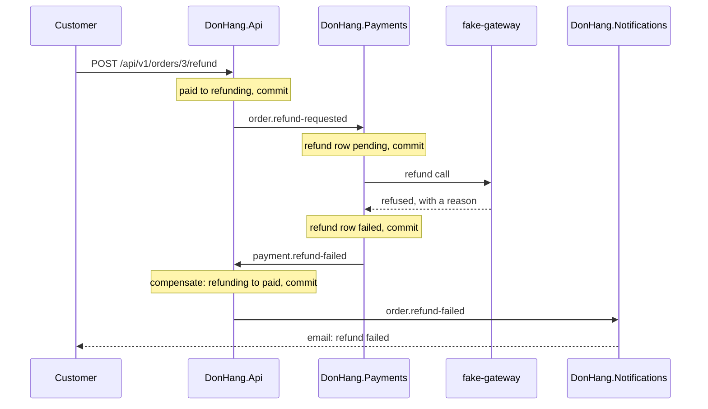

## Before you start

- [[backend.l3.saga-in-progress-status]] — you know that the refund saga holds the order at `refunding`, and that only the saga's own steps move it on.
- [[backend.l2.role-based-access]] — you know that the `StaffOnly` policy lets a token with the `staff` role through and answers `403` to a customer's token.

## The situation

Customer 2 paid order 3 by bank transfer and asks for the money back. `POST /api/v1/orders/3/refund` answers `202` and moves the order to `refunding`; separately, Notifications emails the customer that the request arrived. Payments saves its refund row and calls the payment gateway (the outside service that moves the money; `fake-gateway` in the lab). It says no: a bank transfer cannot be refunded through the card gateway.

No transaction is left open to roll back. The order's step in `DonHang.Api`, the email in Notifications and the refund row in Payments are all saved, in three services and three databases.

How does the saga undo a step that already committed, and what does it leave behind?

## Core concepts

- **compensating action** — a new change, saved in its own local transaction, that undoes for the business what an earlier saga step did, because that step's commit can no longer be rolled back; here, moving order 3 from `refunding` back to `paid`.
- refused refund — the gateway's final "no", which Payments records as a refund row with status `failed` and the gateway's reason, then announces with a `payment.refund-failed` message.
- step that cannot be undone — a step whose effect leaves Đơn Hàng, such as money the gateway returned or an email already delivered; the saga only pushes the steps after it forward.

## How it works



The customer's POST moves the order to `refunding`; its `order.refund-requested` message makes Payments save a refund row and call `fake-gateway`. Both changes committed before the gateway answered. The `refund requested` email is not drawn. A rollback only undoes a transaction that is still open, so it cannot reach them; the saga moves forward instead, with new changes.

The gateway refuses, and Payments saves two things in one transaction: the refund row, now `failed` with the gateway's reason, and a `payment.refund-failed` outbox row. Nothing in `donhang_payments` is deleted.

`DonHang.Api` consumes `payment.refund-failed`. In one transaction it moves the order from `refunding` back to `paid` and saves an `order.refund-failed` outbox row. That move is the compensating action for the order's step: the order is paid again, so staff can ship it, and Notifications tells the customer the refund failed. Each of the saga's changes to the order also adds a row to its history, `order_status_history`: what happened | the status after it. Both rows stay, `refund-requested | refunding` and `refund-failed | paid`. Staff find the refused refund with its reason through `GET /api/v1/refunds?status=failed`, which only staff may call.

Now take the other branch. Once the gateway has returned the money, nothing in Đơn Hàng can take it back. So the steps after it, cancelling the order and emailing the customer, have no compensation: when they fail, they are tried again, never undone. Likewise, compensating a sent email means sending a new one, as the `refund failed` email does here.

## In the Đơn Hàng system

Payments decides what the gateway's answer means in `RecordResult`, called inside the transaction that saves the refund row and its outbox message:

```csharp file=DonHang.Payments/RefundSender.cs tag=stage-3 lines=81-105
    // lesson: backend.l3.safe-to-repeat-saga-steps
    // lesson: backend.l3.compensating-action
    // Refunded: done, and payment.refunded lets DonHang.Api cancel the order.
    // Refused: `failed` with the gateway's reason, and payment.refund-failed
    // starts the compensation. Try again later: one more attempt is counted
    // and the next one waits about twice as long, until GiveUpAfter has
    // passed since the request, which then counts as failed too.
    public OutboxMessage? RecordResult(Payment refund, GatewayRefundResult result, DateTimeOffset now)
    {
        refund.Attempts++;
        if (result.Outcome == RefundOutcome.Refunded)
        {
            refund.Status = "refunded";
            refund.PaidAt = now;
            logger.LogInformation("Refund {RefundId} for order {OrderId} is done", refund.Id, refund.OrderId);
            return Message("payment.refunded", refund, null, now);
        }

        if (result.Outcome == RefundOutcome.Refused || now - refund.RequestedAt >= settings.GiveUpAfter)
        {
            refund.Status = "failed";
            refund.FailureReason = result.Reason;
            logger.LogWarning("Refund {RefundId} for order {OrderId} failed: {Reason}", refund.Id, refund.OrderId, result.Reason);
            return Message("payment.refund-failed", refund, result.Reason, now);
        }
```

A refusal sets `Status` and `FailureReason` on the same row and returns a `payment.refund-failed` message; the row stays. When the gateway counts as refusing, and how often it is tried, belongs to the next lesson.

The compensation itself is a method of `Order`, next to the method for the successful end:

```csharp file=DonHang.Domain/Entities.cs tag=stage-3 lines=158-177
    // lesson: backend.l3.saga
    // The gateway has returned the money (payment.refunded): the order ends
    // as cancelled, which is what the customer asked for.
    public void CompleteRefund()
    {
        if (Status != "refunding") throw new OrderStatusException(Id, "not-refunding", $"order {Id} is not being refunded");
        Status = "cancelled";
        domainEvents.Add(new OrderRefunded(this, DateTimeOffset.UtcNow));
    }

    // lesson: backend.l3.compensating-action
    // The gateway refused the refund (payment.refund-failed). The order's own
    // step cannot be rolled back, it was committed long ago, so a new change
    // undoes its effect: the order is paid again and can still ship.
    public void FailRefund()
    {
        if (Status != "refunding") throw new OrderStatusException(Id, "not-refunding", $"order {Id} is not being refunded");
        Status = "paid";
        domainEvents.Add(new OrderRefundFailed(this, DateTimeOffset.UtcNow));
    }
```

`FailRefund()` checks the same starting status as `CompleteRefund()` and differs only in where it sends the order. Its domain event, `OrderRefundFailed`, is what leads to the `order.refund-failed` outbox row and the `refund-failed` history row, both outside this file. `PaymentEventsConsumer` in `DonHang.Api` calls `FailRefund()` through `OrderService` when `payment.refund-failed` arrives. When that handling fails, for example because the database is down, the consumer returns the message to the queue and tries again; a message that can never be handled goes to the dead-letter queue instead.

## Seniors often assume…

- **"When a later step fails, the database rolls back the earlier steps."** → Actually each step committed in its own transaction, often in another service's database, and a commit is final. Only a new change can undo its effect. You notice this when order 3 shows two history rows after the refusal, `refund-requested | refunding` and `refund-failed | paid`, instead of none.
- **"A compensating action deletes the rows the failed saga created, as if nothing had happened."** → Actually the business needs the record: staff must see which refunds were refused and why, and the customer was already told about the request. So the refund row stays `failed` with its reason. You notice this when `GET /api/v1/refunds?status=failed` as staff lists order 3 with `a bank transfer cannot be refunded through the card gateway`.
- **"Every step of a saga can be undone, including an email already sent."** → Actually a step whose effect left the system, such as money returned or an email delivered, has no undo. The saga either sends a new message, like the `refund failed` email, or keeps trying the steps after it. You notice this when the Try it script lists both emails to customer 2, `refund requested` and `refund failed`, as `sent`.

## Try it (3 minutes)

With the lab running (`scripts/up.sh`), in the root folder of the example repository:

1. Run `scripts/backend/refund-declined.sh`.
2. In the script's output, find the order's history and status, the refund row in `donhang_payments`, the emails to customer 2, and the answers to `GET /api/v1/refunds?status=failed` for staff and for customer 2.
3. Then decide: which of the rows printed was written by the compensating action, and which was never undone?

Expected result: `202`; `refund-requested | refunding` then `refund-failed | paid`, and `now: paid`; a `refund | failed | 1` row (kind | status | attempts) with the gateway's reason; `refund requested | sent` and `refund failed | sent`; `200` with order 3 for staff and `403` for customer 2.

<details><summary>Suggested answer</summary>

`refund-failed | paid` and `now: paid` come from the compensating action in `DonHang.Api`, and so does the `refund failed` email. The `refund-requested | refunding` history row, the `refund requested` email and the `failed` refund row were never undone: the saga keeps them and adds to them.

</details>

## Connections

- [[backend.l3.saga-in-progress-status]] — the status this lesson leaves: `refunding` ends either at `cancelled` or, through compensation, back at `paid`.
- [[backend.l3.dead-letter-queue]] — where a step that cannot move forward ends up: a message the consumer can never handle waits there for a person.
- [[management.l2.requirements-document]] — where the rule starts: the refund requirements ask that staff see each refused refund in a list.
- [[backend.l3.safe-to-repeat-saga-steps]] — the next question: when the gateway counts as refusing, and how it is tried again without refunding twice.

## Five-line summary

1. A saga cannot roll back a step that already committed, so it undoes the step's business effect with a compensating action, a new change.
2. When the gateway refuses, Payments marks the refund row `failed` with the reason and publishes `payment.refund-failed`, in one transaction.
3. `DonHang.Api` compensates with `FailRefund()`: `refunding` back to `paid`, plus an `order.refund-failed` row, so the customer is told and the order can ship.
4. Compensating keeps history: the `failed` row and its reason stay, and staff find them through `GET /api/v1/refunds?status=failed`.
5. Money returned by the gateway cannot be taken back, so the steps after it are tried again, never undone.
