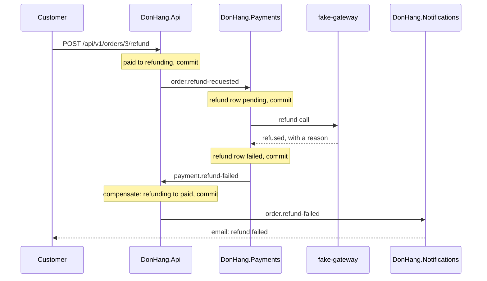

## Bạn cần biết trước

- [[backend.l3.saga-in-progress-status]] — bạn biết rằng saga hoàn tiền giữ đơn ở `refunding`, và chỉ các bước của chính saga mới đưa đơn đi tiếp.
- [[backend.l2.role-based-access]] — bạn biết rằng policy `StaffOnly` cho token có role `staff` đi qua và trả `403` cho token của khách hàng.

## Tình huống

Khách hàng 2 đã trả đơn 3 bằng chuyển khoản ngân hàng và muốn lấy lại tiền. `POST /api/v1/orders/3/refund` trả về `202` và chuyển đơn sang `refunding`. Song song đó, Notifications gửi email báo khách hàng rằng yêu cầu đã tới. Payments lưu dòng hoàn tiền rồi gọi cổng thanh toán (dịch vụ bên ngoài thật sự chuyển tiền, trong lab là `fake-gateway`). Cổng thanh toán từ chối: khoản chuyển khoản ngân hàng không hoàn được qua cổng thanh toán thẻ.

Không còn giao dịch nào mở để rollback. Bước của đơn trong `DonHang.Api`, email trong Notifications và dòng hoàn tiền trong Payments đều đã lưu, ở ba service và ba database.

Saga hủy một bước đã commit bằng cách nào, và nó để lại những gì?

## Khái niệm cốt lõi

- **hành động bù** (compensating action) — một thay đổi mới, lưu trong giao dịch cục bộ của riêng nó, hủy về mặt nghiệp vụ những gì một bước saga trước đó đã làm, vì commit của bước đó không thể rollback nữa. Ở đây là chuyển đơn 3 từ `refunding` về lại `paid`.
- lần hoàn tiền bị từ chối — câu "không" cuối cùng của cổng thanh toán. Payments ghi lại nó thành một dòng hoàn tiền có trạng thái `failed` kèm lý do của cổng thanh toán, rồi báo đi bằng message `payment.refund-failed`.
- bước không thể hủy — bước có tác dụng đã ra khỏi Đơn Hàng, chẳng hạn tiền cổng thanh toán đã trả lại hay email đã gửi tới nơi. Saga chỉ đẩy các bước sau nó đi tiếp.

## Cơ chế hoạt động



POST của khách hàng chuyển đơn sang `refunding`. Message `order.refund-requested` của nó khiến Payments lưu một dòng hoàn tiền và gọi `fake-gateway`. Cả hai thay đổi đều commit trước khi cổng thanh toán trả lời. Email `refund requested` không có trong sơ đồ. Rollback chỉ hủy được giao dịch còn đang mở, nên không chạm tới chúng. Thay vào đó, saga đi tiếp bằng những thay đổi mới.

Cổng thanh toán từ chối, và Payments lưu hai thứ trong một giao dịch: dòng hoàn tiền, giờ là `failed` kèm lý do của cổng thanh toán, và một dòng outbox `payment.refund-failed`. Không có gì trong `donhang_payments` bị xóa.

`DonHang.Api` nhận `payment.refund-failed`. Trong một giao dịch, nó chuyển đơn từ `refunding` về lại `paid` và lưu một dòng outbox `order.refund-failed`. Lần chuyển đó là hành động bù cho bước của đơn: đơn lại ở trạng thái đã thanh toán, nhân viên giao được hàng, và Notifications báo khách hàng rằng hoàn tiền thất bại. Mỗi thay đổi saga làm trên đơn cũng thêm một dòng vào lịch sử của đơn, `order_status_history`: chuyện gì đã xảy ra | trạng thái sau đó. Cả hai dòng đều ở lại, `refund-requested | refunding` và `refund-failed | paid`. Nhân viên tìm lần hoàn tiền bị từ chối cùng lý do qua `GET /api/v1/refunds?status=failed`, endpoint chỉ nhân viên mới được gọi.

Giờ xét nhánh còn lại. Khi cổng thanh toán đã trả tiền lại, không gì trong Đơn Hàng lấy lại được khoản đó. Vì vậy các bước sau nó, tức hủy đơn và gửi email cho khách hàng, không có hành động bù: khi thất bại, chúng được thử lại, không bao giờ bị hủy. Tương tự, bù cho một email đã gửi nghĩa là gửi một email mới, như email `refund failed` ở đây.

## Trong hệ thống Đơn Hàng

Payments quyết định câu trả lời của cổng thanh toán nghĩa là gì trong `RecordResult`, method được gọi bên trong giao dịch lưu dòng hoàn tiền và message outbox của nó:

```csharp file=DonHang.Payments/RefundSender.cs tag=stage-3 lines=81-105
    // lesson: backend.l3.safe-to-repeat-saga-steps
    // lesson: backend.l3.compensating-action
    // Refunded: done, and payment.refunded lets DonHang.Api cancel the order.
    // Refused: `failed` with the gateway's reason, and payment.refund-failed
    // starts the compensation. Try again later: one more attempt is counted
    // and the next one waits about twice as long, until GiveUpAfter has
    // passed since the request, which then counts as failed too.
    public OutboxMessage? RecordResult(Payment refund, GatewayRefundResult result, DateTimeOffset now)
    {
        refund.Attempts++;
        if (result.Outcome == RefundOutcome.Refunded)
        {
            refund.Status = "refunded";
            refund.PaidAt = now;
            logger.LogInformation("Refund {RefundId} for order {OrderId} is done", refund.Id, refund.OrderId);
            return Message("payment.refunded", refund, null, now);
        }

        if (result.Outcome == RefundOutcome.Refused || now - refund.RequestedAt >= settings.GiveUpAfter)
        {
            refund.Status = "failed";
            refund.FailureReason = result.Reason;
            logger.LogWarning("Refund {RefundId} for order {OrderId} failed: {Reason}", refund.Id, refund.OrderId, result.Reason);
            return Message("payment.refund-failed", refund, result.Reason, now);
        }
```

Một lần từ chối đặt `Status` và `FailureReason` trên chính dòng đó và trả về message `payment.refund-failed`. Dòng vẫn ở lại. Khi nào cổng thanh toán được coi là từ chối, và thử lại bao nhiêu lần, thuộc về bài tiếp theo.

Bản thân hành động bù là một method của `Order`, nằm cạnh method cho kết thúc thành công:

```csharp file=DonHang.Domain/Entities.cs tag=stage-3 lines=158-177
    // lesson: backend.l3.saga
    // The gateway has returned the money (payment.refunded): the order ends
    // as cancelled, which is what the customer asked for.
    public void CompleteRefund()
    {
        if (Status != "refunding") throw new OrderStatusException(Id, "not-refunding", $"order {Id} is not being refunded");
        Status = "cancelled";
        domainEvents.Add(new OrderRefunded(this, DateTimeOffset.UtcNow));
    }

    // lesson: backend.l3.compensating-action
    // The gateway refused the refund (payment.refund-failed). The order's own
    // step cannot be rolled back, it was committed long ago, so a new change
    // undoes its effect: the order is paid again and can still ship.
    public void FailRefund()
    {
        if (Status != "refunding") throw new OrderStatusException(Id, "not-refunding", $"order {Id} is not being refunded");
        Status = "paid";
        domainEvents.Add(new OrderRefundFailed(this, DateTimeOffset.UtcNow));
    }
```

`FailRefund()` kiểm tra cùng trạng thái xuất phát như `CompleteRefund()` và chỉ khác ở chỗ đưa đơn đi đâu. Domain event của nó, `OrderRefundFailed`, là thứ dẫn tới dòng outbox `order.refund-failed` và dòng lịch sử `refund-failed`, cả hai nằm ngoài file này. `PaymentEventsConsumer` trong `DonHang.Api` gọi `FailRefund()` qua `OrderService` khi `payment.refund-failed` tới. Khi xử lý đó thất bại, chẳng hạn vì database sập, consumer trả message về queue và thử lại. Message không bao giờ xử lý được thì đi vào dead-letter queue.

## Senior hay nhầm rằng…

- **"Khi một bước sau thất bại, database rollback các bước trước."** → Thực ra mỗi bước đã commit trong giao dịch riêng của nó, thường ở database của service khác, và commit là chốt hẳn. Chỉ một thay đổi mới mới hủy được tác dụng của nó. Bạn sẽ nhận ra khi đơn 3 có hai dòng lịch sử sau lần từ chối, `refund-requested | refunding` và `refund-failed | paid`, chứ không phải không có dòng nào.
- **"Hành động bù xóa những dòng mà saga thất bại đã tạo, như thể chưa có gì xảy ra."** → Thực ra nghiệp vụ cần bản ghi đó: nhân viên phải thấy lần hoàn tiền nào bị từ chối và vì sao, còn khách hàng đã được báo về yêu cầu rồi. Vì vậy dòng hoàn tiền vẫn ở `failed` cùng lý do. Bạn sẽ nhận ra khi `GET /api/v1/refunds?status=failed` với quyền nhân viên liệt kê đơn 3 kèm `a bank transfer cannot be refunded through the card gateway`.
- **"Mọi bước của saga đều hủy được, kể cả email đã gửi."** → Thực ra bước có tác dụng đã ra khỏi hệ thống, như tiền đã trả lại hay email đã gửi tới nơi, thì không có cách hủy. Saga hoặc gửi một message mới, như email `refund failed`, hoặc tiếp tục thử các bước sau nó. Bạn sẽ nhận ra khi script ở mục Thử ngay liệt kê cả hai email gửi khách hàng 2, `refund requested` và `refund failed`, đều là `sent`.

## Thử ngay (3 phút)

Khi lab đang chạy (`scripts/up.sh`), ở thư mục gốc của repo ví dụ:

1. Chạy `scripts/backend/refund-declined.sh`.
2. Trong output của script, tìm lịch sử và trạng thái của đơn, dòng hoàn tiền trong `donhang_payments`, các email gửi khách hàng 2, và câu trả lời của `GET /api/v1/refunds?status=failed` cho nhân viên và cho khách hàng 2.
3. Rồi hãy xác định: trong các dòng được in ra, dòng nào do hành động bù ghi, và dòng nào không bao giờ bị hủy?

Kết quả mong đợi: `202`. `refund-requested | refunding` rồi `refund-failed | paid`, và `now: paid`. Một dòng `refund | failed | 1` (kind | status | attempts) kèm lý do của cổng thanh toán. `refund requested | sent` và `refund failed | sent`. `200` với đơn 3 cho nhân viên và `403` cho khách hàng 2.

<details><summary>Gợi ý đáp án</summary>

`refund-failed | paid` và `now: paid` đến từ hành động bù trong `DonHang.Api`, email `refund failed` cũng vậy. Dòng lịch sử `refund-requested | refunding`, email `refund requested` và dòng hoàn tiền `failed` không bao giờ bị hủy: saga giữ chúng và ghi thêm vào.

</details>

## Liên hệ

- [[backend.l3.saga-in-progress-status]] — trạng thái mà bài này đưa đơn ra khỏi: `refunding` kết thúc ở `cancelled`, hoặc nhờ hành động bù mà quay về `paid`.
- [[backend.l3.dead-letter-queue]] — nơi một bước không đi tiếp được dừng lại: message mà consumer không bao giờ xử lý được sẽ nằm đó chờ người xem.
- [[management.l2.requirements-document]] — nơi quy tắc bắt đầu: yêu cầu về hoàn tiền đòi nhân viên thấy được mọi lần hoàn tiền bị từ chối trong một danh sách.
- [[backend.l3.safe-to-repeat-saga-steps]] — câu hỏi tiếp theo: khi nào cổng thanh toán được coi là từ chối, và thử lại thế nào mà không hoàn tiền hai lần.

## Tóm tắt 5 dòng

1. Saga không rollback được bước đã commit, nên nó hủy tác dụng nghiệp vụ của bước đó bằng hành động bù, tức một thay đổi mới.
2. Khi cổng thanh toán từ chối, Payments đánh dấu dòng hoàn tiền `failed` kèm lý do và publish `payment.refund-failed`, trong cùng một giao dịch.
3. `DonHang.Api` bù bằng `FailRefund()`: `refunding` về lại `paid`, cộng một dòng `order.refund-failed`, để khách hàng được báo và đơn vẫn giao được.
4. Bù không xóa lịch sử: dòng `failed` và lý do của nó ở lại, và nhân viên tìm thấy chúng qua `GET /api/v1/refunds?status=failed`.
5. Tiền cổng thanh toán đã trả lại thì không lấy lại được, nên các bước sau nó được thử lại, không bao giờ bị hủy.
