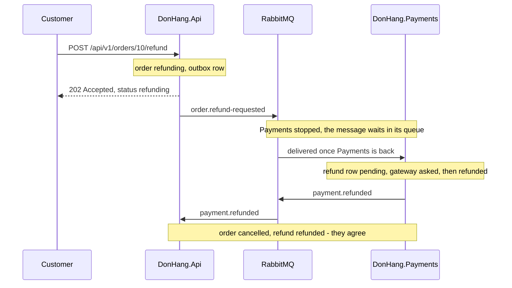

## Before you start

- [[backend.l3.saga]] — you know the four steps of the refund saga, each a local transaction joined to the next by a message.
- [[backend.l2.cache-invalidation]] — you know that a cached copy in Redis can show an old price for a while, and that its TTL limits how long.

## The situation

Customer 1 asks for order 10's money back at a moment when `DonHang.Payments` is not running. The API answers `202` at once, and the order says `refunding`. A few seconds later it still says `refunding`. In `donhang_payments` there is no refund row for order 10 at all: as far as Payments knows, nobody has asked.

Two services now tell two different stories about the same order. Inside one database you never saw this: once a save finished, every later read agreed with it.

Is Đơn Hàng broken, and if not, what does it promise about when the two stories match?

## Core concepts

- **strong consistency** — every read that starts after a change is saved sees that change; inside `donhang`, a query that starts after the refund request's transaction commits sees the order as `refunding`.
- **eventual consistency** — the services' data may disagree for a while, but once every message has been handled and no new change arrives, they all agree; nothing promises how long that takes.
- message in flight — a message one service has saved or sent that the next service has not handled yet; while one exists, the two services can disagree.

## How it works



Inside one database, Đơn Hàng gets strong consistency. At PostgreSQL's default isolation level, each query sees the changes that were committed before it started. So once the refund request's transaction commits in `donhang`, every later query there sees `refunding`.

That guarantee stops at the edge of each service, because each service has its own database. In the situation above, the order changes in `donhang` while `donhang_payments` has not heard of the refund yet. The only thing that will tell it is the `order.refund-requested` message, and with Payments stopped, that message waits in its queue in RabbitMQ.

Follow the diagram from the top. Each message in flight opens a stretch of time when two services disagree. First the order says `refunding` and Payments has no refund row. Once Payments is back, it handles `order.refund-requested`, saves a `pending` refund row, and its background job asks the gateway. After the gateway answers, Payments has a `refunded` row while the order still says `refunding`, until `payment.refunded` reaches `DonHang.Api`.

When the last message has been handled, the order says `cancelled`, the refund row says `refunded`, and the two databases agree. That is eventual consistency: the disagreement is expected, and it ends once the messages are worked through.

The promise has no clock in it. A message can wait as long as its consumer is stopped, and the background job may retry the gateway for up to 24 hours, by the design doc `docs/design/refund-design.md`. What the system does promise is that the outbox keeps each message from being lost and the queue keeps it until Payments handles it, or, after repeated failed attempts, moves it to the dead-letter queue.

## In the Đơn Hàng system

`scripts/backend/payments-down.sh` stops `DonHang.Payments` before the lines below, then asks for a refund of order 10:

```bash file=scripts/backend/payments-down.sh tag=stage-3 lines=37-60
# lesson: backend.l3.eventual-consistency
# DonHang.Api needs nothing from Payments to accept the request: it saves
# its own step and its message, and answers. The services disagree until
# Payments is back and has worked through its queue: the order says
# refunding, and Payments has no refund row at all yet.
echo "== POST /api/v1/orders/10/refund as customer 1"
echo "  -> $(curl -sS -w '\n%{http_code}' -X POST http://localhost:8080/api/v1/orders/10/refund \
  -H "Authorization: Bearer $token" | tail -n 1)"
sleep 5
echo "== 5 seconds later"
order_10
waiting_in_queue 1
echo "  refund rows for order 10 in donhang_payments: $(payments_sql --tuples-only --no-align --command \
  "SELECT count(*) FROM payments WHERE order_id = 10 AND kind = 'refund'")"
echo

docker compose start payments 2>/dev/null
echo "payments is back"
wait_for_status 10 cancelled
echo "== once Payments has caught up"
order_10
waiting_in_queue 0
echo "  the refund row: $(payments_sql --tuples-only --no-align --command \
  "SELECT status FROM payments WHERE order_id = 10 AND kind = 'refund'")"
```

```text output=true
payments is stopped
== POST /api/v1/orders/10/refund as customer 1
  -> 202
== 5 seconds later
  GET /api/v1/orders/10 -> status refunding
  messages waiting in payments.refund-requests: 1
  refund rows for order 10 in donhang_payments: 0

payments is back
== once Payments has caught up
  GET /api/v1/orders/10 -> status cancelled
  messages waiting in payments.refund-requests: 0
  the refund row: refunded
```

Lines 42–44 send the request while Payments is stopped, and the answer is still `202`. Lines 47–50 then read both sides: the order says `refunding`, one message waits in `payments.refund-requests`, and `donhang_payments` has no refund row. That is the disagreement. Line 53 starts Payments again, and line 55 waits until the order reaches `cancelled`. The helpers are defined outside the excerpt: `order_10` prints the status `GET /api/v1/orders/10` returns, and `waiting_in_queue` asks RabbitMQ how many messages wait in `payments.refund-requests`, gives it up to 15 seconds to reach the number passed in, then prints the count it read. The last three output lines show the services agreeing, with the queue empty.

The endpoint that answered is `Refund` in `DonHang.Api/Controllers/OrdersController.cs`:

```csharp file=DonHang.Api/Controllers/OrdersController.cs tag=stage-3 lines=117-135
    // POST /api/v1/orders/7/refund: only the order's own customer (staff have
    // no customer row: 403), only for a paid order (409 otherwise). The order
    // moves to `refunding` and its order.refund-requested message is saved in
    // the same transaction; the answer is 202 Accepted with the order as it is
    // now, `refunding`, before any money has moved. Payments does the rest.
    [Authorize]
    [HttpPost("{id:int}/refund")]
    public async Task<ActionResult<OrderDto>> Refund(int id)
    {
        var customer = await CurrentCustomerAsync();
        if (customer is null) return Forbid();

        var existing = await repository.FindForReadingAsync(id);
        if (existing is null) return NotFound();
        if (existing.CustomerId != customer.Id) return Forbid();

        var order = await orderService.RequestRefundAsync(id);
        return Accepted(ToDto(order));
    }
```

Nothing here calls Payments, so a stopped Payments cannot make the request fail. Line 134 returns the order as it is in `donhang` right now, `refunding`, not the result the customer hopes for. That is what `docs/team/refund-requirements.md` asks for: after sending the request, the customer sees that the order is being refunded (requirement YC-4). The API reports the state it is sure of and leaves the rest to the messages.

## Seniors often assume…

- **"Eventual consistency means the data may stay wrong for good."** → Actually it means the services agree once every message has been handled, and the outbox and the queue keep each message until it is. The promise depends on messages being handled: a message parked in a dead-letter queue keeps the services apart until a person acts on it. You notice this when `payments-down.sh` starts Payments again and the order moves from `refunding` to `cancelled` without anyone touching it.
- **"Eventually consistent services catch up within a fixed time, such as a second."** → Actually nothing limits the time. The order stays `refunding` for as long as Payments is stopped, and `refund-design.md` lets Payments keep asking the gateway for up to 24 hours. You notice this when someone writes a test that checks the order a second after the request and it fails whenever Payments is slow.
- **"While Payments is down, refund requests should fail, so the services never disagree."** → Actually the services disagree after every refund request, even with Payments running: there is always a message in flight between them. Failing the request would not remove the disagreement, only make the customer try again later. YC-7 asks for the request to be accepted within 2 seconds even when the gateway does not answer, and the endpoint needs nothing from Payments to do that. You notice this when `payments-down.sh` prints `payments is stopped` and then `-> 202` for the refund request.

## Try it (3 minutes)

With the lab running (`scripts/up.sh`), in the root folder of the example repository:

1. Run `scripts/backend/payments-down.sh`.
2. Find the order's status, the number of waiting messages and the number of refund rows in the "5 seconds later" part, then the same lines in the last part.
3. Then decide: at which point in the output do `donhang` and `donhang_payments` agree about order 10?

Expected result: `202`; then `refunding`, `1` waiting message and `0` refund rows; at the end `cancelled`, `0` waiting messages and a `refunded` refund row. For item 3, check your answer below.

<details><summary>Suggested answer</summary>

Only in the last part. In the "5 seconds later" part the order says `refunding` while Payments has no refund row, and one message is still waiting. At the end no message is waiting, the order is `cancelled` and the refund row is `refunded`, so both databases tell the same story.

</details>

## Connections

- [[backend.l3.saga]] — the saga's messages are what open each stretch of disagreement; this lesson names what the saga promises about it.
- [[backend.l2.cache-invalidation]] — the same kind of disagreement in a smaller place: there a TTL limits how long Redis can disagree with PostgreSQL, here nothing limits it.
- [[backend.l3.message-broker]] — the queue that keeps `order.refund-requested` while Payments is stopped.
- [[management.l2.non-functional-requirements]] — YC-7 is one: it is why the refund request must not wait for Payments or the gateway.
- [[backend.l3.saga-in-progress-status]] — the next question: what stops other changes to the order while it is `refunding`.

## Five-line summary

1. Services joined by messages agree only after every message has been handled, not at the moment one of them changes.
2. Inside one PostgreSQL database a query that starts after a commit sees the change; that strong consistency ends at each service's edge.
3. While a refund saga runs, the order can say `refunding` while Payments has no refund row, or already a `refunded` one.
4. With Payments stopped, refund requests still get `202` and the order stays `refunding` until Payments is back and works through its queue.
5. Eventual consistency promises agreement, not a time limit, so the API reports `refunding` instead of pretending the refund is done.
