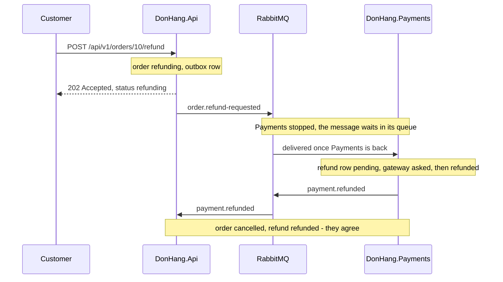

## Bạn cần biết trước

- [[backend.l3.saga]] — bạn biết bốn bước của saga hoàn tiền, mỗi bước là một giao dịch cục bộ, nối với bước sau bằng một message.
- [[backend.l2.cache-invalidation]] — bạn biết rằng bản sao trong cache Redis có thể hiện giá cũ một lúc, và TTL của nó giới hạn "một lúc" đó dài bao lâu.

## Tình huống

Khách hàng 1 yêu cầu hoàn tiền cho đơn 10 đúng lúc `DonHang.Payments` không chạy. API trả về `202` ngay, và đơn ghi `refunding`. Vài giây sau đơn vẫn ghi `refunding`. Trong `donhang_payments` không hề có dòng hoàn tiền nào cho đơn 10: theo những gì Payments biết, chưa ai yêu cầu gì cả.

Giờ hai service kể hai câu chuyện khác nhau về cùng một đơn. Trong một database duy nhất, bạn chưa bao giờ gặp chuyện này: một lần lưu đã xong thì mọi lần đọc sau đó đều khớp với nó.

Đơn Hàng có đang hỏng không, và nếu không thì nó hứa gì về thời điểm hai câu chuyện khớp nhau?

## Khái niệm cốt lõi

- **strong consistency** (Mọi lần đọc bắt đầu sau khi một thay đổi đã lưu đều thấy thay đổi đó) — mọi lần đọc bắt đầu sau khi một thay đổi đã được lưu đều thấy thay đổi đó. Trong `donhang`, một câu truy vấn bắt đầu sau khi giao dịch của yêu cầu hoàn tiền commit sẽ thấy đơn ở `refunding`.
- **eventual consistency** (Các bản dữ liệu có thể lệch nhau một lúc, nhưng khớp lại khi mọi thay đổi đã được xử lý; không hứa thời hạn) — dữ liệu của các service có thể lệch nhau một lúc, nhưng khi mọi message đã được xử lý và không có thay đổi mới nào tới, tất cả sẽ khớp nhau. Không có gì hứa chuyện đó mất bao lâu.
- message đang trên đường — một message mà service này đã lưu hoặc đã gửi nhưng service kế tiếp chưa xử lý. Chừng nào còn một message như vậy, hai service có thể lệch nhau.

## Cơ chế hoạt động



Bên trong một database, Đơn Hàng có strong consistency. Ở isolation level mặc định của PostgreSQL, mỗi câu truy vấn thấy những thay đổi đã commit trước khi nó bắt đầu. Vì vậy khi giao dịch của yêu cầu hoàn tiền đã commit trong `donhang`, mọi câu truy vấn sau đó ở đây đều thấy `refunding`.

Bảo đảm đó dừng lại ở ranh giới của từng service, vì mỗi service có database riêng. Trong tình huống trên, đơn đổi trạng thái trong `donhang` trong khi `donhang_payments` chưa hề nghe tới lần hoàn tiền. Thứ duy nhất sẽ báo cho nó là message `order.refund-requested`, và khi Payments đang dừng, message đó nằm chờ trong hàng đợi của nó ở RabbitMQ.

Hãy đi theo sơ đồ từ trên xuống. Mỗi message đang trên đường mở ra một khoảng thời gian hai service lệch nhau. Đầu tiên đơn ghi `refunding` còn Payments không có dòng hoàn tiền nào. Khi Payments chạy lại, nó xử lý `order.refund-requested`, lưu một dòng hoàn tiền `pending`, và background job của nó gọi cổng thanh toán. Sau khi cổng thanh toán trả lời, Payments có một dòng `refunded` trong khi đơn vẫn ghi `refunding`, cho tới khi `payment.refunded` tới được `DonHang.Api`.

Khi message cuối cùng đã được xử lý, đơn ghi `cancelled`, dòng hoàn tiền ghi `refunded`, và hai database khớp nhau. Đó là eventual consistency: sự lệch nhau là điều được tính trước, và nó kết thúc khi các message đã được xử lý hết.

Lời hứa này không có đồng hồ. Một message có thể chờ lâu đúng bằng thời gian consumer của nó bị dừng, và theo design doc `docs/design/refund-design.md`, background job có thể thử lại cổng thanh toán trong tối đa 24 giờ. Điều hệ thống thật sự hứa là outbox giữ cho mỗi message không bị mất, còn hàng đợi giữ message đó cho tới khi Payments xử lý nó, hoặc chuyển nó sang dead-letter queue sau nhiều lần thử thất bại.

## Trong hệ thống Đơn Hàng

`scripts/backend/payments-down.sh` dừng `DonHang.Payments` trước các dòng dưới đây, rồi yêu cầu hoàn tiền cho đơn 10:

```bash file=scripts/backend/payments-down.sh tag=stage-3 lines=37-60
# lesson: backend.l3.eventual-consistency
# DonHang.Api needs nothing from Payments to accept the request: it saves
# its own step and its message, and answers. The services disagree until
# Payments is back and has worked through its queue: the order says
# refunding, and Payments has no refund row at all yet.
echo "== POST /api/v1/orders/10/refund as customer 1"
echo "  -> $(curl -sS -w '\n%{http_code}' -X POST http://localhost:8080/api/v1/orders/10/refund \
  -H "Authorization: Bearer $token" | tail -n 1)"
sleep 5
echo "== 5 seconds later"
order_10
waiting_in_queue 1
echo "  refund rows for order 10 in donhang_payments: $(payments_sql --tuples-only --no-align --command \
  "SELECT count(*) FROM payments WHERE order_id = 10 AND kind = 'refund'")"
echo

docker compose start payments 2>/dev/null
echo "payments is back"
wait_for_status 10 cancelled
echo "== once Payments has caught up"
order_10
waiting_in_queue 0
echo "  the refund row: $(payments_sql --tuples-only --no-align --command \
  "SELECT status FROM payments WHERE order_id = 10 AND kind = 'refund'")"
```

```text output=true
payments is stopped
== POST /api/v1/orders/10/refund as customer 1
  -> 202
== 5 seconds later
  GET /api/v1/orders/10 -> status refunding
  messages waiting in payments.refund-requests: 1
  refund rows for order 10 in donhang_payments: 0

payments is back
== once Payments has caught up
  GET /api/v1/orders/10 -> status cancelled
  messages waiting in payments.refund-requests: 0
  the refund row: refunded
```

Dòng 42–44 gửi request trong lúc Payments đang dừng, và câu trả lời vẫn là `202`. Dòng 47–50 sau đó đọc cả hai phía: đơn ghi `refunding`, một message đang chờ trong `payments.refund-requests`, và `donhang_payments` không có dòng hoàn tiền nào. Đó chính là sự lệch nhau. Dòng 53 khởi động lại Payments, và dòng 55 chờ tới khi đơn sang `cancelled`. Các hàm hỗ trợ được định nghĩa ngoài đoạn trích: `order_10` in ra trạng thái mà `GET /api/v1/orders/10` trả về, còn `waiting_in_queue` hỏi RabbitMQ có bao nhiêu message đang chờ trong `payments.refund-requests`, cho nó tối đa 15 giây để đạt tới con số được truyền vào, rồi in ra số đã đọc được. Ba dòng output cuối cho thấy các service đã khớp nhau, với hàng đợi trống.

Endpoint đã trả lời là `Refund` trong `DonHang.Api/Controllers/OrdersController.cs`:

```csharp file=DonHang.Api/Controllers/OrdersController.cs tag=stage-3 lines=117-135
    // POST /api/v1/orders/7/refund: only the order's own customer (staff have
    // no customer row: 403), only for a paid order (409 otherwise). The order
    // moves to `refunding` and its order.refund-requested message is saved in
    // the same transaction; the answer is 202 Accepted with the order as it is
    // now, `refunding`, before any money has moved. Payments does the rest.
    [Authorize]
    [HttpPost("{id:int}/refund")]
    public async Task<ActionResult<OrderDto>> Refund(int id)
    {
        var customer = await CurrentCustomerAsync();
        if (customer is null) return Forbid();

        var existing = await repository.FindForReadingAsync(id);
        if (existing is null) return NotFound();
        if (existing.CustomerId != customer.Id) return Forbid();

        var order = await orderService.RequestRefundAsync(id);
        return Accepted(ToDto(order));
    }
```

Không chỗ nào ở đây gọi Payments, nên một Payments đang dừng không thể làm request thất bại. Dòng 134 trả về đơn đúng như nó đang nằm trong `donhang` lúc này, tức `refunding`, chứ không phải kết quả mà khách hàng mong đợi. Đó là điều `docs/team/refund-requirements.md` yêu cầu: sau khi gửi yêu cầu, khách hàng thấy đơn đang được hoàn tiền (yêu cầu YC-4). API báo trạng thái mà nó chắc chắn, phần còn lại để các message lo.

## Senior hay nhầm rằng…

- **"Eventual consistency nghĩa là dữ liệu có thể sai mãi mãi."** → Thực ra nó nghĩa là các service khớp nhau khi mọi message đã được xử lý, và outbox cùng hàng đợi giữ mỗi message cho tới lúc đó. Lời hứa này chỉ đúng khi message được xử lý: một message nằm trong dead-letter queue sẽ giữ các service lệch nhau cho tới khi có người xử lý nó. Bạn sẽ nhận ra khi `payments-down.sh` khởi động lại Payments và đơn tự chuyển từ `refunding` sang `cancelled` mà không ai đụng vào.
- **"Các service eventually consistent sẽ bắt kịp nhau trong một khoảng thời gian cố định, chẳng hạn một giây."** → Thực ra không có gì giới hạn thời gian. Đơn ở `refunding` suốt thời gian Payments bị dừng, và `refund-design.md` cho phép Payments tiếp tục gọi cổng thanh toán trong tối đa 24 giờ. Bạn sẽ nhận ra khi ai đó viết một test kiểm tra đơn một giây sau request, và test đó thất bại mỗi khi Payments chậm.
- **"Khi Payments ngừng chạy, yêu cầu hoàn tiền nên thất bại, để các service không bao giờ lệch nhau."** → Thực ra các service lệch nhau sau mọi yêu cầu hoàn tiền, kể cả khi Payments đang chạy: giữa chúng luôn có một message đang trên đường. Cho request thất bại không xóa được sự lệch nhau, chỉ bắt khách hàng thử lại sau. YC-7 yêu cầu request được nhận trong vòng 2 giây kể cả khi cổng thanh toán không trả lời, và endpoint không cần gì từ Payments để làm được điều đó. Bạn sẽ nhận ra khi `payments-down.sh` in `payments is stopped` rồi `-> 202` cho yêu cầu hoàn tiền.

## Thử ngay (3 phút)

Khi lab đang chạy (`scripts/up.sh`), ở thư mục gốc của repo ví dụ:

1. Chạy `scripts/backend/payments-down.sh`.
2. Tìm trạng thái của đơn, số message đang chờ và số dòng hoàn tiền trong phần "5 seconds later", rồi tìm các dòng tương ứng ở phần cuối.
3. Rồi hãy xác định: tới điểm nào trong output thì `donhang` và `donhang_payments` khớp nhau về đơn 10?

Kết quả mong đợi: `202`; sau đó `refunding`, `1` message đang chờ và `0` dòng hoàn tiền; ở cuối là `cancelled`, `0` message đang chờ và một dòng hoàn tiền `refunded`. Ở mục 3, hãy đối chiếu với đáp án bên dưới.

<details><summary>Gợi ý đáp án</summary>

Chỉ ở phần cuối. Trong phần "5 seconds later", đơn ghi `refunding` còn Payments không có dòng hoàn tiền nào, và vẫn còn một message đang chờ. Ở cuối không còn message nào chờ, đơn là `cancelled` và dòng hoàn tiền là `refunded`, nên hai database kể cùng một câu chuyện.

</details>

## Liên hệ

- [[backend.l3.saga]] — các message của saga chính là thứ mở ra từng khoảng lệch nhau; bài này gọi tên điều saga hứa về khoảng lệch đó.
- [[backend.l2.cache-invalidation]] — cùng kiểu lệch nhau ở một chỗ nhỏ hơn: ở đó TTL giới hạn thời gian Redis lệch với PostgreSQL, còn ở đây không gì giới hạn cả.
- [[backend.l3.message-broker]] — hàng đợi giữ `order.refund-requested` trong lúc Payments bị dừng.
- [[management.l2.non-functional-requirements]] — YC-7 là một yêu cầu phi chức năng: vì nó mà yêu cầu hoàn tiền không được chờ Payments hay cổng thanh toán.
- [[backend.l3.saga-in-progress-status]] — câu hỏi tiếp theo: điều gì chặn các thay đổi khác lên đơn trong lúc nó đang `refunding`.

## Tóm tắt 5 dòng

1. Các service nối với nhau bằng message chỉ khớp nhau sau khi mọi message đã được xử lý, không phải ngay lúc một service thay đổi.
2. Trong một database PostgreSQL, câu truy vấn bắt đầu sau một lần commit sẽ thấy thay đổi đó, nhưng strong consistency này dừng ở ranh giới của từng service.
3. Trong lúc saga hoàn tiền chạy, đơn có thể ghi `refunding` khi Payments chưa có dòng hoàn tiền nào, hoặc đã có một dòng `refunded`.
4. Khi Payments đang dừng, yêu cầu hoàn tiền vẫn nhận `202`, và đơn ở `refunding` cho tới khi Payments chạy lại và xử lý hết hàng đợi của nó.
5. Eventual consistency hứa sẽ khớp nhau, không hứa thời hạn, nên API báo `refunding` thay vì giả như đã hoàn tiền xong.
